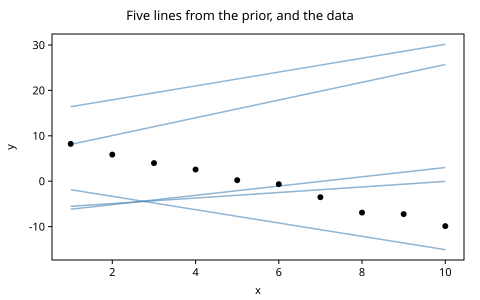
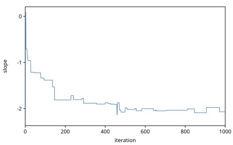
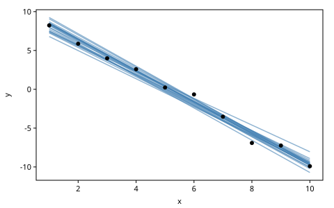

# Getting Started: Linear Regression

We write a short gen.clj program that does Bayesian linear regression:
given points in the plane, find the lines that fit them well. "Well" has a
Bayesian meaning. Good lines make the observed points probable, weighed
against what we believed about lines before we saw any points.

A probabilistic program comes in two parts. A *generative model* says how
we believe the data came about. An *inference program* works backwards,
from the data to what the model must have done. This chapter writes both.
It runs the model forward and reads what it produces. Then it checks the
inference program's answer against the exact one, which this model happens
to have.

This chapter merges Gen.jl's *Getting Started* with the first chapter of
*The GenMLX Book*. Every code block in it runs, in order, in the book's
tests, and every result shown is checked there. Coming from Gen.jl? The
differences are collected in the appendix *Coming from Gen.jl*.

The chapter's code lives in one namespace:

<!-- code: ns -->
```clojure
(ns book.getting-started
  (:refer-clojure :exclude [+ - * /])
  (:require [gen.array :as array :refer [+ - * /]]
            [gen.array.linalg :as linalg]
            [gen.book.svg :as svg]
            [gen.choicemap :as cm]
            [gen.dist :as d]
            [gen.dist.core :as dc]
            [gen.dynamic :refer [gen]]
            [gen.gfi :as gfi]
            [gen.inference.diagnostics :as diag]
            [gen.inference.mh :as mh]
            [gen.random :as rng]
            [gen.selection :as sel]))
```

## The model

The model draws a slope $\mu$ and an intercept $b$, then each $y_i$ near
the line $\mu x_i + b$:

$$
\mu \sim \mathcal{N}(0, 2), \qquad b \sim \mathcal{N}(0, 10), \qquad
y_i \mid x_i \sim \mathcal{N}(\mu x_i + b,\ 1).
$$

Distributions take Gen.jl's parameters, so `normal` takes a mean and a
standard deviation. In gen.clj the model is a *generative function*, made
by `gen`:

<!-- code: model -->
```clojure
(def line-model
  (gen [xs]
    (let [slope (trace :slope (d/normal 0 2))
          intercept (trace :intercept (d/normal 0 10))]
      (doseq [[i x] (map-indexed vector xs)]
        (trace [:y i] (d/normal (+ (* slope x) intercept) 1)))
      [slope intercept])))
```

`gen` takes an argument vector and a body, as `fn` does. The body is plain
Clojure with one more operation, `trace`, which names a random choice: an
*address* and a *distribution*. `(trace :slope (d/normal 0 2))` declares
"a value from this normal, called `:slope`", and returns that value. It
does not say whether the value is drawn fresh or fixed to one we observed.
Whatever runs the model decides that, from outside.

Addresses are keywords or paths. The observations are at `[:y 0]`,
`[:y 1]` and so on, built as the loop runs. Indices start at 0.

The arithmetic is gen.array's. The namespace refers gen.array's `+` and
`*` in place of clojure.core's, so the same model runs on the JVM
backend's numbers and on MLX's arrays.

## Running it forward

`gfi/simulate` runs the model forward, drawing every choice from its
distribution, and returns a *trace*: a record of that one run. It takes
the model, its arguments and a *key*. The arguments are a vector, and
this model has one, the vector of $x$ values.

<!-- code: simulate -->
```clojure
(def xs [1.0 2.0 3.0 4.0 5.0 6.0 7.0 8.0 9.0 10.0])

(def tr (gfi/simulate line-model [xs] (rng/key 1)))
```

Randomness in gen.clj is explicit. Every operation that draws takes a
key, and the same key gives the same draws: simulating again with key 1
gives this trace again. `rng/split` makes independent keys from one. At
the REPL you can leave the key out, and gen.clj draws one; `gfi/seed!`
fixes where those come from.

<!-- code: same-key -->
```clojure
(= (mapv array/->clj (cm/values (:choices tr)))
   (mapv array/->clj (cm/values (:choices (gfi/simulate line-model [xs] (rng/key 1))))))
;=> true
```

A trace answers for its choices. Called with an address, it returns the
choice there:

<!-- code: choices -->
```clojure
[(tr :slope) (tr :intercept) (tr [:y 0])]
;=> [1.432 -5.475 -5.395] ; float64
```

These are the JVM backend's values: it computes in float64. MLX computes
in float32 by default, and a float32 draw is not a float64 draw rounded,
so the same key shows other values there, from the same distribution. A
result marked `; float64` is checked where floats are 64-bit.

## The five fields of a trace

A trace is a record of five fields. Everything inference does, it does by
making, reading and revising traces.

| Field | What it holds |
|-------|---------------|
| `:gen-fn` | the generative function that made it |
| `:args` | the arguments it ran on |
| `:choices` | a *choice map*: every random choice, by address |
| `:retval` | what the body returned |
| `:score` | $\log p(\text{choices} \mid \text{args})$ |

The choice map holds twelve choices, the line and one $y$ per $x$:

<!-- code: addresses -->
```clojure
(count (cm/addresses (:choices tr)))
;=> 12

(take 4 (cm/addresses (:choices tr)))
;=> [[:intercept] [:slope] [:y 0] [:y 1]]
```

The body returned the line, the same two numbers as the trace's choices:

<!-- code: retval -->
```clojure
(= (:retval tr) [(tr :slope) (tr :intercept)])
;=> true
```

## What the score means

The score is the log of the joint density of every choice the run made,
given the arguments. It accumulates as the model runs: each `trace` adds
its choice's log density. So it is a sum we can do by hand, with each
distribution's `log-prob`:

<!-- code: score -->
```clojure
(def score-by-hand
  (let [[slope intercept] (:retval tr)]
    (reduce + (+ (dc/log-prob (d/normal 0 2) slope)
                 (dc/log-prob (d/normal 0 10) intercept))
            (map-indexed (fn [i x] (dc/log-prob (d/normal (+ (* slope x) intercept) 1) (tr [:y i])))
                         xs))))

(array/allclose? (:score tr) score-by-hand)
;=> true
```

They agree, up to the rounding of the backend's floats, because they are
the same computation (`array/allclose?` compares within that rounding). A more negative score
is a less probable run. Once we fix the $y$ values to observed ones, a
difference of scores becomes a difference of evidence between lines: the
currency of inference.

## Lines from the prior

Simulating draws lines from the *prior*, what the model believes before it
sees any data. Here are five of them, beside the data we fit below:

<!-- code: data -->
```clojure
(def ys [8.23 5.87 3.99 2.59 0.23 -0.66 -3.53 -6.91 -7.24 -9.90])

(def prior-lines
  (mapv #(:retval (gfi/simulate line-model [xs] %)) (rng/split (rng/key 2) 5)))
```

<!-- code: prior-figure -->
```clojure
;; figure: figures/011-prior-lines.svg
(svg/lines xs ys prior-lines {:title "Five lines from the prior, and the data"})
```



The prior is broad: the intercept's standard deviation is 10. None of
these lines was fitted to anything.

## Inference: Metropolis–Hastings

To condition on data, we fix the $y$ values. A choice map of the
observations is a set of *constraints*:

<!-- code: observations -->
```clojure
(defn observations
  "The choice map fixing each [:y i] to (ys i)."
  [ys]
  (apply cm/choicemap (mapcat (fn [i y] [[:y i] y]) (range) ys)))
```

`gfi/generate` runs the model under constraints: the constrained choices
take their given values, and the rest are drawn. Its trace is a starting
point, which an MCMC algorithm then revises over and over.
Metropolis–Hastings proposes a new slope, here from its prior, as Gen.jl's
`metropolis_hastings` does with a selection. It accepts the proposal with a
probability that favours lines that make the data more probable. Then it
does the same for the intercept.

<!-- code: mh -->
```clojure
(defn mh-sweep
  "One MH move on the slope, then one on the intercept."
  [tr key]
  (let [[k1 k2] (rng/split key)]
    (-> tr
        (mh/mh (sel/select :slope) k1) :trace
        (mh/mh (sel/select :intercept) k2) :trace)))

(defn inference-program
  "The chain of traces from num-iters MH sweeps, starting from a trace
   consistent with the observations ys."
  [xs ys num-iters key]
  (let [[k-start k-chain] (rng/split key)
        start (:trace (gfi/generate line-model [xs] (observations ys) k-start))]
    (vec (reductions mh-sweep start (rng/split k-chain num-iters)))))

(def chain (inference-program xs ys 1000 (rng/key 3)))
```

The last trace's line is the program's answer, as in Gen.jl's tutorial:

<!-- code: answer -->
```clojure
(:retval (peek chain))
```

## Checking the answer

This model is linear and Gaussian, so its posterior is Gaussian and known
exactly. Let $X$ be the matrix of rows $(x_i, 1)$, $\Sigma_0 =
\operatorname{diag}(2^2, 10^2)$ the prior covariance, and 1 the noise
variance. The posterior of $(\mu, b)$ then has precision $\Lambda =
\Sigma_0^{-1} + X^\top X$ and mean $\Lambda^{-1} X^\top y$.

<!-- code: exact -->
```clojure
(def exact
  (let [X (array/array (mapv (fn [x] [x 1.0]) xs))
        Xt (array/transpose X)
        precision (+ (array/diag (array/array [(/ 1.0 4.0) (/ 1.0 100.0)])) (array/matmul Xt X))
        covariance (linalg/inv precision)
        [[v-slope c] [_ v-intercept]] (array/->clj covariance)]
    {:mean (array/->clj (array/matmul covariance (array/matmul Xt (array/array ys))))
     :sd [(Math/sqrt v-slope) (Math/sqrt v-intercept)]
     :correlation (/ c (Math/sqrt (* v-slope v-intercept)))}))

(:mean exact)
;=> [-1.979 10.143]

(:sd exact)
;=> [0.1097 0.6807]
```

The posterior is far narrower than the prior: the slope's standard
deviation is about a twentieth of the prior's 2. The chain's last line is
one draw, within a few posterior standard deviations of the exact mean:

<!-- code: answer-check -->
```clojure
(let [[slope intercept] (:retval (peek chain))
      [mu-slope mu-intercept] (:mean exact)
      [sd-slope sd-intercept] (:sd exact)]
  [(< (abs (- (array/item slope) mu-slope)) (* 5 sd-slope))
   (< (abs (- (array/item intercept) mu-intercept)) (* 5 sd-intercept))])
;=> [true true]
```

One draw is a rough answer. A better one averages the chain after its
first 200 sweeps, which still remember where it started. `diag/summary`
gives the average, its Monte Carlo standard error (MCSE) and the
effective sample size (ESS), the number of independent draws the chain's
correlated ones are worth:

<!-- code: summary -->
```clojure
(def burned (subvec chain 200))

(def slope-summary (diag/summary (diag/draws [burned] :slope)))

(select-keys slope-summary [:mean :mcse-mean :ess-bulk])
```

The 801 sweeps averaged are worth only a handful of independent draws:

<!-- code: ess -->
```clojure
(< (:ess-bulk slope-summary) 20)
;=> true
```

The slope's trace along the chain shows why. It moves rarely, and in
jumps.

<!-- code: chain-figure -->
```clojure
;; figure: figures/011-slope-chain.svg
(svg/series (map #(% :slope) chain) {:title "The slope along the chain" :y-label "slope"})
```



<!-- code: acceptance -->
```clojure
(defn acceptance
  "The fraction of sweeps that moved the choice at addr."
  [chain addr]
  (/ (count (filter true? (map #(not= (array/->clj (%1 addr)) (array/->clj (%2 addr))) chain (rest chain))))
     (double (dec (count chain)))))

[(acceptance chain :slope) (acceptance chain :intercept)]

(< (max (acceptance chain :slope) (acceptance chain :intercept)) 0.1)
;=> true
```

A proposal from the prior is a blind guess. The posterior is narrow, so
most guesses land where the data are improbable and are rejected: fewer
than one in ten. A second reason is the posterior's shape. The slope and
the intercept are strongly correlated, because a steeper line fits the
same points only with a higher intercept:

<!-- code: correlation -->
```clojure
(:correlation exact)
;=> -0.886
```

A move of one with the other held fixed can only go a short way along that
narrow ridge. Exercise 3 shows what a proposal that looks at the trace
buys; later chapters go further with the gradient (MALA, HMC and NUTS).

Lines from the chain fit the data. These are every fortieth sweep after
the first 200:

<!-- code: posterior-figure -->
```clojure
;; figure: figures/011-posterior-lines.svg
(svg/lines xs ys (mapv :retval (take-nth 40 burned)) {:title "Lines from the posterior"})
```



## Workshop

Each exercise has a tested solution at the end of the chapter.

1. **The score, again.** Give the slope the prior `(d/normal 1 3)`, and
   check that a simulated trace's score is still the sum of its choices'
   log densities.
2. **Fewer points.** Keep only the first three points. How does the exact
   posterior's standard deviation of the slope change, and why?
3. **A better proposal.** Propose the slope and the intercept together,
   each from a random walk around its current value, with `mh/mh`'s
   proposal form `(mh/mh tr proposal [] key)`. A proposal is a generative
   function whose first argument is the current trace. How often is the
   move accepted, how many independent draws is the chain worth, and does
   its average agree with the exact mean?

## Solutions

**1.** Only the slope's term changes:

<!-- code: solution-1 -->
```clojure
(def line-model-2
  (gen [xs]
    (let [slope (trace :slope (d/normal 1 3))
          intercept (trace :intercept (d/normal 0 10))]
      (doseq [[i x] (map-indexed vector xs)]
        (trace [:y i] (d/normal (+ (* slope x) intercept) 1)))
      [slope intercept])))

(let [t (gfi/simulate line-model-2 [xs] (rng/key 4))
      [slope intercept] (:retval t)]
  (array/allclose? (:score t)
                   (reduce + (+ (dc/log-prob (d/normal 1 3) slope) (dc/log-prob (d/normal 0 10) intercept))
                           (map-indexed (fn [i x] (dc/log-prob (d/normal (+ (* slope x) intercept) 1) (t [:y i]))) xs))))
;=> true
```

**2.** The posterior's precision is the prior's plus $X^\top X$, which
grows with every point. With three points close together the slope is far
less certain:

<!-- code: solution-2 -->
```clojure
(defn exact-sd
  "The exact posterior's standard deviations, from points xs."
  [xs]
  (let [X (array/array (mapv (fn [x] [x 1.0]) xs))
        Xt (array/transpose X)]
    (array/->clj (array/sqrt (array/diag (linalg/inv (+ (array/diag (array/array [0.25 0.01])) (array/matmul Xt X))))))))

[(first (exact-sd (subvec xs 0 3))) (first (exact-sd xs))]
;=> [0.661 0.1097]
```

**3.** A random walk proposes near the current line, so far fewer
proposals land where the data are improbable. The move is still a valid
MH move, because `mh/mh` weighs the proposal in both directions:

<!-- code: solution-3 -->
```clojure
(def random-walk
  (gen [tr]
    (trace :slope (d/normal (tr :slope) 0.1))
    (trace :intercept (d/normal (tr :intercept) 0.5))))

(def walk-chain
  (let [[k-start k-chain] (rng/split (rng/key 5))]
    (vec (reductions (fn [tr k] (:trace (mh/mh tr random-walk [] k)))
                     (:trace (gfi/generate line-model [xs] (observations ys) k-start))
                     (rng/split k-chain 2000)))))

(def walk-summary (diag/summary (diag/draws [(subvec walk-chain 200)] :slope)))

[(> (acceptance walk-chain :slope) 0.3)
 (> (:ess-bulk walk-summary) (* 3 (:ess-bulk slope-summary)))]
;=> [true true]
```

Its average agrees with the exact mean, within five of its standard
errors:

<!-- code: solution-3-check -->
```clojure
(< (abs (- (:mean walk-summary) (first (:mean exact)))) (* 5 (:mcse-mean walk-summary)))
;=> true
```

The ridge still slows it down: the proposal steps across the correlation,
not along it. A proposal shaped like the posterior, or the gradient, does
better; that is where the chapter on MCMC begins.
