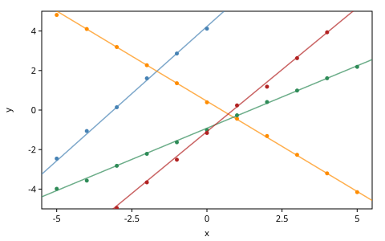
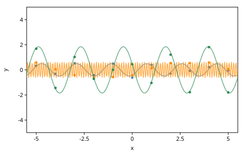
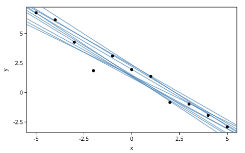
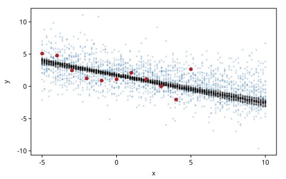
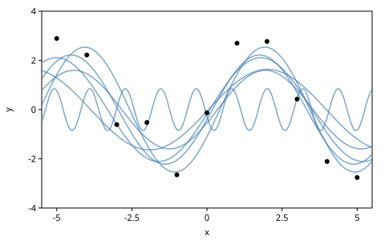
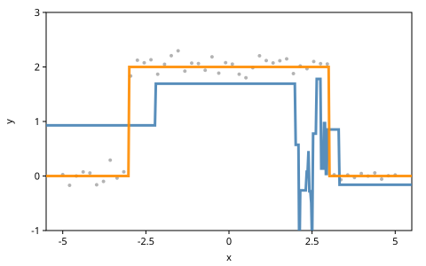

# Introduction to Modeling

A probabilistic program has two parts: a model, which says how we believe
the data came about, and an inference program, which works back from the
data to the model's hidden choices. This chapter is about the model: how
to state a problem as a generative function, and how far a few ideas
reach. A model can choose between explanations with a coin flip, call
other models, and recurse, so that the number of its parameters is itself
random. Predicting new data from inferred parameters checks a model.

For inference the chapter uses one generic algorithm as a tool: importance
sampling with the prior as the proposal. With enough computation it is
correct, but it is often slow, and the chapter shows where it works and
where it fails. The next chapter, *Conditioning*, takes it apart.

This chapter ports Gen.jl's *Introduction to Modeling*, with its exercises
as the Workshop. Its code lives in one namespace, beside a few helpers:
`(addresses t)` lists the addresses of trace `t`, and `average`,
`standard-error` and `fraction` summarize numbers.

<!-- code: ns -->
```clojure
(ns book.modeling
  (:refer-clojure :exclude [+ - * /])
  (:require [gen.array :as array :refer [+ - * /]]
            [gen.book.svg :as svg]
            [gen.choicemap :as cm]
            [gen.dist :as d]
            [gen.dist.core :as dc]
            [gen.dynamic :refer [gen]]
            [gen.gfi :as gfi]
            [gen.inference.importance :as is]
            [gen.random :as rng]
            [gen.selection :as sel]))
```

## Generative functions

A model is a *generative function*, made by `gen`. Each run makes random
choices, and `trace` gives each one an *address*: a keyword or another
value, or a vector, which is a path of addresses such as `[:y 0]`. An
address names a random choice, not a variable. This function has one
variable, `x`, and makes one choice or two; fixing the first choice with
`gfi/generate` shows both cases:

<!-- code: shifted -->
```clojure
(def shifted
  (gen []
    (let [x (trace :initial-x (d/normal 0 1))]
      (if (array/< x 0)
        (+ x (trace :addition-to-x (d/normal 2 1)))
        x))))

(for [x [1.0 -1.0]]
  (addresses (:trace (gfi/generate shifted [] (cm/choicemap :initial-x x)
                                   (rng/key 1)))))
;=> ([[:initial-x]] [[:addition-to-x] [:initial-x]])
```

`trace` takes a distribution. A deterministic value, such as the sine of
`x`, is not a random choice, and gen.clj says so. Other generative
functions are called with `splice`, as a later section shows.

<!-- code: not-a-choice -->
```clojure
;; error: trace at [:not-a-random-choice] needs a distribution
(gfi/simulate (gen [x] (trace :not-a-random-choice (array/sin x)))
              [1.0] (rng/key 3))
```

## A model of lines

Suppose we have points in the plane, and want a slope and an intercept
that explain them. The model says how such points could come about: it
draws a line, then each $y$ near it.

<!-- code: line-model -->
```clojure
(def line-model
  (gen [xs]
    (let [slope (trace :slope (d/normal 0 1))
          intercept (trace :intercept (d/normal 0 2))
          y (fn [x] (+ (* slope x) intercept))]
      (doseq [[i x] (map-indexed vector xs)]
        (trace [:y i] (d/normal (y x) 0.1)))
      y)))

(def xs [-5.0 -4.0 -3.0 -2.0 -1.0 0.0 1.0 2.0 3.0 4.0 5.0])

(fn? (line-model xs))
;=> true
```

The priors $\mathcal{N}(0, 1)$ on the slope and $\mathcal{N}(0, 2)$ on the
intercept say that neither is likely to be more than a few units from 0.
The noise is fixed at 0.1. The model returns `y`, the line as a Clojure
function. Called like a function, as above, a generative function runs
once with a key from the implicit source and returns its return value, as
in Gen.jl; its choices are lost. `gfi/simulate` keeps them in a trace,
with the arguments and the return value. A trace called with an address
returns the choice there, as `cm/get-choice` on its choice map does, and
called with the empty path it returns the return value, as Gen.jl's
`trace[]` does:

<!-- code: simulate -->
```clojure
(def tr (gfi/simulate line-model [xs] (rng/key 4)))

(:args tr)
;=> [[-5.0 -4.0 -3.0 -2.0 -1.0 0.0 1.0 2.0 3.0 4.0 5.0]]

(tr :slope)
;=> -0.6047 ; float64

(= (tr :slope) (cm/get-choice (:choices tr) :slope))
;=> true

[(= (:retval tr) (tr [])) (array/allclose? ((tr []) 0.0) (tr :intercept))]
;=> [true true]
```

A model is stochastic, so we look at several runs. A figure helper,
`trace-layers`, draws each trace's function and its points:

<!-- code: line-figure -->
```clojure
;; figure: figures/012-line-traces.svg
(svg/plot (trace-layers (mapv #(gfi/simulate line-model [xs] %)
                              (rng/split (rng/key 5) 4)))
          {:x-range [-5.5 5.5] :y-range [-5 5]})
```



## Sine waves

Gen.jl's tutorial asks next for a model of sine waves, $y(x) = a \sin(2\pi
x / p + \varphi)$, with a random period $p$, amplitude $a$ and phase
$\varphi$. Gamma priors keep the period and the amplitude positive, and
the phase is uniform on $[0, 2\pi]$. `wave` makes the function:

<!-- code: sine-model -->
```clojure
(defn wave
  "The sine wave of a period, an amplitude and a phase, as a function of x."
  [period amplitude phase]
  (fn [x] (* amplitude (array/sin (+ (/ (* 2 Math/PI x) period) phase)))))

(def sine-model
  (gen [xs]
    (let [period (trace :period (d/gamma 1 1))
          amplitude (trace :amplitude (d/gamma 1 1))
          phase (trace :phase (d/uniform 0 (* 2 Math/PI)))
          y (wave period amplitude phase)]
      (doseq [[i x] (map-indexed vector xs)]
        (trace [:y i] (d/normal (y x) 0.1)))
      y)))
```

<!-- code: sine-figure -->
```clojure
;; figure: figures/012-sine-traces.svg
(def sine-traces
  (mapv #(gfi/simulate sine-model [xs] %) (rng/split (rng/key 6) 3)))

(mapv #(% :period) sine-traces)
;=> [1.827 0.0031 2.211] ; float64

(svg/plot (trace-layers sine-traces) {:x-range [-5.5 5.5] :y-range [-5 5]})
```



## Posterior inference

Pictures of random lines are not the goal. We have data, and we want the
lines that explain it: the *posterior*. Here are Gen.jl's data, and the
observations as a choice map, as in *Getting Started*:

<!-- code: data -->
```clojure
(def ys [6.75003 6.1568 4.26414 1.84894 3.09686 1.94026 1.36411 -0.83959
         -0.976 -1.93363 -2.91303])

(defn observations
  "The choice map fixing each [:y i] to (ys i)."
  [ys]
  (apply cm/choicemap (mapcat (fn [i y] [[:y i] y]) (range) ys)))
```

The inference program uses *importance resampling*. It runs the model `n`
times with `gfi/generate`, each run constrained by the observations, and
weighs each run by how probable it makes them. Then it draws one run in
proportion to its weight. As `n` grows, that run's distribution approaches
the posterior. With `:batched? true` the `n` runs execute as one batched
execution of the model; a model whose control flow depends on its choices
runs them one at a time instead.

<!-- code: do-inference -->
```clojure
(defn do-inference
  "A trace of model on xs, approximately from the posterior given ys: one of
   n importance samples, drawn in proportion to its weight."
  [model xs ys n key]
  (:trace (is/importance-resampling model [xs] (observations ys) n
                                    {:key key :batched? true})))

(defn answers
  "k traces of model, each from its own inference on (xs, ys) with n
   samples."
  [model xs ys n k key]
  (mapv #(do-inference model xs ys n %) (rng/split key k)))

(def line-answers (answers line-model xs ys 100 10 (rng/key 7)))
```

<!-- code: posterior-figure -->
```clojure
;; figure: figures/012-line-posterior.svg
(svg/plot [{:curves (map :retval line-answers)}
           {:points (map vector xs ys)}])
```



The ten answers disagree. Is that our uncertainty about the line? This
model is linear and Gaussian, so its posterior is known exactly. The $x$
values sum to zero, which makes the slope and the intercept independent
normals:

<!-- code: exact -->
```clojure
(defn line-posterior
  "The exact posterior of line-model's slope and intercept given ys at xs,
   for xs that sum to zero: two independent normals."
  [xs ys]
  (let [x (array/array xs)
        y (array/array ys)
        noise-precision (/ 1 (* 0.1 0.1))
        precision [(+ 1 (* noise-precision (array/sum (* x x))))
                   (+ (/ 1 4) (* noise-precision (count xs)))]
        weighted [(* noise-precision (array/sum (* x y)))
                  (* noise-precision (array/sum y))]]
    {:mean (mapv #(array/item (/ %1 %2)) weighted precision)
     :sd (mapv #(array/item (/ 1 (array/sqrt %))) precision)}))

(def exact (line-posterior xs ys))

[(:mean exact) (:sd exact)]
;=> [[-0.9409 1.7050] [0.00953 0.0301]]
```

The posterior is narrow: it knows the slope to about 0.01. Measured in
posterior standard deviations, a draw from the posterior lies at a squared
distance of 2 on average from the mean, with a standard deviation of 2 (a
$\chi^2$ with two degrees of freedom). The answers lie much further out:

<!-- code: spread -->
```clojure
(defn squared-distance
  "The squared distance of trace t's line from the exact posterior mean, in
   posterior standard deviations: 2 on average for draws from the
   posterior."
  [t]
  (array/item
   (reduce + (map (fn [addr mean sd] (array/square (/ (- (t addr) mean) sd)))
                  [:slope :intercept] (:mean exact) (:sd exact)))))

(def spread (average (map squared-distance line-answers)))

spread
;=> 268.9 ; float64

(> spread (+ 2 (* 5 (/ 2 (Math/sqrt 10)))))
;=> true
```

So most of the spread in the figure is the inference's error, not the
posterior's uncertainty: 100 guesses from the prior rarely land where this
posterior lives. Exercise 2 measures how the error shrinks with more
samples.

## Predicting new data

`gfi/generate` takes the constrained choices as given and draws the rest,
as *Getting Started* showed. So to predict $y$ at new $x$ values, we fix
the parameters at the values inference found and run the model on the new
$x$:

<!-- code: predict -->
```clojure
(defn predict-new-data
  "The ys model predicts at new-xs, with the choices at param-addrs fixed
   to their values in trace tr."
  [model tr new-xs param-addrs key]
  (let [constraints (apply cm/choicemap
                           (mapcat (fn [a] [a (tr a)]) param-addrs))
        new-tr (:trace (gfi/generate model [new-xs] constraints key))]
    (mapv #(new-tr [:y %]) (range (count new-xs)))))
```

`infer-and-predict` repeats inference and prediction, here at 100 points
from $x = -5$ to $x = 10$, past the data:

<!-- code: infer-and-predict -->
```clojure
(defn infer-and-predict
  "num-traces predictions of ys at new-xs, each from its own inference on
   (xs, ys) with n samples."
  [model xs ys new-xs param-addrs num-traces n key]
  (mapv (fn [k]
          (let [[k-infer k-predict] (rng/split k)
                tr (do-inference model xs ys n k-infer)]
            (predict-new-data model tr new-xs param-addrs k-predict)))
        (rng/split key num-traces)))

(def new-xs (mapv #(+ -5 (* 15 (/ % 99))) (range 100)))
```

Comparing predicted data with the observed data is the idea behind a
*posterior predictive check*. To measure scatter, `roughness` takes the
residual standard deviation of points around their least-squares line.
Gen.jl's second data set is noisier than the first:

<!-- code: noisy -->
```clojure
(def ys-noisy [5.092 4.781 2.46815 1.23047 0.903318 1.11819 2.10808 1.09198
               0.0203789 -2.05068 2.66031])

(defn roughness
  "The residual standard deviation of the points (xs, ys) around their
   least-squares line."
  [xs ys]
  (let [x (array/array xs)
        y (array/array (mapv array/item ys))
        dx (- x (array/mean x))
        dy (- y (array/mean y))
        slope (/ (array/sum (* dx dy)) (array/sum (* dx dx)))
        residual (- dy (* slope dx))]
    (array/item (array/sqrt (/ (array/sum (* residual residual))
                               (- (count xs) 2))))))

[(roughness xs ys) (roughness xs ys-noisy)]
;=> [0.729 1.561]
```

Even the first data set is rougher than the model's noise of 0.1 allows.
On the noisy one, whatever line inference finds, a prediction's roughness
is 0.1 times the root of a $\chi^2$ over its degrees of freedom, so every
prediction is far smoother than the data:

<!-- code: fixed-noise -->
```clojure
(def fixed-predictions
  (infer-and-predict line-model xs ys-noisy new-xs [:slope :intercept] 20 1000
                     (rng/key 11)))

(def fixed-roughness (mapv #(roughness new-xs %) fixed-predictions))

(< (apply max fixed-roughness) (/ (roughness xs ys-noisy) 5))
;=> true
```

The model is *misspecified*: it is sure of a noise level the data do not
show. The fix is to make the noise a random choice too, and to infer it
with the line:

<!-- code: line-model-fancy -->
```clojure
(def line-model-fancy
  (gen [xs]
    (let [slope (trace :slope (d/normal 0 1))
          intercept (trace :intercept (d/normal 0 2))
          noise (trace :noise (d/gamma 1 1))
          y (fn [x] (+ (* slope x) intercept))]
      (doseq [[i x] (map-indexed vector xs)]
        (trace [:y i] (d/normal (y x) noise)))
      y)))

(def fancy-predictions
  (infer-and-predict line-model-fancy xs ys-noisy new-xs
                     [:slope :intercept :noise] 20 10000 (rng/key 12)))
```

The inferred model's predictions are as rough as the data, within a factor
of two and five standard errors:

<!-- code: fancy-roughness -->
```clojure
(def fancy-roughness (mapv #(roughness new-xs %) fancy-predictions))

[(average fixed-roughness) (average fancy-roughness)]
;=> [0.0969 1.726] ; float64

(let [data (roughness xs ys-noisy)
      m (average fancy-roughness)
      band (* 5 (standard-error fancy-roughness))]
  (< (/ data 2) (- m band) (+ m band) (* 2 data)))
;=> true
```

With the noise inferred, the predictions (blue) spread like the data,
while the fixed-noise model's (black) keep to a thin band:

<!-- code: noisy-figure -->
```clojure
;; figure: figures/012-predictions-noisy.svg
(svg/plot (concat (prediction-layers xs ys-noisy new-xs fancy-predictions
                                     "steelblue")
                  (prediction-layers xs ys-noisy new-xs fixed-predictions
                                     "black")))
```



## Calling other generative functions

A generative function can call another in three ways. `(splice f
args…)`, Gen.jl's `{*} ~ f(args…)`, puts the callee's choices among the
caller's own. `(splice addr f args…)`, Gen.jl's `{addr} ~ f(args…)`, puts
them under `addr`. A nested address is a path: Gen.jl's `:z => :y` is
`[:z :y]`, and a trace takes a path wherever it takes an address. A plain
call, `(f args…)`, runs `f` untraced: its choices are lost to the caller,
and it draws with a key from the implicit source, so the caller's run no
longer repeats with its own key. Gen.jl advises against it too.

<!-- code: foo-bar -->
```clojure
(def foo (gen [] (trace :y (d/normal 0 1))))

(def bar
  (gen []
    (trace :x (d/bernoulli 0.5))
    (splice foo)))

(def bar-using-namespace
  (gen []
    (trace :x (d/bernoulli 0.5))
    (splice :z foo)))

[(addresses (gfi/simulate bar [] (rng/key 13)))
 (addresses (gfi/simulate bar-using-namespace [] (rng/key 13)))]
;=> [[[:x] [:y]] [[:x] [:z :y]]]

((gfi/simulate bar-using-namespace [] (rng/key 14)) [:z :y])
;=> 1.0212 ; float64

(def plain-call (gen [] (foo)))

(addresses (gfi/simulate plain-call [] (rng/key 16)))
;=> []

(apply = (repeatedly 2 #(:retval (gfi/simulate plain-call [] (rng/key 16)))))
;=> false
```

A splice without an address shares the caller's namespace, so splicing
the same function twice repeats its addresses, which is an error:

<!-- code: clash -->
```clojure
;; error: Address [:y] is used twice
(gfi/simulate (gen [] (splice foo) (splice foo)) [] (rng/key 15))
```

Now a model that explains data either as a line or as a sine wave, with
the noise inferred in both. A coin flip at `:is-line` picks one. This is
*model selection*: the data decide which model is chosen.

<!-- code: combined-model -->
```clojure
(def sine-model-fancy
  (gen [xs]
    (let [period (trace :period (d/gamma 5 1))
          amplitude (trace :amplitude (d/gamma 1 1))
          phase (trace :phase (d/uniform 0 (* 2 Math/PI)))
          noise (trace :noise (d/gamma 1 1))
          y (wave period amplitude phase)]
      (doseq [[i x] (map-indexed vector xs)]
        (trace [:y i] (d/normal (y x) noise)))
      y)))

(def combined-model
  (gen [xs]
    (if (trace :is-line (d/bernoulli 0.5))
      (splice line-model-fancy xs)
      (splice sine-model-fancy xs))))
```

Gen.jl's third data set is a sine wave. Answers of the combined model on
it from `do-inference` are mostly sine waves; in this run, one of the six
is a line, since each answer is one draw from an approximation:

<!-- code: combined-figure -->
```clojure
;; figure: figures/012-combined.svg
(def ys-sine [2.89 2.22 -0.612 -0.522 -2.65 -0.133 2.70 2.77 0.425 -2.11
              -2.76])

(svg/plot [{:curves (map :retval (answers combined-model xs ys-sine 2000 6
                                          (rng/key 19)))}
           {:points (map vector xs ys-sine)}]
          {:y-range [-4 4]})
```



Importance sampling's weights tell which model explains a data set.
`is/importance-sampling` returns all `n` runs with their normalized log
weights, and the share of the weight on runs with a line estimates the
posterior probability of a line. The line explains the first data set,
and the sine wave explains `ys-sine`:

<!-- code: probability -->
```clojure
(defn probability
  "Importance sampling's estimate of the posterior probability that pred
   holds of model's trace given ys: the share of n samples' weight on the
   traces where it does."
  [pred model xs ys n key]
  (let [result (is/importance-sampling model [xs] (observations ys) n
                                       {:key key :batched? true})]
    (reduce + (map (fn [t log-w] (if (pred t) (Math/exp log-w) 0.0))
                   (is/traces result) (:log-normalized-weights result)))))

(defn line?
  "Did trace t of combined-model choose the line?"
  [t]
  (array/item (t :is-line)))

(def line-probabilities
  [(probability line? combined-model xs ys 2000 (rng/key 17))
   (probability line? combined-model xs ys-sine 2000 (rng/key 18))])

line-probabilities
;=> [0.999999 0.00016] ; float64

[(> (first line-probabilities) 0.9) (< (second line-probabilities) 0.1)]
;=> [true true]
```

## An unbounded number of parameters

A model can leave open how many parameters it has, and infer their number
with their values: a simple *Bayesian nonparametric* model. Take functions
that are constant on segments, with any number of changepoints.
`generate-segments` splits an interval recursively. With probability 0.7
an interval is a leaf with a value; otherwise it splits at a fraction
drawn from beta(2, 2), and the function calls itself on both halves, under
the addresses `:left` and `:right`. A tree is a Clojure map:

<!-- code: segments -->
```clojure
(def generate-segments
  (gen [l u]
    (if (trace :isleaf (d/bernoulli 0.7))
      {:interval [l u] :value (trace :value (d/normal 0 1))}
      (let [frac (trace :frac (d/beta 2 2))
            mid (+ l (* (- u l) frac))]
        {:interval [l u]
         :left (splice :left generate-segments l mid)
         :right (splice :right generate-segments mid u)}))))
```

`value-at` reads a tree at `x`. It uses `array/where`, an elementwise
`if`: in a plain function, `if` on an array value would test the array
object, not its value, on a backend whose scalars are arrays. (Inside
`gen`, conditionals branch on values on every backend.)

<!-- code: value-at -->
```clojure
(defn value-at
  "The value of the segment of the tree node that holds x."
  [node x]
  (if-let [left (:left node)]
    (array/where (array/<= x (second (:interval left)))
                 (value-at left x)
                 (value-at (:right node) x))
    (:value node)))
```

Each interval splits into two with probability 0.3, so it has 0.6
children on average. That is fewer than one, so the recursion ends with
probability one. Most trees have one segment, and the mean number of
segments $L$ solves $L = 0.7 + 0.3 \cdot 2L$: it is 1.75.

<!-- code: segment-counts -->
```clojure
(defn segments
  "The leaves of a tree from generate-segments, left to right."
  [node]
  (if (:left node)
    (concat (segments (:left node)) (segments (:right node)))
    [node]))

(def segment-counts
  (mapv #(count (segments (:retval (gfi/simulate generate-segments
                                                 [0.0 1.0] %))))
        (rng/split (rng/key 21) 2000)))

[(< (abs (- (fraction #{1} segment-counts) 0.7))
    (* 5 (Math/sqrt (/ (* 0.7 0.3) 2000))))
 (< (abs (- (average segment-counts) 1.75))
    (* 5 (standard-error segment-counts)))]
;=> [true true]
```

Four trees from the prior, as functions on $[0, 1]$:

<!-- code: segments-figure -->
```clojure
;; figure: figures/012-segments-prior.svg
(svg/plot (segment-layers (mapv #(:retval (gfi/simulate generate-segments
                                                        [0.0 1.0] %))
                                (rng/split (rng/key 20) 4)))
          {:x-range [0 1] :y-range [-3 3]})
```

![Four trees from generate-segments on [0, 1], one color each](figures/012-segments-prior.svg)

The changepoint model adds noise, with a prior of its own, to a tree's
function at each $x$. Gen.jl's two data sets have 50 points: a constant,
and a function with two changepoints, both with noise of 0.1.

<!-- code: changepoint-model -->
```clojure
(def changepoint-model
  (gen [xs]
    (let [node (splice :tree generate-segments (apply min xs) (apply max xs))
          noise (trace :noise (d/gamma 0.5 0.5))]
      (doseq [[i x] (map-indexed vector xs)]
        (trace [:y i] (d/normal (value-at node x) noise)))
      node)))
```

<!-- code: changepoint-data -->
```clojure
(def xs-dense (mapv #(+ -5 (* 10 (/ % 49))) (range 50)))

(defn noisy
  "f at each of xs, plus normal noise with standard deviation 0.1."
  [f xs key]
  (mapv #(+ (f %1) (* 0.1 %2)) xs (array/->clj (rng/normal key [(count xs)]))))

(def ys-simple (noisy (constantly 1.0) xs-dense (rng/key 22)))

(def ys-complex
  (noisy #(if (even? (long (Math/floor (abs (/ % 3))))) 2.0 0.0)
         xs-dense (rng/key 23)))
```

On the simple data, inference prefers one segment: more would fit no
better, and the prior charges for each. Importance sampling puts almost
all its weight on one-segment trees:

<!-- code: simple-inference -->
```clojure
(defn one-segment?
  "Did trace t of changepoint-model choose one segment?"
  [t]
  (= 1 (count (segments (:retval t)))))

(> (probability one-segment? changepoint-model xs-dense ys-simple 4000
                (rng/key 24))
   0.9)
;=> true
```

The complex data defeat importance sampling from the prior. A tree that
fits needs splits near $-3$ and $3$, values near 0, 2 and 0, and noise
near 0.1, and few prior draws come close. Here is an answer from 20000
samples, beside a tree written by hand as a choice map whose paths reach
into the recursion:

<!-- code: complex-inference -->
```clojure
(def complex-answer
  (do-inference changepoint-model xs-dense ys-complex 20000 (rng/key 26)))

(def by-hand
  (cm/choicemap [:tree :isleaf] false [:tree :frac] 0.2
                [:tree :left :isleaf] true [:tree :left :value] 0.0
                [:tree :right :isleaf] false [:tree :right :frac] 0.75
                [:tree :right :left :isleaf] true
                [:tree :right :left :value] 2.0
                [:tree :right :right :isleaf] true
                [:tree :right :right :value] 0.0
                :noise 0.1))

(def by-hand-trace
  (:trace (gfi/generate changepoint-model [xs-dense]
                        (cm/merge by-hand (observations ys-complex))
                        (rng/key 27))))

(map :interval (segments (:retval by-hand-trace)))
;=> ([-5.0 -3.0] [-3.0 3.0] [3.0 5.0])
```

`gfi/project` with the selection of `:y` gives the log density of a
trace's observations. The answer explains the data far worse than the
hand-written tree:

<!-- code: likelihoods -->
```clojure
(defn log-likelihood
  "The log density of trace t's observations: how well t explains them."
  [t]
  (array/item (gfi/project t (sel/select :y))))

[(log-likelihood by-hand-trace) (log-likelihood complex-answer)]
;=> [36.3 -57.8] ; float64

(> (log-likelihood by-hand-trace) (+ (log-likelihood complex-answer) 50))
;=> true
```

<!-- code: complex-figure -->
```clojure
;; figure: figures/012-changepoint-complex.svg
(svg/plot (cons (data-layer xs-dense ys-complex)
                (segment-layers (map :retval [complex-answer by-hand-trace])))
          {:y-range [-1 3]})
```



The model can describe these data well; the inference program cannot find
the description. *Conditioning* opens up importance sampling, and the
chapters on inference build algorithms that do better on models like this.

## Workshop

Each exercise has a tested solution at the end of the chapter.

1. **The same address twice.** Write a generative function that uses one
   address twice. Predict what happens, then run it.
2. **How much computation?** The figure of posterior lines used 100
   samples per answer. Run `do-inference` on the line model with 1, 10,
   100, 1000 and 10000 samples, twenty answers each, and measure how far
   the answers lie from the exact posterior. Which amount is a good
   trade-off between accuracy and running time?
3. **The period's prior.** Infer the period of `ys-sine` with
   `sine-model`, 1000 samples per answer. Then give the period the prior gamma(5, 1).
   Explain the difference. Hint: compare sine waves of periods 6 and 6/7
   at the integer $x$ values.
4. **Line or sine?** Construct a data set for which it is ambiguous
   whether the line or the sine model is best. Estimate the posterior
   probability of the sine model from the fraction of the answers of
   `combined-model` whose `:is-line` is false, and compare it with the estimate
   from the two models' marginal likelihoods, which
   `is/importance-sampling` returns as `:log-ml-estimate`.
5. **Recursion without addresses.** Write a version of `generate-segments`
   that calls itself with `splice` and no address. Hint: the addresses
   must still be unique. How can you number the nodes of a binary tree?

## Solutions

**1.** The second use is a loud error:

<!-- code: solution-1 -->
```clojure
;; error: Address [:x] is used twice
(gfi/simulate (gen [] (trace :x (d/normal 0 1)) (trace :x (d/normal 0 1)))
              [] (rng/key 28))
```

**2.** Each tenfold increase in samples cuts the mean squared distance
about tenfold, down to the posterior's own 2. At 1000 samples the answers
are still measurably worse than posterior draws; at 10000, twenty answers
can no longer tell them apart:

<!-- code: solution-2 -->
```clojure
(def errors-by-n
  (into (sorted-map)
        (for [n [1 10 100 1000 10000]]
          [n (mapv squared-distance
                   (answers line-model xs ys n 20
                            (rng/fold-in (rng/key 29) n)))])))

(update-vals errors-by-n #(Math/round (double (average %))))
;=> {1 47220, 10 3214, 100 318, 1000 40, 10000 4} ; float64

(let [at-1000 (errors-by-n 1000)
      at-10000 (errors-by-n 10000)]
  [(> (average at-1000) (+ 2 (* 5 (/ 2 (Math/sqrt 20)))))
   (< (- (average at-10000) (* 5 (standard-error at-10000))) 2)])
;=> [true true]
```

The running time grows with the number of samples, and past 10000 more
buys nothing here. On harder posteriors the knee moves far out, as the
changepoint model showed.

**3.** At the integer $x$ values, a sine wave of frequency $f$ looks the
same as one of frequency $f + k$, or of $k - f$ with the phase reflected,
for any integer $k$. These *aliases* fit the data equally well, so the
prior decides among them. The data have a period near 6, whose aliases
include 6/7 and 6/5:

<!-- code: solution-3-aliases -->
```clojure
(let [at-xs (fn [f] (array/array (mapv f xs)))
      wave-6 (at-xs (wave 6.0 2.0 0.3))]
  [(array/allclose? wave-6 (at-xs (wave (/ 6.0 7) 2.0 0.3)))
   (array/allclose? wave-6 (at-xs (wave (/ 6.0 5) 2.0 (- Math/PI 0.3))))])
;=> [true true]

(mapv #(dc/log-prob (d/gamma 1 1) %) [6.0 (/ 6.0 7) (/ 6.0 5)])
;=> [-6.0 -0.857 -1.2]
```

Under gamma(1, 1), the prior density at the period 6 is about $e^{5}$
times lower than at 6/7 or 6/5, so the answers are aliases with short
periods. Under gamma(5, 1), whose mean is 5, they have the long period:

<!-- code: solution-3 -->
```clojure
(def sine-model-5
  (gen [xs]
    (let [y (wave (trace :period (d/gamma 5 1))
                  (trace :amplitude (d/gamma 1 1))
                  (trace :phase (d/uniform 0 (* 2 Math/PI))))]
      (doseq [[i x] (map-indexed vector xs)]
        (trace [:y i] (d/normal (y x) 0.1)))
      y)))

(defn long-period-fraction
  "The fraction of 40 answers of model on ys-sine whose period is over 3."
  [model key]
  (fraction #(> (array/item (% :period)) 3)
            (answers model xs ys-sine 1000 40 key)))

(def fractions
  [(long-period-fraction sine-model (rng/key 30))
   (long-period-fraction sine-model-5 (rng/key 31))])

fractions
;=> [0.0 1.0] ; float64

(> (- (second fractions) (first fractions))
   (* 5 (Math/sqrt (/ (* 2 0.25) 40))))
;=> true
```

**4.** With few points both models fit, as with the first five points of
`ys-sine`. With equal prior probabilities, the posterior probability of
the sine model is also $Z_s / (Z_\ell + Z_s)$, where $Z_\ell$ and $Z_s$
are the two models' marginal likelihoods of the data, which importance
sampling estimates (*Conditioning* shows how). The two estimates agree
within five standard errors:

<!-- code: solution-4 -->
```clojure
(def xs-few (subvec xs 0 5))

(def ys-few (subvec ys-sine 0 5))

(def p-sine
  (fraction (complement line?)
            (answers combined-model xs-few ys-few 500 100 (rng/key 32))))

(defn log-ml
  "Importance sampling's estimate of log p(ys) under model at xs."
  [model xs ys n key]
  (:log-ml-estimate (is/importance-sampling model [xs] (observations ys) n
                                            {:key key :batched? true})))

(def p-sine-ml
  (let [line (log-ml line-model-fancy xs-few ys-few 100000 (rng/key 33))
        sine (log-ml sine-model-fancy xs-few ys-few 100000 (rng/key 34))]
    (/ 1 (+ 1 (Math/exp (- line sine))))))

[p-sine p-sine-ml]
;=> [0.4 0.3735] ; float64

(< (abs (- p-sine p-sine-ml)) (* 5 (Math/sqrt (/ 0.25 100))))
;=> true
```

**5.** Number the root 0, and the children of node $i$ $2i + 1$ and $2i +
2$. Each address pairs a choice's name with its node's number, so no two
calls share an address:

<!-- code: solution-5 -->
```clojure
(def generate-segments-flat
  (gen [l u i]
    (if (trace [:isleaf i] (d/bernoulli 0.7))
      {:interval [l u] :value (trace [:value i] (d/normal 0 1))}
      (let [frac (trace [:frac i] (d/beta 2 2))
            mid (+ l (* (- u l) frac))]
        {:interval [l u]
         :left (splice generate-segments-flat l mid (+ (* 2 i) 1))
         :right (splice generate-segments-flat mid u (+ (* 2 i) 2))}))))

(take 5 (addresses (gfi/simulate generate-segments-flat [0.0 1.0 0]
                                  (rng/key 38))))
;=> [[:frac 0] [:frac 2] [:isleaf 0] [:isleaf 1] [:isleaf 2]] ; float64
```

The two versions are one model with two addressing schemes. Translated to
the flat addresses, every tree keeps its score:

<!-- code: solution-5-check -->
```clojure
(defn flat-address
  "The address in generate-segments-flat of the choice at path in
   generate-segments: node i's children are 2i + 1 and 2i + 2."
  [path]
  [(peek path)
   (reduce (fn [i step] (if (= step :left) (+ (* 2 i) 1) (+ (* 2 i) 2)))
           0 (pop path))])

(defn same-score?
  "Does generate-segments-flat give trace t's choices, at their flat
   addresses, the score t has?"
  [t]
  (let [flat (apply cm/choicemap
                    (mapcat (fn [[path v]] [(flat-address path) v])
                            (cm/leaves (:choices t))))]
    (array/allclose? (:score t)
                     (:weight (gfi/assess generate-segments-flat [0.0 1.0 0]
                                          flat (rng/key 36))))))

(every? same-score? (mapv #(gfi/simulate generate-segments [0.0 1.0] %)
                          (rng/split (rng/key 37) 50)))
;=> true
```
