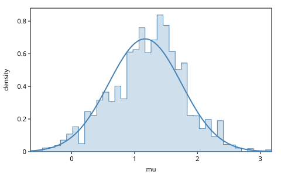

# Update and Regenerate

`simulate` and `generate` make traces from nothing. This chapter is about
the operations that start from a trace we have. `update` changes chosen
values and reports how the trace's probability changed. `regenerate`
draws chosen values afresh and reports the number Metropolis–Hastings
needs to accept or reject the move. `assess` scores a complete choice map,
and `project` reads part of a trace's score; we use both to check the
other two. At the end we build Metropolis–Hastings from `regenerate` and
check it against an exact posterior.

The chapter ports the GenMLX book's *Updating and Regenerating* and merges
in Gen.jl's *Reasoning about Regenerate*, whose three-choice model has
every probability in closed form. Every weight the text states is checked
against densities computed by hand.

<!-- code: ns -->
```clojure
(ns book.update-regenerate
  (:refer-clojure :exclude [+ - * /])
  (:require [gen.array :as array :refer [+ - * /]]
            [gen.book.svg :as svg]
            [gen.choicemap :as cm]
            [gen.diff :as diff]
            [gen.dist :as d]
            [gen.dist.core :as dc]
            [gen.dynamic :refer [gen]]
            [gen.gfi :as gfi]
            [gen.inference.diagnostics :as diag]
            [gen.inference.mh :as mh]
            [gen.random :as rng]
            [gen.selection :as sel]))
```

## Two models

The first is the line model of *Getting Started*, with its ten points:

<!-- code: line-model -->
```clojure
(def line-model
  (gen [xs]
    (let [slope (trace :slope (d/normal 0 2))
          intercept (trace :intercept (d/normal 0 10))]
      (doseq [[i x] (map-indexed vector xs)]
        (trace [:y i] (d/normal (+ (* slope x) intercept) 1)))
      [slope intercept])))

(def xs [1.0 2.0 3.0 4.0 5.0 6.0 7.0 8.0 9.0 10.0])

(def ys [8.23 5.87 3.99 2.59 0.23 -0.66 -3.53 -6.91 -7.24 -9.90])

(defn observations
  "The choice map fixing each [:y i] to (ys i)."
  [ys]
  (apply cm/choicemap (mapcat (fn [i y] [[:y i] y]) (range) ys)))
```

A trace to revise should be one we know. `generate` with every choice
constrained makes the line $y = -2x + 10$, near the posterior's mean.
Nothing is drawn, so its score is the same on every backend, and it is
the sum of log densities we can also add up by hand:

<!-- code: line-trace -->
```clojure
(def tr
  (:trace (gfi/generate line-model [xs]
                        (cm/merge (cm/choicemap :slope -2.0 :intercept 10.0)
                                  (observations ys))
                        (rng/key 1))))

(:score tr)
;=> -16.975
```

<!-- code: log-joint -->
```clojure
(defn log-likelihood
  "The log density of the points (xs, ys) given a line, by hand."
  [slope intercept xs ys]
  (reduce + (map (fn [x y]
                   (dc/log-prob (d/normal (+ (* slope x) intercept) 1) y))
                 xs ys)))

(defn log-joint
  "log p(slope, intercept, ys; xs), by hand: the priors and the likelihood."
  [slope intercept xs ys]
  (+ (dc/log-prob (d/normal 0 2) slope)
     (dc/log-prob (d/normal 0 10) intercept)
     (log-likelihood slope intercept xs ys)))

(array/allclose? (:score tr) (log-joint -2.0 10.0 xs ys))
;=> true
```

The second model is Gen.jl's. It flips up to three coins, and whether it
flips the second depends on the first:

<!-- code: coins -->
```clojure
(def coins
  (gen [prob-a]
    (let [a (trace :a (d/bernoulli prob-a))
          b (when a (trace :b (d/bernoulli 0.6)))
          val (if a b true)
          c (trace :c (d/bernoulli (if val 0.9 0.2)))]
      (and val c))))
```

It has six choice maps. Their probabilities, by hand from the model, are
Gen.jl's table:

<!-- code: table -->
```clojure
(def table
  "Every choice map coins can make on 0.3, with its probability, by hand
   from the model."
  {{:a true :b true :c true} (* 0.3 0.6 0.9)
   {:a true :b true :c false} (* 0.3 0.6 0.1)
   {:a true :b false :c true} (* 0.3 0.4 0.2)
   {:a true :b false :c false} (* 0.3 0.4 0.8)
   {:a false :c true} (* 0.7 0.9)
   {:a false :c false} (* 0.7 0.1)})

(array/allclose? (reduce + (vals table)) 1.0)
;=> true
```

## Assess scores a complete choice map

`assess` takes a generative function, its arguments and a choice map with
a value at every address the body visits. It returns the log probability
of those choices as `:weight`, and the return value, and draws nothing.
Its probabilities are the table's:

<!-- code: assess -->
```clojure
(defn assessed
  "The probability of the choice map m (a Clojure map) under coins on 0.3,
   by assess."
  [m]
  (array/exp (:weight (gfi/assess coins [0.3] (cm/from-map m)))))

(assessed {:a true :b false :c true})
;=> 0.024

(every? (fn [[m p]] (array/allclose? (assessed m) p)) table)
;=> true
```

`assess` is strict: a missing choice is an error, since the answer would
be the probability of something else.

<!-- code: assess-missing -->
```clojure
;; error: assess: no value for the choice at [:b]
(gfi/assess coins [0.3] (cm/choicemap :a true :c true))
```

## Update changes choices

`update` takes a trace and a choice map of new values, and runs the body
again. A constrained address takes its new value; an address the old trace
had keeps its value; a new address is drawn, as `simulate` would draw it.
An old address the new run does not visit is dropped. `update` returns the
new trace, a *weight*, a *retdiff* and a *discard*. As in Gen.jl it takes
the trace, not the generative function; unlike Gen.jl, the arguments may
be left out, and the trace keeps its own. We move the slope from −2 to
−1.5:

<!-- code: update -->
```clojure
(def moved (gfi/update tr (cm/choicemap :slope -1.5) (rng/key 2)))

(keys moved)
;=> (:trace :weight :retdiff :discard)

[((:trace moved) :slope) ((:trace moved) :intercept)]
;=> [-1.5 10.0]

(:weight moved)
;=> -40.236

(diff/unknown-change? (:retdiff moved))
;=> true
```

The retdiff says how the return value changed: here `unknown-change`,
since the line moved. Combinators use retdiffs to skip work
(*Composition*). The weight is the change in log probability:

$$
\log w = \log p(t'; x') - \log p(t; x).
$$

A slope of −1.5 fits the points far worse: the new trace is $e^{-40}$
times as probable. The weight is the score difference, and the
difference of the joint densities by hand:

<!-- code: update-weight -->
```clojure
(array/allclose? (:weight moved) (- (:score (:trace moved)) (:score tr)))
;=> true

(array/allclose? (:weight moved)
                 (- (log-joint -1.5 10.0 xs ys) (log-joint -2.0 10.0 xs ys)))
;=> true
```

### New arguments

The full form of `update` takes new arguments and one *argdiff* per
argument, a hint of how it changed (`gen.diff`); `diff/unknown-change` is
always sound. We add an eleventh point and observe its $y$:

<!-- code: update-args -->
```clojure
(def xs+ (conj xs 11.0))

(def extended
  (gfi/update tr [xs+] [diff/unknown-change]
              (cm/choicemap [:y 10] -12.1) (rng/key 4)))

(array/allclose? (:weight extended)
                 (dc/log-prob (d/normal (+ (* -2.0 11.0) 10.0) 1) -12.1))
;=> true

(cm/empty? (:discard extended))
;=> true
```

The weight is the log density of the new observation under the trace's
line, and nothing was discarded: this is how a particle filter takes in
an observation.

## The discard reverses an update

The discard holds the old values `update` overwrote or dropped. Given back
to `update`, it restores the old trace, with the opposite weight:

<!-- code: discard -->
```clojure
(cm/to-map (:discard moved))
;=> {:slope -2.0}

(def restored (gfi/update (:trace moved) (:discard moved) (rng/key 6)))

[((:trace restored) :slope) (cm/to-map (:discard restored))]
;=> [-2.0 {:slope -1.5}]

(array/allclose? (:weight restored) (array/negate (:weight moved)))
;=> true
```

Let $t$ be the coin trace `{:a true :b false :c true}`. On it, a
structure change shows what "dropped" means:

<!-- code: outcome -->
```clojure
(defn outcome
  "The choices of a trace of coins, as a Clojure map of host values."
  [t]
  (update-vals (cm/to-map (:choices t)) array/->clj))

(def t
  (:trace (gfi/generate coins [0.3] (cm/from-map {:a true :b false :c true})
                        (rng/key 7))))
```

With `:a` false the body never flips `:b`, so `:b` goes into the discard
with `:a`'s old value. The weight is the log ratio of the table's
probabilities, and the discard takes us back:

<!-- code: discard-structure -->
```clojure
(def a-false (gfi/update t (cm/choicemap :a false) (rng/key 8)))

[(outcome (:trace a-false)) (cm/to-map (:discard a-false))]
;=> [{:a false, :c true} {:a true, :b false}]

(array/allclose? (:weight a-false)
                 (array/log (/ (table {:a false :c true})
                               (table {:a true :b false :c true}))))
;=> true

(def a-back (gfi/update (:trace a-false) (:discard a-false) (rng/key 9)))

[(outcome (:trace a-back)) (cm/to-map (:discard a-back))]
;=> [{:a true, :b false, :c true} {:a false}]
```

The reverse adds a choice. Setting `:a` true on `{:a false :c true}`
without a value for `:b` makes `update` draw one. A choice drawn so
carries its density in the new score and in the proposal alike, so it
stays out of the weight:

$$
\log w = \log p(t'; x') - \log q(\text{fresh}) - \log p(t; x),
$$

where $q(\text{fresh})$ is the density of the choices drawn fresh. This is
Gen.jl's convention; the thesis leaves such an update undefined.

<!-- code: update-new-choice -->
```clojure
(def a-true (gfi/update (:trace a-false) (cm/choicemap :a true) (rng/key 10)))

(let [t' (:trace a-true)
      fresh-b (dc/log-prob (d/bernoulli 0.6) (t' :b))]
  (array/allclose? (:weight a-true)
                   (- (array/log (table (outcome t')))
                      fresh-b
                      (array/log (table {:a false :c true})))))
;=> true
```

This is what makes `update` a valid MCMC move (the thesis's Prop. 2.3.1):
a kernel must be able to state and score the move that undoes its
proposal, and the discard is that move.

## Regenerate resamples a selection

`regenerate` takes a *selection* instead of values: the addresses to draw
afresh. It draws from the *internal proposal* that `generate` uses, with
the trace's unselected choices as the constraints. For a `gen` function
that is ancestral sampling: run the body, draw each choice that is
selected or new, keep the rest.

Select `:a` in $t$. The constraints are $u$ = `{:b false :c true}`. The
body draws `:a`: true with probability 0.3, keeping `:b` and `:c`; false
with probability 0.7, never visiting `:b` and keeping `:c`. So regenerate
proposes two choice maps:

| New choice map $t'$ | $q(t';\ x, u)$ |
|---------------------|----------------|
| `{:a true :b false :c true}` | 0.3 |
| `{:a false :c true}` | 0.7 |

A thousand regenerates, one per key, find exactly these two, each always
with the same weight:

<!-- code: regenerate -->
```clojure
(defn moves
  "n regenerates of trace t's selection s, one per key split from key:
   each as [the new choices, the weight], in host values."
  [t s n key]
  (mapv (fn [k]
          (let [{t' :trace w :weight} (gfi/regenerate t s k)]
            [(outcome t') (array/item w)]))
        (rng/split key n)))

(def from-t (moves t (sel/select :a) 1000 (rng/key 11)))

(count (set from-t))
;=> 2

(def weights (into {} from-t))

weights
;=> {{:a true, :b false, :c true} 0.0, {:a false, :c true} 1.504}
```

They come in proportion to $q$, within five standard errors of 0.7:

<!-- code: regenerate-frequency -->
```clojure
(let [n (count from-t)
      dropped (count (filter #(= {:a false :c true} (first %)) from-t))]
  (< (abs (- (/ dropped (double n)) 0.7))
     (* 5 (Math/sqrt (/ (* 0.7 0.3) n)))))
;=> true
```

## Project reads part of a score

`project` gives the log density of a trace's selected choices: the score
for all of them, 0 for none. Selecting `:y` selects every `[:y i]` under
it, so projecting on it gives the points' log likelihood:

<!-- code: project -->
```clojure
(array/allclose? (gfi/project tr sel/all) (:score tr))
;=> true

(gfi/project tr sel/none)
;=> 0.0

(array/allclose? (gfi/project tr (sel/select :y))
                 (log-likelihood -2.0 10.0 xs ys))
;=> true
```

*Conditioning* uses `project` to state `generate`'s weight. Here it
states regenerate's.

## The weight of regenerate

Let $I$ be the selection, $u$ the old choice map $t$ without $I$'s
addresses, and $u'$ the new choice map $t'$ without them. Regenerate draws
$t'$ from $q(\cdot\,;\ x', u)$, and its weight is the thesis's Eq. 4.1:

$$
\log w = \log \frac{p(t';\ x')\ q(t;\ x, u')}{p(t;\ x)\ q(t';\ x', u)}.
$$

In the denominator, $q$ is the forward move's probability; in the
numerator, it is the reverse move's, from $t'$ back to $t$ with $u'$
kept. For the move to
`{:a false :c true}`, $u'$ is `{:c true}`, and the reverse move must draw
`:a` true and then `:b` false. That is Gen.jl's computation:

<!-- code: regenerate-gen-jl -->
```clojure
(let [p (table {:a true :b false :c true})
      p' (table {:a false :c true})
      q-forward 0.7
      q-back (* 0.3 0.4)]
  (array/log (/ (* p' q-back) (* p q-forward))))
;=> 1.504
```

When the internal proposal samples forward, most of Eq. 4.1 cancels.
$q(t';\ x', u)$ is the product of the densities of the choices it drew,
each as $p(t';\ x')$ has it, so $p(t')/q(t')$ is the product of the
densities of the choices it kept; the same holds in reverse. What remains
are the *retained* choices $R$, the old trace's unselected choices that
the new one still has. Selected, fresh and dropped choices all cancel:

$$
\log w = \sum_{a \in R} \bigl(\log p_{t'}(t[a]) - \log p_{t}(t[a])\bigr)
= \mathrm{project}(t', R) - \mathrm{project}(t, R).
$$

<!-- code: eq-4-1 -->
```clojure
(defn retained
  "The selection of the choices a regenerate of t to t' with the selection
   s kept: t's unselected addresses that t' still has."
  [t t' s]
  (let [now (set (cm/addresses (:choices t')))]
    (sel/from-paths (filter #(and (now %) (not (sel/selected? s %)))
                            (cm/addresses (:choices t))))))

(defn retained-ratio
  "Eq. 4.1 for a model that samples forward: the log ratio of the
   densities of the retained choices in t' and in t."
  [t t' s]
  (let [r (retained t t' s)]
    (- (gfi/project t' r) (gfi/project t r))))
```

For the coins' move to `{:a false :c true}`, $R$ is `{:c}`, whose
probability goes from 0.2 to 0.9: $\log(0.9/0.2) = 1.504$. For the other
move, $R$ is `{:b :c}`, and neither density changes. Every move's weight
is the retained ratio:

<!-- code: eq-4-1-coins -->
```clojure
(every? (fn [k]
          (let [{t' :trace w :weight} (gfi/regenerate t (sel/select :a) k)]
            (array/allclose? w (retained-ratio t t' (sel/select :a)))))
        (rng/split (rng/key 12) 50))
;=> true
```

On the line model, regenerating the slope draws it from its prior. The
retained choices are the intercept, whose density does not change, and
the points, so the weight is the log likelihood ratio. This key draws a
slope far from the data:

<!-- code: regenerate-line -->
```clojure
(def resampled (gfi/regenerate tr (sel/select :slope) (rng/key 13)))

(def new-slope ((:trace resampled) :slope))

[new-slope (:weight resampled)]
;=> [1.129 -1836.39] ; float64

(array/allclose? (:weight resampled)
                 (- (log-likelihood new-slope 10.0 xs ys)
                    (log-likelihood -2.0 10.0 xs ys))
                 {:atol 1e-4})
;=> true
```

So regenerate's weight is not the score difference, as `update`'s was.
The score difference also holds the slope's prior ratio, which the
proposal cancels:

<!-- code: regenerate-not-score -->
```clojure
(array/allclose? (- (:score (:trace resampled)) (:score tr) (:weight resampled))
                 (- (dc/log-prob (d/normal 0 2) new-slope)
                    (dc/log-prob (d/normal 0 2) -2.0))
                 {:atol 1e-4})
;=> true
```

gen.clj's laws (`test/gen/laws.clj`) check Eq. 4.1 for every kind of
generative function, by the retained choices and, for any internal
proposal, by projections. Gen.jl 0.4.8's Switch combinator departs from
it; see the appendix *Coming from Gen.jl*.

The weight is what Metropolis–Hastings needs. A move from $t$ proposed by
a kernel $k$ is accepted with probability $\min(1, \alpha)$, where

$$
\alpha = \frac{p(t')\ k(t' \to t)}{p(t)\ k(t \to t')}.
$$

With regenerate as the kernel, $k(t \to t') = q(t';\ x, u)$ and $k(t'
\to t) = q(t;\ x, u')$, so $\log \alpha$ is regenerate's weight.

## Reversibility

Gen.jl's notebook notes that if regenerate can move $t$ to $t'$ with a
selection, it can move $t'$ back with the same one. From $t'$ = `{:a
false :c true}`, selecting `:a` reaches three choice maps, since `:b` is
drawn fresh when `:a` comes up true. One of them is $t$, with the
opposite weight:

<!-- code: reverse -->
```clojure
(def t' (:trace (gfi/generate coins [0.3] (cm/from-map {:a false :c true})
                              (rng/key 14))))

(def from-t' (moves t' (sel/select :a) 400 (rng/key 15)))

(def back-weights (into {} from-t'))

(count back-weights)
;=> 3

(back-weights {:a true :b false :c true})
;=> -1.504

(mapv back-weights [{:a false :c true} {:a true :b true :c true}])
;=> [0.0 0.0]
```

Because $w$ is Eq. 4.1's ratio, $p(t)\,k(t \to t') \min(1, e^{w})$ is
$\min\{p(t)\,k(t \to t'),\ p(t')\,k(t' \to t)\}$, the same in both
directions: an MH chain of such moves is in detailed balance, and leaves
$p$ unchanged.

## Metropolis–Hastings by hand

Metropolis–Hastings proposes a change and accepts it with probability
$\min(1, \alpha)$:

1. Start from a trace consistent with the observations (`generate`).
2. Propose a new trace by regenerating a selection.
3. Draw $u$ uniform on $(0, 1)$, and accept when $\log u < w$, which has
   probability $\min(1, e^w)$. Otherwise keep the current trace.
4. Repeat.

We check it on a model whose posterior is known: the mean $\mu$ of two
measurements, each $\mathcal{N}(\mu, 1)$, with the prior $\mu \sim
\mathcal{N}(0, 1)$.

<!-- code: mean-model -->
```clojure
(def mean-model
  (gen [n]
    (let [mu (trace :mu (d/normal 0 1))]
      (dotimes [i n]
        (trace [:y i] (d/normal mu 1)))
      mu)))

(def measurements [2.1 1.4])

(def start
  (:trace (gfi/generate mean-model [(count measurements)]
                        (observations measurements) (rng/key 16))))
```

One step transcribes steps 2 and 3, and a chain is a sequence of steps:

<!-- code: mh-step -->
```clojure
(defn mh-step
  "One Metropolis-Hastings move on the trace tr: regenerate the selection
   s, and accept the proposal with probability min(1, exp(weight)). The
   key splits in two, for the move and for the acceptance, as mh/mh's."
  [tr s key]
  (let [[k-move k-accept] (rng/split key)
        {proposed :trace w :weight} (gfi/regenerate tr s k-move)
        u (array/item (rng/uniform k-accept))]
    (if (< (Math/log u) (array/item w)) proposed tr)))
```

<!-- code: run-chain -->
```clojure
(defn run-chain
  "The traces of n moves from the trace tr, each (move tr s key)."
  [move tr s n key]
  (vec (reductions (fn [t k] (move t s k)) tr (rng/split key n))))

(def by-hand (run-chain mh-step start (sel/select :mu) 3000 (rng/key 17)))
```

The library's `mh/mh` with a selection is this function. With the same
keys it makes the same chain, draw for draw:

<!-- code: same-as-library -->
```clojure
(def by-library
  (run-chain (fn [t s k] (:trace (mh/mh t s k)))
             start (sel/select :mu) 3000 (rng/key 17)))

(= (diag/draws by-hand :mu) (diag/draws by-library :mu))
;=> true
```

The prior is conjugate, so the posterior is normal, with precision
$1 + n$ and mean $\sum_i y_i / (1 + n)$:

<!-- code: mean-exact -->
```clojure
(def exact
  (let [precision (+ 1.0 (count measurements))]
    {:mean (/ (reduce + measurements) precision)
     :sd (Math/sqrt (/ 1.0 precision))}))

exact
;=> {:mean 1.1667 :sd 0.5774}
```

After the first 200 steps, the chain's draws follow the exact posterior
density:

<!-- code: histogram-figure -->
```clojure
;; figure: figures/016-mh-histogram.svg
(let [posterior (d/normal (:mean exact) (:sd exact))]
  (svg/histogram [{:values (diag/draws (subvec by-hand 200) :mu)
                   :density #(array/exp (dc/log-prob posterior %))}]
                 {:x-label "mu"}))
```



Their mean and standard deviation agree with the exact ones within five
Monte Carlo standard errors, and the 2800 draws are worth about 270
independent ones:

<!-- code: mean-check -->
```clojure
(def mu-summary (diag/summary (diag/draws (subvec by-hand 200) :mu)))

[(< (abs (- (:mean mu-summary) (:mean exact))) (* 5 (:mcse-mean mu-summary)))
 (< (abs (- (:sd mu-summary) (:sd exact))) (* 5 (:mcse-sd mu-summary)))]
;=> [true true]

(:ess-bulk mu-summary)
;=> 269.6 ; float64
```

The chain is correct because regenerate's weight is the acceptance
ratio, whatever the proposal. It is slow because the proposal ignores the
data. Better proposals change only how the move is made: a random walk
(*Getting Started*'s workshop), the gradient (MALA, HMC and NUTS, in Part
II), or a proposal of our own through `mh/mh`'s proposal form, which
scores the reverse move with the discard. Each is weighed through the same
interface.

Updating with new arguments took an argdiff. The next chapter,
*Composition*, builds models from combinators, whose updates use such
hints to rerun only what changed.

## Workshop

Each exercise has a tested solution at the end of the chapter.

1. **Update to the same value.** Update the line trace's `:slope` to −2,
   its current value. Predict the weight, and whether `:slope` is in the
   discard.
2. **Forget the proposal.** Write `mh-step` with the score difference in
   place of regenerate's weight, and run it on the mean model. Which
   distribution does the chain target, and does the check against the
   exact posterior catch it?
3. **Which traces can regenerate reach?** For each of the coins' six
   choice maps, find the choice maps that regenerating `:a` can reach.
   Then do the same for `:c`, and for all three addresses. Can an MH chain
   that only selects `:a` visit every choice map? (Gen.jl's closing
   exercise, on irreducibility.)
4. **MH on the coins.** Observe `:c` true, and run `mh-step` with the
   selection `:a` for 2000 steps. The chain changes structure as it goes:
   `:b` comes and goes. Predict the fraction of steps with `:a` true from
   the table, and check the chain against it.

## Solutions

**1.** The weight is 0: nothing changed. `:slope` is in the discard all
the same, since `update` overwrote it; as in Gen.jl, the discard holds
every constrained choice's old value:

<!-- code: solution-1 -->
```clojure
(def same (gfi/update tr (cm/choicemap :slope -2.0) (rng/key 20)))

[(:weight same) (cm/to-map (:discard same))]
;=> [0.0 {:slope -2.0}]
```

**2.** The proposal draws $\mu'$ from its prior, so weighing by the score
difference counts the prior twice: the chain targets $p(\mu)^2\,p(y \mid
\mu)$, whose precision is $2 + n$ and mean $3.5/4 = 0.875$. The check
catches it, and the chain agrees with the wrong target instead:

<!-- code: solution-2 -->
```clojure
(defn wrong-step
  "mh-step weighed by the score difference: the proposal forgotten."
  [tr s key]
  (let [[k-move k-accept] (rng/split key)
        {proposed :trace} (gfi/regenerate tr s k-move)
        w (- (:score proposed) (:score tr))
        u (array/item (rng/uniform k-accept))]
    (if (< (Math/log u) (array/item w)) proposed tr)))

(let [chain (run-chain wrong-step start (sel/select :mu) 3000 (rng/key 19))
      {:keys [mean mcse-mean]}
      (diag/summary (diag/draws (subvec chain 200) :mu))]
  [(< (abs (- mean (:mean exact))) (* 5 mcse-mean))
   (< (abs (- mean 0.875)) (* 5 mcse-mean))])
;=> [false true]
```

**3.** `reach` collects, for each choice map, where a few hundred
regenerates take it:

<!-- code: solution-3 -->
```clojure
(defn reach
  "For every choice map of coins, the choice maps that regenerating the
   selection s reached from it in n tries."
  [s n key]
  (into {} (map (fn [m k]
                  (let [[k-trace k-moves] (rng/split k)
                        t (:trace (gfi/generate coins [0.3] (cm/from-map m)
                                                k-trace))]
                    [m (set (map first (moves t s n k-moves)))]))
                (keys table)
                (rng/split key (count table)))))
```

Selecting `:a` never changes `:c`: the four choice maps with `:a` true
reach two, and the two with `:a` false reach three. Selecting `:c` flips
only `:c`. Selecting everything is `simulate`, so all six are reachable
from any of them:

<!-- code: solution-3-check -->
```clojure
(def by-a (reach (sel/select :a) 300 (rng/key 22)))

(def by-c (reach (sel/select :c) 300 (rng/key 23)))

[(every? (fn [[m to]] (every? #(= (:c m) (:c %)) to)) by-a)
 (every? (fn [[m to]] (= (count to) (if (:a m) 2 3))) by-a)
 (every? (fn [[m to]] (= to #{m (update m :c not)})) by-c)]
;=> [true true true]

(count (set (map first (moves t' (sel/select :a :b :c) 1000 (rng/key 24)))))
;=> 6
```

A chain that only selects `:a` stays among the three choice maps with its
starting `:c`. With `:c` observed, that is what we want; on the prior,
it is not irreducible.

**4.** The table's rows with `:c` true are proportional to the posterior,
so $P(a \mid c) = (0.162 + 0.024) / (0.162 + 0.024 + 0.63)$. The chain
agrees within five standard errors:

<!-- code: solution-4 -->
```clojure
(def coin-chain
  (let [[k-start k-chain] (rng/split (rng/key 25))
        start (:trace (gfi/generate coins [0.3] (cm/choicemap :c true)
                                    k-start))]
    (run-chain mh-step start (sel/select :a) 2000 k-chain)))

(def a-exact
  (let [with-a (+ (table {:a true :b true :c true})
                  (table {:a true :b false :c true}))]
    (/ with-a (+ with-a (table {:a false :c true})))))

a-exact
;=> 0.2279

(let [{:keys [mean mcse-mean]} (diag/summary (diag/draws coin-chain :a))]
  (< (abs (- mean a-exact)) (* 5 mcse-mean)))
;=> true
```
