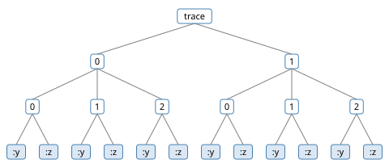

# Composition

Every model so far has been one `gen` function. Real models have parts: a
prior feeding a likelihood, a step repeated over time, a choice between two
structures, a tree whose shape is random. This chapter builds larger models
from smaller ones, and shows what each way of composing does to the trace
and its addresses. The central fact is that composition loses nothing. A
composed model is a generative function, with traces, scores and every
operation of the GFI, so every inference algorithm runs on it unchanged.

gen.clj composes in two ways. `splice` calls a generative function from
inside a `gen` body, its choices nested under an address. A *combinator*
takes generative functions and returns a new one, as `comp` and `partial`
do for plain functions. This chapter ports the GenMLX book's chapter on
composition, with gen.clj's combinators, which follow Gen.jl's. Where an
exact answer exists, the chapter checks against it: a Map's score against
the sum of its elements', a hidden Markov model's evidence against the
forward algorithm, an incremental update's weight against a full
recomputation.

<!-- code: ns -->
```clojure
(ns book.composition
  (:refer-clojure :exclude [+ - * /])
  (:require [gen.array :as array :refer [+ - * /]]
            [gen.book.svg :as svg]
            [gen.choicemap :as cm]
            [gen.combinators :as comb]
            [gen.diff :as diff]
            [gen.dist :as d]
            [gen.dist.core :as dc]
            [gen.dynamic :refer [gen]]
            [gen.gfi :as gfi]
            [gen.inference.importance :as imp]
            [gen.inference.weights :as weights]
            [gen.random :as rng]
            [gen.selection :as sel]
            [gen.state-space :as ss]
            [gen.trace :as trace]))
```

## Splice: calling a sub-model

*Introduction to Modeling* met `splice`. `(splice addr gf & args)` calls
the generative function `gf` on `args` and nests its choices under the
address `addr`. Two noisy sensors, each the same one-line model, make a
sensor-fusion model:

<!-- code: sensor -->
```clojure
(def sensor
  (gen [position]
    (trace :reading (d/normal position 0.5))))

(def fusion
  (gen [position]
    [(splice :a sensor position)
     (splice :b sensor position)]))
```

Both sensors trace the address `:reading`, and they do not collide, since
each call's choices live under the call's own address:

<!-- code: fusion-trace -->
```clojure
(def fused (gfi/simulate fusion [5.0] (rng/key 1)))

(cm/addresses (:choices fused))
;=> [[:a :reading] [:b :reading]]

[(fused [:a :reading]) (fused [:b :reading])]
;=> [3.925 4.534] ; float64

(= (:retval fused) [(fused [:a :reading]) (fused [:b :reading])])
;=> true
```

The sensor model is written without knowing where it will be called; the
caller keeps the copies apart. Called with a call's address, a trace returns
what the call returned. `trace/subtrace` returns the call's own trace, its
*subtrace*, with its arguments, its choices at their local addresses, and
its score. The caller's score is the sum of its calls' scores:

<!-- code: fusion-subtrace -->
```clojure
(def sensor-a (trace/subtrace fused :a))

[(:args sensor-a) (cm/addresses (:choices sensor-a))]
;=> [[5.0] [[:reading]]]

(= (fused :a) (:retval sensor-a))
;=> true

(array/allclose? (:score fused)
                 (+ (:score sensor-a) (:score (trace/subtrace fused :b))))
;=> true
```

Constraints follow the same tree. A choice map that fixes `[:b :reading]`
fixes the second sensor's reading: `generate` hands the call at `:b` the
part of the constraints under `:b`. With one reading fixed and the other
drawn, the weight is the fixed reading's log density:

<!-- code: fusion-constrain -->
```clojure
(def one-reading (cm/choicemap [:b :reading] 5.2))

(array/allclose?
 (:weight (gfi/generate fusion [5.0] one-reading (rng/key 2)))
 (dc/log-prob (d/normal 5.0 0.5) 5.2))
;=> true
```

*Choice Maps, Traces and Selections* reads nested choice maps and traces as
data. Here we see them from the side that makes them: `splice` is what
nests.

Without an address, `(splice gf & args)` is Gen.jl's `{*} ~ gf(args)`: the
callee's choices land in the caller's namespace, as if its body were
written in place:

<!-- code: splice-flat -->
```clojure
(def one-sensor
  (gen [position]
    (splice sensor position)))

(cm/addresses (:choices (gfi/simulate one-sensor [5.0] (rng/key 3))))
;=> [[:reading]]
```

It shares code; it does not make copies. Two calls without addresses would
trace `:reading` twice, and gen.clj refuses, loudly:

<!-- code: splice-twice -->
```clojure
;; error: Address [:reading] is used twice
(def two-sensors
  (gen [position]
    [(splice sensor position)
     (splice sensor position)]))

(gfi/simulate two-sensors [5.0] (rng/key 3))
```

It works by running the callee's body in the caller's, so the callee must
be a `gen` function. Any other generative function needs an address:

<!-- code: splice-flat-only-gen -->
```clojure
;; error: A splice without an address needs a dynamic generative function
(def many-sensors
  (gen [positions]
    (splice (comb/map sensor) positions)))

(gfi/simulate many-sensors [[1.0 2.0]] (rng/key 3))
```

Splice suits parts that have names: a prior and a likelihood, this sensor
and that one. When the parts are many copies of one model, a combinator
says so directly.

## Map: independent replication

`comb/map` turns a model of one element into a model of a sequence of
them, applying it independently to each. The model it applies is its
*kernel*:

<!-- code: map-model -->
```clojure
(def point
  (gen [x]
    (trace :y (d/normal (* 2.0 x) 1.0))))

(def points (comb/map point))
```

A Map's arguments are vectors, one for each argument of the kernel, with
one element per application: element $i$ calls the kernel on the $i$-th
element of each. Its choices nest under the integer address $i$, from 0,
and it returns the vector of the kernel's return values:

<!-- code: map-trace -->
```clojure
(def xs [1.0 2.0 3.0 4.0 5.0])

(def mapped (gfi/simulate points [xs] (rng/key 4)))

(cm/addresses (:choices mapped))
;=> [[0 :y] [1 :y] [2 :y] [3 :y] [4 :y]]

(:retval mapped)
;=> [1.139 3.786 4.213 7.398 11.199] ; float64
```

A kernel of two arguments takes two vectors of one length (vectors of
different lengths are a loud error):

<!-- code: map-columns -->
```clojure
(def scaled
  (comb/map (gen [x sd] (trace :y (d/normal (* 2.0 x) sd)))))

(cm/addresses
 (:choices (gfi/simulate scaled [[1.0 2.0] [0.1 10.0]] (rng/key 5))))
;=> [[0 :y] [1 :y]]
```

The elements are independent, so the joint density factors, and the score
is the sum of the elements' scores. The Map keeps each element's trace, at
its index:

<!-- code: map-score -->
```clojure
(def element-scores
  (mapv #(:score (trace/subtrace mapped %)) (range (count xs))))

(array/allclose? (:score mapped) (reduce + element-scores))
;=> true
```

Constraining one element leaves the others alone. With element 2's `:y`
fixed at 7, where the kernel expects $2 \cdot 3 = 6$, the weight of
`generate` is that one choice's log density, $\log \mathcal{N}(7; 6, 1)$.
The other elements are drawn from the kernel and add nothing to it:

<!-- code: map-constrain -->
```clojure
(def element-2 (cm/choicemap [2 :y] 7.0))

(array/allclose? (:weight (gfi/generate points [xs] element-2 (rng/key 6)))
                 (dc/log-prob (d/normal 6.0 1.0) 7.0))
;=> true
```

The constraint's path names the element first, then the kernel's address:
`[2 :y]`. Writing `[:y 2]`, the order a loop in a `gen` body would use, is
a loud error, since a Map has no address `:y`:

<!-- code: map-wrong-path -->
```clojure
;; error: generate: the constraint at [:y] was not visited
(gfi/generate points [xs] (cm/choicemap [:y 2] 7.0) (rng/key 6))
```

Map is the plate of a graphical model: $n$ exchangeable data points, or any
"the same thing, repeated".

## Unfold: a hidden Markov model

When each repetition depends on the one before, a combinator threads a
state through them. The kernel of `comb/unfold` takes a step number $t$,
the state and any parameters, makes its choices, and returns the next
state. A hidden Markov model is one such step: a hidden state $z_t \in
\{0, 1\}$, drawn from the row of the transition matrix $A$ that the
previous state picks, and an observation $y_t$ near the state's mean:

$$
z_t \sim \operatorname{categorical}(A_{z_{t-1}}), \qquad
y_t \sim \mathcal{N}(\mu_{z_t}, 1).
$$

<!-- code: hmm-model -->
```clojure
(def hmm-step
  (gen [t state transition means]
    (let [state' (trace :z (d/categorical (array/take transition state)))]
      (trace :y (d/normal (array/take means state') 1.0))
      state')))

(def hmm (comb/unfold hmm-step))

(def transition (array/array [[0.9 0.1] [0.2 0.8]]))

(def means (array/array [-1.0 2.0]))
```

The kernel picks rows and means with `array/take`, so it never reads a
state on the host. An Unfold is called with the number of steps, the
initial state and the parameters, which every step receives: `[n init &
params]`. Step $t$'s choices nest under $t$, and the Unfold returns the
vector of the states after each step. Here the initial state is 0, so
$z_0$ is drawn from $A$'s first row:

<!-- code: hmm-trace -->
```clojure
(def chain (gfi/simulate hmm [4 0 transition means] (rng/key 6)))

(cm/addresses (:choices chain))
;=> [[0 :y] [0 :z] [1 :y] [1 :z] [2 :y] [2 :z] [3 :y] [3 :z]]

(:retval chain)
;=> [0 0 1 1] ; float64

(= (:retval chain) (mapv #(chain [% :z]) (range 4)))
;=> true
```

One step defines the whole chain, and since the chain is a generative
function, questions about it are GFI questions. Take six observations:

<!-- code: hmm-data -->
```clojure
(def ys [-0.6 -1.4 1.7 2.5 0.4 2.2])

(def n (count ys))

(def hmm-args [n 0 transition means])
```

The *evidence* (or marginal likelihood) of the observations is $p(y) =
\sum_z p(z, y)$, a sum over every sequence of hidden states. With two
states and six steps there are 64 sequences, and `gfi/assess` gives each
one's joint log density $\log p(z, y)$. Their log-sum-exp is $\log p(y)$,
exactly:

<!-- code: hmm-enumerate -->
```clojure
(defn paths
  "Every sequence of n states, each 0 or 1."
  [n]
  (if (zero? n) [[]] (for [p (paths (dec n)) z [0 1]] (conj p z))))

(defn joint
  "The choice map of the states zs and the observations ys."
  [zs]
  (apply cm/choicemap (mapcat (fn [t z y] [[t :z] z [t :y] y]) (range) zs ys)))

(def log-joints
  (array/stack
   (mapv #(:weight (gfi/assess hmm hmm-args (joint %))) (paths n))))

(def log-evidence (array/logsumexp log-joints))

[(count (paths n)) log-evidence]
;=> [64 -10.247]
```

`gen.state-space/hmm` computes the same number another way. The
observations are its only choices, and each one's density is $p(y_t \mid
y_0, \dots, y_{t-1})$, from the forward algorithm, with the hidden states
summed out. Its first state comes from a prior, here $A$'s first row. The
two agree:

<!-- code: hmm-exact -->
```clojure
(def observations (apply cm/choicemap (interleave (range) ys)))

(def forward
  (gfi/assess ss/hmm
              [n (array/take transition 0)
               {:transition transition :emission (d/normal means 1.0)}]
              observations))

(array/allclose? (:weight forward) log-evidence)
;=> true
```

Normalized, the 64 joint densities are the posterior over sequences.
Summing them by state at each step gives the posterior marginals, $P(z_t =
1 \mid y)$:

<!-- code: hmm-marginals -->
```clojure
(def state-1
  "The posterior probability of state 1 at each step, by enumeration."
  (array/matmul (array/softmax log-joints)
                (array/array (mapv #(mapv double %) (paths n)))))
```

<!-- code: hmm-figure -->
```clojure
;; figure: figures/017-hmm-marginals.svg
(svg/series (array/->clj state-1)
            {:x-label "step t" :y-label "P(state 1 | y)"})
```


Step 4 shows what the chain adds. Its observation, $y_4 = 0.4$, is more
probable in state 0 than in state 1, by a log likelihood ratio of 0.3. But
the steps on either side of it are almost surely in state 1, and states
tend to persist, so the posterior puts step 4 in state 1:

<!-- code: hmm-step-4 -->
```clojure
(def likelihood-ratio
  "log p(y_4 | state 0) - log p(y_4 | state 1)."
  (- (dc/log-prob (d/normal -1.0 1.0) (ys 4))
     (dc/log-prob (d/normal 2.0 1.0) (ys 4))))

[likelihood-ratio (array/take state-1 4)]
;=> [0.3 0.957]
```

Enumeration takes $2^n$ assessments, so it is a check, not a method; the
forward algorithm does the same sum in time linear in $n$.

## Scan: a driven sequence

`comb/scan`, modeled on JAX's `scan`, is an Unfold with inputs and outputs.
Its kernel takes the carried state and one input, and returns a pair: the
next state and an output. It suits a sequence driven by data, such as a
room's temperature under a heater's setting at each step:

<!-- code: scan-model -->
```clojure
(def heat-step
  (gen [temp heater]
    (let [temp' (trace :temp (d/normal (+ (* 0.9 temp) heater) 0.3))]
      [temp' (trace :reading (d/normal temp' 0.5))])))

(def heating (comb/scan heat-step))
```

A Scan is called with the initial carry and the vector of inputs, `[init xs
& params]`. It addresses step $t$ under $t$, as Unfold does, and returns
`[carry ys]`, the last carry and the vector of outputs:

<!-- code: scan-trace -->
```clojure
(def heaters [1.0 1.0 0.0 0.0 2.0])

(def heated (gfi/simulate heating [20.0 heaters] (rng/key 8)))

(take 4 (cm/addresses (:choices heated)))
;=> [[0 :reading] [0 :temp] [1 :reading] [1 :temp]]

(let [[temp readings] (:retval heated)]
  [(= temp (heated [4 :temp]))
   (= readings (mapv #(heated [% :reading]) (range 5)))])
;=> [true true]
```

Unfold suits a chain that evolves on its own, and Scan one that consumes an
input at each step. Exercise 3 writes the hidden Markov model as a Scan.

## Incremental updates

*Update and Regenerate* introduced `gfi/update` and its change hints: with
new arguments come *argdiffs*, one per argument, saying how each changed,
and the update returns a *retdiff*, saying how the return value did
(`gen.diff`). Map, Unfold and Scan keep each element's subtrace, so an
update can revise only the elements a change reaches. That is a reason to
use them over a loop in a `gen` body.

Move the Map's third input from 3 to 3.5, with an argdiff, a
`diff/vector-diff`, that says the vector kept its five elements and only
element 2 may have changed. The Map revisits element 2 alone: every other
element's subtrace is the old one, the same object.

<!-- code: map-update -->
```clojure
(def xs' (assoc xs 2 3.5))

(def moved
  (gfi/update mapped [xs'] [(diff/vector-diff 5 5 {2 diff/unknown-change})]
              cm/EMPTY (rng/key 9)))

(defn revisited
  "The indices whose subtraces differ between traces a and b."
  [a b]
  (vec (remove #(identical? (trace/subtrace a %) (trace/subtrace b %))
               (range (count (:retval a))))))

(revisited mapped (:trace moved))
;=> [2]
```

The update keeps every choice and changes an argument, so its weight is
$\log p(\text{choices}; x') - \log p(\text{choices}; x)$. A full
recomputation, assessing the old choices under the new arguments, gives the
same number:

<!-- code: map-update-check -->
```clojure
(def recomputed
  (- (:weight (gfi/assess points [xs'] (:choices mapped))) (:score mapped)))

(array/allclose? (:weight moved) recomputed)
;=> true
```

`diff/unknown-change` is always sound, and costs more: the Map then
revisits every element, for the same weight.

<!-- code: map-update-unknown -->
```clojure
(def moved-blind
  (gfi/update mapped [xs'] [diff/unknown-change] cm/EMPTY (rng/key 9)))

[(revisited mapped (:trace moved-blind))
 (array/allclose? (:weight moved-blind) (:weight moved))]
;=> [[0 1 2 3 4] true]
```

Element $i$ draws from its own key, `(rng/fold-in key i)`, so the length of
a Map does not shift the other elements' randomness. With the same key, a
Map of six elements repeats the first five draws of a Map of five:

<!-- code: map-keys -->
```clojure
(def six (gfi/simulate points [(conj xs 6.0)] (rng/key 4)))

(= (subvec (:retval six) 0 5) (:retval mapped))
;=> true
```

An Unfold extended by a step revisits none of the old ones: their states
and parameters did not change, and nothing constrains them. (The step
count's argdiff is `unknown-change`, which is always sound.) It runs the
new step, here with its observation constrained, and its retdiff says the
vector of states grew from four to five with no old state changed:

<!-- code: unfold-extend -->
```clojure
(def longer
  (gfi/update chain [5 0 transition means]
              [diff/unknown-change diff/no-change diff/no-change diff/no-change]
              (cm/choicemap [4 :y] 1.0) (rng/key 10)))

(revisited chain (:trace longer))
;=> []

(:retdiff longer)
;=> {:new-length 5 :prev-length 4 :updated {}}
```

The new step's state is drawn from its prior, the internal proposal, so its
density cancels from the weight, which is the new observation's log density
given that state:

<!-- code: unfold-extend-weight -->
```clojure
(def new-state ((:trace longer) [4 :z]))

(array/allclose? (:weight longer)
                 (dc/log-prob (d/normal (array/take means new-state) 1.0)
                              1.0))
;=> true
```

This is the step a particle filter takes for each particle, one
observation at a time: gen.clj's (`gen.inference.particle-filter`, in Part
II) extends each trace with `update` and adds the weight to the particle's.

## Switch: choosing a branch

`comb/switch` makes one generative function of several *branches*, and
runs the one its first argument, an index, chooses. Two models of points on
a curve, a line and a parabola, share their observation model through a
splice without an address:

<!-- code: switch-models -->
```clojure
(def observe
  (gen [f xs]
    (doseq [[i x] (map-indexed vector xs)]
      (trace [:y i] (d/normal (f x) 1.0)))))

(def line
  (gen [xs]
    (let [b (trace :intercept (d/normal 0 2))
          m (trace :slope (d/normal 0 2))]
      (splice observe (fn [x] (+ b (* m x))) xs))))

(def parabola
  (gen [xs]
    (let [b (trace :intercept (d/normal 0 2))
          m (trace :slope (d/normal 0 2))
          c (trace :curvature (d/normal 0 2))]
      (splice observe (fn [x] (+ b (* m x) (* c x x))) xs))))

(def shape (comb/switch line parabola))
```

`observe` traces `[:y i]` in its caller's namespace, so both models make
the same observation addresses. A Switch is called with the branch index,
then the branch's arguments: `[index & args]`. Only one branch runs, so its
addresses appear as they are, with no wrapper:

<!-- code: switch-trace -->
```clojure
(def xs2 [-2.0 -1.0 0.0 1.0 2.0])

(def as-line (gfi/simulate shape [0 xs2] (rng/key 11)))

(def as-parabola (gfi/simulate shape [1 xs2] (rng/key 11)))

(cm/addresses (:choices as-line))
;=> [[:intercept] [:slope] [:y 0] [:y 1] [:y 2] [:y 3] [:y 4]]

(take 3 (cm/addresses (:choices as-parabola)))
;=> [[:curvature] [:intercept] [:slope]]
```

A Switch trace's score is its branch's:

<!-- code: switch-score -->
```clojure
(array/allclose?
 (:weight (gfi/assess shape [1 xs2] (:choices as-parabola)))
 (:weight (gfi/assess parabola [xs2] (:choices as-parabola))))
;=> true
```

A map of branches, `(comb/switch {:line line :parabola parabola})`, makes
a keyed Switch, called with a key in place of an index.

Pointed at two whole models, a Switch answers a question of model
selection: which model makes the data more probable? Each branch's evidence
$p(y \mid \text{branch})$ is the measure. These two models are linear in
their parameters, with normal priors and normal noise, so each one's
evidence is a multivariate normal density, known exactly:

<!-- code: evidence-exact -->
```clojure
(def ys2 [3.9 0.6 -0.4 1.2 4.3])

(def observed (apply cm/choicemap (mapcat (fn [i y] [[:y i] y]) (range) ys2)))

(defn exact-evidence
  "log p(ys) of a model whose mean at x is the dot product of weights w
   and (features x), each weight ~ N(0, 2), with noise 1: for X the matrix
   of the features' rows, ys ~ N(0, 4 X X^T + I)."
  [features xs ys]
  (let [X (array/array (mapv features xs))
        k (count xs)
        cov (+ (* 4.0 (array/matmul X (array/transpose X))) (array/eye k))]
    (array/item (dc/log-prob (d/mvnormal (array/zeros [k]) cov)
                             (array/array ys)))))

(def evidence
  [(exact-evidence (fn [x] [1.0 x]) xs2 ys2)
   (exact-evidence (fn [x] [1.0 x (* x x)]) xs2 ys2)])

evidence
;=> [-16.931 -10.231]
```

The GFI estimates the same evidence knowing nothing of the model's form.
With the observations constrained and the parameters drawn from the prior,
`generate`'s weight has expectation $p(y)$, and importance sampling
(*Conditioning*) averages it. `imp/importance-sampling` does this through
the Switch, and its estimates agree with the exact evidence within five
standard errors:

<!-- code: evidence-is -->
```clojure
(defn estimate
  "The log evidence of branch k by importance sampling with n samples, and
   its standard error, sqrt(1/ESS - 1/n) for the samples' effective sample
   size ESS."
  [k n key]
  (let [r (imp/importance-sampling shape [k xs2] observed n
                                   {:key key :batched? true})
        ess (weights/ess (:log-normalized-weights r))]
    {:log-evidence (:log-ml-estimate r)
     :se (Math/sqrt (- (/ 1.0 ess) (/ 1.0 n)))}))

(def estimates
  [(estimate 0 20000 (rng/key 12)) (estimate 1 20000 (rng/key 13))])

(mapv (fn [{:keys [log-evidence se]} exact]
        (< (abs (- log-evidence exact)) (* 5 se)))
      estimates evidence)
;=> [true true]
```

`{:batched? true}` runs the 20000 samples as one *batched execution*: the
Switch, its branch and their arithmetic run once, on arrays with a
particle axis, instead of 20000 times. The GenMLX book's Vmap combinator
batches one kernel this way. gen.clj batches any model, with no
combinator, and Part II's chapter on batched execution shows how.

The data came from a parabola, and the parabola wins by a log Bayes factor
of 6.7: the data are $e^{6.7} \approx 800$ times more probable under it.

<!-- code: bayes-factor -->
```clojure
(- (evidence 1) (evidence 0))
;=> 6.70
```

Nothing here knew about model selection. It is two generative functions,
each scored by the same weights, compared by subtraction.

When an update changes a Switch's index, the new branch runs against the
old branch's choices. Addresses both branches make keep their values, as
they would under an `if`, and the new branch draws the rest. Switching the
line to the parabola keeps the line's slope, intercept and observations,
and draws a curvature, whose prior density cancels from the weight:

<!-- code: switch-update -->
```clojure
(def to-parabola
  (gfi/update as-line [1 xs2] [diff/unknown-change diff/no-change]
              cm/EMPTY (rng/key 14)))

(every? #(= (as-line %) ((:trace to-parabola) %))
        (cm/addresses (:choices as-line)))
;=> true

(def curvature ((:trace to-parabola) :curvature))

(array/allclose? (:weight to-parabola)
                 (- (:score (:trace to-parabola)) (:score as-line)
                    (dc/log-prob (d/normal 0 2) curvature)))
;=> true
```

Switching back discards the curvature, which the line does not make. With
no new choice, the weight is the difference of the scores:

<!-- code: switch-back -->
```clojure
(def to-line
  (gfi/update (:trace to-parabola) [0 xs2] [diff/unknown-change diff/no-change]
              cm/EMPTY (rng/key 15)))

(cm/addresses (:discard to-line))
;=> [[:curvature]]

(array/allclose? (:weight to-line)
                 (- (:score (:trace to-line)) (:score (:trace to-parabola))))
;=> true
```

## Mix: a mixture of models

`comb/mix` draws the branch index itself. `((comb/mix gf0 gf1 …) weights &
args)` draws an index from `(d/categorical weights)`, at the address
`:index`, and calls that component on `args`, its choices under
`:component`. It is a categorical choice followed by a Switch:

<!-- code: mix-model -->
```clojure
(def either (comb/mix line parabola))

(def mixed (gfi/simulate either [[0.3 0.7] xs2] (rng/key 16)))

(take 3 (cm/addresses (:choices mixed)))
;=> [[:component :curvature] [:component :intercept] [:component :slope]]

(mixed :index)
;=> 1 ; float64
```

GenMLX's Mix keeps its index at `:component-idx` and the component's
choices at the top level. gen.clj's nests them under `:component`, so an
index and a component's choice can never collide. The score is the index's
log probability plus the component's score:

<!-- code: mix-score -->
```clojure
(array/allclose? (:score mixed)
                 (+ (Math/log 0.7) (:score (trace/subtrace mixed :component))))
;=> true
```

Over many draws, each component is chosen in proportion to its weight.
With weights 0.3 and 0.7, the fraction of 2000 draws that choose the
parabola is within five binomial standard errors of 0.7:

<!-- code: mix-frequency -->
```clojure
(def indices
  (mapv #((gfi/simulate either [[0.3 0.7] xs2] %) :index)
        (rng/split (rng/key 17) 2000)))

(let [freq (/ (count (filter #(== 1 (array/item %)) indices)) 2000.0)
      se (Math/sqrt (/ (* 0.7 0.3) 2000))]
  (< (abs (- freq 0.7)) (* 5 se)))
;=> true
```

`comb/mix-logits` takes logits in place of probabilities, as
`d/categorical-logits` does.

## Recursion

A `gen` function can splice itself. A random binary tree flips a coin at
each node: a leaf draws a value, and an internal node returns the sum of
two subtrees, spliced at `:left` and `:right`. At depth 2 every node is a
leaf, so the tree ends:

<!-- code: tree-plain -->
```clojure
(def tree
  (gen [depth]
    (if (or (>= depth 2) (trace :leaf? (d/bernoulli 0.5)))
      (trace :value (d/normal 0 1))
      (+ (splice :left tree (inc depth))
         (splice :right tree (inc depth))))))

(def grown (gfi/simulate tree [0] (rng/key 27)))

(filter #(= :value (peek %)) (cm/addresses (:choices grown)))
;=> [[:left :left :value] [:left :right :value] [:right :value]] ; float64

(mapv #(count (cm/addresses (:choices (gfi/simulate tree [0] %))))
      (rng/split (rng/key 28) 8))
;=> [2 6 2 6 2 2 6 6] ; float64
```

The tree's shape is random, so the number of choices varies from run to
run. Each splice adds a level to the addresses, and a trace's addresses
take the shape of its tree:

<!-- code: tree-figure -->
```clojure
;; figure: figures/017-tree.svg
(svg/tree (cm/addresses (:choices grown)))
```


GenMLX's `recurse` existed to hand a model a reference to itself, which a
var already does in gen.clj. `comb/recurse` is Gen.jl's Recurse, made for
something else. It grows a tree with two kernels. A *production* kernel
turns a node's input into a value and the inputs of its children, `{:value
v :children [inputs …]}`, and an *aggregation* kernel turns a node's value
and its children's aggregations into the node's own. The same random tree,
as a Recurse with at most two children per node:

<!-- code: recurse-model -->
```clojure
(def grow
  (gen [depth]
    (if (or (>= depth 2) (trace :leaf? (d/bernoulli 0.5)))
      {:value (trace :value (d/normal 0 1)) :children []}
      {:value 0.0 :children [(inc depth) (inc depth)]})))

(def total (gen [value children] (reduce + value children)))

(def recursive-tree (comb/recurse grow total 2))
```

Nodes are numbered as in a complete tree: the root is 0, and child $j$ of
node $i$ is $i \cdot b + j + 1$, for at most $b$ children per node.
`comb/get-child` computes it, and `comb/get-parent` and
`comb/get-child-num` invert it:

<!-- code: recurse-numbers -->
```clojure
[(comb/get-child 0 0 2) (comb/get-child 0 1 2) (comb/get-child 1 0 2)]
;=> [1 2 3]

[(comb/get-parent 3 2) (comb/get-child-num 3 2)]
;=> [1 0]
```

The addresses are flat: node $i$'s choices are at `[i :production …]` and
`[i :aggregation …]`, however deep the node lies. A root that splits into
two leaves, valued 0.3 and -1.2, is this choice map, and its log density
is three coin flips and two values:

<!-- code: recurse-assess -->
```clojure
(def small-tree
  (cm/choicemap [0 :production :leaf?] false
                [1 :production :leaf?] true
                [1 :production :value] 0.3
                [2 :production :leaf?] true
                [2 :production :value] -1.2))

(def assessed (gfi/assess recursive-tree [0] small-tree))

(:retval assessed)
;=> -0.9

(array/allclose? (:weight assessed)
                 (+ (* 3 (Math/log 0.5))
                    (dc/log-prob (d/normal 0 1) 0.3)
                    (dc/log-prob (d/normal 0 1) -1.2)))
;=> true
```

Like Map, Recurse keeps each node's subtraces, so an update revisits only
what a change reaches. Changing leaf 2's value revisits its production and
the aggregations on its way to the root, and nothing else:

<!-- code: recurse-update -->
```clojure
(def small (:trace (gfi/generate recursive-tree [0] small-tree (rng/key 31))))

(def regrown
  (gfi/update small (cm/choicemap [2 :production :value] 0.5) (rng/key 32)))

(:retval (:trace regrown))
;=> 0.8

(for [node [0 1 2]
      part [:production :aggregation]
      :let [p [node part]]
      :when (not (identical? (trace/subtrace small p)
                             (trace/subtrace (:trace regrown) p)))]
  p)
;=> [[0 :aggregation] [2 :production] [2 :aggregation]]
```

## Adapters

Three small combinators change how a generative function is called and
leave what it does alone. `comb/call-at` is Gen.jl's `call_at`: it takes an
address as the last argument and puts the function's choices under it.
`comb/choice-at` is Gen.jl's `choice_at`, the same for one choice from a
distribution constructor. Under a Map, they put each element's choices at
an address the caller chooses:

<!-- code: call-at -->
```clojure
(def sensor-at (comb/call-at sensor))

(cm/addresses (:choices (gfi/simulate sensor-at [5.0 :c] (rng/key 19))))
;=> [[:c :reading]]

(def normal-at (comb/choice-at d/normal))

(cm/addresses
 (:choices (gfi/simulate (comb/map normal-at)
                         [[0.0 5.0] [1.0 1.0] [:first :second]]
                         (rng/key 20))))
;=> [[0 :first] [1 :second]]
```

`comb/dimap` maps a generative function's arguments on the way in and its
return value on the way out, and leaves its choices where they were. A
sensor that measures in meters, called and answered in feet:

<!-- code: dimap -->
```clojure
(def feet-per-meter 3.28084)

(def sensor-in-feet
  (comb/dimap sensor
              (fn [feet] [(/ feet feet-per-meter)])
              (fn [meters] (* meters feet-per-meter))))

(def in-feet (gfi/simulate sensor-in-feet [16.4] (rng/key 21)))

(cm/addresses (:choices in-feet))
;=> [[:reading]]

(array/allclose? (:retval in-feet) (* (in-feet :reading) feet-per-meter))
;=> true
```

`comb/contramap` maps the arguments only, and `comb/map-retval` the return
value only:

<!-- code: contramap -->
```clojure
(def from-feet (comb/contramap sensor (fn [feet] [(/ feet feet-per-meter)])))

(def to-feet (comb/map-retval sensor (fn [meters] (* meters feet-per-meter))))

(def five-meters (cm/choicemap :reading 5.0))

[(array/allclose? (:weight (gfi/assess from-feet [16.4] five-meters))
                  (dc/log-prob (d/normal (/ 16.4 feet-per-meter) 0.5) 5.0))
 (array/allclose? (:retval (gfi/assess to-feet [5.0] five-meters))
                  (* 5.0 feet-per-meter))]
;=> [true true]
```

The addresses do not change, so constraints, selections and inference
written for the inner model apply to the adapted one.

## Addressing conventions

Each kind of composition puts a callee's choices at its own kind of
address. Knowing the scheme is how to read a composed trace, and how to
write constraints and selections for it:

| Composition | Called with | A callee's choice `:c` lands at |
|-------------|------------|--------------------------------|
| `(splice :k gf …)` | `gf`'s arguments | `[:k :c]` |
| `(splice gf …)` | `gf`'s arguments | `[:c]` |
| Map | vectors, an element per call | `[i :c]` |
| Unfold | `n init & params` | `[t :c]` |
| Scan | `init xs & params` | `[t :c]` |
| Switch | `index & args` | `[:c]` |
| Mix | `weights & args` | `[:component :c]`, the index at `:index` |
| Recurse | the root's input | `[i :production :c]`, `[i :aggregation :c]` |
| call-at | `args … k` | `[k :c]` |
| dimap, contramap, map-retval | mapped arguments | `[:c]` |

The compositions that make many calls put each one under an address that
names its place: a keyword for splice, an index for Map, Unfold and Scan, a
node number for Recurse. Those that make one call leave its addresses
alone: Switch, the adapters, and splice without an address. Mix makes a
choice of its own beside its one call, so it puts the call under
`:component`. Indices are 0-based throughout, where Gen.jl's are 1-based.

## The GFI is closed under composition

A combinator takes generative functions and returns one, so combinators
nest in each other, and in `gen` bodies, with no special cases. A Map of
Unfolds is several independent hidden Markov chains:

<!-- code: nested -->
```clojure
(def hmms (comb/map hmm))

(def hmms-args [[3 3] [0 1] [transition transition] [means means]])

(def nested (gfi/simulate hmms hmms-args (rng/key 22)))

(take 4 (cm/addresses (:choices nested)))
;=> [[0 0 :y] [0 0 :z] [0 1 :y] [0 1 :z]]
```

Its addresses are one level deeper, element, then step, then choice:

<!-- code: nested-figure -->
```clojure
;; figure: figures/017-nested.svg
(svg/tree (cm/addresses (:choices nested)))
```



The operations stay the same. With every choice constrained, `generate`'s
weight is the score; `assess` gives the same density without a trace;
`project` on every choice gives the score again; and regenerating nothing
changes nothing, with a weight of 0:

<!-- code: nested-gfi -->
```clojure
(def all-choices (:choices nested))

[(array/allclose?
  (:weight (gfi/generate hmms hmms-args all-choices (rng/key 23)))
  (:score nested))
 (array/allclose? (:weight (gfi/assess hmms hmms-args all-choices))
                  (:score nested))
 (array/allclose? (gfi/project nested sel/all) (:score nested))
 (:weight (gfi/regenerate nested sel/none (rng/key 24)))]
;=> [true true true 0.0]
```

These are instances of the GFI's laws, which gen.clj's tests check for
every combinator (`test/gen/laws.clj`), and which Part III states. For a
modeler, the point is the one every section of this chapter has made: the
inference algorithms of Part II are written once, against the GFI, and run
on any model these pieces build.

With composition, the foundations are in place: a model is a generative function, a trace records one run of it,
the GFI's operations make and revise traces, and composition keeps all of
it intact. Part II turns to inference.

## Workshop

Each exercise has a tested solution at the end of the chapter.

1. **A third sensor.** Add a sensor at `:c` to the fusion model. Predict
   the address of its reading. Then resample only sensor b's reading, with
   `gfi/regenerate` and a selection, and check that the other two readings
   keep their values.
2. **Occam's razor.** Points near a line, `[0.2 0.1 1.3 1.4 2.1]` at the
   same $x$ values: which model has more evidence, the line or the
   parabola? The parabola can draw every line. Does it win, and why?
3. **Unfold as Scan.** Write the hidden Markov model as a Scan whose inputs
   are the step numbers $0, \dots, n - 1$, reusing `hmm-step` through a
   splice without an address. Check that it gives the Unfold's joint
   density on the same choices.
4. **Evidence, one observation at a time.** Make a trace of
   `gen.state-space/hmm` with the first five observations, then `update` it
   to six steps with the sixth observation constrained. What is the
   update's weight? Check it against the exact evidence of all six.

## Solutions

**1.** The third reading is at `[:c :reading]`. The selection names one
choice, and `regenerate` resamples it and keeps every other:

<!-- code: solution-1 -->
```clojure
(def three-sensors
  (gen [position]
    [(splice :a sensor position)
     (splice :b sensor position)
     (splice :c sensor position)]))

(def three (gfi/simulate three-sensors [5.0] (rng/key 25)))

(cm/addresses (:choices three))
;=> [[:a :reading] [:b :reading] [:c :reading]]

(def resampled
  (:trace (gfi/regenerate three (sel/select [:b :reading]) (rng/key 26))))

(mapv #(= (three [% :reading]) (resampled [% :reading])) [:a :b :c])
;=> [true false true]
```

**2.** The line wins, by a log Bayes factor of 2.0. A model's evidence
averages its likelihood over its prior. The parabola spreads its prior
over curvatures that the data rule out, so most of its prior makes the
data improbable. An extra parameter costs evidence unless the data need
it: the Bayesian Occam's razor.

<!-- code: solution-2 -->
```clojure
(def ys-line [0.2 0.1 1.3 1.4 2.1])

(def evidence-line
  [(exact-evidence (fn [x] [1.0 x]) xs2 ys-line)
   (exact-evidence (fn [x] [1.0 x (* x x)]) xs2 ys-line)])

(- (evidence-line 0) (evidence-line 1))
;=> 2.02
```

**3.** The step number arrives as the Scan's input and the state as its
carry, and the kernel returns the new state as both the next carry and the
output. A splice without an address puts `hmm-step`'s `:z` and `:y` at
`[t :z]` and `[t :y]`, the Unfold's addresses, so the same choice map
serves both:

<!-- code: solution-3 -->
```clojure
(def hmm-scan-step
  (gen [state t transition means]
    (let [state' (splice hmm-step t state transition means)]
      [state' state'])))

(def hmm-scan (comb/scan hmm-scan-step))

(array/allclose?
 (:weight (gfi/assess hmm-scan [0 (vec (range n)) transition means]
                      (joint [0 0 1 1 1 1])))
 (:weight (gfi/assess hmm hmm-args (joint [0 0 1 1 1 1]))))
;=> true
```

**4.** The update runs one new step of the forward algorithm, and nothing
before it. Its weight is $\log p(y_5 \mid y_0, \dots, y_4)$, the sixth
observation's log predictive density. It is the evidence of six
observations less that of five, and the evidence of five is the score of
the five-step trace.

<!-- code: solution-4 -->
```clojure
(defn hmm-exact-args
  "gen.state-space/hmm's arguments for the first k observations."
  [k]
  [k (array/take transition 0)
   {:transition transition :emission (d/normal means 1.0)}])

(def first-five
  (:trace (gfi/generate ss/hmm (hmm-exact-args 5)
                        (apply cm/choicemap (interleave (range 5) ys))
                        (rng/key 29))))

(def sixth
  (gfi/update first-five (hmm-exact-args 6)
              [diff/unknown-change diff/no-change diff/no-change]
              (cm/choicemap 5 (ys 5)) (rng/key 30)))

(array/allclose? (:weight sixth)
                 (- log-evidence (:score first-five)))
;=> true
```
