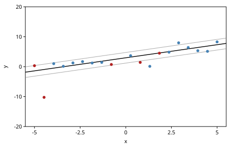
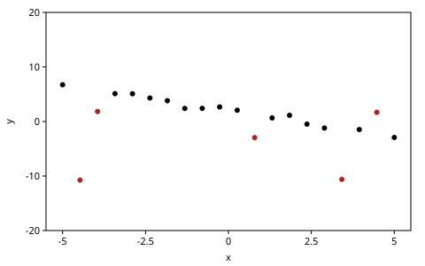
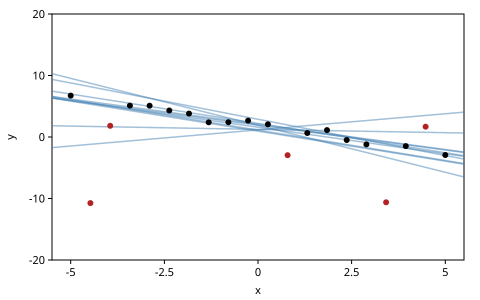
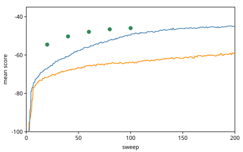
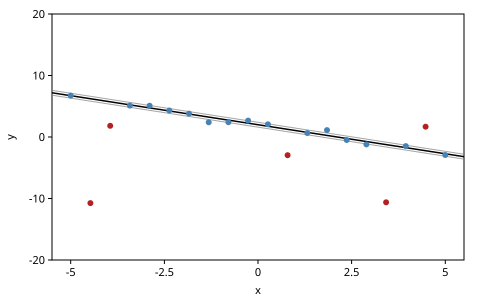

# MCMC and MAP

Importance sampling draws whole traces at once and weighs them. When a
model has many latent choices, a whole trace drawn at once is almost never
right in every detail. This chapter starts from one trace instead and
improves it, a few choices at a time. *Markov chain Monte Carlo* (MCMC)
makes many small random changes, each accepted or rejected so that the
chain's traces come to follow the posterior. *Maximum a posteriori* (MAP)
optimization makes changes that only climb, toward the single most
probable trace.

The model is a regression with outliers: a line fits most points, and
the rest are outliers that the line need not explain. It has a line, a
noise level, an outlier probability and one classification per point:
twenty-four latent choices for twenty points. We write
Metropolis–Hastings moves of three kinds for it: blocks resampled from the
prior, a random walk on the line, and jumps proposed by a data-driven
heuristic. Then we optimize it.

The chapter ports Gen.jl's *Basics of Iterative Inference: MCMC and MAP*.
Every claim is checked. Where a block of the model has a closed-form
posterior given the rest, a move is checked against it exactly; where
algorithms are compared, the comparison is a band of standard errors over
independent runs.

<!-- code: ns -->
```clojure
(ns book.mcmc-map
  (:refer-clojure :exclude [+ - * /])
  (:require [gen.array :as array :refer [+ - * /]]
            [gen.array.linalg :as linalg]
            [gen.batched :as batched]
            [gen.book.svg :as svg]
            [gen.choicemap :as cm]
            [gen.dist :as d]
            [gen.dist.core :as dc]
            [gen.dynamic :refer [gen]]
            [gen.gfi :as gfi]
            [gen.gradients :as grad]
            [gen.inference.diagnostics :as diag]
            [gen.inference.importance :as is]
            [gen.inference.kernel :as k]
            [gen.inference.mcmc :as mcmc]
            [gen.inference.mh :as mh]
            [gen.random :as rng]
            [gen.selection :as sel]))
```

## Regression with outliers

The model draws a slope, an intercept, an inlier noise and an outlier
probability, then classifies each point and draws its $y$:

$$
\text{slope}, \text{intercept} \sim \mathcal{N}(0, 2), \qquad
\text{noise} \sim \text{Gamma}(1, 1), \qquad
p \sim \mathcal{U}(0, 1),
$$

$$
\text{outlier}_i \sim \text{Bernoulli}(p), \qquad
y_i \sim \begin{cases}
\mathcal{N}(0, 10) & \text{if outlier}_i, \\
\mathcal{N}(\text{slope} \cdot x_i + \text{intercept},\ \text{noise})
& \text{otherwise.}
\end{cases}
$$

The priors say what we assume: the line is not far from flat and not far
from the origin, the noise is small, and any fraction of the points may be
outliers.

<!-- code: model -->
```clojure
(def regression-with-outliers
  (gen [xs]
    (let [slope (trace :slope (d/normal 0 2))
          intercept (trace :intercept (d/normal 0 2))
          noise (trace :noise (d/gamma 1 1))
          prob-outlier (trace :prob-outlier (d/uniform 0 1))]
      (mapv (fn [i x]
              (let [outlier? (trace [:data i :outlier?]
                                    (d/bernoulli prob-outlier))
                    line (+ (* slope x) intercept)]
                (trace [:data i :y]
                       (d/normal (array/where outlier? 0 line)
                                 (array/where outlier? 10 noise)))))
            (range) xs))))
```

Gen.jl's version branches with `if` on each classification.
`array/where` picks between the two explanations instead, so every run of
the model visits the same addresses and computes with the same shapes.
That lets gen.clj run many traces of it at once as one batched execution,
which importance sampling uses below; an `if` on a value that differs
from trace to trace would make it fall back to one trace at a time. The
addresses are paths, `[:data i :outlier?]` and `[:data i :y]`, with `i`
from 0 (Gen.jl's `:data => i => :is_outlier`, from 1). Gen.jl's shorthand
`slope ~ normal(0, 2)` names the address after the variable; in gen.clj
the address is always written out.

## Traces of the model

To look at a trace, we draw its line, the line plus and minus its noise,
its inliers in blue and its outliers in red:

<!-- code: trace-layers -->
```clojure
(defn trace-layers
  "svg/plot's layers for a trace: its line in black, the line plus and
   minus its noise in gray, its inliers in blue and its outliers in red."
  [tr]
  (let [[xs] (:args tr)
        is (range (count xs))
        point (fn [i] [(xs i) (tr [:data i :y])])
        outlier? (fn [i] (tr [:data i :outlier?]))
        line (fn [x] (+ (* (tr :slope) x) (tr :intercept)))]
    [{:curves [#(+ (line %) (tr :noise)) #(- (line %) (tr :noise))]
      :color "gray" :width 1}
     {:curves [line] :color "black" :opacity 1}
     {:points (map point (remove outlier? is)) :color "steelblue"}
     {:points (map point (filter outlier? is)) :color "firebrick"}]))

(def window {:x-range [-5.5 5.5] :y-range [-20 20]})
```

The $x$ values are twenty points evenly spaced on $[-5, 5]$, as in
Gen.jl. Here is one trace of the model, drawn forward:

<!-- code: prior-figure -->
```clojure
;; figure: figures/022-prior-trace.svg
(def xs (mapv #(+ -5.0 (* 10.0 (/ % 19.0))) (range 20)))

(def prior-trace (gfi/simulate regression-with-outliers [xs] (rng/key 16)))

(svg/plot (trace-layers prior-trace) window)
```



<!-- code: prior-trace -->
```clojure
(defn outliers
  "The indices of the points a trace classifies as outliers."
  [tr]
  (filterv #(tr [:data % :outlier?]) (range (count (first (:args tr))))))

[(prior-trace :prob-outlier) (outliers prior-trace)]
;=> [0.4356 [0 1 8 9 11 13]] ; float64

(count (filter #(< (abs (array/item (prior-trace [:data % :y]))) 20)
               (outliers prior-trace)))
;=> 5 ; float64
```

Its outlier probability came out at 0.44, and six of its twenty points are
outliers, five of them inside the window. An outlier's $y$ is drawn
without regard to the line, so an outlier can land anywhere, close to the
line too. Three of these six lie within one noise of it:

<!-- code: near-line -->
```clojure
(defn residual
  "How far point i of trace tr lies above the trace's line."
  [tr i]
  (let [[xs] (:args tr)]
    (- (tr [:data i :y]) (+ (* (tr :slope) (xs i)) (tr :intercept)))))

(mapv #(< (abs (array/item (residual prior-trace %)))
         (array/item (prior-trace :noise)))
      (outliers prior-trace))
;=> [true false true false false true] ; float64
```

The model can also make datasets in which most points are outliers. With
$p$ uniform, the number of outliers among twenty is uniform on
$0, 1, \ldots, 20$, so the chance of fifteen or more is $6/21$. Two
thousand traces agree, within five standard errors:

<!-- code: prior-outliers -->
```clojure
(def outlier-counts
  (mapv #(count (outliers (gfi/simulate regression-with-outliers [xs] %)))
        (rng/split (rng/key 6) 2000)))

(let [p (/ 6.0 21.0)
      n (count outlier-counts)
      freq (/ (count (filter #(>= % 15) outlier-counts)) (double n))]
  (< (abs (- freq p)) (* 5 (Math/sqrt (/ (* p (- 1 p)) n)))))
;=> true
```

## The data

The data are not drawn from the model. Gen.jl's synthetic dataset puts
each point on the line $y = -x + 2$ with noise 0.5, or, with probability
0.2, makes it an outlier drawn from $\mathcal{N}(0, 5)$. Gen.jl seeds
Julia's global random number generator; here the generator takes a key:

<!-- code: synthetic -->
```clojure
(defn synthetic-dataset
  "A y for each x: with probability 0.2 an outlier, N(0, 5), and
   otherwise on the line y = -x + 2 with noise 0.5. {:ys :outliers}, host
   numbers and booleans."
  [xs key]
  (let [point (fn [x k]
                (let [[k-outlier k-y] (rng/split k)
                      outlier? (< (array/item (rng/uniform k-outlier)) 0.2)
                      z (array/item (rng/normal k-y))]
                  [outlier? (if outlier? (* 5.0 z) (+ (- 2.0 x) (* 0.5 z)))]))
        points (mapv point xs (rng/split key (count xs)))]
    {:ys (mapv second points) :outliers (mapv first points)}))

(def dataset (synthetic-dataset xs (rng/key 1)))
```

A key draws other values on a backend that computes in float32, so the
book writes the $y$ values out, to two digits, and every backend fits the
same twenty points. On float64 they are the generator's, and so are its
outliers:

<!-- code: data -->
```clojure
(def ys
  [6.73 -10.75 1.82 5.11 5.09 4.31 3.80 2.39 2.40 2.67
   2.07 -2.96 0.65 1.13 -0.48 -1.20 -10.62 -1.48 1.68 -2.92])

(def true-outliers [1 2 11 16 18])

[(= ys (mapv #(/ (Math/round (* 100 %)) 100.0) (:ys dataset)))
 (= true-outliers (filterv (:outliers dataset) (range 20)))]
;=> [true true] ; float64
```

The five points it drew as outliers are red:

<!-- code: data-figure -->
```clojure
;; figure: figures/022-data.svg
(defn data-layers
  "svg/plot's layers for points (xs, ys): those at the indices in
   red-ones in red, the rest in black."
  [xs ys red-ones]
  (let [point (fn [i] [(xs i) (ys i)])
        is (range (count xs))]
    [{:points (map point (remove (set red-ones) is))}
     {:points (map point (filter (set red-ones) is)) :color "firebrick"}]))

(svg/plot (data-layers xs ys true-outliers) window)
```



The observations fix each $y$:

<!-- code: observations -->
```clojure
(defn observations
  "The choice map fixing each [:data i :y] to (ys i)."
  [ys]
  (apply cm/choicemap (mapcat (fn [i y] [[:data i :y] y]) (range) ys)))
```

## The limits of importance sampling

To compare algorithms we keep, for each trace an algorithm returns, its
parameters, its score and its classification, as host numbers. A trace's
*score* is the log joint density of all its choices, the observed $y$
values included; between traces of the same data, a higher score is a
better explanation. We also count the points a trace classifies otherwise
than the generator drew them:

<!-- code: record -->
```clojure
(defn record
  "A trace's parameters, score and classifications, as host values."
  [tr]
  {:slope (array/item (tr :slope))
   :intercept (array/item (tr :intercept))
   :noise (array/item (tr :noise))
   :prob-outlier (array/item (tr :prob-outlier))
   :score (array/item (:score tr))
   :outliers (outliers tr)})

(defn misclassified
  "How many points record r classifies otherwise than the dataset drew
   them: inliers it calls outliers, and outliers it calls inliers."
  [r]
  (let [called (set (:outliers r))
        drawn (set true-outliers)]
    (+ (count (remove drawn called)) (count (remove called drawn)))))
```

Importance resampling with 2000 samples, as Gen.jl does it, a hundred times.
`{:batched? true}` draws the 2000 samples as one batched execution:

<!-- code: importance -->
```clojure
(def importance-runs
  (mapv #(record (:trace (is/importance-resampling
                          regression-with-outliers [xs] (observations ys) 2000
                          {:batched? true :key %})))
        (rng/split (rng/key 10) 100)))
```

The batched run stays batched for this model. The same model written with
Gen.jl's `if` falls back to one trace at a time:

<!-- code: batched -->
```clojure
(def regression-with-if
  (gen [xs]
    (let [slope (trace :slope (d/normal 0 2))
          intercept (trace :intercept (d/normal 0 2))
          noise (trace :noise (d/gamma 1 1))
          prob-outlier (trace :prob-outlier (d/uniform 0 1))]
      (mapv (fn [i x]
              (if (trace [:data i :outlier?] (d/bernoulli prob-outlier))
                (trace [:data i :y] (d/normal 0 10))
                (trace [:data i :y]
                       (d/normal (+ (* slope x) intercept) noise))))
            (range) xs))))

(defn stays-batched?
  "Does a batched generate of model on the data stay one batched trace?"
  [model]
  (batched/batched? (:particles (batched/generate model [xs] (observations ys)
                                                  100 (rng/key 9)))))

[(stays-batched? regression-with-outliers) (stays-batched? regression-with-if)]
;=> [true false]
```

The means of those hundred runs, with their standard errors, describe what
importance sampling finds:

<!-- code: mean-se -->
```clojure
(defn mean-se
  "The mean of host numbers and its standard error."
  [vs]
  (let [n (count vs)
        m (/ (reduce + vs) n)
        var (/ (reduce + (map #(* (- % m) (- % m)) vs)) (dec n))]
    {:mean m :se (Math/sqrt (/ var n))}))

(defn mean-of
  "The mean of (f r) over records rs."
  [f rs]
  (:mean (mean-se (map f rs))))

((juxt #(mean-of :score %) #(mean-of :noise %) #(mean-of misclassified %))
 importance-runs)
;=> [-69.0 1.67 6.31] ; float64
```

Here are the lines of ten of the runs:

<!-- code: importance-figure -->
```clojure
;; figure: figures/022-importance.svg
(defn line-layer
  "svg/plot's layer of the lines of records rs."
  [rs]
  {:curves (map (fn [{:keys [slope intercept]}] #(+ (* slope %) intercept)) rs)
   :opacity 0.5})

(svg/plot (cons (line-layer (take 10 importance-runs))
                (data-layers xs ys true-outliers))
          window)
```



Importance resampling has not failed outright: most of its lines run near
the data. The details are wrong. Its noise averages 1.67 where the
generator's is 0.5, and it misclassifies six of the twenty points in a
typical run. There are too many choices to get right at once, and 2000
guesses at all of them together are not enough.

## MCMC, part 1: block resimulation

An MCMC algorithm starts from a trace consistent with the observations,
which `generate` makes, and changes it a little at a time. Each change is
a *Metropolis–Hastings* (MH) move. MH proposes a new trace, then accepts
it with a probability that favors traces that explain the data better and
corrects for how the proposal was made: a move into a less probable
region is accepted more readily when the reverse move is easy to propose.
Accepted or not, the chain's traces come to follow the posterior.

The start explains the data badly:

<!-- code: start -->
```clojure
(defn start-trace
  "A trace of the model consistent with the observations ys, and with the
   choices of init (a choice map) when given."
  ([xs ys key] (start-trace xs ys cm/EMPTY key))
  ([xs ys init key]
   (:trace (gfi/generate regression-with-outliers [xs]
                         (cm/merge (observations ys) init) key))))

(def tr (start-trace xs ys (rng/key 2)))

(:score tr)
;=> -543.2 ; float64
```

The simplest move resimulates a *block*, a selection of choices, from the
model, keeping the rest: `mh/mh` with a selection, as Gen.jl's `mh`. It
returns the new trace (the old one when the proposal is rejected), whether
it accepted, and the log acceptance ratio:

<!-- code: one-move -->
```clojure
(def moved (mh/mh tr (sel/select :prob-outlier) (rng/key 3)))

(keys moved)
;=> (:trace :accepted? :log-alpha)
```

How to group the choices into blocks is the design decision. One block of
everything is close to importance sampling, which we saw fail. Gen.jl's
blocking:

- the slope, the intercept and the noise together: a new line;
- each point's classification alone, so that one point's classification
  is accepted or rejected on its own;
- the outlier probability.

A *sweep* makes one move per block. `k/kern` (Gen.jl's `@kern`) writes it
as statements: each statement is a kernel, a `doseq` makes one per point,
and `(block-resimulation-update n)` returns their chain, one kernel. A
*kernel* is a function of a trace and a key; the chain splits the key, one
per move, and reports each move's accept decision. *The Inference Toolkit*
covers kernels in depth.

<!-- code: block-resimulation -->
```clojure
(def block-resimulation-update
  (k/kern [n]
    (k/mh (sel/select :slope :intercept :noise))
    (doseq [i (range n)]
      (k/mh (sel/select [:data i :outlier?])))
    (k/mh (sel/select :prob-outlier))))

(def resimulation-sweep (block-resimulation-update 20))

(count (:accepted (resimulation-sweep tr (rng/key 4))))
;=> 22
```

A chain is a sequence of sweeps. We keep each sweep's record and only the
last trace, so that a long chain holds host numbers rather than traces.
We run a hundred chains of 200 sweeps, each from its own start:

<!-- code: run-chain -->
```clojure
(defn run-chain
  "n sweeps of kernel from the trace tr: the last trace, and the record of
   each sweep's trace."
  [kernel tr n key]
  (reduce (fn [chain k]
            (let [t (:trace (kernel (:trace chain) k))]
              (-> chain (assoc :trace t) (update :sweeps conj (record t)))))
          {:trace tr :sweeps []}
          (rng/split key n)))

(defn chains
  "m chains of n sweeps of kernel, each from a trace generated with the
   observations ys, on keys split from key."
  [kernel xs ys m n key]
  (mapv (fn [k]
          (let [[k-start k-chain] (rng/split k)]
            (run-chain kernel (start-trace xs ys k-start) n k-chain)))
        (rng/split key m)))

(def resimulation-chains
  (chains resimulation-sweep xs ys 100 200 (rng/key 11)))
```

The chains' last traces classify the points far better than importance
sampling did, three points wrong in twenty where it got six, but their
noise is still wide:

<!-- code: finals -->
```clojure
(defn finals
  "The records of the chains' last sweeps."
  [chains]
  (map #(peek (:sweeps %)) chains))

((juxt #(mean-of :score %) #(mean-of :noise %) #(mean-of misclassified %))
 (finals resimulation-chains))
;=> [-58.9 1.43 2.93] ; float64
```

To call one algorithm better than another, we check that its mean beats
the other's by more than five standard errors of the difference, the band
the book uses throughout: a gap that size is not run-to-run noise, and it
holds on a backend that draws other values. That takes many runs here,
because a few chains go wrong. Five of the hundred end misclassifying
more than half the points. Ten chains would more often than not include
none of them, and so understate the standard error.
Block resimulation beats importance sampling on the classifications:

<!-- code: gap -->
```clojure
(defn gap
  "How many standard errors of their difference the mean of as lies
   above the mean of bs."
  [as bs]
  (let [a (mean-se as)
        b (mean-se bs)]
    (/ (- (:mean a) (:mean b)) (Math/hypot (:se a) (:se b)))))

(count (filter #(> (misclassified %) 10) (finals resimulation-chains)))
;=> 5 ; float64

(> (gap (map misclassified importance-runs)
        (map misclassified (finals resimulation-chains)))
   5)
;=> true
```

The chains keep changing their classifications but rarely change their
line. The classification of some point changes in 81% of the sweeps; the
line changes in 4% of them:

<!-- code: changes -->
```clojure
(defn changes
  "The fraction of a chain's sweeps after which (f record) differed from
   the sweep before, averaged over chains."
  [chains f]
  (mean-of (fn [chain]
             (let [vs (map f (:sweeps chain))]
               (/ (count (filter true? (map not= vs (rest vs))))
                  (double (dec (count vs))))))
           chains))

[(changes resimulation-chains :slope)
 (changes resimulation-chains :outliers)]
;=> [0.037 0.81] ; float64
```

The line block proposes a slope, an intercept and a noise from the
prior, all at once. The posterior is narrow, so nearly every such
proposal explains the data worse, and is rejected. The noise shares that
block, which is why it stays wide.

### Each block targets its conditional

An MH move on a block leaves the posterior unchanged: it samples the
block's *conditional*, its distribution given the rest of the trace. Two
of this model's blocks have conditionals in closed form, so we check
them exactly. A *reference trace* fixes every choice: the generator's
line, noise 0.5, outlier probability 0.2, and the generator's
classifications. Nothing in it is drawn, so it is the same on every
backend.

<!-- code: reference -->
```clojure
(defn line-choices
  "The choice map of a line [slope intercept]."
  [[slope intercept]]
  (cm/choicemap :slope slope :intercept intercept))

(defn classification
  "The choice map classifying the points at the indices is as outliers,
   and the rest of n points as inliers."
  [n is]
  (apply cm/choicemap
         (mapcat (fn [i] [[:data i :outlier?] (contains? (set is) i)])
                 (range n))))

(def reference
  (start-trace xs ys (cm/merge (line-choices [-1.0 2.0])
                               (cm/choicemap :noise 0.5 :prob-outlier 0.2)
                               (classification 20 true-outliers))
               (rng/key 20)))
```

Given the rest, point $i$ is an outlier with the probability Bayes' rule
gives its two explanations of $y_i$:

$$
P(\text{outlier}_i \mid \text{rest}) =
\frac{p\, \mathcal{N}(y_i; 0, 10)}
{p\, \mathcal{N}(y_i; 0, 10) + (1 - p)\,
\mathcal{N}(y_i; \text{slope} \cdot x_i + \text{intercept}, \text{noise})}.
$$

Point 7 lies 0.93 below the reference line, almost two noise widths, and
is an outlier with probability 0.063:

<!-- code: outlier-probability -->
```clojure
(defn outlier-probability
  "The exact probability that point i is an outlier given the rest of a
   trace's record r: Bayes' rule on the two explanations of its y."
  [{:keys [slope intercept noise prob-outlier]} i]
  (let [y (ys i)
        line (+ (* slope (xs i)) intercept)
        as-outlier (+ (Math/log prob-outlier)
                      (dc/log-prob (d/normal 0 10) y))
        as-inlier (+ (Math/log (- 1 prob-outlier))
                     (dc/log-prob (d/normal line noise) y))]
    (array/item (array/sigmoid (- as-outlier as-inlier)))))

(residual reference 7)
;=> -0.926

(outlier-probability (record reference) 7)
;=> 0.063
```

A chain that moves point 7's classification alone, and nothing else,
classifies it as an outlier at that rate. `within?` checks a chain's mean
and standard deviation against exact ones, each within five Monte Carlo
standard errors; `diag/summary` gives them, with standard errors that
account for the correlation between successive draws:

<!-- code: block-check -->
```clojure
(defn block-draws
  "(f trace) after each of n moves of kernel from the trace tr."
  [kernel f tr n key]
  (mapv f (rest (reductions (fn [t k] (:trace (kernel t k)))
                            tr (rng/split key n)))))

(defn within?
  "Do draws have the mean and the standard deviation sd, each within five
   Monte Carlo standard errors?"
  [draws mean sd]
  (let [s (diag/summary draws)]
    (and (< (abs (- (:mean s) mean)) (* 5 (:mcse-mean s)))
         (< (abs (- (:sd s) sd)) (* 5 (:mcse-sd s))))))

(let [p (outlier-probability (record reference) 7)]
  (within? (block-draws (k/mh (sel/select [:data 7 :outlier?]))
                        #(if (% [:data 7 :outlier?]) 1.0 0.0)
                        reference 2000 (rng/key 21))
           p (Math/sqrt (* p (- 1 p)))))
;=> true
```

Given the classifications, the outlier probability's conditional is a
beta distribution, $\text{Beta}(1 + k,\ 1 + n - k)$ for $k$ outliers among
$n$ points, with mean $(1 + k)/(n + 2)$. The chain that moves it alone
agrees:

<!-- code: prob-check -->
```clojure
(let [a (+ 1 (count true-outliers))
      b (+ 1 (- 20 (count true-outliers)))]
  (within? (block-draws (k/mh (sel/select :prob-outlier))
                        #(array/item (% :prob-outlier))
                        reference 2000 (rng/key 22))
           (/ a (double (+ a b)))
           (Math/sqrt (/ (* a b) (double (* (+ a b) (+ a b) (+ a b 1)))))))
;=> true
```

A sweep applies such moves one after another, and each leaves the
posterior unchanged, so the sweep does too. That is what makes the chain
correct, however slowly it moves.

## MCMC, part 2: Gaussian drift

Resimulation ignores the current values: it proposes a line from the prior
wherever the chain is. `mh/mh` also takes a *proposal*, a generative
function whose first argument is the current trace, with a vector of
further arguments: `(mh/mh tr proposal args key)`. Its choices are the new
values. This one perturbs the slope and the intercept, a random walk on
the line (a *Gaussian drift*). From the start trace, a first drift move
is accepted:

<!-- code: drift -->
```clojure
(def line-proposal
  (gen [tr]
    (trace :slope (d/normal (tr :slope) 0.5))
    (trace :intercept (d/normal (tr :intercept) 0.5))))

(:accepted? (mh/mh tr line-proposal [] (rng/key 12)))
;=> true ; float64
```

The proposal proposes to the addresses it makes, `:slope` and
`:intercept`, so no selection is needed. MH weighs the move both ways: the
new trace's probability against the old, and the proposal's density of
the move against that of the move back. In gen.clj the reverse move is
scored by `assess`, on the values the forward move overwrote.

The drift sweep moves the line by drift, the classifications and the
outlier probability by resimulation as before, and the noise in a block of
its own. We run 150 chains this time, since the comparison with MAP at the
chapter's end needs more than a hundred:

<!-- code: drift-update -->
```clojure
(def gaussian-drift-update
  (k/kern [n]
    (k/mh line-proposal [])
    (doseq [i (range n)]
      (k/mh (sel/select [:data i :outlier?])))
    (k/mh (sel/select :prob-outlier))
    (k/mh (sel/select :noise))))

(def drift-chains
  (chains (gaussian-drift-update 20) xs ys 150 200 (rng/key 13)))

((juxt #(mean-of :score %) #(mean-of :noise %) #(mean-of misclassified %))
 (finals drift-chains))
;=> [-45.2 0.47 0.96] ; float64

(mapv #(changes drift-chains %) [:slope :noise :outliers])
;=> [0.17 0.22 0.63] ; float64
```

The line now moves in 17% of the sweeps, and the noise in 22%. The noise
comes down to 0.47, close to the generator's 0.5, and about one point in
twenty is misclassified. A single trace's score varies from sweep to
sweep, so we compare chains by the mean score of each chain's last 100
sweeps. By that measure the drift chains beat the resimulation chains:

<!-- code: settled -->
```clojure
(defn settled
  "The mean score of each chain's last 100 sweeps."
  [chains]
  (mapv (fn [chain] (mean-of :score (take-last 100 (:sweeps chain))))
        chains))

(> (gap (settled drift-chains) (settled resimulation-chains)) 5)
;=> true
```

Given the classifications and the noise, the line is a Bayesian linear
regression on the inliers: its posterior is Gaussian, with precision the
prior's plus $X^\top X / \text{noise}^2$, $X$ having rows $(x_i, 1)$ for
the inliers (as in *Getting Started*):

<!-- code: line-posterior -->
```clojure
(defn line-posterior
  "The exact posterior of the line given trace tr's classifications and
   noise, a Gaussian: the means and standard deviations of the slope and
   the intercept."
  [tr]
  (let [inliers (remove (set (outliers tr)) (range (count xs)))
        X (array/array (mapv (fn [i] [(xs i) 1.0]) inliers))
        Xt (array/transpose X)
        y (array/array (mapv ys inliers))
        v (* (tr :noise) (tr :noise))
        prior-precision (array/diag (array/array [0.25 0.25]))
        covariance (linalg/inv (+ prior-precision (/ (array/matmul Xt X) v)))
        [[v-slope _] [_ v-intercept]] (array/->clj covariance)]
    {:mean (array/->clj (array/matmul covariance (/ (array/matmul Xt y) v)))
     :sd [(Math/sqrt v-slope) (Math/sqrt v-intercept)]}))

(line-posterior reference)
;=> {:mean [-0.944 1.993] :sd [0.0464 0.1288]}
```

A chain of drift moves alone, from the reference trace, draws slopes and
intercepts whose means and standard deviations agree with the exact
posterior's:

<!-- code: drift-check -->
```clojure
(defn line-check
  "Do n moves of kernel from the trace tr, which move the line alone, draw
   slopes and intercepts with the exact posterior's means and standard
   deviations?"
  [kernel tr n key]
  (let [lines (block-draws kernel (juxt #(array/item (% :slope))
                                        #(array/item (% :intercept)))
                           tr n key)
        {[mean-slope mean-intercept] :mean [sd-slope sd-intercept] :sd}
        (line-posterior tr)]
    [(within? (mapv first lines) mean-slope sd-slope)
     (within? (mapv second lines) mean-intercept sd-intercept)]))

(line-check (k/mh line-proposal []) reference 4000 (rng/key 23))
;=> [true true]
```

The drift sweep resimulates the noise in a block of its own. Its
conditional is one-dimensional, the gamma prior's density times the
inliers' normal densities, so we compute it on a grid. A chain of noise
moves alone, from the reference trace, agrees with it:

<!-- code: noise-check -->
```clojure
(defn noise-posterior
  "The mean and standard deviation of the noise given the rest of the
   trace tr, on a grid: its log density is, up to a constant, -noise -
   m log(noise) - S/(2 noise^2), for the gamma(1, 1) prior and m inliers
   whose squared residuals sum to S."
  [tr]
  (let [inliers (remove (set (outliers tr)) (range (count xs)))
        m (count inliers)
        S (reduce + (map #(let [r (array/item (residual tr %))] (* r r))
                         inliers))
        grid (mapv #(* 0.001 %) (range 1 4001))
        log-p (fn [s] (- (- s) (* m (Math/log s)) (/ S (* 2 s s))))
        top (apply max (map log-p grid))
        w (mapv #(Math/exp (- (log-p %) top)) grid)
        total (reduce + w)
        mean (/ (reduce + (map * w grid)) total)
        var (/ (reduce + (map (fn [wi s] (* wi (* (- s mean) (- s mean))))
                              w grid))
               total)]
    {:mean mean :sd (Math/sqrt var)}))

(noise-posterior reference)
;=> {:mean 0.462 :sd 0.0922}

(let [{:keys [mean sd]} (noise-posterior reference)]
  (within? (block-draws (k/mh (sel/select :noise)) #(array/item (% :noise))
                        reference 3000 (rng/key 24))
           mean sd))
;=> true
```

## MCMC, part 3: heuristic guidance

A proposal can use any computation, a heuristic too. *RANSAC* (random
sample consensus) guesses a line from the data:

1. Choose a small random subset of the points, say three.
2. Fit a line to them by least squares.
3. Count the points within `eps` of that line.
4. Do this a number of times, say ten, and keep the line with the most
   points near it.

Least squares for a line has a closed form:

<!-- code: least-squares -->
```clojure
(defn least-squares
  "The line [slope intercept] closest to the points (xs, ys) in squared
   vertical distance."
  [xs ys]
  (let [n (count xs)
        mx (/ (reduce + xs) n)
        my (/ (reduce + ys) n)
        sxy (reduce + (map (fn [x y] (* (- x mx) (- y my))) xs ys))
        sxx (reduce + (map (fn [x] (* (- x mx) (- x mx))) xs))
        slope (/ sxy sxx)]
    [slope (- my (* slope mx))]))

(least-squares [0.0 1.0 2.0] [1.0 3.0 5.0])
;=> [2.0 1.0]
```

RANSAC is host code, with an explicit key for its subsets:

<!-- code: ransac -->
```clojure
(defn random-subset
  "m distinct indices below n, drawn uniformly with key."
  [n m key]
  (->> (array/->clj (rng/uniform key [n]))
       (map-indexed vector)
       (sort-by second)
       (take m)
       (mapv first)))

(defn ransac
  "RANSAC: of iters lines, each fitted to a random subset of subset-size
   points, the first with the most points within eps of it, as
   [slope intercept]."
  [xs ys {:keys [iters subset-size eps]} key]
  (let [hypothesis
        (fn [k]
          (let [idx (random-subset (count xs) subset-size k)
                [slope intercept] (least-squares (mapv xs idx) (mapv ys idx))
                near? (fn [x y] (< (abs (- y (+ (* slope x) intercept))) eps))]
            {:line [slope intercept]
             :inliers (count (filter true? (map near? xs ys)))}))]
    (:line (reduce (fn [best h] (if (> (:inliers h) (:inliers best)) h best))
                   (map hypothesis (rng/split key iters))))))

(def ransac-params {:iters 10 :subset-size 3 :eps 1.0})

(ransac xs ys ransac-params (rng/key 30))
;=> [-0.931 2.081] ; float64
```

### Where the randomness goes

Gen.jl's `ransac_proposal` calls `ransac` inside the proposal, and
`ransac` draws its subsets from Julia's global random number generator.
gen.clj has no hidden randomness, so there are two ways to port it.

This chapter draws the guess in the inference loop, with a key of its own,
and passes it to the proposal as an argument. For a fixed guess $g$, the
move is an MH move with the proposal $q(\cdot\,; g)$, which proposes a line
near $g$ whatever the current line. MH scores the reverse move under the
same guess, so the move leaves the posterior unchanged, as every MH move
does. The guess does not depend on the trace, so the kernel is a mixture
of such moves, one per guess, and leaves the posterior unchanged too.

The other way calls `(untraced-key)` inside the proposal, a key from its
*encapsulated randomness* $\omega$ (a `gen` body's randomness that is not
traced). The proposal's density is then known only given $\omega$:
`propose` reports $q(u; \omega)$ for the $\omega$ it drew, and `mh`
assesses the reverse move with an independent $\omega'$. That is still a
valid MH move, by the argument of Cusumano-Towner and Mansinghka (2018),
which Gen.jl's tutorial cites; exercise 4 checks it. We prefer the first:
the acceptance ratio is exact, the guess is in plain view in the code that
runs the chain, and the proposal is an ordinary generative function of its
arguments.

<!-- code: ransac-proposal -->
```clojure
(def ransac-proposal
  (gen [tr [slope-guess intercept-guess]]
    (trace :slope (d/normal slope-guess 0.1))
    (trace :intercept (d/normal intercept-guess 1.0))))

(defn ransac-jump
  "One MH move of the line to near a RANSAC guess for the points (xs, ys),
   the guess drawn with a key of its own."
  [xs ys]
  (fn [tr key]
    (let [[k-guess k-move] (rng/split key)
          guess (ransac xs ys ransac-params k-guess)]
      (mh/mh tr ransac-proposal [guess] k-move))))
```

From the reference trace, a chain of RANSAC jumps alone, each with a
fresh guess, agrees with the exact line posterior:

<!-- code: ransac-check -->
```clojure
(line-check (ransac-jump xs ys) reference 3000 (rng/key 31))
;=> [true true]
```

One RANSAC update makes a jump, then spends twenty sweeps refining: the
outlier probability, the noise, a drift move on the line and every
classification. `jump` is a kernel argument, so the same update serves
any jump. RANSAC inference starts from a trace with RANSAC's line and
makes five updates:

<!-- code: ransac-update -->
```clojure
(def ransac-update
  (k/kern [n jump]
    jump
    (doseq [_ (range 20)]
      (k/mh (sel/select :prob-outlier))
      (k/mh (sel/select :noise))
      (k/mh line-proposal [])
      (doseq [i (range n)]
        (k/mh (sel/select [:data i :outlier?]))))))

(defn ransac-inference
  "Five RANSAC updates with the RANSAC jump jump, from a trace generated
   with the choices init: the chain of run-chain, a record per update."
  [xs ys jump init key]
  (let [[k-start k-chain] (rng/split key)]
    (run-chain (ransac-update (count xs) jump)
               (start-trace xs ys init k-start) 5 k-chain)))

(defn ransac-start
  "The choice map of a RANSAC line for the points (xs, ys)."
  [xs ys key]
  (line-choices (ransac xs ys ransac-params key)))

(def ransac-runs
  (mapv (fn [key]
          (let [[k-guess k-run] (rng/split key)]
            (ransac-inference xs ys (ransac-jump xs ys)
                              (ransac-start xs ys k-guess) k-run)))
        (rng/split (rng/key 14) 60)))
```

After five updates, a hundred sweeps, the runs score above where the
resimulation chains settle after two hundred, their noise is near the
generator's, and about one point is misclassified in a typical run:

<!-- code: ransac-results -->
```clojure
((juxt #(mean-of :score %) #(mean-of :noise %) #(mean-of misclassified %))
 (finals ransac-runs))
;=> [-46.0 0.503 1.12] ; float64

(> (gap (map :score (finals ransac-runs)) (settled resimulation-chains)) 5)
;=> true
```

The figure shows the three kernels sweep by sweep: the mean score of the
hundred resimulation chains (orange), of the 150 drift chains (blue), and of
the 60 RANSAC runs after each update (green dots, every twenty
sweeps).

<!-- code: scores-figure -->
```clojure
;; figure: figures/022-scores.svg
(defn mean-scores
  "The mean score of chains after each sweep."
  [chains]
  (apply mapv (fn [& scores] (/ (reduce + scores) (count scores)))
         (map #(map :score (:sweeps %)) chains)))

(defn steps
  "The function of x that is the (ceil x)-th of values, from the first."
  [values]
  (let [n (count values)]
    (fn [x] (nth values (max 0 (min (dec n) (dec (long (Math/ceil x)))))))))

(svg/plot [{:curves [(steps (mean-scores resimulation-chains))]
            :color "darkorange" :opacity 1}
           {:curves [(steps (mean-scores drift-chains))] :opacity 1}
           {:points (map-indexed (fn [i s] [(* 20 (inc i)) s])
                                 (mean-scores ransac-runs))
            :color "seagreen" :r 4}]
          {:x-range [0 200] :y-range [-100 -35]
           :x-label "sweep" :y-label "mean score"})
```



The resimulation chains stall, waiting for a line from the prior that
fits. The drift chains climb, some of them slowly. RANSAC's runs start on
a good line, and their updates refine the rest.

## MAP optimization

Sometimes we want one good explanation of the data rather than samples:
the trace that maximizes the posterior. Gen.jl's tutorial optimizes each
kind of choice in its own way.

The classifications are discrete. For each point in turn, `update` makes
the trace with the point an inlier and the trace with it an outlier, and
we keep the one with the higher score. (Gen.jl's version also sets the
outlier probability to 0.1 in these updates; ours leaves the trace's.)
Given the line, the noise and the outlier probability, the points'
classifications are independent, so one pass finds the most probable
classification of all of them: each point an outlier exactly when its
conditional probability is above one half.

<!-- code: outlier-map -->
```clojure
(defn outlier-map-update
  "The trace with each point's classification set, in turn, to the more
   probable of the two given the rest."
  [tr key]
  (let [classify (fn [t [i k]]
                   (let [[k-in k-out] (rng/split k)
                         as (fn [outlier? k]
                              (:trace (gfi/update
                                       t (cm/choicemap [:data i :outlier?]
                                                       outlier?)
                                       k)))
                         inlier (as false k-in)
                         outlier (as true k-out)]
                     (if (> (array/item (:score inlier))
                            (array/item (:score outlier)))
                       inlier
                       outlier)))
        n (count xs)]
    (reduce classify tr (map vector (range n) (rng/split key n)))))

(= (outliers (outlier-map-update reference (rng/key 40)))
   (filterv #(> (outlier-probability (record reference) %) 0.5) (range 20)))
;=> true
```

The line is continuous. `mcmc/map-optimize`, Gen.jl's `map_optimize`,
takes one step of gradient ascent on the selected choices' log density,
with a backtracking line search: it tries `:max-step-size` times the
gradient, and halves the step until the score does not decrease. It
returns what a kernel does, the trace under `:trace` and whether the
search found a step as `:accepted?`, so it chains with MCMC kernels
(`k/map-optimize`). Given the classifications and the noise, the line's
posterior is Gaussian, so its maximum is its mean. A hundred steps from
the reference trace reach it:

<!-- code: map-optimize -->
```clojure
(def line-selection (sel/select :slope :intercept))

(def optimized
  (nth (iterate #(:trace (mcmc/map-optimize
                          % line-selection
                          {:max-step-size 1.0 :min-step-size 1e-5}))
                reference)
       100))

(let [{:keys [slope intercept]} (record optimized)]
  (array/allclose? (array/array [slope intercept])
                   (array/array (:mean (line-posterior reference)))
                   {:atol 2e-3}))
;=> true
```

One round of MAP optimization steps the line, then the noise, then
classifies the points, then sets the outlier probability to the fraction
of outliers, the maximum of its conditional, kept within $[0.05, 0.5]$ as
in Gen.jl:

<!-- code: map-update -->
```clojure
(defn outlier-fraction
  "The fraction of a trace's points classified as outliers."
  [tr]
  (/ (count (outliers tr)) (double (count xs))))

(defn map-update
  "One round of MAP optimization: gradient steps on the line and on the
   noise, the most probable classifications, and the outlier probability
   set to the fraction of outliers, kept within [0.05, 0.5]."
  [tr key]
  (let [[k-classify k-prob] (rng/split key)
        tr (-> tr
               (mcmc/map-optimize line-selection
                                  {:max-step-size 1.0 :min-step-size 1e-5})
               :trace
               (mcmc/map-optimize (sel/select :noise)
                                  {:max-step-size 1e-2 :min-step-size 1e-5})
               :trace
               (outlier-map-update k-classify))
        prob (min 0.5 (max 0.05 (outlier-fraction tr)))]
    (:trace (gfi/update tr (cm/choicemap :prob-outlier prob) k-prob))))
```

The noise takes smaller steps: its gradient grows like $1/\text{noise}^3$
as the noise shrinks, and a full step can throw it far, or below zero.
Below zero the noise is outside its gamma prior's support, so a trial
step's run stops there, with score $-\infty$, before the normal sees a
negative standard deviation: a choice outside its support stops the run.
The line search counts that step a failure and halves it. From the
reference trace, a full step would land at $-8.3$; the search halves it
seven times, to $1/128$ of it, where the score rises:

<!-- code: map-noise-step -->
```clojure
(def noise-gradient
  (array/item (cm/get-choice (:gradients (grad/choice-gradients
                                          reference (sel/select :noise)))
                             :noise)))

(def noise-step
  (:trace (mcmc/map-optimize reference (sel/select :noise)
                             {:max-step-size 1.0})))

[(+ 0.5 noise-gradient) (array/item (noise-step :noise))]
;=> [-8.301 0.4312]

[(/ (- (array/item (noise-step :noise)) 0.5) noise-gradient)
 (> (:score noise-step) (:score reference))]
;=> [0.0078125 true]
```

Twenty rounds of MAP from each RANSAC run's last trace raise the score of
every run, and the optimized traces score above the drift chains' settled
traces. MAP climbs deterministically: 54 of the 60 runs climb to the
same peak, a score of −40.41, and six stop on lower ones, the lowest
twelve points below it. Rare runs that far below the rest, here and among
the drift chains, are why this comparison takes 60 runs and 150 chains: a
smaller set can miss them, understate the standard error, and clear five
standard errors by luck.

<!-- code: map-inference -->
```clojure
(defn map-inference
  "20 rounds of MAP optimization from the trace tr."
  [tr key]
  (reduce map-update tr (rng/split key 20)))

(def map-runs
  (mapv #(record (map-inference (:trace %1) %2))
        ransac-runs (rng/split (rng/key 15) 60)))

[(every? true? (map > (map :score map-runs) (map :score (finals ransac-runs))))
 (> (gap (map :score map-runs) (settled drift-chains)) 5)]
;=> [true true]

(mean-of :score map-runs)
;=> -40.73 ; float64

(count (filter #(< (abs (- (:score %) -40.41)) 0.01) map-runs))
;=> 54 ; float64

(apply min (map :score map-runs))
;=> -52.85 ; float64
```

<!-- code: map-figure -->
```clojure
;; figure: figures/022-map.svg
(def map-trace (map-inference (:trace (first ransac-runs)) (rng/key 16)))

(svg/plot (trace-layers map-trace) window)
```



The MAP trace classifies exactly the five points the generator drew as
outliers, and its line and noise are close to the generator's:

<!-- code: map-answer -->
```clojure
((juxt :slope :intercept :noise :prob-outlier :outliers) (record map-trace))
;=> [-0.9445 1.996 0.397 0.25 [1 2 11 16 18]] ; float64
```

A higher score does not make MAP a better algorithm; it solves another
problem. MCMC samples the posterior, and so describes what we do not know.
Point 7 is borderline. MAP calls it an inlier, although at MAP's own line
and noise its conditional probability of being an outlier is 0.11. The
drift chains call it an outlier in some sweeps and an inlier in others:

<!-- code: borderline -->
```clojure
(outlier-probability (record map-trace) 7)
;=> 0.11 ; float64

(defn both-ways?
  "Did the chain call point i an outlier in some of its last 100 sweeps,
   and an inlier in others?"
  [chain i]
  (let [calls (map #(contains? (set (:outliers %)) i)
                   (take-last 100 (:sweeps chain)))]
    (boolean (and (some true? calls) (some false? calls)))))

(count (filter #(both-ways? % 7) drift-chains))
;=> 148 ; float64

(some #(both-ways? % 7) drift-chains)
;=> true
```

The moves of this chapter use the gradient only to optimize. The next
chapter, *Gradient-Based MCMC*, uses it to sample: MALA, HMC and NUTS
propose continuous moves along the gradient and accept them with MH.

## Workshop

Each exercise has a tested solution at the end of the chapter.

1. **RANSAC with the trace's noise.** RANSAC's `eps` decides which points
   count as near a line. Make it the trace's current noise. The guess now
   depends on the trace: is the move still valid? Does RANSAC inference do
   better with it?
2. **An inlier heuristic.** Write a proposal that fits a line by least
   squares to the points the trace calls inliers and proposes near that
   line, each parameter with standard deviation 0.5. Is the move valid?
   Check it against the exact line posterior.
3. **Initialization.** RANSAC inference starts from RANSAC's line. Start
   instead from a far line, slope 3 and intercept −2 with noise 2, and
   predict whether the first RANSAC jump is accepted. Why? Then run
   RANSAC inference from a trace with no start at all.
4. **RANSAC inside the proposal.** Write the RANSAC proposal with the
   guess drawn inside it, from `(untraced-key)`. Is the move valid?
   Check it against the exact line posterior.

## Solutions

**1.** The move is still valid. The guess depends on the trace only
through its noise, and the move changes only the line: the move back
draws its guess from the same distribution. For each guess the move is an
MH move, and the mixture over guesses is the same in both directions. The
exact line posterior agrees:

<!-- code: solution-1 -->
```clojure
(defn noise-ransac-jump
  "ransac-jump with RANSAC's eps set to the trace's noise."
  [xs ys]
  (fn [tr key]
    (let [[k-guess k-move] (rng/split key)
          params (assoc ransac-params :eps (array/item (tr :noise)))
          guess (ransac xs ys params k-guess)]
      (mh/mh tr ransac-proposal [guess] k-move))))

(line-check (noise-ransac-jump xs ys) reference 3000 (rng/key 50))
;=> [true true]
```

It does not do better here. While the trace's noise is still wide, so is
`eps`, and RANSAC counts outliers as near its lines. The runs score no
higher than plain RANSAC's, and lower, if anything:

<!-- code: solution-1-runs -->
```clojure
(def noise-ransac-runs
  (mapv (fn [key]
          (let [[k-guess k-run] (rng/split key)]
            (ransac-inference xs ys (noise-ransac-jump xs ys)
                              (ransac-start xs ys k-guess) k-run)))
        (rng/split (rng/key 51) 10)))

(mapv #(mean-of :score (finals %)) [noise-ransac-runs ransac-runs])
;=> [-50.3 -46.0] ; float64

(< (gap (map :score (finals noise-ransac-runs))
        (map :score (finals ransac-runs)))
   5)
;=> true
```

**2.** The proposal reads the trace's classifications, which the move
does not change, so the move back proposes from the same line fit: for
each classification it is an MH move with a fixed proposal. The exact
line posterior agrees:

<!-- code: solution-2 -->
```clojure
(def inlier-proposal
  (gen [tr xs ys]
    (let [inliers (remove (set (outliers tr)) (range (count xs)))
          [slope intercept] (least-squares (mapv xs inliers) (mapv ys inliers))]
      (trace :slope (d/normal slope 0.5))
      (trace :intercept (d/normal intercept 0.5)))))

(line-check (k/mh inlier-proposal [xs ys]) reference 3000 (rng/key 52))
;=> [true true]
```

**3.** The jump is rejected. Its acceptance ratio contains the density of
the move back, from the guess to the old line, and the old slope lies
some forty of the proposal's standard deviations from the guess's. The
new line explains the data far better, but not by enough to make up for
that term: the log acceptance ratio is below −100.

<!-- code: solution-3 -->
```clojure
(def far
  (start-trace xs ys (cm/merge (line-choices [3.0 -2.0])
                               (cm/choicemap :noise 2.0))
               (rng/key 53)))

(def guess (ransac xs ys ransac-params (rng/key 54)))

(/ (- 3.0 (first guess)) 0.1)
;=> 39.6 ; float64

(< (:log-alpha (mh/mh far ransac-proposal [guess] (rng/key 55))) -100)
;=> true

(:weight (gfi/assess ransac-proposal [far guess] (line-choices [3.0 -2.0])))
;=> -791.0 ; float64
```

A proposal that ignores the current state leaves a state only as readily
as it could have proposed it: from a line it would never propose, its
jumps are rejected. Without RANSAC's start,
the drift moves between the jumps must first bring the line near the
data. Gen.jl reports that this costs it sharply. Here most runs recover
within five updates, but the first run ends with a much lower score:

<!-- code: solution-3-runs -->
```clojure
(def unstarted-runs
  (mapv #(ransac-inference xs ys (ransac-jump xs ys) cm/EMPTY %)
        (rng/split (rng/key 56) 10)))

(mapv #(Math/round (:score %)) (finals unstarted-runs))
;=> [-70 -47 -42 -41 -42 -47 -47 -46 -50 -42] ; float64
```

**4.** The move is valid. Write $\pi$ for the posterior and $q(x' \mid x,
\omega)$ for the proposal given its encapsulated randomness $\omega$,
drawn from $p(\omega)$. `mh/mh` proposes with one $\omega$ and assesses
the move back with an independent $\omega'$, so the probability of moving
from $x$ to $x' \ne x$ satisfies

$$
\pi(x) K(x, x') = \iint p(\omega)\, p(\omega')
\min\{\pi(x)\, q(x' \mid x, \omega),\ \pi(x')\, q(x \mid x', \omega')\}
\,d\omega\, d\omega',
$$

which is symmetric in $(x, \omega)$ and $(x', \omega')$: the chain is in
detailed balance with $\pi$. The exact line posterior agrees:

<!-- code: solution-4 -->
```clojure
(def ransac-inside-proposal
  (gen [tr xs ys]
    (let [[slope-guess intercept-guess]
          (ransac xs ys ransac-params (untraced-key))]
      (trace :slope (d/normal slope-guess 0.1))
      (trace :intercept (d/normal intercept-guess 1.0)))))

(line-check (k/mh ransac-inside-proposal [xs ys]) reference 3000
            (rng/key 57))
;=> [true true]
```
