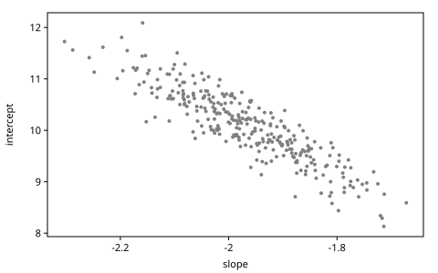
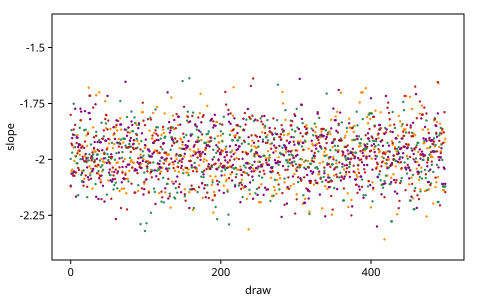

# Gradient-Based MCMC

*MCMC and MAP* built Markov chains from Metropolis–Hastings moves: a
proposal changes some choices, and the move is accepted with the
probability that keeps the posterior invariant. Those proposals do not
look where they go. When the posterior is a narrow, tilted ridge, a blind
step large enough to travel along it lands off it, and a step small enough
to stay on it travels nowhere. This chapter gives proposals a direction:
the gradient of the log density, which gen.clj computes from the model by
automatic differentiation. MALA takes one step along it. HMC takes many,
carried by a momentum, and its proposals move far and are still accepted.
NUTS chooses how many steps to take, and Stan's warmup tunes the rest. Two
kernels that need no gradient close the chapter: Gibbs moves for discrete
choices, and elliptical slice sampling for choices under a Gaussian prior.

The chapter ports the GenMLX book's *Markov Chain Monte Carlo*, with its
examples rebuilt on *Getting Started*'s line model. Every posterior in it
is known exactly, so every sampler is checked against the answer, with
the diagnostics of *The Inference Toolkit*: R-hat, the effective sample
size (ESS) and the Monte Carlo standard error (MCSE).

<!-- code: ns -->
```clojure
(ns book.gradient-mcmc
  (:refer-clojure :exclude [+ - * /])
  (:require [gen.array :as array :refer [+ - * /]]
            [gen.array.linalg :as linalg]
            [gen.batched :as batched]
            [gen.book.svg :as svg]
            [gen.choicemap :as cm]
            [gen.combinators :as comb]
            [gen.dist :as d]
            [gen.dist.core :as dc]
            [gen.dynamic :refer [gen]]
            [gen.gfi :as gfi]
            [gen.gradients :as grad]
            [gen.inference.diagnostics :as diag]
            [gen.inference.enumerative :as enum]
            [gen.inference.importance :as is]
            [gen.inference.kernel :as k]
            [gen.inference.mcmc :as mcmc]
            [gen.inference.nuts :as nuts]
            [gen.random :as rng]
            [gen.selection :as sel]))
```

## The ridge

The model is *Getting Started*'s line, with its ten points. `line` selects
the two choices that every sampler below moves:

<!-- code: model -->
```clojure
(def line-model
  (gen [xs]
    (let [slope (trace :slope (d/normal 0 2))
          intercept (trace :intercept (d/normal 0 10))]
      (doseq [[i x] (map-indexed vector xs)]
        (trace [:y i] (d/normal (+ (* slope x) intercept) 1)))
      [slope intercept])))

(def xs [1.0 2.0 3.0 4.0 5.0 6.0 7.0 8.0 9.0 10.0])

(def ys [8.23 5.87 3.99 2.59 0.23 -0.66 -3.53 -6.91 -7.24 -9.90])

(defn observations
  "The choice map fixing each [:y i] to (ys i)."
  [ys]
  (apply cm/choicemap (mapcat (fn [i y] [[:y i] y]) (range) ys)))

(def line (sel/select :slope :intercept))
```

The posterior is Gaussian, with the mean and covariance that *Getting
Started* derived:

<!-- code: exact -->
```clojure
(defn posterior
  "The exact posterior of the line given points (xs, ys): its mean and
   covariance, slope first."
  [xs ys]
  (let [X (array/array (mapv (fn [x] [x 1.0]) xs))
        Xt (array/transpose X)
        prior-precision (array/diag (array/array [(/ 1.0 4.0) (/ 1.0 100.0)]))
        covariance (linalg/inv (+ prior-precision (array/matmul Xt X)))]
    {:mean (array/matmul covariance (array/matmul Xt (array/array ys)))
     :cov covariance}))

(def exact (posterior xs ys))

(array/->clj (:mean exact))
;=> [-1.979 10.143]

(array/->clj (array/sqrt (array/diag (:cov exact))))
;=> [0.1097 0.6807]
```

The standard deviations hide the posterior's shape. The slope and the
intercept are strongly correlated, because a steeper line fits the points
only with a higher intercept. The posterior's principal axes, the
eigenvectors of its covariance, show the shape. We call the standard
deviation along the long axis the ridge's *length*, and the one across it
the ridge's *width*:

<!-- code: axes -->
```clojure
(defn axes
  "The principal axes of a 2×2 covariance, the longer first: [sd
   direction] of each, the direction a unit vector [slope intercept]."
  [cov]
  (let [[[a b] [_ c]] (array/->clj cov)
        middle (/ (+ a c) 2)
        half-gap (Math/sqrt (+ (* (/ (- a c) 2) (/ (- a c) 2)) (* b b)))
        axis (fn [lambda]
               (let [v [b (- lambda a)]
                     norm (Math/sqrt (reduce + (map * v v)))]
                 [(Math/sqrt lambda) (mapv #(/ % norm) v)]))]
    [(axis (+ middle half-gap)) (axis (- middle half-gap))]))

(def ridge (axes (:cov exact)))

(def length (first (first ridge)))

(def width (first (second ridge)))

[length width (/ length width)]
;=> [0.6877 0.05043 13.6]
```

The posterior is a ridge 13.6 times as long as it is wide, tilted against
both axes. Three hundred draws from it show the shape; the later figures
draw them in gray, under each sampler's draws:

<!-- code: exact-draws -->
```clojure
(def exact-draws
  (let [p (d/mvnormal (:mean exact) (:cov exact))]
    (mapv #(array/->clj (dc/sample p %)) (rng/split (rng/key 1) 300))))
```

<!-- code: ridge-figure -->
```clojure
;; figure: figures/023-ridge.svg
(svg/plot [{:points exact-draws :color "gray" :r 2}]
          {:x-label "slope" :y-label "intercept"})
```



## A random walk on the ridge

*Getting Started*'s workshop ended with a random walk: propose a slope
near the current one (standard deviation 0.1) and an intercept near the
current one (0.5), and accept by MH. Its steps are scaled to the two
choices' spreads, but not to the tilt.

The chains of this chapter run through `k/run`, which applies a *kernel*,
a function of a trace and a key that returns `{:trace …}` (*The
Inference Toolkit*). With `:keep`, a function of a trace or a map of
them, it keeps only their values, as host numbers under `:draws`, so a
long chain holds one trace at a time, on any backend. The chains here keep
the values at a few addresses:

<!-- code: values-at -->
```clojure
(defn values-at
  "What a chain keeps of each trace: the values at addrs, a function for
   each (k/run's :keep)."
  [addrs]
  (into {} (map (fn [a] [a #(% a)])) addrs))
```

The chains start from four traces that `generate` draws from the prior.
`batched/generate` makes them at once, as a particle collection
(`gen.batched`), which the HMC section reuses; `batched/traces` gives each
particle as a trace of its own:

<!-- code: starts -->
```clojure
(def start-particles
  (:particles (batched/generate line-model [xs] (observations ys) 4
                                (rng/key 2))))

(def starts (batched/traces start-particles))

(mapv #(% :slope) starts)
;=> [4.626 0.515 1.459 3.788] ; float64
```

The prior's slopes are far from the posterior's −1.98, so each chain's
first moves must find the ridge. Each chain takes 200 steps of burn-in,
then keeps 500:

<!-- code: walk -->
```clojure
(def random-walk
  (gen [tr]
    (trace :slope (d/normal (tr :slope) 0.1))
    (trace :intercept (d/normal (tr :intercept) 0.5))))

(def walk
  "The MH kernel of the random walk."
  (k/mh random-walk []))

(def walk-chains
  (mapv (fn [t key]
          (k/run walk t {:samples 500 :burn 200 :key key
                         :keep (values-at [:slope :intercept])}))
        starts (rng/split (rng/key 3) 4)))

(defn chains
  "The draws at addr of each of runs, a vector of chains."
  [runs addr]
  (mapv #(get-in % [:draws addr]) runs))

(mapv :acceptance-rate walk-chains)
;=> [0.424 0.41 0.393 0.453] ; float64
```

About two moves in five are accepted. But the draws are worth few
independent ones, fewer than 100 of each chain's 500:

<!-- code: walk-ess -->
```clojure
(mapv diag/ess-bulk (chains walk-chains :slope))
;=> [25.0 24.1 3.1 21.9] ; float64

(every? #(< (diag/ess-bulk %) 100) (chains walk-chains :slope))
;=> true
```

Draw by draw, each chain's slope holds still through runs of rejections
and wanders slowly between them, and at any time the four chains sit in
different places (one is still arriving from its start):

<!-- code: walk-figure -->
```clojure
;; figure: figures/023-walk.svg
(defn trace-plot
  "Each chain's draws against their index, one color a chain."
  [chains]
  (svg/plot (map (fn [chain color]
                   {:points (map-indexed vector chain) :color color :r 1.2})
                 chains ["darkorange" "seagreen" "firebrick" "purple"])
            {:x-label "draw" :y-label "slope" :y-range [-2.45 -1.35]}))

(trace-plot (chains walk-chains :slope))
```


A proposal must stay small across the ridge, or it lands off it and is
rejected. Along the ridge, small steps in random directions travel slowly:
a random walk's distance grows only as the square root of its number of
steps.

## R-hat exposes the stall

One chain cannot know what it has not visited. R-hat compares several
chains, started apart: the variance between their means against the
variance within each. When every chain has explored the same
distribution the two agree, and R-hat is near 1. `diag/r-hat` is the
rank-normalized split R-hat of Vehtari et al. (2021), who advise using
the draws only when it is below 1.01. The walk's chains fail it:

<!-- code: r-hat -->
```clojure
(def walk-r-hat
  [(diag/r-hat (chains walk-chains :slope))
   (diag/r-hat (chains walk-chains :intercept))])

walk-r-hat
;=> [1.111 1.129] ; float64

(every? #(> % 1.01) walk-r-hat)
;=> true
```

Here each chain's ESS warns too. R-hat is the check that does not rely on
one chain to see its own problem: a chain can report a plausible spread
while missing most of the posterior, as the first exercise shows.

## The gradient

A proposal that knew which way the posterior rises would not have to
guess. The gradient of the log density with respect to the selected
choices says it, and `grad/choice-gradients` computes it for any
generative function, by reverse-mode automatic differentiation of
`assess`'s weight. It returns the selected `:values` and a choice map of
`:gradients` of the same shape. `center` is a trace at the exact mean
(rounded), and `at` moves a trace to another line by `update`:

<!-- code: center -->
```clojure
(def center
  "The trace at the exact posterior mean, rounded."
  (:trace (gfi/generate line-model [xs]
                        (cm/merge (cm/choicemap :slope -1.979
                                                :intercept 10.143)
                                  (observations ys))
                        (rng/key 0))))

(defn at
  "The trace t moved to the line [slope intercept]."
  [t [slope intercept]]
  (:trace (gfi/update t (cm/choicemap :slope slope :intercept intercept)
                      (rng/key 0))))
```

<!-- code: gradient -->
```clojure
(defn gradient
  "The gradient of the trace's log density with respect to the line:
   [d/dslope d/dintercept], by choice-gradients."
  [t]
  (let [g (:gradients (grad/choice-gradients t line))]
    [(cm/get-choice g :slope) (cm/get-choice g :intercept)]))

(gradient (at center [-1.5 9.0]))
;=> [-121.785 -14.92]
```

For a Gaussian posterior with mean $\mu$ and precision $\Lambda$ (the
inverse of its covariance), the gradient at $\theta$ is $\Lambda(\mu -
\theta)$. The model's log density differs from the posterior's by a
constant, $\log p(y)$, so its gradient is the same:

<!-- code: gradient-exact -->
```clojure
(def precision (linalg/inv (:cov exact)))

(defn exact-gradient
  "The gradient of the exact posterior's log density at the line theta:
   precision · (mean - theta)."
  [theta]
  (array/matmul precision (- (:mean exact) (array/array theta))))

(array/allclose? (array/array (gradient (at center [-1.5 9.0])))
                 (exact-gradient [-1.5 9.0]))
;=> true
```

The gradient points uphill, but on a ridge uphill is mostly across. One
width off the crest, the gradient pulls back with strength $1/\text{width}
= 19.8$; one length along the crest, with $1/\text{length} = 1.45$, 13.6
times weaker:

<!-- code: pull -->
```clojure
(defn norm
  "The Euclidean length of the vector v."
  [v]
  (Math/sqrt (array/item (reduce + (map * v v)))))

(def mean (array/->clj (:mean exact)))

(defn off-mean
  "The line k standard deviations from the mean along the axis [sd
   direction]."
  [k [sd direction]]
  (mapv + mean (mapv #(* k sd %) direction)))

(defn pull
  "The size of the gradient one standard deviation from the mean along
   the axis."
  [axis]
  (norm (gradient (at center (off-mean 1 axis)))))

[(pull (first ridge)) (pull (second ridge))]
;=> [1.454 19.83]

(array/allclose? (/ (pull (second ridge)) (pull (first ridge)))
                 (/ length width))
;=> true
```

## MALA: one step along the gradient

The *Metropolis-adjusted Langevin algorithm* (MALA) proposes one step
along the gradient, with noise,

$$
\theta' \sim \mathcal{N}\bigl(\theta + \tau \nabla \log p(\theta),\ 2\tau I\bigr),
$$

and accepts by MH, weighing the reverse proposal, whose mean takes the
gradient at $\theta'$. `mcmc/mala` takes $\tau$, as Gen.jl's `mala` does;
GenMLX's takes a step size $\varepsilon$, with $\tau = \varepsilon^2/2$.

`mcmc/mala-particles` moves every particle of a collection at once: one
batched gradient per step for all the chains, each accepted on its own.
`run-particles` runs such a kernel and keeps each chain's draws:

<!-- code: run-particles -->
```clojure
(defn run-particles
  "Chains of the kernel k (a function of particles and a key, as
   mcmc/hmc-particles) from the particles ps, one a particle: burn steps,
   then samples steps kept. Returns {:draws {addr chains} :acceptance r},
   a chain of host numbers per particle at each of addrs, and the fraction
   of the kept steps' moves accepted."
  [k ps addrs {:keys [samples burn key] :or {burn 0}}]
  (let [step-keys (rng/split key (+ burn samples))]
    (loop [i 0, ps ps, rows (zipmap addrs (repeat [])), accepted []]
      (if (= i (count step-keys))
        {:draws (update-vals rows #(apply mapv vector %))
         :acceptance (/ (count (filter true? accepted))
                        (double (count accepted)))}
        (let [{ps' :particles moved :accepted} (k ps (step-keys i))
              keep? (>= i burn)
              read (fn [m addr]
                     (update m addr conj
                             (array/->clj (batched/choice ps' addr))))]
          (recur (inc i) ps'
                 (if keep? (reduce read rows addrs) rows)
                 (if keep? (into accepted moved) accepted)))))))
```

Four chains start at the center, so these runs measure how the chains
mix, not how they find the ridge. With $\tau = 0.004$, MALA accepts 62% of
its proposals, and its 4000 draws are worth 20 independent ones:

<!-- code: mala -->
```clojure
(def at-center
  "Four particles, each at the trace center."
  (batched/take (:particles (batched/generate line-model [xs]
                                              (:choices center) 1
                                              (rng/key 0)))
                [0 0 0 0]))

(def mala-identity
  (run-particles #(mcmc/mala-particles %1 line 0.004 %2) at-center
                 [:slope :intercept] {:samples 1000 :burn 100
                                      :key (rng/key 4)}))

[(:acceptance mala-identity)
 (diag/ess-bulk (get-in mala-identity [:draws :slope]))]
;=> [0.615 20.0] ; float64
```

The proposal's spread, $\sqrt{2\tau} \approx 0.09$, is the same in both
choices. That is two widths of the ridge, but an eighth of its length: the
step must be small in every direction because it must be small across the
ridge.

A *metric* rescales the choices. MALA, HMC and NUTS take one as
`:inv-metric`, a variance for each selected choice at its address, and
MALA's proposal becomes
$\mathcal{N}(\theta + \tau M^{-1} \nabla \log p,\ 2\tau M^{-1})$, so each
choice steps in proportion to its spread. A choice map of the exact
variances is one:

<!-- code: labeled-metric -->
```clojure
(def inv-metric
  (let [[v-slope v-intercept] (array/->clj (array/diag (:cov exact)))]
    (cm/choicemap :slope v-slope :intercept v-intercept)))

(cm/to-map inv-metric)
;=> {:slope 0.01204 :intercept 0.4634}
```

A vector of the two would leave the kernel to guess their order: the
selection's, slope first, or the choice map's, intercept first. A wrong
guess mis-scales every move and raises no error (Exercise 1 measures by
how much), so for more than one choice a vector is refused:

<!-- code: unlabeled-metric -->
```clojure
;; error: :inv-metric as a vector or array leaves its order to guess
(mcmc/mala center line 0.2 {:inv-metric [0.01204 0.4634] :key (rng/key 4)})
```

With the exact variances as the metric and $\tau = 0.2$, the chains'
draws are worth several times as many, here eight, though still fewer
than a tenth of their number:

<!-- code: mala-metric -->
```clojure
(def mala-scaled
  (run-particles #(mcmc/mala-particles %1 line 0.2
                                       {:inv-metric inv-metric :key %2})
                 at-center [:slope :intercept]
                 {:samples 1000 :burn 100 :key (rng/key 4)}))

[(:acceptance mala-scaled)
 (diag/ess-bulk (get-in mala-scaled [:draws :slope]))]
;=> [0.573 168.4] ; float64

(let [ess #(diag/ess-bulk (get-in % [:draws :slope]))]
  [(> (ess mala-scaled) (* 1.5 (ess mala-identity)))
   (< (ess mala-scaled) (* 0.1 4000))])
;=> [true true]
```

One gradient step is not enough. The metric scales the two choices, but
not the tilt, and the gradient's step goes mostly across the ridge, toward
its crest, where the chain already is.

## HMC: many steps, with momentum

*Hamiltonian Monte Carlo* (HMC) makes many gradient steps into one
proposal. It gives each selected choice a *momentum* $p$, drawn from
$\mathcal{N}(0, M)$ at every move, and treats $-\log p(\theta)$ as a
potential energy. The state is a ball rolling on that surface, and its
total energy, the *Hamiltonian*

$$
H(\theta, p) = -\log p(\theta) + \tfrac12\, p^\top M^{-1} p,
$$

is conserved as it rolls. The ridge is a valley, and the ball rolls along
its floor. The *leapfrog* integrator simulates the motion: half a step of
the momentum along the gradient, a step of the position along the
momentum, and another half step of the momentum. HMC takes $L$ leapfrog
steps of size $\varepsilon$ from $(\theta, p)$ to $(\theta', p')$ and
accepts the move with probability $\min\bigl(1, e^{H(\theta, p) -
H(\theta', p')}\bigr)$. The leapfrog nearly conserves $H$, so long moves
are accepted.

With the identity metric, one leapfrog step from $p \sim \mathcal{N}(0,
I)$ lands at $\theta + \varepsilon p + (\varepsilon^2/2) \nabla \log
p(\theta)$, drawn from $\mathcal{N}(\theta + (\varepsilon^2/2) \nabla \log
p,\ \varepsilon^2 I)$: MALA's proposal, with $\tau = \varepsilon^2/2$.
MALA is HMC with $L = 1$.

The leapfrog takes a few lines, with `gradient` for the force:

<!-- code: leapfrog -->
```clojure
(defn line-of
  "The trace's line, [slope intercept]."
  [t]
  [(t :slope) (t :intercept)])

(defn leapfrog
  "One leapfrog step of size eps from [t p], a trace and its momentum
   [p-slope p-intercept]: half a step of the momentum along the gradient,
   a step of the position along the momentum, and the other half step of
   the momentum, at the new position."
  [eps [t p]]
  (let [kick (fn [p t] (mapv + p (mapv #(* (/ eps 2) %) (gradient t))))
        p-half (kick p t)
        t' (at t (mapv + (line-of t) (mapv #(* eps %) p-half)))]
    [t' (kick p-half t')]))

(defn energy
  "The Hamiltonian of [t p]: the potential energy -log p(t) plus the
   kinetic energy |p|²/2."
  [[t p]]
  (+ (- (:score t)) (* 0.5 (reduce + (map * p p)))))
```

A ball released at rest, one and a half lengths down the ridge and a width
off its crest, rolls along the ridge. In 40 steps of 0.05 it reaches the
other side, 1.46 lengths past the mean, and its energy never drifts by
more than 0.12. An MH test of the move would accept it with probability
at least $e^{-0.12} \approx 0.89$:

<!-- code: trajectory -->
```clojure
(def released
  "At rest, one and a half lengths down the ridge and one width off it."
  [(at center (mapv + (off-mean -1.5 (first ridge))
                    (mapv - (off-mean 1 (second ridge)) mean)))
   [0.0 0.0]])

(def trajectory (vec (take 41 (iterate (partial leapfrog 0.05) released))))

(defn along
  "How far along the ridge the trace's line is, in lengths from the
   mean."
  [t]
  (let [[_ direction] (first ridge)]
    (/ (reduce + (map * (mapv - (line-of t) mean) direction)) length)))

[(along (first (first trajectory))) (along (first (peek trajectory)))]
;=> [-1.5 1.46]

(let [h0 (energy (first trajectory))]
  (apply max (map #(abs (- (energy %) h0)) trajectory)))
;=> 0.12
```

<!-- code: trajectory-figure -->
```clojure
;; figure: figures/023-trajectory.svg
(defn along-path
  "Points every 1/k of the way along each segment of the path ps, which
   drawn small make a line."
  [ps k]
  (mapcat (fn [[x0 y0] [x1 y1]]
            (for [i (range k) :let [f (/ i (double k))]]
              [(+ x0 (* f (- x1 x0))) (+ y0 (* f (- y1 y0)))]))
          ps (rest ps)))

(let [path (map #(line-of (first %)) trajectory)]
  (svg/plot [{:points exact-draws :color "gray" :r 2}
             {:points (along-path path 8) :color "steelblue" :r 0.7}
             {:points path :color "steelblue" :r 3}]
            {:x-label "slope" :y-label "intercept"}))
```


The gradient pulls the ball back toward the crest at every step, so it
zigzags across the ridge. Along the crest it gains speed and keeps it:
the momentum accumulates what each step's gradient gives along the ridge,
which no single step could use.

### The library's HMC

`mcmc/hmc` is this move, with the momentum drawn afresh and the MH test.
`mcmc/hmc-particles` runs it on every particle of a collection at once.
From the walk's four starts, with 20 steps of 0.05, it accepts 92% of its
moves, its chains pass R-hat, and each chain's 500 draws are worth 330 to
440 independent ones:

<!-- code: hmc -->
```clojure
(def hmc-chains
  (run-particles #(mcmc/hmc-particles %1 line {:L 20 :eps 0.05} %2)
                 start-particles [:slope :intercept]
                 {:samples 500 :burn 100 :key (rng/key 5)}))

(:acceptance hmc-chains)
;=> 0.92 ; float64

(def hmc-r-hat
  [(diag/r-hat (get-in hmc-chains [:draws :slope]))
   (diag/r-hat (get-in hmc-chains [:draws :intercept]))])

(every? #(< % 1.01) hmc-r-hat)
;=> true

(mapv diag/ess-bulk (get-in hmc-chains [:draws :slope]))
;=> [326.1 365.4 359.0 435.5] ; float64
```

The draws agree with the exact posterior, in mean and in standard
deviation, within five Monte Carlo standard errors:

<!-- code: hmc-check -->
```clojure
(defn agrees?
  "Do the chains' mean and standard deviation agree with the exact ones
   within five Monte Carlo standard errors?"
  [chains exact-mean exact-sd]
  (let [{:keys [mean sd mcse-mean mcse-sd]} (diag/summary chains)]
    [(< (abs (- mean exact-mean)) (* 5 mcse-mean))
     (< (abs (- sd exact-sd)) (* 5 mcse-sd))]))

(def exact-sd (array/->clj (array/sqrt (array/diag (:cov exact)))))

[(agrees? (get-in hmc-chains [:draws :slope]) (mean 0) (exact-sd 0))
 (agrees? (get-in hmc-chains [:draws :intercept]) (mean 1) (exact-sd 1))]
;=> [[true true] [true true]]
```

Draw by draw, the four chains' slopes overlap in one band, each crossing
the posterior's range again and again:

<!-- code: hmc-figure -->
```clojure
;; figure: figures/023-hmc.svg
(trace-plot (get-in hmc-chains [:draws :slope]))
```



Each move costs 21 gradients, one at the start and one per leapfrog step.
Per gradient, HMC's chains gain 0.035 effective draws, against the walk's
0.016 per proposal:

<!-- code: cost -->
```clojure
(defn ess-per
  "The chains' bulk ESS at :slope per unit of work, n units in all."
  [runs n]
  (/ (diag/ess-bulk runs) n))

[(ess-per (chains walk-chains :slope) (* 4 500))
 (ess-per (get-in hmc-chains [:draws :slope]) (* 4 500 21))]
;=> [0.0155 0.0353] ; float64
```

On two choices the gain per unit of work is small, and a gradient is not
free: reverse-mode differentiation records the model's run and then runs
back through it. The third exercise gives the walk as many proposals as
HMC took gradients. Gradients pay off with many correlated choices, as in
the hidden Markov model below.

### The step size

The leapfrog is stable only for steps under twice the posterior's
narrowest standard deviation (with the identity metric, for a Gaussian).
Past twice the ridge's width, the energy error grows with every step, and
HMC accepts nothing:

<!-- code: step-size -->
```clojure
(defn acceptance-at
  "HMC's acceptance from the trace center with L = 20 steps of size eps,
   over 100 moves."
  [eps]
  (:acceptance-rate (k/run (k/hmc line {:L 20 :eps eps}) center
                           {:samples 100 :key (rng/key 6)})))

[(acceptance-at (* 1.8 width)) (acceptance-at (* 2.2 width))]
;=> [0.66 0.0] ; float64

[(> (acceptance-at (* 1.8 width)) 0.2) (acceptance-at (* 2.2 width))]
;=> [true 0.0]
```

## NUTS and Stan's warmup

HMC needs a step size, a number of steps and a metric. The *No-U-Turn
Sampler* (NUTS; Hoffman and Gelman 2014) chooses the number of steps at
every move. It doubles the trajectory, forward or backward in time at
random, until its two ends begin to come back toward each other (a
U-turn), and draws the next state from the points it visited.
`gen.inference.nuts` is Stan's sampler. Its warmup adapts the step size by
dual averaging, toward an acceptance statistic of 0.8, and estimates a
diagonal metric from the warmup's draws, in windows that double. Then it
draws with what it learned. `nuts/sample` runs both, with Stan's defaults
(1000 warmup iterations):

<!-- code: nuts -->
```clojure
(def nuts-run (nuts/sample (first starts) line {:samples 1000} (rng/key 7)))

[(:eps nuts-run) (cm/to-map (:inv-metric nuts-run))]
;=> [0.309 {:slope 0.0124 :intercept 0.472}] ; float64

[(:divergences nuts-run) (:divergences (:warmup nuts-run))]
;=> [0 13] ; float64
```

The step size it learned is 0.31, and its inverse metric, a choice map
like the one above, is close to the exact variances, 0.0120 for the slope
and 0.463 for the intercept. A *divergence* is a trajectory whose energy
error passed 1000 or turned non-finite: 13 of the warmup's iterations
diverged, while its step size was still too large, and none of the draws
did. Each draw took seven leapfrog steps on average, in trees of one to
four doublings:

<!-- code: nuts-stats -->
```clojure
(defn mean-of
  "The mean of the numbers xs."
  [xs]
  (/ (reduce + xs) (double (count xs))))

(def nuts-steps (mean-of (map :n-leapfrog (:stats nuts-run))))

[nuts-steps (frequencies (map :tree-depth (:stats nuts-run)))]
;=> [7.17 {1 115, 2 471, 3 387, 4 27}] ; float64
```

The draws agree with the exact posterior:

<!-- code: nuts-check -->
```clojure
(def nuts-draws
  {:slope (diag/draws (:traces nuts-run) :slope)
   :intercept (diag/draws (:traces nuts-run) :intercept)})

[(agrees? (:slope nuts-draws) (mean 0) (exact-sd 0))
 (agrees? (:intercept nuts-draws) (mean 1) (exact-sd 1))]
;=> [[true true] [true true]]
```

The metric is an estimate, made from the draws of the warmup's last
window, here 500 of them. A variance's relative standard error is twice
that of the standard deviation, which `diag/mcse-sd` estimates from the
1000 draws above; from $n$ draws that mix as these do, it is
$\sqrt{1000/n}$ times as large. The default warmup's variances have a
relative standard error of 11%:

<!-- code: nuts-metric -->
```clojure
(defn relative-se
  "The relative standard error of a variance estimated from n draws that
   mix as the draws xs do: twice that of their standard deviation, from
   diag/mcse-sd, scaled from their number to n."
  [xs n]
  (let [{:keys [sd mcse-sd]} (diag/summary xs)]
    (* 2 (/ mcse-sd sd) (Math/sqrt (/ (count xs) (double n))))))

(defn window-se
  "The larger of the metric's two relative standard errors, for a last
   window of n draws."
  [n]
  (max (relative-se (:slope nuts-draws) n)
       (relative-se (:intercept nuts-draws) n)))

(window-se 500)
;=> 0.108 ; float64
```

Five of those make a band of 54%, which a metric of half the variances
would pass, so a check of this metric could not show that the adaptation
is right. A longer warmup can. `nuts/adapt` runs the warmup alone, and
with 6000 iterations its last window holds the draws from iteration 1650
to 5949, 4300 of them. The band narrows to 18%, the adapted variances
are within it, and a metric off by a factor of two either way would not
be:

<!-- code: nuts-metric-long -->
```clojure
(def long-warmup
  (nuts/adapt (first starts) line {:warmup 6000} (rng/key 23)))

(defn ratios
  "Each adapted variance over the exact one, by address."
  [adapted]
  (into {} (for [addr [:slope :intercept]
                 :let [variance #(array/item (cm/get-choice % addr))]]
             [addr (/ (variance (:inv-metric adapted))
                      (variance inv-metric))])))

(ratios long-warmup)
;=> {:slope 0.987 :intercept 0.998} ; float64

(def metric-band (* 5 (window-se 4300)))

metric-band
;=> 0.184 ; float64

;; Over 12 other keys (200-211), the long warmup's ratios had standard
;; deviations of 0.041 and 0.038, as the standard error says (0.037).
[(< metric-band 0.5)
 (every? #(< (abs (- % 1.0)) metric-band) (vals (ratios long-warmup)))]
;=> [true true]
```

### A diagonal metric cannot turn the ridge

A diagonal metric rescales each choice. Rescaling the axes leaves the
correlation as it was, so in the metric's units the posterior is still a
ridge, $\sqrt{(1 + |\rho|)/(1 - |\rho|)} = 4.06$ times as long as it is
wide, and NUTS's trajectories still zigzag:

<!-- code: tilt -->
```clojure
(def correlation
  (let [[[a b] [_ c]] (array/->clj (:cov exact))]
    (/ b (Math/sqrt (* a c)))))

correlation
;=> -0.886

(def scaled-sds
  "The posterior's standard deviations along its axes, in the units of a
   metric of its exact variances: √(1 ± |r|), r the correlation."
  [(Math/sqrt (+ 1 (abs correlation))) (Math/sqrt (- 1 (abs correlation)))])

(apply / scaled-sds)
;=> 4.06
```

A dense metric, the posterior's covariance, would make the ridge round.
gen.clj's metric is diagonal only for now; a dense one is planned (bean
genclj-q9ge). Until then, a reparameterization can remove the tilt. The
line's height at the points' mean $\bar x = 5.5$, its *level*, is nearly
independent of its slope. The centered model draws the level in place of
the intercept, with the same joint distribution: given the slope, a level
drawn from $\mathcal{N}(\text{slope} \cdot \bar x, 10)$ makes the
intercept, level $-$ slope $\cdot \bar x$, a draw from $\mathcal{N}(0,
10)$. NUTS takes four steps a draw on it, not seven:

<!-- code: centered -->
```clojure
(def x-bar (mean-of xs))

(def centered-model
  (gen [xs]
    (let [slope (trace :slope (d/normal 0 2))
          level (trace :level (d/normal (* slope x-bar) 10))
          intercept (- level (* slope x-bar))]
      (doseq [[i x] (map-indexed vector xs)]
        (trace [:y i] (d/normal (+ (* slope x) intercept) 1)))
      [slope intercept])))

(def centered-run
  (nuts/sample (:trace (gfi/generate centered-model [xs] (observations ys)
                                     (rng/key 2)))
               (sel/select :slope :level) {:samples 1000} (rng/key 7)))

(def centered-steps (mean-of (map :n-leapfrog (:stats centered-run))))

centered-steps
;=> 4.02 ; float64
```

Its slopes follow the same exact posterior, and each gradient buys
several times as many effective draws, here four and a half:

<!-- code: centered-check -->
```clojure
(def centered-slopes (diag/draws (:traces centered-run) :slope))

(agrees? centered-slopes (mean 0) (exact-sd 0))
;=> [true true]

(defn per-gradient
  "A run's bulk ESS at :slope per leapfrog step."
  [draws steps]
  (/ (diag/ess-bulk draws) (* 1000 steps)))

[(per-gradient (:slope nuts-draws) nuts-steps)
 (per-gradient centered-slopes centered-steps)]
;=> [0.0356 0.159] ; float64

(> (per-gradient centered-slopes centered-steps)
   (* 2.5 (per-gradient (:slope nuts-draws) nuts-steps)))
;=> true
```

## Many correlated states: HMC on an HMM

Two choices make a small problem. Gradients earn their cost when there
are many correlated choices, as in a time series. The GenMLX book's
example is a hidden Markov model with continuous states: a position
$z_t$ follows a random walk, $z_t \sim \mathcal{N}(z_{t-1}, 0.5)$ from
$z_{-1} = 0$, and $y_t \sim \mathcal{N}(z_t, 1)$ observes it. As in
*Composition*, an Unfold writes it as one step, whose choices nest under
the step's number. We observe twenty steps and select the twenty states:

<!-- code: hmm-model -->
```clojure
(def hmm-step
  (gen [t z]
    (let [z' (trace :z (d/normal z 0.5))]
      (trace :y (d/normal z' 1.0))
      z')))

(def hmm (comb/unfold hmm-step))

(def hmm-ys
  [0.77 -1.59 2.11 -0.15 0.07 0.69 0.73 1.32 2.77 2.17
   3.08 3.85 4.09 1.73 3.27 2.81 0.67 2.54 3.32 1.85])

(def n (count hmm-ys))

(def hmm-observations
  (apply cm/choicemap (mapcat (fn [t y] [[t :y] y]) (range) hmm-ys)))

(def states (sel/from-paths (for [t (range n)] [t :z])))
```

The posterior is Gaussian again. Its precision is the sum of the random
walk's and the observations', and its mean pulls each state from its
observation toward its neighbors:

<!-- code: hmm-exact -->
```clojure
(defn smoothed
  "The exact posterior of the states given ys: their means and standard
   deviations. Its precision is the random walk's, D'D/0.5², plus the
   observations', I/1², D taking differences z_t - z_{t-1} (z_{-1} = 0);
   its mean is the precision's inverse times ys."
  [ys]
  (let [n (count ys)
        D (array/array (vec (for [i (range n)]
                              (vec (for [j (range n)]
                                     (cond (= i j) 1.0
                                           (= j (dec i)) -1.0
                                           :else 0.0))))))
        precision (+ (/ (array/matmul (array/transpose D) D) 0.25)
                     (array/eye n))
        cov (linalg/inv precision)]
    {:mean (array/->clj (array/matmul cov (array/array ys)))
     :sd (array/->clj (array/sqrt (array/diag cov)))}))

(def hmm-exact (smoothed hmm-ys))

(mapv #(Math/round (* 100 %)) (take 5 (:mean hmm-exact)))
;=> [13 9 48 46 59]
```

NUTS moves the twenty states at once. Here the warmup and the draws are
separate: `nuts/adapt` returns the warmup's last trace with the step size
and metric it learned, and `nuts/sample`, its warmup 0, draws with them,
keeping the states' values (`:keep`, as `k/run`'s). Each draw takes about
13 leapfrog steps:

<!-- code: hmm-nuts -->
```clojure
(def hmm-start
  (:trace (gfi/generate hmm [n 0.0] hmm-observations (rng/key 8))))

(def hmm-adapted (nuts/adapt hmm-start states {:warmup 300} (rng/key 9)))

(def hmm-run
  (nuts/sample (:trace hmm-adapted) states
               (assoc (select-keys hmm-adapted [:eps :inv-metric])
                      :samples 500 :warmup 0
                      :keep (values-at (for [t (range n)] [t :z])))
               (rng/key 10)))

(mean-of (map :n-leapfrog (:stats hmm-run)))
;=> 13.05 ; float64
```

Every state's mean agrees with the exact one within five Monte Carlo
standard errors, and the least-mixed state's 500 draws are worth 337
independent ones:

<!-- code: hmm-check -->
```clojure
(def hmm-summaries
  (mapv #(diag/summary (get-in hmm-run [:draws [% :z]])) (range n)))

(every? true? (map (fn [{:keys [mean mcse-mean]} exact-mean]
                     (< (abs (- mean exact-mean)) (* 5 mcse-mean)))
                   hmm-summaries (:mean hmm-exact)))
;=> true

(apply min (map :ess-bulk hmm-summaries))
;=> 337.5 ; float64
```

<!-- code: hmm-figure -->
```clojure
;; figure: figures/023-hmm.svg
(defn polyline
  "The function of x through the points (0, ys 0), (1, ys 1), …, linear
   between them."
  [ys]
  (fn [x]
    (let [i (min (long x) (- (count ys) 2))
          f (- x i)]
      (+ (* (- 1 f) (ys i)) (* f (ys (inc i)))))))

(let [{m :mean sd :sd} hmm-exact]
  (svg/plot [{:points (map-indexed vector hmm-ys) :color "gray"}
             {:curves [(polyline m)] :color "black"}
             {:curves [(polyline (mapv + m (mapv #(* 2 %) sd)))
                       (polyline (mapv - m (mapv #(* 2 %) sd)))]
              :color "black" :opacity 0.4 :width 1}
             {:points (map-indexed #(vector %1 (:mean %2)) hmm-summaries)
              :color "steelblue" :r 3}]
            {:x-label "step t" :y-label "state" :x-range [0 (dec n)]}))
```


*Conditioning*'s importance sampling from the prior must guess all twenty
states at once. Of 2000 samples, its weights leave about 12 effective
ones:

<!-- code: hmm-is -->
```clojure
(:ess (is/importance-sampling hmm [n 0.0] hmm-observations 2000
                              {:key (rng/key 11)}))
;=> 12.0 ; float64
```

A random walk on all twenty states at once, accepted by MH, must take
small steps, since a step that is large in twenty directions is unlikely
in most of them. In 5000 steps it accepts a third of its proposals, and
its worst state's draws are worth about nine independent ones. Counting a
run of the model per proposal and a gradient per leapfrog step, NUTS gets
more than four times as many effective draws for each, here about
thirty times:

<!-- code: hmm-walk -->
```clojure
(def block-walk
  (gen [tr]
    (dotimes [t n]
      (trace [t :z] (d/normal (tr [t :z]) 0.15)))))

(def hmm-walk
  (k/run (k/mh block-walk []) hmm-start
         {:samples 5000 :burn 1000 :key (rng/key 12)
          :keep (values-at (for [t (range n)] [t :z]))}))

(def walk-min-ess
  (apply min (map #(diag/ess-bulk (get-in hmm-walk [:draws [% :z]]))
                  (range n))))

[(:acceptance-rate hmm-walk) walk-min-ess]
;=> [0.34 8.59] ; float64

(def per-evaluation
  "The worst state's ESS per proposal of the walk, and per gradient of
   NUTS."
  [(/ walk-min-ess 5000)
   (/ (apply min (map :ess-bulk hmm-summaries))
      (* 500 (mean-of (map :n-leapfrog (:stats hmm-run)))))])

per-evaluation
;=> [0.0017 0.0517] ; float64

(< (* 4 (first per-evaluation)) (second per-evaluation))
;=> true
```

Moves of one state at a time are another way (*MCMC and MAP*), and they
are cheap in an Unfold, whose update reruns only the steps a change
reaches (*Composition*). They rely on the model's chain structure; NUTS
needs only a differentiable log density.

## Discrete choices: Gibbs moves

A gradient needs continuous choices. The GenMLX book's mixture has a
discrete one: $z$ picks a component, 0 with probability 0.4 or 1 with 0.6,
$x$ is drawn near the component's mean $1 + 3z$, and $y = 2$ observes $x$
with noise 0.5. `categorical` takes probabilities, as Gen.jl's does, and
its values are 0 and 1:

<!-- code: mixture -->
```clojure
(def mixture
  (gen []
    (let [z (trace :z (d/categorical [0.4 0.6]))
          x (trace :x (d/normal (+ 1.0 (* 3.0 z)) 1.0))]
      (trace :y (d/normal x 0.5))
      z)))

(def mixture-start
  (:trace (gfi/generate mixture [] (cm/choicemap :y 2.0) (rng/key 13))))
```

HMC refuses $z$, loudly:

<!-- code: discrete-error -->
```clojure
;; error: choice-gradients: the choice at [:z] is not continuous
(mcmc/hmc mixture-start (sel/select :z :x) {:L 5 :eps 0.3} (rng/key 14))
```

A *Gibbs move* draws a choice from its exact conditional distribution
given every other choice, and is always accepted. `enum/with-exact-proposal`
makes a generative function with the model's distribution and traces,
whose internal proposal draws the listed finite choices from their exact
conditional, by enumerating their supports. Regenerating them is then a
Gibbs move, of weight 0:

<!-- code: gibbs-model -->
```clojure
(def gibbs-mixture (enum/with-exact-proposal mixture [:z]))

(def gibbs-start
  (:trace (gfi/generate gibbs-mixture [] (cm/choicemap :y 2.0)
                        (rng/key 13))))

(mapv #(:weight (gfi/regenerate gibbs-start (sel/select :z) %))
      (rng/split (rng/key 15) 3))
;=> [0.0 0.0 0.0]
```

So an MH move on $z$ is a Gibbs move, and HMC moves $x$ given $z$. A
kernel that makes one move and then the other, their chain (`k/chain`),
leaves the posterior invariant, since each does:

<!-- code: gibbs -->
```clojure
(def gibbs-hmc
  "A Gibbs move on z, then an HMC move on x."
  (k/chain (k/mh (sel/select :z)) (k/hmc (sel/select :x) {:L 5 :eps 0.3})))

(def mixture-run
  (k/run gibbs-hmc gibbs-start
         {:samples 3000 :burn 100 :key (rng/key 16)
          :keep (values-at [:z :x])}))
```

The exact posterior follows from two Gaussian facts. Given $z$, $y$ is
$\mathcal{N}(1 + 3z, \sqrt{1.25})$, and $x$ given $z$ and $y$ has
precision $1 + 4 = 5$ and mean $(1 + 3z + 4 \cdot 2)/5$:

<!-- code: mixture-exact -->
```clojure
(defn x-mean
  "E[x | z, y = 2]: x | z, y is N((1 + 3z + 4·2)/5, √(1/5))."
  [z]
  (/ (+ 1 (* 3 z) 8.0) 5))

(def mixture-exact
  "P(z = 1 | y = 2) and E[x | y = 2], exactly: given z, y is N(1 + 3z,
   √1.25)."
  (let [joint (fn [z prior]
                (let [y-given-z (d/normal (+ 1 (* 3 z)) (Math/sqrt 1.25))]
                  (* prior (array/exp (dc/log-prob y-given-z 2.0)))))
        p1 (/ (joint 1 0.6) (+ (joint 0 0.4) (joint 1 0.6)))]
    {:p1 p1 :x (+ (* (- 1 p1) (x-mean 0)) (* p1 (x-mean 1)))}))

mixture-exact
;=> {:p1 0.3112 :x 1.9867}
```

The chain agrees with both numbers within five Monte Carlo standard
errors:

<!-- code: mixture-check -->
```clojure
(let [{z-mean :mean z-se :mcse-mean} (diag/summary
                                      (get-in mixture-run [:draws :z]))
      {x-mean :mean x-se :mcse-mean} (diag/summary
                                      (get-in mixture-run [:draws :x]))]
  [(< (abs (- z-mean (:p1 mixture-exact))) (* 5 z-se))
   (< (abs (- x-mean (:x mixture-exact))) (* 5 x-se))])
;=> [true true]
```

<!-- code: mixture-figure -->
```clojure
;; figure: figures/023-mixture.svg
(defn mixture-density
  "The exact posterior density of x given y = 2."
  [x]
  (let [{p1 :p1} mixture-exact
        component (fn [z] (array/exp (dc/log-prob
                                      (d/normal (x-mean z) (Math/sqrt 0.2))
                                      x)))]
    (+ (* (- 1 p1) (component 0)) (* p1 (component 1)))))

(svg/histogram [{:values (get-in mixture-run [:draws :x])
                 :density mixture-density}]
               {:x-label "x"})
```


## Gaussian priors: elliptical slice

When a choice's prior is Gaussian, $\mathcal{N}(\mu, \Sigma)$, *elliptical
slice sampling* (Murray, Adams and MacKay 2010) moves it with no step size
and no gradient. It draws $\nu$ from the prior and a threshold for the
likelihood, then searches the ellipse through the current value $f$ and
$\nu$,

$$
f(\phi) = \mu + (f - \mu)\cos\phi + (\nu - \mu)\sin\phi,
$$

shrinking a bracket of angles toward the current value until the
likelihood passes the threshold. The ellipse keeps the prior invariant,
and the threshold, a slice of the likelihood, does the rest. The move
never rejects: it ends at a new value every time.

A Gaussian process prior on six function values, with a squared-exponential
covariance, makes an example. Each value is observed with noise 0.5:

<!-- code: gp-model -->
```clojure
(def gp-n 6)

(def gp-cov
  "A squared-exponential covariance of length scale 1.5 over the points
   0, 1, …, 5, with a little jitter on its diagonal."
  (array/array (vec (for [i (range gp-n)]
                      (vec (for [j (range gp-n)]
                             (+ (Math/exp (/ (* (- i j) (- i j)) -4.5))
                                (if (= i j) 1e-6 0.0))))))))

(def gp
  (gen []
    (let [f (trace :f (d/mvnormal (array/zeros [gp-n]) gp-cov))]
      (dotimes [i gp-n]
        (trace [:y i] (d/normal (array/take f i) 0.5)))
      f)))

(def gp-ys [0.8 1.4 0.9 -0.3 -1.2 -0.6])

(def gp-start
  (:trace (gfi/generate gp [] (observations gp-ys) (rng/key 17))))
```

`mcmc/elliptical-slice` takes the choice's address and its prior's mean
and covariance, and `k/elliptical-slice` makes it a kernel. Every one of
its 2000 moves lands somewhere new:

<!-- code: elliptical -->
```clojure
(defn slice
  "The kernel of elliptical slice moves of f, under the prior N(0, cov)."
  [cov]
  (k/elliptical-slice :f (array/zeros [gp-n]) cov))

(def gp-run
  (k/run (slice gp-cov) gp-start
         {:samples 2000 :burn 100 :key (rng/key 18) :keep (values-at [:f])}))

(def fs (get-in gp-run [:draws :f]))

(every? true? (map not= fs (rest fs)))
;=> true
```

The posterior is Gaussian, with mean $\Sigma(\Sigma + 0.5^2 I)^{-1} y$,
and the chain's means agree with it within five Monte Carlo standard
errors:

<!-- code: elliptical-check -->
```clojure
(def gp-exact-mean
  "Σ (Σ + 0.5² I)^-1 y, the exact posterior mean of f."
  (let [noisy (+ gp-cov (* 0.25 (array/eye gp-n)))
        gain (array/matmul gp-cov (linalg/inv noisy))]
    (array/->clj (array/matmul gain (array/array gp-ys)))))

(defn within-five?
  "Do the draws' means of each element agree with exact-mean within five
   Monte Carlo standard errors?"
  [fs exact-mean]
  (every? true? (map (fn [i m]
                       (let [{:keys [mean mcse-mean]}
                             (diag/summary (mapv #(nth % i) fs))]
                         (< (abs (- mean m)) (* 5 mcse-mean))))
                     (range) exact-mean)))

(within-five? fs gp-exact-mean)
;=> true
```

## Involutive MCMC

One family of MH moves waits for Part III. In *involutive MCMC*
(Cusumano-Towner, Lew and Mansinghka 2020), a proposal draws auxiliary
choices, and an involution, a function that is its own inverse, maps the
trace and those choices to a new trace and the choices that would undo
the move. The acceptance probability includes the map's Jacobian. Because
the map may add or remove choices, the family covers reversible-jump moves
between models of different dimensions. gen.clj has it as
`mh/involutive-mh`, and Part III's *Trace Translators and Involutive MCMC*
builds it from the interface.

The gradient kernels also have faster forms. `:compile? true` compiles
the gradient steps of `hmc`, `mala` and `nuts` (into one MLX graph on the
MLX backend), and the `-particles` kernels move many chains with one
batched gradient. They compute what the plain kernels do; *Speeding Up*
takes them up.

## Choosing a sampler

| Situation | Kernel |
|-----------|--------|
| Continuous choices, shape unknown | NUTS with Stan's warmup (`nuts/sample`) |
| Strongly correlated continuous choices | NUTS, after a reparameterization that removes the correlation |
| Many chains of a model that runs batched | `hmc-particles`, `mala-particles` |
| Discrete choices with finite supports | Gibbs moves (`enum/with-exact-proposal`), alternating with gradient moves |
| A choice under a Gaussian prior | elliptical slice |
| Few choices and a cheap model | a random walk (*MCMC and MAP*) |
| A mode, not a distribution | MAP (*MCMC and MAP*) |
| Moves that change the model's dimension | involutive MCMC (Part III) |

Each of these kernels is a function of a trace and a key, and the models
never changed to suit them: the same `gen` function ran under the walk,
MALA, HMC and NUTS. The Gibbs moves rested on enumerating a choice's
support. *Debugging with Enumeration*, next, enumerates whole posteriors,
to check inference against the answer.

## Workshop

Each exercise has a tested solution at the end of the chapter.

1. **A metric swapped.** Give MALA ($\tau = 0.01$) the exact variances
   swapped, the intercept's at `:slope` and the slope's at `:intercept`,
   and run four chains from the center. Predict each chain's standard
   deviations of the slope and of the intercept, and what R-hat says.
2. **Trajectory length.** With the exact variances as the metric and a
   step size of 0.3, run HMC with $L$ = 1, 3 and 10. Predict how the ESS
   changes. Can it exceed the number of draws?
3. **Equal work.** Give the random walk 10,500 steps a chain, 21 times
   HMC's 500 draws, so that it makes as many proposals as HMC took
   gradients. Compare the effective draws per unit of work.
4. **The prior elliptical slice is told.** Give `elliptical-slice` the
   covariance $4\Sigma$ in place of the model's $\Sigma$. Predict whether
   the chain still targets the posterior.

## Solutions

**1.** The intercept gets the slope's small variance and barely moves,
while the slope gets the intercept's large one. Each chain then explores
the slope's conditional distribution given its nearly fixed intercept,
whose standard deviation is
$\sqrt{\Sigma_{ss} - \Sigma_{sb}^2/\Sigma_{bb}} = 0.051$, not the
posterior's 0.11. Each chain's slope spreads as that conditional does,
and its intercept less than a third as far as the posterior's. Each chain
sits around its own intercept, and R-hat flags them:

<!-- code: solution-1 -->
```clojure
(def swapped-metric
  "The exact variances, each at the other choice's address."
  (cm/choicemap :slope (cm/get-choice inv-metric :intercept)
                :intercept (cm/get-choice inv-metric :slope)))

(def swapped
  (run-particles #(mcmc/mala-particles %1 line 0.01
                                       {:inv-metric swapped-metric :key %2})
                 at-center [:slope :intercept]
                 {:samples 500 :burn 100 :key (rng/key 19)}))

(def conditional-sd
  "The slope's standard deviation given the intercept."
  (let [[[a b] [_ c]] (array/->clj (:cov exact))]
    (Math/sqrt (- a (/ (* b b) c)))))

(defn sds
  "The standard deviation of each chain's draws at addr."
  [run addr]
  (mapv #(:sd (diag/summary %)) (get-in run [:draws addr])))

[conditional-sd (sds swapped :slope) (sds swapped :intercept)]
;=> [0.0509 [0.051 0.054 0.056 0.057] [0.087 0.128 0.075 0.087]] ; float64

[(every? #(< (abs (- % conditional-sd)) (* 0.4 conditional-sd))
         (sds swapped :slope))
 (every? #(< % (/ (exact-sd 1) 3)) (sds swapped :intercept))
 (> (diag/r-hat (get-in swapped [:draws :intercept])) 1.01)]
;=> [true true true]
```

With each variance at its own address, the intercepts spread far wider:
no chain's stays within that third:

<!-- code: solution-1-matched -->
```clojure
(def matched
  (run-particles #(mcmc/mala-particles %1 line 0.01
                                       {:inv-metric inv-metric :key %2})
                 at-center [:slope :intercept]
                 {:samples 500 :burn 100 :key (rng/key 19)}))

(not-any? #(< % (/ (exact-sd 1) 3)) (sds matched :intercept))
;=> true
```

**2.** One step is MALA, and mixes slowly. Three mix far better. Ten give
an ESS at diagnostics' cap, $S \log_{10} S$ for $S$ draws, above the 2000
draws:

<!-- code: solution-2 -->
```clojure
(defn hmc-ess
  "The pooled bulk ESS at :slope of four HMC chains of 500 draws from the
   trace center, with the exact variances as the metric, step size 0.3
   and L steps."
  [L]
  (let [run (run-particles
             #(mcmc/hmc-particles %1 line {:L L :eps 0.3
                                           :inv-metric inv-metric} %2)
             at-center [:slope] {:samples 500 :burn 100 :key (rng/key 20)})]
    (diag/ess-bulk (get-in run [:draws :slope]))))

(def by-length (into (sorted-map) (map (juxt identity hmc-ess)) [1 3 10]))

by-length
;=> {1 47.8 3 274.0 10 6602.1} ; float64

(let [{e1 1 e3 3 e10 10} by-length]
  [(< (* 2 e1) e3) (< e3 2000 e10)])
;=> [true true]
```

In the metric's units the posterior's axes have the standard deviations
`scaled-sds`, and a trajectory of length $L\varepsilon$ turns a state
around each axis by $L\varepsilon / (2\pi\,\text{sd})$ of a full period.
Ten steps of 0.3 turn the long axis by 0.35 of a period, past a quarter,
so each draw lands on the far side of the mean from the last.
Anticorrelated draws estimate a mean better than independent ones, and
the ESS says so. A trajectory near a full period would return near its
start; NUTS's U-turn criterion stops a trajectory where it begins to come
back:

<!-- code: solution-2-turns -->
```clojure
(mapv #(/ (* 10 0.3) % 2 Math/PI) scaled-sds)
;=> [0.348 1.412]
```

**3.** With 21 times the steps the walk's chains pass R-hat, and per unit
of work the walk is within a factor of two of HMC, here nearly level. On
two choices a well-scaled random walk is a fair choice; the hidden Markov
model shows where it falls behind:

<!-- code: solution-3 -->
```clojure
(def long-walks
  (mapv (fn [t key]
          (k/run walk t {:samples 10500 :burn 200 :key key
                         :keep (values-at [:slope])}))
        starts (rng/split (rng/key 21) 4)))

(def long-walk-slopes (chains long-walks :slope))

[(diag/r-hat long-walk-slopes) (ess-per long-walk-slopes (* 4 10500))
 (ess-per (get-in hmc-chains [:draws :slope]) (* 4 500 21))]
;=> [1.0047 0.0289 0.0353] ; float64

(let [ratio (/ (ess-per long-walk-slopes (* 4 10500))
               (ess-per (get-in hmc-chains [:draws :slope]) (* 4 500 21)))]
  [(< (diag/r-hat long-walk-slopes) 1.01) (< 0.5 ratio 2)])
;=> [true true]
```

**4.** The chain still targets the posterior. `elliptical-slice` takes
the likelihood to be the update's weight less the given prior's log
density ratio, so the target is the given prior times the model's density
over that prior: the model's posterior, whatever prior it is given. The
given prior shapes only the ellipses, and so how fast the chain mixes:

<!-- code: solution-4 -->
```clojure
(def wide-run
  (k/run (slice (* 4 gp-cov)) gp-start
         {:samples 2000 :burn 100 :key (rng/key 22) :keep (values-at [:f])}))

(within-five? (get-in wide-run [:draws :f]) gp-exact-mean)
;=> true
```
