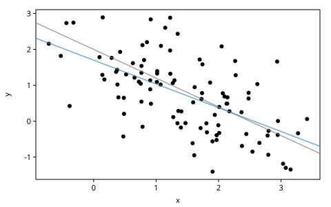
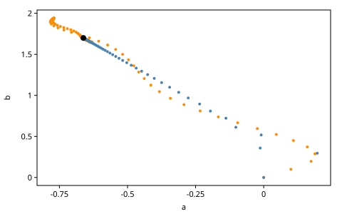
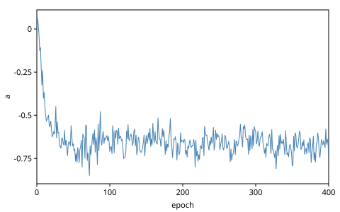
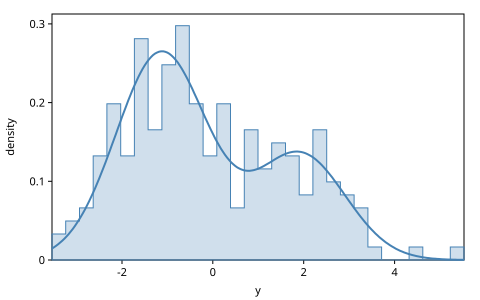
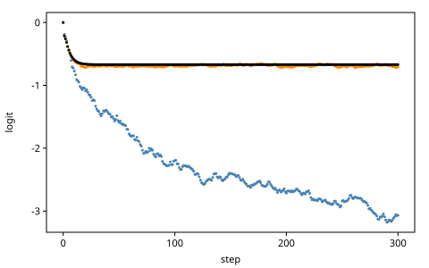
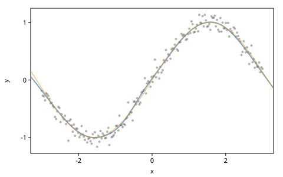

# Learning

Inference recovers what a model's random choices were in one problem.
*Learning* recovers what stays the same across many: the parameters of a
model we will use again, or of a proposal that serves many inference
problems. Gen.jl draws the line there: learning infers long-lived
unobserved quantities, inference short-lived ones. This chapter is about
*maximum-likelihood learning* of *trainable parameters*: numbers that
belong to a generative function rather than to a trace, that have no
prior, and that we fit by following the gradient of the log density of
data.

The chapter ports Gen.jl's *Learning Generative Functions*, which
describes most of its algorithms in prose; here each one runs, and its
answer is checked against an exact one. It merges in the GenMLX book's
*Gradients, Learning and Neural Models*: the two gradients, the
optimizers, the training loop, a neural network as a generative
function, custom gradients and amortized inference. We start with
parameters and their gradients, learn from complete data, then from
incomplete data with EM and Monte Carlo EM, and end by learning a model
together with the proposal that serves it.

<!-- code: ns -->
```clojure
(ns book.learning
  (:refer-clojure :exclude [+ - * /])
  (:require [gen.array :as array :refer [+ - * /]]
            [gen.array.linalg :as linalg]
            [gen.batched :as batched]
            [gen.book.svg :as svg]
            [gen.choicemap :as cm]
            [gen.custom :as custom]
            [gen.dist :as d]
            [gen.dist.core :as dc]
            [gen.dynamic :as dyn :refer [gen]]
            [gen.gfi :as gfi]
            [gen.gradients :as grad]
            [gen.inference.diagnostics :as diag]
            [gen.inference.proposal :as prop]
            [gen.learning :as learn]
            [gen.random :as rng]
            [gen.selection :as sel]))
```

## Parameters

Inside a body, `(param name)` reads a trainable parameter. Gen.jl's first
example has three:

<!-- code: model -->
```clojure
(def model
  (gen []
    (let [x (trace :x (d/normal (param :x-mu) 1))]
      (trace :y (d/normal (+ (* (param :a) x) (param :b)) 1)))))
```

The model draws $x$ around `x-mu`, and $y$ around the line $a x + b$.
None of `x-mu`, `a` and `b` is a choice: none has an address or a prior.
Their values come from a *parameter store*, a map from names to values,
which `dyn/with-params` gives the generative function:

<!-- code: store -->
```clojure
(def truth {:x-mu 1.5 :a -0.8 :b 2.0})

(def tr (gfi/simulate (dyn/with-params model truth) [] (rng/key 1)))

(cm/to-map (:choices tr))
;=> {:x 2.216 :y -0.320} ; float64
```

The trace holds the two choices only. Its score is their log density
under the store's values, with no term for the parameters:

<!-- code: score -->
```clojure
(defn log-density
  "log p(x, y) of a choice map under the store, by hand."
  [{:keys [x-mu a b]} choices]
  (let [x (cm/get-choice choices :x)]
    (+ (dc/log-prob (d/normal x-mu 1) x)
       (dc/log-prob (d/normal (+ (* a x) b) 1) (cm/get-choice choices :y)))))

(array/allclose? (:score tr) (log-density truth (:choices tr)))
;=> true
```

A store is a value. Gen.jl's `init_param!` sets a parameter inside the
generative function, for everyone who holds it; `with-params` returns a
new generative function and leaves `model` as it was. The trace keeps
the store its generative function ran under:

<!-- code: trace-store -->
```clojure
(gfi/stores (:gen-fn tr))
;=> {:x-mu 1.5 :a -0.8 :b 2.0}
```

A model whose parameters have no values cannot run, and says so:

<!-- code: no-store -->
```clojure
;; error: The parameter :x-mu has no value
(gfi/simulate model [] (rng/key 1))
```

## Two gradients

A trace's score is a differentiable function of two kinds of input: its
choices, and the parameters it ran under. gen.gradients differentiates
it with respect to either. `grad/choice-gradients` takes a selection of
continuous choices, and returns their values and the gradient, as choice
maps of the same shape:

<!-- code: choice-gradients -->
```clojure
(def by-choice (grad/choice-gradients tr (sel/select :x :y)))

(cm/to-map (:gradients by-choice))
;=> {:x -0.278 :y 0.547} ; float64
```

With the residual $r = y - (a x + b)$, the log density is
$-(x - x_\mu)^2/2 - r^2/2$ plus a constant, so $\partial/\partial x =
(x_\mu - x) + a r$ and $\partial/\partial y = -r$:

<!-- code: choice-gradients-check -->
```clojure
(let [{:keys [x-mu a b]} truth
      x (tr :x)
      r (- (tr :y) (+ (* a x) b))
      g (:gradients by-choice)]
  [(array/allclose? (cm/get-choice g :x) (+ (- x-mu x) (* a r)))
   (array/allclose? (cm/get-choice g :y) (- r))])
;=> [true true]
```

These are the gradients that MALA and HMC follow (*Gradient-Based MCMC*).
`grad/param-gradients`, Gen.jl's `accumulate_param_gradients!`,
differentiates the same score with respect to the trace's store:

<!-- code: param-gradients -->
```clojure
(def by-param (grad/param-gradients tr))

by-param
;=> {:x-mu 0.716 :a -1.213 :b -0.547} ; float64
```

The derivatives are $x - x_\mu$, $r x$ and $r$:

<!-- code: param-gradients-check -->
```clojure
(let [{:keys [x-mu a b]} truth
      x (tr :x)
      r (- (tr :y) (+ (* a x) b))]
  (mapv array/allclose? [(:x-mu by-param) (:a by-param) (:b by-param)]
        [(- x x-mu) (* r x) r]))
;=> [true true true]
```

Gen.jl accumulates parameter gradients inside the generative function,
for an update to read and reset. In gen.clj a gradient is a value, a map
in the store's shape: to accumulate gradients, add them, and to weigh
them, use `grad/weighted-sum`. Learning climbs the second gradient.

## Learning from complete data

Data are *complete* when every choice is observed. An example's
likelihood is then its trace's density, and maximum likelihood maximizes
$\sum_i \log p(t_i; \theta)$ over the parameters $\theta$. We draw 100
examples from the model under the true store, and from here on forget
the store:

<!-- code: dataset -->
```clojure
(def dataset
  (mapv #(:choices (gfi/simulate (dyn/with-params model truth) [] %))
        (rng/split (rng/key 2) 100)))
```

For this model the maximum is known in closed form. The log density is a
term in `x-mu` plus a term in `a` and `b`, so `x-mu` is the mean of the
$x$'s, and `a` and `b` are the least-squares line of $y$ on $x$:

<!-- code: mle -->
```clojure
(defn column
  "The values at addr across data, an array."
  [data addr]
  (array/array (mapv #(array/item (cm/get-choice % addr)) data)))

(defn mle
  "The maximum-likelihood store for complete data: x-mu the mean of the
   x's, and a and b the least-squares line of the y's on the x's."
  [data]
  (let [x (column data :x)
        y (column data :y)
        dx (- x (array/mean x))
        a (/ (array/sum (* dx (- y (array/mean y)))) (array/sum (* dx dx)))]
    {:x-mu (array/mean x) :a a :b (- (array/mean y) (* a (array/mean x)))}))

(def exact (mle dataset))

exact
;=> {:x-mu 1.451 :a -0.662 :b 1.700} ; float64
```

Each example becomes a trace by `generate` with all of its choices
constrained, under the store being tried. The *objective* is the traces'
mean score. Gen.jl sums the scores; the mean keeps a good step size
independent of the number of examples:

<!-- code: traces-under -->
```clojure
(defn traces-under
  "Traces of model under store, one for each example of data, generated
   with every choice constrained: each trace's score is its example's log
   density."
  [store data key]
  (mapv (fn [choices k]
          (:trace (gfi/generate (dyn/with-params model store) [] choices k)))
        data
        (rng/split key (count data))))

(defn objective
  "The mean score of traces: the log likelihood per example."
  [traces]
  (/ (reduce + (map #(array/item (:score %)) traces)) (count traces)))

(def start {:x-mu 0.0 :a 0.0 :b 0.0})

(objective (traces-under start dataset (rng/key 3)))
;=> -4.140 ; float64
```

Its gradient is the mean of the traces' parameter gradients. At
$\theta = 0$ the derivatives above are the means of $x$, $x y$ and $y$:

<!-- code: gradient -->
```clojure
(defn complete-gradient
  "The gradient of the objective on data at store: the mean of its
   traces' parameter gradients."
  [data]
  (fn [store key]
    (grad/mean (map grad/param-gradients (traces-under store data key)))))

(def g0 ((complete-gradient dataset) start (rng/key 4)))

(let [x (column dataset :x)
      y (column dataset :y)]
  (mapv array/allclose? [(:x-mu g0) (:a g0) (:b g0)]
        [(array/mean x) (array/mean (* x y)) (array/mean y)]))
;=> [true true true]
```

Learning is now gradient ascent. An *optimizer* takes a store and a
gradient and returns a new store: `learn/init` makes its first state,
and `learn/step` takes a step, returning the new store and state.
`ascend` threads them through a loop, one key a step, and returns every
store along the way:

<!-- code: ascend -->
```clojure
(defn ascend
  "The stores along steps of optimizer from store, each step along
   (gradient store key): a lazy sequence of steps + 1 stores."
  [optimizer store steps gradient key]
  (map first
       (reductions (fn [[store state] k]
                     (learn/step optimizer state store (gradient store k)))
                   [store (learn/init optimizer store)]
                   (rng/split key steps))))
```

A trace cannot be reused from one step to the next: it holds the store
it ran under, so each step generates the traces again under the new one.
(Gen.jl's `train_model` generates its traces once, because there the
parameters live in the generative function and change in place.) SGD
with a step of 0.4 reaches the closed form in 150 steps:

<!-- code: fit -->
```clojure
(def sgd-path
  (vec (ascend (learn/sgd {:lr 0.4}) start 150
               (complete-gradient dataset) (rng/key 5))))

(def fitted (peek sgd-path))

(defn near?
  "Is every parameter of store within tol of target's?"
  [store target tol]
  (every? (fn [[k v]] (< (abs (- (array/item (store k)) (array/item v))) tol))
          target))

(near? fitted exact 1e-4)
;=> true

(objective (traces-under fitted dataset (rng/key 6)))
;=> -2.623 ; float64
```

<!-- code: fit-figure -->
```clojure
;; figure: figures/028-complete-fit.svg
(svg/plot [{:points (mapv vector
                          (array/->clj (column dataset :x))
                          (array/->clj (column dataset :y)))}
           {:curves [#(+ (* (:a truth) %) (:b truth))] :color "gray"}
           {:curves [#(+ (* (:a fitted) %) (:b fitted))]}])
```



## Optimizers

gen.learning has Gen.jl's three update rules, as data: `sgd`
(Gen.jl's `FixedStepGradientDescent`), `gradient-descent`
(`GradientDescent`, whose step decays) and `adam`. It also has the
common rules that GenFluxOptimizers brings to Gen.jl: `momentum` (with
Nesterov's variant), `rmsprop`, `adagrad` and `adamw`, and `clip-norm`,
which clips the gradients before another rule's step. *Extending
gen.clj* adds a rule of its own. Every rule ascends, since the objective
is a log density. They differ in how far a step goes. Take one step from 0 along a gradient whose second coordinate is a
hundredth of its first:

<!-- code: one-step -->
```clojure
(def s0 {:a 0.0 :b 0.0})

(def g {:a 1.0 :b 0.01})

(defn one-step
  "The store after one step of optimizer from s0 along g."
  [optimizer]
  (first (learn/step optimizer (learn/init optimizer s0) s0 g)))

(one-step (learn/sgd {:lr 0.1}))
;=> {:a 0.1 :b 0.001}

(one-step (learn/adam {:lr 0.1}))
;=> {:a 0.1 :b 0.0999999}
```

SGD moves each parameter in proportion to its gradient. Adam's first
step moves each by about its learning rate, whatever the gradient's
scale, because it divides by a running root mean square of the gradient.
`gradient-descent`'s step is $s_0 (\beta + 1)/(\beta + t)$ at step $t$:
0.1 at the first and $0.1 \cdot 11/12$ at the second:

<!-- code: gradient-descent -->
```clojure
(let [opt (learn/gradient-descent {:step-size-init 0.1 :step-size-beta 10})
      [s1 state] (learn/step opt (learn/init opt s0) s0 g)
      [s2 _] (learn/step opt state s1 g)]
  [(:a s1) (- (:a s2) (:a s1))])
;=> [0.1 0.0917]
```

SGD's step has a limit. This objective is a quadratic bowl, and a step
of SGD multiplies the distance from the maximum along each of the bowl's
axes by $1 - \text{lr}\,\lambda$, where $\lambda$ is the curvature along
that axis. Every factor must be smaller than 1 in size, so SGD converges
when $\text{lr} < 2/\lambda_{\max}$. The curvature in $(a, b)$ is the
matrix of the $x$'s moments:

<!-- code: curvature -->
```clojure
(defn curvatures
  "The eigenvalues of the objective's curvature in (a, b), the matrix
   [[mean x², mean x] [mean x, 1]], the largest first (x-mu's is 1)."
  [data]
  (let [x (column data :x)
        xx (array/item (array/mean (* x x)))
        t (+ xx 1.0)
        det (- xx (array/item (array/square (array/mean x))))
        largest (/ (+ t (Math/sqrt (- (* t t) (* 4.0 det)))) 2.0)]
    [largest (/ det largest)]))

(curvatures dataset)
;=> [3.747 0.234] ; float64

(def lr-max (/ 2.0 (first (curvatures dataset))))

lr-max
;=> 0.534 ; float64
```

A little below the limit SGD converges; a little above it, it diverges:

<!-- code: threshold -->
```clojure
(defn error-after
  "How far a is from the MLE after steps of SGD at lr."
  [lr steps]
  (let [store (last (ascend (learn/sgd {:lr lr}) start steps
                            (complete-gradient dataset) (rng/key 7)))]
    (abs (- (array/item (:a store)) (array/item (:a exact))))))

[(< (error-after (* 0.95 lr-max) 200) 1e-3)
 (> (error-after (* 1.05 lr-max) 200) 1e3)]
;=> [true true]
```

The two curvatures differ by a factor of 16: the bowl is a long, narrow
ridge, because a steeper line fits the same points only with a higher
intercept (as in *Getting Started*). The step that the steep axis
allows is slow along the flat one. Adam rescales each parameter's step,
and reaches the maximum at its learning rate 0.1 by another path:

<!-- code: adam -->
```clojure
(def adam-path
  (vec (ascend (learn/adam {:lr 0.1}) start 150
               (complete-gradient dataset) (rng/key 8))))

(near? (peek adam-path) exact 1e-3)
;=> true
```

<!-- code: paths-figure -->
```clojure
;; figure: figures/028-paths.svg
(let [ab (fn [path] (mapv (fn [s] [(:a s) (:b s)]) path))]
  (svg/plot [{:points (ab adam-path) :color "darkorange" :r 2}
             {:points (ab sgd-path) :color "steelblue" :r 2}
             {:points [[(:a exact) (:b exact)]] :r 4}]
            {:x-label "a" :y-label "b"}))
```



SGD crosses the ridge in a few steps and then creeps along it. Adam
moves along the ridge from the start, overshoots and comes back.

A step takes a tree of stores and a tree of gradients of the same shape.
So `{:model store :proposal store}` steps two generative functions'
stores at once, as Gen.jl's `ParamUpdate` does with several of them; the
last section uses it. A step updates only the parameters it is given
gradients for, which exercise 3 uses.

## Training on minibatches

A gradient over the whole dataset costs a pass over it. Stochastic
gradient ascent uses a *minibatch* instead: a few examples drawn at
random, whose mean gradient estimates the full one without bias.
`learn/train` is Gen.jl's `train!`: each step draws a minibatch from a
*data function* and takes one optimizer step along its mean gradient.

Maximum likelihood also trains *discriminative* models, whose arguments
differ from example to example. Gen.jl's minimal one regresses $y$ on
$x$:

<!-- code: disc-model -->
```clojure
(def disc-model
  (gen [x]
    (trace :y (d/normal (+ (* (param :a) x) (param :b)) 1))))
```

Its maximum-likelihood `a` and `b` are the generative model's: that
model's log density is $\log p(x; x_\mu) + \log p(y \mid x; a, b)$, and
only the second term depends on `a` and `b`. `train`'s data function
takes a key and returns one example, its arguments and its constraints.
Ours draws one from the dataset:

<!-- code: example -->
```clojure
(defn example
  "One example of the dataset, drawn uniformly with key: [args
   constraints], as train's data-fn returns them."
  [key]
  (let [choices (dataset (array/item (rng/randint key 0 (count dataset))))]
    [[(cm/get-choice choices :x)]
     (cm/choicemap :y (cm/get-choice choices :y))]))
```

`train` runs epochs of minibatches and returns the store with a history.
We call it one epoch at a time, ten minibatches of ten examples, to see
the store after each:

<!-- code: train -->
```clojure
(def epochs
  (vec (reductions
        (fn [{:keys [store]} key]
          (learn/train disc-model store (learn/sgd {:lr 0.05})
                       example grad/param-gradients
                       {:epochs 1 :batches-per-epoch 10 :batch-size 10
                        :key key}))
        {:store {:a 0.0 :b 0.0}}
        (rng/split (rng/key 9) 400))))

(:history (peek epochs))
;=> [-1.346] ; float64
```

`train` differs from Gen.jl's `train!` in two ways.
It calls the data function for every example of every minibatch, where
Gen.jl draws an epoch's examples once and takes the minibatches from
them. And its history holds each epoch's mean score of its last
minibatch, where Gen.jl's holds the mean log density of fresh held-out
examples. The gradients are the same; the histories measure different
things, and gen.clj's is noisier.

With a fixed step, SGD on minibatches does not settle. Each minibatch's
gradient points to that minibatch's own maximum, so the store keeps
moving in a cloud around the full data's maximum:

<!-- code: epochs-figure -->
```clojure
;; figure: figures/028-epochs.svg
(svg/series (map #(get-in % [:store :a]) epochs)
            {:x-label "epoch" :y-label "a"})
```



The cloud's spread is a few hundredths, where full-batch SGD reached
$10^{-4}$. Its center is the maximum. The expected minibatch gradient is
the full gradient, which is linear in the parameters here, so the mean
of the stores converges to the maximum: averaging the stores (Polyak
averaging) recovers it. The settled epochs are a correlated chain, so we
compare their mean with the maximum by its Monte Carlo standard error,
as *Getting Started* did a chain's:

<!-- code: polyak -->
```clojure
(defn settled
  "The parameter k's values after each epoch from the 100th on."
  [k]
  (mapv #(array/item (get-in % [:store k])) (subvec epochs 100)))

(def a-summary (diag/summary (settled :a)))

(def b-summary (diag/summary (settled :b)))

[(:sd a-summary) (:sd b-summary)]
;=> [0.047 0.044] ; float64

(mapv (fn [s k]
        (< (abs (- (:mean s) (array/item (k exact)))) (* 5 (:mcse-mean s))))
      [a-summary b-summary] [:a :b])
;=> [true true]
```

## Learning from incomplete data

Usually some choices go unobserved. An example's likelihood is then the
*marginal likelihood* of what was observed, a sum (or integral) over the
unobserved choices $z$:

$$
\log p(y; \theta) = \log \sum_z p(z, y; \theta).
$$

Gen.jl's tutorial describes the algorithms built on it in prose. We run
them on a mixture of two normals, whose marginal is a sum of two terms,
so that every answer can be checked exactly. Each point flips $z$ with
probability $\sigma(\text{logit})$ and draws $y$ around `mu1` or `mu0`;
the learner sees only the $y$'s:

<!-- code: mixture -->
```clojure
(def point
  (gen []
    (let [z (trace :z (d/bernoulli (array/sigmoid (param :logit))))]
      (trace :y (d/normal (array/where z (param :mu1) (param :mu0)) 1)))))

(def mixture-truth {:mu0 -1.0 :mu1 2.0 :logit (Math/log (/ 0.3 0.7))})

(def ys
  (mapv #(:retval (gfi/simulate (dyn/with-params point mixture-truth) [] %))
        (rng/split (rng/key 10) 200)))
```

`log-marginal` assesses both completions of a point and sums them in
exp space:

<!-- code: marginal -->
```clojure
(defn log-marginal
  "log p(y) = log Σ_z p(z, y) under store: the two completions' log
   densities, assessed, and summed in exp space."
  [store y]
  (let [m (dyn/with-params point store)
        joint (fn [z] (:weight (gfi/assess m [] (cm/choicemap :z z :y y)
                                           (rng/key 0))))]
    (array/logaddexp (joint false) (joint true))))

(def store0 {:mu0 0.0 :mu1 1.0 :logit 0.0})

(log-marginal store0 (first ys))
;=> -1.171 ; float64
```

The marginal likelihood's gradient is an average over completions. By
*Fisher's identity*,

$$
\nabla_\theta \log p(y; \theta)
= \mathbb{E}_{z \sim p(z \mid y; \theta)}\,
  \nabla_\theta \log p(z, y; \theta),
$$

it is each completion's complete-data gradient, weighted by the
completion's posterior probability. A completion is a trace with $z$
filled in:

<!-- code: completions -->
```clojure
(defn completions
  "Both completions of y under store, as traces, with their posterior
   probabilities p(z | y)."
  [store y key]
  (let [m (dyn/with-params point store)
        traces (mapv (fn [z k]
                       (:trace (gfi/generate m [] (cm/choicemap :z z :y y) k)))
                     [false true]
                     (rng/split key 2))
        scores (mapv #(array/item (:score %)) traces)
        total (array/item (array/logaddexp (scores 0) (scores 1)))]
    {:traces traces :probs (mapv #(Math/exp (- % total)) scores)}))
```

The two traces' parameter gradients, weighted by their probabilities
(Gen.jl's `accumulate_param_gradients!` with a scale factor), sum to the
gradient of `log-marginal`, which `array/grad` takes directly:

<!-- code: fisher -->
```clojure
(let [y (first ys)
      {:keys [traces probs]} (completions store0 y (rng/key 11))
      fisher (grad/weighted-sum probs (map grad/param-gradients traces))
      direct ((array/grad #(log-marginal % y)) store0)]
  (every? #(array/allclose? (% fisher) (% direct)) [:mu0 :mu1 :logit]))
;=> true
```

This is the pattern behind Gen.jl's list of algorithms: complete the
hidden choices by inference under the current $\theta$, then step
$\theta$ along the completed data's gradient. `weighted-gradient` does
it for every point at once. `batched/generate` with `:per-particle`
runs the model once for all the completions, each constrained by its
own choice map, and `batched/map-particles` takes every completion's
parameter gradients in the same batched run; each point's weights are
normalized by a softmax (*Speeding Up* has more on batched execution):

<!-- code: weighted-gradient -->
```clojure
(defn weighted-gradient
  "The mean over points of each point's completions' parameter gradients,
   weighted by the completions' normalized importance weights. cs holds k
   completions (choice maps) of each point in turn, generated by m as one
   batch."
  [m cs k key]
  (let [n (quot (count cs) k)
        {:keys [particles weights]}
        (batched/generate m [] cm/EMPTY (count cs) key {:per-particle cs})
        probs (array/softmax (array/reshape weights [n k]))
        grads (batched/map-particles particles
                                     (fn [t _] (grad/param-gradients t)) nil)]
    (array/tree-map #(/ (array/sum (* probs (array/reshape % [n k]))) n)
                    grads)))

(defn em-gradient
  "The gradient of the mixture at store along k completions of each point
   of cs (weighted-gradient)."
  [cs k]
  (fn [store key]
    (weighted-gradient (dyn/with-params point store) cs k key)))

(defn enumerated
  "Both completions of each of ys: :z false, then true."
  [ys]
  (vec (for [y ys z [false true]] (cm/choicemap :z z :y y))))

(defn marginal-gradient
  "The gradient of the mean log marginal likelihood of ys at store."
  [store]
  (grad/mean (map (fn [y] ((array/grad #(log-marginal % y)) store)) ys)))

(let [batch ((em-gradient (enumerated ys) 2) store0 (rng/key 12))
      direct (marginal-gradient store0)]
  (every? #(array/allclose? (% batch) (% direct)) [:mu0 :mu1 :logit]))
;=> true
```

With both completions of every point and their exact weights, one
gradient step a round is *EM* in its gradient form (generalized EM). By
Fisher's identity it is also gradient ascent on the marginal likelihood,
and it stops where the marginal's gradient vanishes:

<!-- code: em -->
```clojure
(def em-path
  (vec (ascend (learn/sgd {:lr 2.0}) store0 300
               (em-gradient (enumerated ys) 2) (rng/key 13))))

(def em (peek em-path))

em
;=> {:mu0 -1.134 :mu1 1.913 :logit -0.670} ; float64

(every? #(< (abs (array/item %)) 1e-5) (vals (marginal-gradient em)))
;=> true
```

The textbook EM instead jumps to the maximum of the completed objective
each round, in closed form for this model: the responsibilities, then
the means they weigh. It finds the same maximum:

<!-- code: classic-em -->
```clojure
(defn classic-em-step
  "One step of the textbook EM for the mixture, in closed form: each
   point's responsibility r = p(z = 1 | y), then the means weighted by
   them and their mean."
  [{:keys [mu0 mu1 logit]}]
  (let [y (array/array ys)
        r (array/sigmoid (+ logit (* 0.5 (- (array/square (- y mu0))
                                              (array/square (- y mu1))))))
        pi (array/mean r)]
    {:mu0 (array/item (/ (array/sum (* (- 1.0 r) y)) (array/sum (- 1.0 r))))
     :mu1 (array/item (/ (array/sum (* r y)) (array/sum r)))
     :logit (array/item (array/log (/ pi (- 1.0 pi))))}))

(def mle-mixture (nth (iterate classic-em-step store0) 500))

(near? em mle-mixture 1e-4)
;=> true
```

<!-- code: mixture-figure -->
```clojure
;; figure: figures/028-mixture.svg
(svg/histogram [{:values ys :density #(array/exp (log-marginal em %))}]
               {:bins 30 :x-label "y"})
```



## Monte Carlo EM

Enumerating completions works for a coin. For a hidden choice with many
values, or a continuous one, Monte Carlo EM samples them. Gen.jl's
tutorial draws completions by importance sampling, and either resamples
them or keeps them weighted. Here a point's completions are $k$ samples
of $z$ from the model's internal proposal, the prior, kept with their
normalized importance weights: the same `weighted-gradient`, given
choice maps that constrain $y$ only. With 20 samples a point, the logit
settles near the maximum but not on it: averaged over the last 200 steps
of four runs, it is 0.02 below, more than five Monte Carlo standard
errors (as for Polyak averaging above). That is a bias, not noise:

<!-- code: sampled -->
```clojure
(defn sampled
  "k copies of each of ys's observation, completions whose z the batch's
   internal proposal, the prior, fills in."
  [ys k]
  (vec (for [y ys _ (range k)] (cm/choicemap :y y))))

(defn mc-em
  "Monte Carlo EM: the logit along steps of SGD, each along the gradient
   weighted over k sampled completions of every point."
  [k steps key]
  (mapv #(array/item (:logit %))
        (ascend (learn/sgd {:lr 2.0}) store0 steps
                (em-gradient (sampled ys k) k) key)))

(def mc-20-runs (mapv #(mc-em 20 300 %) (rng/split (rng/key 14) 4)))

(def mc-20 (first mc-20-runs))

(def mc-20-summary (diag/summary (mapv #(subvec % 100) mc-20-runs)))

[(:mean mc-20-summary) (:mcse-mean mc-20-summary) (:logit mle-mixture)]
;=> [-0.6906 0.00175 -0.6702] ; float64

(let [{:keys [mean mcse-mean]} mc-20-summary]
  (< mean (- (:logit mle-mixture) (* 5 mcse-mean))))
;=> true
```

With 5 it drifts away: after 300 steps the logit is below the maximum
by more than five times its spread over runs (0.20, measured over ten
runs):

<!-- code: mc-em-5 -->
```clojure
(def mc-5 (mc-em 5 300 (rng/key 15)))

;; the last logit's spread over ten runs (keys 101 to 110): 0.20
(< (peek mc-5) (- (:logit mle-mixture) (* 5 0.20)))
;=> true
```

<!-- code: em-figure -->
```clojure
;; figure: figures/028-em.svg
(let [dots (fn [logits color]
             {:points (map-indexed vector logits) :color color :r 1.5})]
  (svg/plot [(dots mc-5 "steelblue")
             (dots mc-20 "darkorange")
             (dots (map :logit em-path) "black")]
            {:x-label "step" :y-label "logit"}))
```



The weights are *self-normalized*: each point's are divided by their
sum, which biases the weighted gradient for a finite $k$, and that is
the gap at 20 samples. Here the bias has a direction. A point whose $k$
samples all have $z = 0$ counts wholly for component 0, however close it
lies to component 1, and that happens with probability $(1 - \pi)^k$:

<!-- code: no-sample-rate -->
```clojure
(let [pi (array/sigmoid (:logit mle-mixture))]
  (mapv #(array/pow (- 1.0 pi) %) [20 5]))
;=> [0.00026 0.127] ; float64
```

With 5 samples, one point in eight has no say for component 1. The
E-step undercounts component 1, the step lowers the logit, the prior then
proposes $z = 1$ less often, and the drift feeds itself. At the maximum,
where the exact gradient is 0, the estimated logit gradient averages
$-0.033$ over 100 keys, more than twenty standard errors below 0:

<!-- code: bias -->
```clojure
(defn mean-and-error
  "The mean of independent draws xs, and its standard error."
  [xs]
  (let [{:keys [mean sd]} (diag/summary xs)]
    [mean (/ sd (Math/sqrt (count xs)))]))

(def at-mle
  (let [gradient (em-gradient (sampled ys 5) 5)]
    (mapv #(array/item (:logit (gradient mle-mixture %)))
          (rng/split (rng/key 16) 100))))

(mean-and-error at-mle)
;=> [-0.0326 0.0014] ; float64

(let [[mean se] (mean-and-error at-mle)]
  (< mean (* -5 se)))
;=> true
```

Gen.jl's tutorial also sketches *online* Monte Carlo EM, which keeps one
round's completions to start the next round's inference, by MCMC,
instead of sampling afresh. A better proposal is the other remedy, and
the last two sections learn one.

## A neural network as a generative function

gen.clj has no library of network layers (GenMLX's `nn` namespace is not
yet ported). A network is a function of arrays and weights, so gen.array
is enough. This one has one hidden layer of tanh units, from scalars to
scalars, applied to each element of an array:

<!-- code: mlp -->
```clojure
(defn mlp
  "A network of one hidden layer of tanh units, applied to each element of
   the 1-d array xs: w1 and b1 the hidden layer's weights and biases, [h]
   each, and w2 ([h]) and b2 the output's."
  [{:keys [w1 b1 w2 b2]} xs]
  (+ (array/matmul (array/tanh (+ (array/outer xs w1) b1)) w2) b2))

(def net
  (custom/deterministic
   {:params [:w1 :b1 :w2 :b2]
    :apply (fn [[xs] params] (mlp params xs))}))
```

`custom/deterministic` makes it a generative function. It makes no
choices and its score is 0; with `:params`, its weights are trainable
parameters, read from the store in effect: the store of the model that
calls it. The network gives the mean of every observation, and the
noise's scale is a parameter too, on the log scale so that it stays
positive:

<!-- code: curve -->
```clojure
(def curve
  (gen [xs]
    (let [mean (splice :net net xs)]
      (trace :ys (d/normal mean (array/exp (param :log-sigma)))))))
```

`splice` calls the network as it would any generative function. `:ys`
is one choice, an array of 200 values, whose log density is the sum of
theirs. The data are $\sin x$ plus noise of standard deviation 0.1, and
the initial weights are random:

<!-- code: net-data -->
```clojure
(def grid (array/linspace -3.0 3.0 200))

(def noisy (+ (array/sin grid) (* 0.1 (rng/normal (rng/key 17) [200]))))

(defn initial-store
  "Random weights for h hidden units (the output's scaled by 1/√h), zero
   biases, and log-sigma 0."
  [h key]
  (let [[k1 k2] (rng/split key)]
    {:w1 (rng/normal k1 [h]) :b1 (array/zeros [h])
     :w2 (/ (rng/normal k2 [h]) (Math/sqrt h)) :b2 0.0
     :log-sigma 0.0}))
```

Training is the complete-data loop again, on one trace that holds the
whole dataset, with Adam:

<!-- code: net-train -->
```clojure
(defn curve-gradient
  "The gradient of the log likelihood of the noisy data at store."
  [store key]
  (let [m (dyn/with-params curve store)]
    (grad/param-gradients
     (:trace (gfi/generate m [grid] (cm/choicemap :ys noisy) key)))))

(def trained
  (last (ascend (learn/adam {:lr 0.01}) (initial-store 16 (rng/key 18)) 3000
                curve-gradient (rng/key 19))))
```

At the maximum the derivative in the noise's scale is zero:
$n(\text{rms}^2/\sigma^2 - 1) = 0$, so the learned $\sigma$ is the
residuals' root mean square. Both are a little below that of the noise
actually drawn:

<!-- code: net-check -->
```clojure
(def fitted-mean (mlp trained grid))

(def rms (array/sqrt (array/mean (array/square (- noisy fitted-mean)))))

(def noise-rms
  (array/sqrt (array/mean (array/square (- noisy (array/sin grid))))))

[(array/exp (:log-sigma trained)) rms noise-rms]
;=> [0.0866 0.0871 0.0887] ; float64
```

A trained network's result depends on its data and its initial weights,
so its checks take their bands from training it again: ten times, each
with its own noise and initial weights, the spreads measured once and
written beside the checks. The learned $\sigma$ is the residuals' root
mean square within five times its spread, and the noise's true scale,
0.1, within five times its spread over datasets: the noise drawn here
happens to be small. The residuals are no larger than the noise, so the
network leaves nothing of $\sin x$ unexplained (they are a little
smaller, since it fits a little of the noise). And the network's mean is
nearer $\sin x$ than the data are. Its root-mean-square distance from
$\sin x$ is 0.019, a fifth of the noise's, and the gap is more than five
times its spread:

<!-- code: net-check-bands -->
```clojure
(def fit-error
  (array/sqrt (array/mean (array/square (- fitted-mean (array/sin grid))))))

fit-error
;=> 0.0191 ; float64

;; spreads over ten trainings, each with its own noise (keys 201 to 210)
;; and initial weights (keys 101 to 110): 0.00033 of sigma - rms, 0.0066
;; of sigma, 0.00073 of rms - noise-rms, 0.0060 of noise-rms - fit-error
(let [sigma (array/item (array/exp (:log-sigma trained)))]
  [(< (abs (- sigma (array/item rms))) (* 5 0.00033))
   (< (abs (- sigma 0.1)) (* 5 0.0066))
   (< (array/item (- rms noise-rms)) (* 5 0.00073))
   (> (array/item (- noise-rms fit-error)) (* 5 0.0060))])
;=> [true true true true]
```

<!-- code: net-figure -->
```clojure
;; figure: figures/028-network.svg
(svg/plot [{:points (mapv vector (array/->clj grid) (array/->clj noisy))
            :r 2 :opacity 0.3}
           {:curves [#(mlp trained (array/array [%]))] :width 2}
           {:curves [#(Math/sin %)] :color "darkorange" :width 1}])
```



On its own, the network is a generative function without randomness.
Given its weights by `custom/with-params`, its trace has no choices and
score 0, and its return value is the network's output. So it composes
with the rest: a model can splice it, a Map can map it, and inference
can work on the choices around it.

<!-- code: net-trace -->
```clojure
(let [weights (select-keys trained [:w1 :b1 :w2 :b2])
      t (gfi/simulate (custom/with-params net weights) [grid] (rng/key 20))]
  [(cm/empty? (:choices t))
   (:score t)
   (array/allclose? (:retval t) fitted-mean)])
;=> [true 0.0 true]
```

## Custom gradients

Gradients reach a model's choices and parameters through the operations
gen.array runs. Code that computes on host numbers (a solver, a
simulator, a call into a library) is invisible to differentiation.
Kepler's equation is an example: the eccentric anomaly $E$ of an orbit
solves $E - e \sin E = m$, which has no closed form, so Newton's method
finds it:

<!-- code: kepler -->
```clojure
(defn eccentric-anomaly
  "E with E - e·sin E = m (Kepler's equation), by Newton's method on host
   doubles."
  [m e]
  (loop [E m i 0]
    (if (< i 20)
      (recur (- E (/ (- E (* e (Math/sin E)) m) (- 1.0 (* e (Math/cos E)))))
             (inc i))
      E)))

(eccentric-anomaly 1.2 0.5)
;=> 1.6961
```

As a deterministic generative function it reads $m$ on the host, so
differentiation cannot follow $m$ through it. In a model that observes
$E$ with noise, $m$'s gradient would then be its prior's term alone,
$(1 - 1.2)/0.5^2 = -0.8$, with the likelihood's dependence on $m$ lost.

<!-- code: anomaly-plain -->
```clojure
(def anomaly-plain
  (custom/deterministic
   {:apply (fn [[m]] (eccentric-anomaly (array/item m) 0.5))}))

(defn orbit
  "A mean anomaly m, its eccentric anomaly by the function anomaly, and a
   noisy observation of it."
  [anomaly]
  (gen []
    (let [m (trace :m (d/normal 1.0 0.5))]
      (trace :obs (d/normal (splice :E anomaly m) 0.1)))))

(defn m-gradient
  "The derivative in m of the log density of orbit's trace at m = 1.2 and
   obs = 1.9."
  [anomaly]
  (let [t (:trace (gfi/generate (orbit anomaly) []
                                (cm/choicemap :m 1.2 :obs 1.9) (rng/key 21)))]
    (cm/get-choice (:gradients (grad/choice-gradients t (sel/select :m)))
                   :m)))
```

gen.clj does not let the gradient go wrong silently: reading a value
being differentiated on the host is an error, and its message names the
ways out.

<!-- code: anomaly-plain-error -->
```clojure
;; error: Cannot read a value being differentiated on the host
(m-gradient anomaly-plain)
```

A `:gradient` gives the derivative instead (Gen.jl's
`CustomGradientGF`). By the implicit function theorem, $dE/dm =
1/(1 - e \cos E)$. The gradient function takes the arguments, the return
value and the return value's cotangent, and returns one gradient per
argument:

<!-- code: anomaly -->
```clojure
(def anomaly
  (custom/deterministic
   {:apply (fn [[m]] (eccentric-anomaly (array/item m) 0.5))
    :gradient (fn [_ E retgrad]
                [(/ retgrad (- 1.0 (* 0.5 (array/cos E))))])}))

(let [E (eccentric-anomaly 1.2 0.5)
      dE (/ 1.0 (- 1.0 (* 0.5 (Math/cos E))))]
  (array/allclose? (m-gradient anomaly)
                   (+ (/ (- 1.0 1.2) 0.25) (* (/ (- 1.9 E) 0.01) dE))))
;=> true
```

A central difference of the assessed density agrees:

<!-- code: anomaly-fd -->
```clojure
(defn orbit-density
  "The log density of orbit at m and obs = 1.9."
  [m]
  (array/item (:weight (gfi/assess (orbit anomaly) []
                                   (cm/choicemap :m m :obs 1.9) (rng/key 0)))))

(let [h 1e-3]
  (/ (- (orbit-density (+ 1.2 h)) (orbit-density (- 1.2 h))) (* 2 h)))
;=> 18.39
```

gen.custom's documentation has the variants that keep state, and the
gradients of a deterministic function's own parameters.

## Amortized inference: learning a proposal

Every inference problem so far started from scratch. An *amortized*
proposal is trained once to map an observation to a distribution on the
latent choices, and then serves every new observation with one forward
pass. For the mixture, the posterior of $z$ given $y$ is a logistic
function of $y$, so a proposal of that form can be exact:

<!-- code: proposal -->
```clojure
(def proposal
  (gen [constraints]
    (when-not (cm/has-value? (cm/get-submap constraints :z))
      (let [y (cm/get-choice constraints :y)]
        (trace :z (d/bernoulli (array/sigmoid (+ (* (param :w) y)
                                                  (param :c)))))))))

(defn guided
  "The mixture under model-store, generating with its z drawn by the
   proposal under q-store (the internal-proposal override)."
  [model-store q-store]
  (prop/with-internal-proposal (dyn/with-params point model-store)
                               (dyn/with-params proposal q-store)))
```

The proposal reads $y$ from its argument, the constraints, and proposes
$z$ only when the constraints leave it open. That is the form of an
*internal proposal* (`prop/with-internal-proposal`): `guided` is the
mixture whose `generate` draws $z$ from the proposal instead of the
prior, weighed so that importance sampling stays unbiased. The best
parameters follow from the model, $\log p(z = 1, y) - \log p(z = 0, y) =
\text{logit} + (\mu_1 - \mu_0) y - (\mu_1^2 - \mu_0^2)/2$, and agree with
the completions' probabilities:

<!-- code: posterior-logit -->
```clojure
(defn posterior-logit
  "The exact posterior's logit, w·y + c, under the mixture's store: log
   p(z = 1, y) - log p(z = 0, y)."
  [{:keys [mu0 mu1 logit]}]
  {:w (- mu1 mu0) :c (- logit (/ (- (* mu1 mu1) (* mu0 mu0)) 2.0))})

(def best (posterior-logit mle-mixture))

best
;=> {:w 3.047 :c -1.857} ; float64

(let [y (first ys)
      {:keys [w c]} best]
  (array/allclose? (second (:probs (completions mle-mixture y (rng/key 22))))
                   (array/sigmoid (+ (* w y) c))))
;=> true
```

The *sleep phase* of the wake-sleep algorithm trains a proposal on the
model's own dreams: simulate a trace of the model, and raise the
proposal's log density of the trace's latent choices given its
observation. `learn/lecture-batched` (Gen.jl's `lecture_batched!`) gives
that log density's mean over $n$ traces, with its gradient. Its
expectation is largest where the proposal equals the posterior:

<!-- code: sleep -->
```clojure
(def learned-model (dyn/with-params point mle-mixture))

(defn q-args
  "The proposal's arguments for a trace of the model: its observation, as
   constraints."
  [t]
  [(cm/choicemap :y (t :y))])

(defn sleep-gradient
  "The gradient at a proposal's store of its mean log density of the
   latent choices of 20 of model's own traces (lecture-batched)."
  [model]
  (fn [store key]
    (:grads (learn/lecture-batched model [] proposal store q-args 20 key))))

(def sleep-path
  (mapv (fn [s] [(array/item (:w s)) (array/item (:c s))])
        (ascend (learn/adam {:lr 0.1}) {:w 0.0 :c 0.0} 1500
                (sleep-gradient learned-model) (rng/key 23))))
```

The parameters wander with the minibatches of dreams. Averaged over the
second half of the run, they come close to the best ones. The trained
proposal is a learned function, so its band, like the network's, comes
from training it again with ten other keys: at every data point, its
probability of $z = 1$ agrees with the posterior's within five times
the largest spread of that probability (0.009 apart at worst):

<!-- code: sleep-check -->
```clojure
(def trained-q
  (let [tail (subvec sleep-path 750)]
    {:w (:mean (diag/summary (mapv first tail)))
     :c (:mean (diag/summary (mapv second tail)))}))

trained-q
;=> {:w 3.10 :c -1.86} ; float64

;; the largest spread of the proposal's probability at a point of ys, over
;; ten trainings (keys 101 to 110): 0.0078
(let [y (array/array ys)
      prob (fn [{:keys [w c]}] (array/sigmoid (+ (* w y) c)))]
  (< (array/item (array/max (array/abs (- (prob trained-q) (prob best)))))
     (* 5 0.0078)))
;=> true
```

With the trained proposal, the importance weights of a point's samples
are nearly equal: each is $p(z, y)/q(z \mid y) \approx p(y)$, whatever
$z$ is. So 20 samples are worth 20, where from the prior they are worth
12. `ess-fractions` gives each point's effective sample size of weighted
samples (as gen.inference.weights computes it, not a chain's), as a
fraction of the 20. The points are independent draws, so the mean of
their fractions has a standard error. Each claim holds by more than
five of them: the prior's fraction is below 0.8, the trained proposal's
is above 0.99:

<!-- code: amortized -->
```clojure
(defn ess-fractions
  "The effective sample size, as a fraction of k, of k importance samples
   of m given each of ys, generated as one batch: a fraction a point."
  [m ys k key]
  (let [n (count ys)
        {:keys [weights]} (batched/generate m [] cm/EMPTY (* n k) key
                                            {:per-particle (sampled ys k)})
        p (array/softmax (array/reshape weights [n k]))]
    (array/->clj (/ 1.0 (* k (array/sum (* p p) {:axis 1}))))))

(def new-ys
  (mapv #(:retval (gfi/simulate learned-model [] %))
        (rng/split (rng/key 24) 100)))

(def ess-prior
  (mean-and-error (ess-fractions learned-model new-ys 20 (rng/key 25))))

(def ess-trained
  (mean-and-error (ess-fractions (guided mle-mixture trained-q) new-ys 20
                                 (rng/key 26))))

[ess-prior ess-trained]
;=> [[0.619 0.02] [0.9999 2.3E-5]] ; float64

;; each point's fraction is an independent draw (its own y and samples),
;; so the standard error is mean-and-error's; the prior's means over 140
;; such sets of draws (keys 301 to 440, each split in three: the points,
;; the prior's samples, the proposal's) spread 0.022, against its 0.020
(let [[[prior prior-se] [trained trained-se]] [ess-prior ess-trained]]
  [(< (+ prior (* 5 prior-se)) 0.8) (> (- trained (* 5 trained-se)) 0.99)])
;=> [true true]
```

The E-step that sank Monte Carlo EM recovers too. At the maximum, 5
samples a point from the trained proposal give a logit gradient whose
average is 0 within five standard errors, where 5 samples from the prior
gave one more than twenty standard errors below it:

<!-- code: amortized-bias -->
```clojure
(def at-mle-trained
  (let [m (guided mle-mixture trained-q)
        cs (sampled ys 5)]
    (mapv #(array/item (:logit (weighted-gradient m cs 5 %)))
          (rng/split (rng/key 16) 100))))

(let [[mean se] (mean-and-error at-mle-trained)]
  (< (abs mean) (* 5 se)))
;=> true
```

## Learning a model and its proposal together

Monte Carlo EM failed with 5 samples a point because its proposal, the
prior, ignores the observation. *Reweighted wake-sleep* (Bornschein and
Bengio, in Gen.jl's list) learns the proposal along with the model. Each
round, a wake step moves the model along the weighted gradient of
completions drawn from the proposal, and a sleep step moves the proposal
toward the current model's posterior. One optimizer step takes both
stores, nested in a map:

<!-- code: rws -->
```clojure
(defn rws-gradient
  "Reweighted wake-sleep's gradients at the stores {:model :proposal}: the
   model's along k completions of every point drawn by the proposal (the
   wake phase), the proposal's along the model's own traces (the sleep
   phase)."
  [k]
  (let [cs (sampled ys k)]
    (fn [{model :model q :proposal} key]
      (let [[k-wake k-sleep] (rng/split key)
            sleep (sleep-gradient (dyn/with-params point model))]
        {:model (weighted-gradient (guided model q) cs k k-wake)
         :proposal (sleep q k-sleep)}))))

(defn wake-sleep
  "The model's stores along steps of Adam on both stores, from store0 and
   a proposal that knows nothing, with k completions of every point."
  [k steps key]
  (mapv :model
        (ascend (learn/adam {:lr 0.05})
                {:model store0 :proposal {:w 0.0 :c 0.0}}
                steps (rws-gradient k) key)))

(def rws (wake-sleep 5 600 (rng/key 27)))
```

From the same start, with the same 5 samples a point that made Monte
Carlo EM collapse, it finds the maximum. In every parameter, the average
over the second half of its run lies within five spreads of the maximum,
the spread being that of such averages across ten runs. A run's own
standard error would not do: the steps are so strongly autocorrelated
that the naive one, $\text{sd}/\sqrt{n}$, is a fifth of the spread, and
a Monte Carlo standard error from 300 steps is right on average but
varies by half from run to run:

<!-- code: rws-check -->
```clojure
(defn second-half
  "The averages of the model's parameters over path's second half."
  [path]
  (let [tail (subvec path (quot (count path) 2))]
    (into {} (for [k [:mu0 :mu1 :logit]]
               [k (/ (reduce + (map #(array/item (k %)) tail))
                     (count tail))]))))

(second-half rws)
;=> {:mu0 -1.133 :mu1 1.911 :logit -0.671} ; float64

;; the spreads of these averages over ten runs (keys 101 to 110)
(def rws-spreads {:mu0 0.0045 :mu1 0.0092 :logit 0.0090})

(let [averages (second-half rws)]
  (every? (fn [[k spread]]
            (< (abs (- (averages k) (k mle-mixture))) (* 5 spread)))
          rws-spreads))
;=> true
```

Gen.jl's tutorial lists more of this family: the plain wake-sleep
algorithm, variational EM, and amortized variational inference, which
trains the proposal by the evidence lower bound instead of the sleep
phase; *Variational Inference* covers that bound. Learning, like
inference, comes down to generating traces and differentiating their
scores, many times. *Speeding Up* makes those operations fast.

## Workshop

Each exercise has a tested solution at the end of the chapter.

1. **Centering.** Subtract the mean of the $x$'s from every $x$ in the
   dataset. Predict the curvatures, SGD's largest step, and how many
   steps of SGD at a step of 1.0 reach the closed form.
2. **MAP instead of maximum likelihood.** Make `a` and `b` choices with
   $\mathcal{N}(0, 1)$ priors, keep the first 10 examples, and maximize
   the log joint density by SGD along the choice gradients, updating the
   trace with `gfi/update`. Compare the answer with ridge regression and
   with the 10 examples' least-squares line.
3. **A frozen network.** Start from the untrained network and train only
   `:log-sigma`. What $\sigma$ does learning report, and why?
4. **A proposal that ignores the model.** Run Monte Carlo EM with 5
   samples a point drawn from a fair coin instead of the prior. Does the
   logit still collapse? Is the answer the maximum?

## Solutions

**1.** Centered, the curvature matrix is diagonal: the variance of the
$x$'s (0.876) and 1. So the largest step is 2.0, nearly four times the
uncentered one. A step of 1.0 multiplies the distance to the maximum
along $a$ by $1 - 0.876 = 0.124$, and reaches $b$ and `x-mu` in one
step. Ten steps reach the closed form, where the uncentered SGD was
still far from it after ten:

<!-- code: solution-1 -->
```clojure
(def centered
  (let [m (array/mean (column dataset :x))]
    (mapv #(cm/choicemap :x (- (cm/get-choice % :x) m)
                         :y (cm/get-choice % :y))
          dataset)))

(curvatures centered)
;=> [1.0 0.876] ; float64

(let [path (ascend (learn/sgd {:lr 1.0}) start 10
                   (complete-gradient centered) (rng/key 28))]
  [(near? (last path) (mle centered) 1e-4)
   (near? (nth sgd-path 10) exact 1e-4)])
;=> [true false]
```

**2.** A choice gradient is as good a direction for an optimizer as a
parameter gradient; the store here is the choices' values. The answer is
the *maximum a posteriori* (MAP) line:

<!-- code: solution-2 -->
```clojure
(def bayes-line
  (gen [xs]
    (let [a (trace :a (d/normal 0 1))
          b (trace :b (d/normal 0 1))]
      (doseq [[i x] (map-indexed vector xs)]
        (trace [:y i] (d/normal (+ (* a x) b) 1))))))

(def few (subvec dataset 0 10))

(def few-ys
  (apply cm/choicemap
         (mapcat (fn [i c] [[:y i] (cm/get-choice c :y)]) (range) few)))

(defn map-step
  "One step of SGD on the choices a and b, along their gradient."
  [tr key]
  (let [{:keys [values gradients]}
        (grad/choice-gradients tr (sel/select :a :b))
        [moved _] (learn/step (learn/sgd {:lr 0.02}) nil
                              (cm/to-map values) (cm/to-map gradients))]
    (:trace (gfi/update tr (cm/from-map moved) key))))

(def map-trace
  (let [xs (mapv #(cm/get-choice % :x) few)
        start (cm/merge few-ys (cm/choicemap :a 0.0 :b 0.0))]
    (reduce map-step
            (:trace (gfi/generate bayes-line [xs] start (rng/key 29)))
            (rng/split (rng/key 30) 300))))
```

With priors $\mathcal{N}(0, 1)$ and noise 1, the log joint is the
least-squares objective plus $-(a^2 + b^2)/2$: ridge regression, whose
solution is $(X^\top X + I)^{-1} X^\top y$. The prior pulls the line
away from the 10 examples' least-squares fit:

<!-- code: solution-2-check -->
```clojure
(defn ridge
  "The MAP line under the N(0, 1) priors: (X^T X + I)^-1 X^T y, X's rows
   (x, 1)."
  [data]
  (let [X (array/array (mapv (fn [c] [(array/item (cm/get-choice c :x)) 1.0])
                             data))
        Xt (array/transpose X)
        precision (+ (array/eye 2) (array/matmul Xt X))]
    (array/->clj (array/matmul (linalg/inv precision)
                               (array/matmul Xt (column data :y))))))

(let [[a b] (ridge few)]
  [(near? {:a (map-trace :a) :b (map-trace :b)} {:a a :b b} 1e-4)
   (> (abs (- a (array/item (:a (mle few))))) 0.01)])
;=> [true true]
```

**3.** The noise must explain whatever the mean does not, so $\sigma$
becomes the root mean square of the untrained network's misfit, far above
the noise's 0.1. The step leaves the weights alone, since they have no
gradients:

<!-- code: solution-3 -->
```clojure
(def untrained (initial-store 16 (rng/key 18)))

(def noise-only
  (last (ascend (learn/adam {:lr 0.05}) untrained 500
                #(select-keys (curve-gradient %1 %2) [:log-sigma])
                (rng/key 31))))

(def misfit
  (array/sqrt (array/mean (array/square (- noisy (mlp untrained grid))))))

[(array/exp (:log-sigma noise-only)) misfit]
;=> [0.757 0.757] ; float64

[(< (abs (array/item (- (array/exp (:log-sigma noise-only)) misfit))) 1e-3)
 (identical? (:w1 noise-only) (:w1 untrained))]
;=> [true true]
```

**4.** It does not collapse: a fair coin proposes $z = 1$ half the time,
whatever the logit, so the drift cannot feed itself. But the weights are
still self-normalized over 5 samples, and the answer is biased the other
way: the logit too high by 0.21, and `mu1` too low by 0.36, each more
than five times its spread over ten runs:

<!-- code: solution-4 -->
```clojure
(def coin
  (gen [constraints]
    (when-not (cm/has-value? (cm/get-submap constraints :z))
      (trace :z (d/bernoulli 0.5)))))

(def coin-em
  (let [cs (sampled ys 5)]
    (vec (ascend (learn/sgd {:lr 2.0}) store0 300
                 (fn [store key]
                   (weighted-gradient
                    (prop/with-internal-proposal (dyn/with-params point store)
                                                 coin)
                    cs 5 key))
                 (rng/key 32)))))

(def coin-gaps
  (let [averages (second-half coin-em)]
    (into {} (for [[k v] averages] [k (- v (k mle-mixture))]))))

coin-gaps
;=> {:mu0 -0.014 :mu1 -0.357 :logit 0.209} ; float64

;; the spread of either gap over ten runs (keys 101 to 110): 0.014
[(> (:logit coin-gaps) (* 5 0.014)) (< (:mu1 coin-gaps) (* -5 0.014))]
;=> [true true]
```

A proposal that knows the observation, as in the last section, keeps
the bias small with 5 samples a point, where the prior needed 20.
