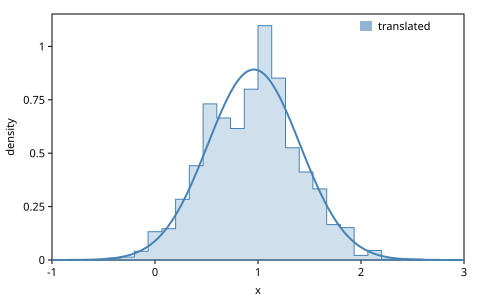
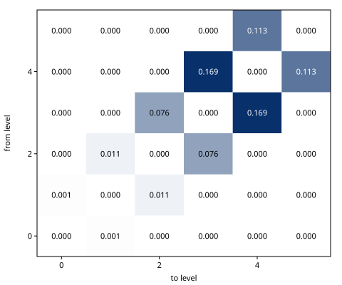
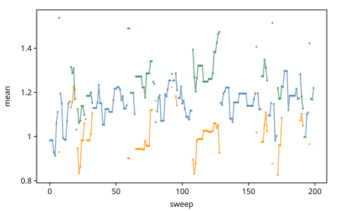
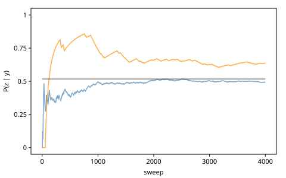

# Trace Translators and Involutive MCMC

Every kernel of Part II moved a trace within one structure: the same
addresses before and after, only their values changed. Some questions
need more. A model may be unsure how many means its data have, and a
kernel must then delete two choices and create one. An inference program
may want to carry particles from one model to another whose addresses
have nothing in common with the first. This chapter builds the construct
that does both. A *trace translator* maps traces of one model to traces
of another through a bijection, and weighs the result so that importance
sampling and SMC stay correct. Its special case from a model to itself is
the *involutive MCMC* kernel, whose acceptance probability is the same
weight. Metropolis–Hastings, reversible-jump MCMC and the SMCP3 steps of
*SMC in Depth* are all instances.

The chapter follows §3.6 and §3.7 of Cusumano-Towner's thesis (2020),
whose definitions, equations and algorithms it cites by number, and ports
the GenMLX book's *Trace Translators and Involutive MCMC*. Its
reversible-jump example is the split/merge move of the thesis's §3.7.4,
which Gen.jl's *Reversible-Jump MCMC* notebook also builds; the notebook's
own models, a piecewise-constant regression and kernel programs for
airline data, are Part V's. *Gradient-Based MCMC* deferred involutive MCMC
to this chapter, which builds it from the interface, one operation at a
time, and checks it against the library's kernel.

The thesis writes $\upsilon$ for a trace's latent choices, $\rho$ for its
observations, $\sigma$ for auxiliary choices and $\oplus$ for the union
of two choice maps with no address in common, which is `cm/merge`. The
code:

<!-- code: ns -->
```clojure
(ns book.trace-translators
  (:refer-clojure :exclude [+ - * /])
  (:require [gen.array :as array :refer [+ - * /]]
            [gen.array.linalg :as linalg]
            [gen.array.special :as special]
            [gen.book.svg :as svg]
            [gen.choicemap :as cm]
            [gen.dist :as d]
            [gen.dist.core :as dc]
            [gen.dynamic :refer [gen]]
            [gen.gfi :as gfi]
            [gen.inference.diagnostics :as diag]
            [gen.inference.mh :as mh]
            [gen.inference.particle-filter :as pf]
            [gen.inference.transform :as tf]
            [gen.random :as rng]))
```

## Trace transforms

A *trace transform* is a bijection between spaces of choice maps (the
second half of Definition 3.6.1). gen.clj writes one in Gen.jl's
transform language (thesis §3.6.3). `tf/deftransform` names four spaces:
the body reads choices from two inputs, `model-in` ($\upsilon$) and
`aux-in` ($\sigma$), and writes choices to two outputs, `model-out`
($\upsilon'$) and `aux-out` ($\sigma'$). Every read and write carries a
tag, `:discrete` or `:continuous`. The body is ordinary Clojure over
gen.array's operators, and may branch on what it reads as discrete.

The thesis's first example (p. 114) is a point in the plane in two
coordinate systems. `cartesian` draws $x$ and $y$ and observes each with
noise; `polar` draws a radius and an angle. We widen `cartesian`'s noise
from the thesis's 0.1 to 0.5, and leave out `polar`'s observation, for
the importance sampler below:

<!-- code: plane-models -->
```clojure
(def polar
  (gen []
    (let [r (trace :r (d/gamma 1 1))
          theta (trace :theta (d/uniform (- Math/PI) Math/PI))]
      [r theta])))

(def cartesian
  (gen []
    (let [x (trace :x (d/normal 0 1))
          y (trace :y (d/normal 0 1))]
      (trace :obsx (d/normal x 0.5))
      (trace :obsy (d/normal y 0.5))
      [x y])))
```

The two transforms convert between the coordinates, and `tf/pair` makes
each the other's inverse (Gen.jl's `pair_bijections!`):

<!-- code: plane-transforms -->
```clojure
(tf/deftransform polar->cartesian
  "(r, θ) to (x, y) = (r cos θ, r sin θ)."
  [model-in aux-in model-out aux-out]
  (let [r (tf/read model-in :r :continuous)
        theta (tf/read model-in :theta :continuous)]
    (tf/write model-out :x (* r (array/cos theta)) :continuous)
    (tf/write model-out :y (* r (array/sin theta)) :continuous)))

(tf/deftransform cartesian->polar
  "(x, y) to (r, θ) = (√(x² + y²), atan2(y, x))."
  [model-in aux-in model-out aux-out]
  (let [x (tf/read model-in :x :continuous)
        y (tf/read model-in :y :continuous)]
    (tf/write model-out :r (array/sqrt (+ (* x x) (* y y))) :continuous)
    (tf/write model-out :theta (array/atan2 y x) :continuous)))

(def to-cartesian
  "polar->cartesian, paired with cartesian->polar as its inverse."
  (first (tf/pair polar->cartesian cartesian->polar)))
```

`tf/run` applies a transform to choice maps (or a trace's choices). It
returns the outputs and $\log \lvert \det J \rvert$, the log of the
absolute determinant of the Jacobian of the transform's continuous part.
For $(r, \theta) \mapsto (r \cos\theta, r \sin\theta)$ the determinant is
$r$, so at $r = 2$ the log is $\log 2$:

<!-- code: run -->
```clojure
(def point (cm/choicemap :r 2.0 :theta 0.9))

(def moved (tf/run to-cartesian point nil))

(cm/to-map (:model moved))
;=> {:x 1.243 :y 1.567}

(array/allclose? (:log-abs-det moved) (Math/log 2.0))
;=> true
```

gen.clj computes the Jacobian by automatic differentiation, with the
continuous reads as inputs and the continuous writes as outputs. Central
differences of the same map, on host numbers, agree:

<!-- code: finite-differences -->
```clojure
(defn log-abs-det-fd
  "log |det J| of f, a function from a vector of n numbers to another, at
   x: the Jacobian by central differences of step h."
  [f x h]
  (let [column (fn [j]
                 (let [at (fn [dx] (f (update x j + dx)))]
                   (mapv #(/ (- %1 %2) (* 2 h)) (at h) (at (- h)))))
        ;; J's columns as rows: its transpose, with the same determinant
        columns (array/array (mapv column (range (count x))))]
    (array/item (second (linalg/slogdet columns)))))

(defn polar->xy
  "The map of polar->cartesian on host numbers."
  [[r theta]]
  [(* r (Math/cos theta)) (* r (Math/sin theta))])

(< (abs (- (log-abs-det-fd polar->xy [2.0 0.9] 1e-5) (Math/log 2.0)))
   1e-6)
;=> true
```

The inverse of a bijection undoes it, and its Jacobian is the inverse
matrix, so the two logs of determinants cancel. `tf/inverse` gives the
paired transform:

<!-- code: round-trip -->
```clojure
(let [back (tf/run (tf/inverse to-cartesian) (:model moved) nil)]
  [(tf/same-choices? (:model back) point)
   (array/allclose? (+ (:log-abs-det moved) (:log-abs-det back)) 0.0)])
;=> [true true]
```

A transform often moves a value unchanged. `tf/copy` says so: a copied
choice contributes a column with a single 1 to the Jacobian, and the
determinant is then that of the matrix without its row and column
(thesis §3.6.2), which the interpreter need not compute. The thesis's
example is $(u, v, x, y) \mapsto (u, 2u - v, y, x)$, whose Jacobian has
determinant $-1$, so its log is 0. In gen.clj a copy of a choice the body
never reads leaves the Jacobian, and a copy of one it reads, like $u$
here, stays in it as an output:

<!-- code: copies -->
```clojure
(tf/deftransform shuffle
  "(u, v, x, y) to (u, 2u - v, y, x): the thesis's example of copies."
  [model-in aux-in model-out aux-out]
  (let [u (tf/read model-in :u :continuous)
        v (tf/read model-in :v :continuous)]
    (tf/copy model-in :u model-out :u)
    (tf/write model-out :v (- (* 2 u) v) :continuous)
    (tf/copy model-in :y model-out :x)
    (tf/copy model-in :x model-out :y)))

(defn negligible?
  "Is the host number of x within 1e-5 of 0?"
  [x]
  (< (abs (array/item x)) 1e-5))

(def shuffled
  (tf/run shuffle (cm/choicemap :u 0.3 :v 1.1 :x 2.0 :y -1.0) nil))

(cm/to-map (:model shuffled))
;=> {:u 0.3 :v -0.5 :x -1.0 :y 2.0}

(negligible? (:log-abs-det shuffled))
;=> true
```

## Trace translators

A transform maps choices. A *trace translator* maps traces of a model
$\mathcal{P}_1$, given observations $\rho_1$, to traces of a model
$\mathcal{P}_2$ given $\rho_2$, with a weight. Definition 3.6.1 makes it
a tuple $(\mathcal{P}_1, \rho_1, \mathcal{P}_2, \rho_2, \mathcal{Q}_1,
\mathcal{Q}_2, h)$. When the latent choices of the two models are in
bijection, $h$ maps one to the other, and the weight for $\upsilon_1 \sim
p_1(\cdot \mid \rho_1)$ is Equation 3.12:

$$
\frac{p_2(h(\upsilon_1) \oplus \rho_2)}{p_1(\upsilon_1 \oplus \rho_1)}
\, \lvert J_h \rvert(\upsilon_1). \tag{3.12}
$$

The Jacobian is there because $h$ stretches the continuous choices: a
density pushed through a bijection is divided by the volume change. (The
thesis starts from discrete addresses alone, Equation 3.10, where there
is no volume to change.) When the two spaces are not in bijection, say of
different dimensions, auxiliary generative functions extend them until
they are: $\mathcal{Q}_1$ draws choices $\sigma_1$ beside $\upsilon_1$,
$h$ maps $\upsilon_1 \oplus \sigma_1$ to $\upsilon_2 \oplus \sigma_2$,
and $\mathcal{Q}_2$ scores $\sigma_2$. The weight is Equation 3.13:

$$
\frac{p_2(\upsilon_2 \oplus \rho_2)\, q_2(\sigma_2; \upsilon_2 \oplus
\rho_2)}{p_1(\upsilon_1 \oplus \rho_1)\, q_1(\sigma_1; \upsilon_1 \oplus
\rho_1)} \, \lvert J_h \rvert(\upsilon_1 \oplus \sigma_1). \tag{3.13}
$$

Algorithm 9's TRANSLATE computes it with the interface: simulate
$\mathcal{Q}_1$, apply $h$, generate $\mathcal{P}_2$'s trace from
$\upsilon_2 \oplus \rho_2$, and assess $\sigma_2$ under $\mathcal{Q}_2$.
`tf/translator` is that procedure (Gen.jl's `GeneralTraceTranslator`):
it takes the new model and its arguments, its observations, the two
auxiliary functions and the transform, and returns a function of a trace
and a key. With `:check? true` it also runs the inverse transform on the
result and throws unless that gives back the input. Here it carries a
trace of `polar` to `cartesian`, given the observations $(1.2, 1.6)$:

<!-- code: translator -->
```clojure
(def observed (cm/choicemap :obsx 1.2 :obsy 1.6))

(def translate
  "The trace translator from polar to cartesian given observed."
  (tf/translator {:p-new cartesian :p-new-args [] :new-observations observed
                  :transform to-cartesian :check? true}))

(def t1 (:trace (gfi/generate polar [] point (rng/key 1))))

(def translated (translate t1 (rng/key 2)))

(cm/to-map (:choices (:trace translated)))
;=> {:x 1.243 :y 1.567 :obsx 1.2 :obsy 1.6}
```

The weight is the log of Equation 3.12. By hand, it is the new trace's
log density, less the old one's, plus $\log r$:

<!-- code: translator-weight -->
```clojure
(defn log-density
  "The log density of distribution dist at v, a host number."
  [dist v]
  (array/item (dc/log-prob dist v)))

(def weight-by-hand
  (let [[x y] [(* 2.0 (Math/cos 0.9)) (* 2.0 (Math/sin 0.9))]
        log-p2 (+ (log-density (d/normal 0 1) x) (log-density (d/normal 0 1) y)
                  (log-density (d/normal x 0.5) 1.2)
                  (log-density (d/normal y 0.5) 1.6))
        log-p1 (+ (log-density (d/gamma 1 1) 2.0)
                  (log-density (d/uniform (- Math/PI) Math/PI) 0.9))]
    (+ (- log-p2 log-p1) (Math/log 2.0))))

[(:weight translated) (array/allclose? (:weight translated) weight-by-hand)]
;=> [0.2356 true]
```

Why this weight? `polar` has no observations, so $\rho_1 = \{\}$ and
$\upsilon_1$ comes from $p_1$ itself. Then the weight's expectation is
$\int p_2(h(\upsilon_1) \oplus \rho_2) \lvert J_h \rvert(\upsilon_1)\,
d\upsilon_1 = \int p_2(\upsilon_2 \oplus \rho_2)\, d\upsilon_2 =
p_2(\rho_2)$, by the change of variables $\upsilon_2 = h(\upsilon_1)$: the
average weight estimates `cartesian`'s evidence, and `polar` serves as an
importance sampler's proposal. The evidence is known: $x$ and $y$ are
standard normal and the noise is 0.5, so each observation is
$\mathcal{N}(0, \sqrt{1.25})$. Over 4000 translated traces, the average
weight agrees with it within five standard errors:

<!-- code: translator-is -->
```clojure
(defn mean-se
  "The mean of numbers xs and its standard error."
  [xs]
  (let [n (count xs)
        mean (/ (reduce + xs) n)
        variance (/ (reduce + (map #(* (- % mean) (- % mean)) xs)) (dec n))]
    {:mean mean :se (Math/sqrt (/ variance n))}))

(def translations
  "[x weight] of each of 4000 traces of polar, translated."
  (mapv (fn [key]
          (let [[k1 k2] (rng/split key)
                {t :trace w :weight} (translate (gfi/simulate polar [] k1) k2)]
            [(array/item (t :x)) (array/item w)]))
        (rng/split (rng/key 3) 4000)))

(def evidence
  "p2(ρ2): obsx and obsy are independent, each N(0, √1.25)."
  (Math/exp (+ (log-density (d/normal 0 (Math/sqrt 1.25)) 1.2)
               (log-density (d/normal 0 (Math/sqrt 1.25)) 1.6))))

(let [{:keys [mean se]} (mean-se (mapv #(Math/exp (second %)) translations))]
  [evidence (< (abs (- mean evidence)) (* 5 se))])
;=> [0.0257 true]
```

The weighted traces approximate `cartesian`'s posterior. Its $x$ is
normal with mean $1.2/1.25 = 0.96$, and the self-normalized estimate
agrees within five of its standard errors (by the delta method):

<!-- code: translator-posterior -->
```clojure
(defn weighted-mean-se
  "The self-normalized estimate Σ w·x / Σ w of [x log-w] pairs, with its
   standard error by the delta method."
  [pairs]
  (let [ws (mapv #(Math/exp (second %)) pairs)
        total (reduce + ws)
        mean (/ (reduce + (map #(* %1 (first %2)) ws pairs)) total)
        terms (map #(* %1 %1 (- (first %2) mean) (- (first %2) mean)) ws pairs)]
    {:mean mean :se (/ (Math/sqrt (reduce + terms)) total)}))

(def x-posterior
  "The exact posterior of x given obsx: N(1.2/1.25, √(0.25/1.25))."
  (d/normal 0.96 (Math/sqrt 0.2)))

(let [{:keys [mean se]} (weighted-mean-se translations)]
  (< (abs (- mean 0.96)) (* 5 se)))
;=> true
```

<!-- code: translator-figure -->
```clojure
;; figure: figures/033-translated.svg
(svg/histogram [{:values (mapv first translations)
                 :weights (mapv #(Math/exp (second %)) translations)
                 :density #(Math/exp (log-density x-posterior %))
                 :label "translated"}]
               {:range [-1.0 3.0] :bins 30 :x-label "x"})
```



Equation 3.13's auxiliary choices are needed when the dimensions differ.
Take one mean $s \sim \mathcal{N}(0, \sqrt 2)$ and two means $a, b \sim
\mathcal{N}(0, 1)$. No bijection joins $\mathbb{R}$ and $\mathbb{R}^2$,
so $\mathcal{Q}_1$ draws a difference $d \sim \mathcal{N}(0, \sqrt 2)$
and $h$ maps $(s, d)$ to $((s + d)/2, (s - d)/2)$; $\mathcal{Q}_2$ draws
nothing. The way back is the same translator with the roles swapped:
$\mathcal{Q}_1$ draws nothing, the transform writes $d' = a - b$ to the
auxiliary output, and `difference` scores it as $\mathcal{Q}_2$:

<!-- code: one-to-two -->
```clojure
(def one-mean (gen [] (trace :s (d/normal 0 (Math/sqrt 2)))))

(def two-means (gen [] (trace :a (d/normal 0 1)) (trace :b (d/normal 0 1))))

(def difference (gen [_] (trace :d (d/normal 0 (Math/sqrt 2)))))

(tf/deftransform to-two
  "(s, d) to (a, b) = ((s + d)/2, (s - d)/2)."
  [model-in aux-in model-out aux-out]
  (let [s (tf/read model-in :s :continuous)
        dd (tf/read aux-in :d :continuous)]
    (tf/write model-out :a (/ (+ s dd) 2) :continuous)
    (tf/write model-out :b (/ (- s dd) 2) :continuous)))

(tf/deftransform to-one
  "(a, b) to (s, d) = (a + b, a - b)."
  [model-in aux-in model-out aux-out]
  (let [a (tf/read model-in :a :continuous)
        b (tf/read model-in :b :continuous)]
    (tf/write model-out :s (+ a b) :continuous)
    (tf/write aux-out :d (- a b) :continuous)))

(def splitting (tf/pair to-two to-one))

(def split-one
  (tf/translator {:p-new two-means :p-new-args [] :q-forward difference
                  :q-forward-args [] :transform (first splitting)
                  :check? true}))

(def merge-two
  (tf/translator {:p-new one-mean :p-new-args [] :q-backward difference
                  :q-backward-args [] :transform (second splitting)
                  :check? true}))
```

The sum and the difference of two independent standard normals are
independent $\mathcal{N}(0, \sqrt 2)$, so this translator is exact: every
weight, either way, is $\log 1 = 0$. The Jacobian, $\log \frac12$, is what
makes it so; leave it out and every weight is $\log 2$:

<!-- code: one-to-two-weights -->
```clojure
(map (fn [key]
       (let [[k1 k2 k3] (rng/split key 3)
             {t2 :trace w :weight} (split-one (gfi/simulate one-mean [] k1) k2)]
         [(negligible? w) (negligible? (:weight (merge-two t2 k3)))]))
     (rng/split (rng/key 4) 3))
;=> [[true true] [true true] [true true]]

(:log-abs-det (tf/run (first splitting) (cm/choicemap :s 1.0)
                      (cm/choicemap :d 0.4)))
;=> -0.6931
```

gen.clj has the other translators of Gen.jl and GenParticleFilters
too: `tf/deterministic-translator` (no auxiliary choices),
`tf/extending-translator` (a step that only adds choices) and
`tf/updating-translator`, which the section on SMC below uses.

## Symmetric trace translators

A translator from a model to itself, whose transform is its own inverse,
is a *symmetric trace translator* (Definition 3.7.1): $\mathcal{P}_1 =
\mathcal{P}_2 = \mathcal{P}$, $\rho_1 = \rho_2 = \rho$, $\mathcal{Q}_1 =
\mathcal{Q}_2 = \mathcal{Q}$, and $h = h^{-1}$, an *involution*. Its
weight simplifies to Equation 3.15:

$$
\frac{p(\upsilon' \oplus \rho)\, q(\sigma'; \upsilon')}{p(\upsilon \oplus
\rho)\, q(\sigma; \upsilon)} \, \lvert J_h \rvert(\upsilon \oplus
\sigma), \qquad \sigma \sim q(\cdot; \upsilon), \quad h(\upsilon \oplus
\sigma) = \upsilon' \oplus \sigma'. \tag{3.15}
$$

`tf/involution` turns a transform into the involution that
`mh/involutive-mh` takes (Gen.jl's `SymmetricTraceTranslator`), and the
kernel reports the log of this weight as `:log-alpha`. The thesis gives
four examples (p. 121). We run them on a model of a rate with counts: a
rate from $\mathrm{Gamma}(1, 1)$, and Poisson counts. gen.clj's `gamma`
takes a shape and a scale, as Gen.jl's does, so given the counts $(2, 0,
1)$ the rate's posterior is $\mathrm{Gamma}(1 + 3, 1/(1 + 3))$, with mean
1:

<!-- code: rate-model -->
```clojure
(def rate-model
  (gen [n]
    (let [rate (trace :rate (d/gamma 1 1))]
      (doseq [i (range n)]
        (trace [:count i] (d/poisson rate)))
      rate)))

(def counts [2 0 1])

(defn rate-trace
  "The trace of rate-model at rate, given the first n counts."
  [rate n]
  (let [observed (mapcat (fn [i c] [[:count i] c]) (range n) counts)]
    (:trace (gfi/generate rate-model [n]
                          (apply cm/choicemap :rate rate observed)
                          (rng/key 0)))))
```

The *identity* translator draws no auxiliary choices and leaves the
trace as it is. Its weight is 1:

<!-- code: identity -->
```clojure
(def nothing "An auxiliary generative function of no choices." (gen [_] nil))

(tf/deftransform identity-move
  "The identity: the rate copied."
  [model-in aux-in model-out aux-out]
  (tf/copy model-in :rate model-out :rate))

(negligible? (:log-alpha (mh/involutive-mh (rate-trace 0.7 3) nothing []
                                           (tf/involution identity-move)
                                           (rng/key 5))))
;=> true
```

A *deterministic* one needs no auxiliary choices either. Under the
model with the rate alone, $h(\{a \mapsto x\}) = \{a \mapsto 1/x\}$ has
the weight $p_{\mathrm{Gamma}(1,1)}(x^{-1}) / p_{\mathrm{Gamma}(1,1)}(x)
\cdot 1/x^2$, the last factor its Jacobian:

<!-- code: reciprocal -->
```clojure
(tf/deftransform reciprocal
  "The rate to its reciprocal."
  [model-in aux-in model-out aux-out]
  (tf/write model-out :rate (/ 1 (tf/read model-in :rate :continuous))
            :continuous))

(defn reciprocal-weight
  "The thesis's weight of the reciprocal at x, in logs: log p(1/x) - log
   p(x) - 2 log x, p the density of Gamma(1, 1)."
  [x]
  (- (log-density (d/gamma 1 1) (/ 1 x)) (log-density (d/gamma 1 1) x)
     (* 2 (Math/log x))))

(for [x [2.0 0.3]]
  (let [{la :log-alpha} (mh/involutive-mh (rate-trace x 0) nothing []
                                          (tf/involution reciprocal)
                                          (rng/key 6))]
    [la (array/allclose? la (reciprocal-weight x))]))
;=> [[0.1137 true] [-0.6254 true]]
```

*Conditional sample and swap* draws $\sigma$ from the exact conditional
$p(\cdot \mid \rho)$ and exchanges it with the model's choice. Its weight
is 1, whatever the trace:

<!-- code: conditional-swap -->
```clojure
(def exact-rate
  "The exact conditional of the rate given the three counts."
  (gen [_] (trace :rate (d/gamma 4 0.25))))

(tf/deftransform swap
  "The model's rate and the auxiliary rate exchanged."
  [model-in aux-in model-out aux-out]
  (tf/copy aux-in :rate model-out :rate)
  (tf/copy model-in :rate aux-out :rate))

(for [[x key] (map vector [0.3 1.0 2.5] (rng/split (rng/key 7) 3))]
  (negligible? (:log-alpha (mh/involutive-mh (rate-trace x 3) exact-rate []
                                             (tf/involution swap) key))))
;=> [true true true]
```

*Propose and swap* does the same with a proposal $q$ that is not the
conditional. Its weight is Equation 3.16,

$$
\frac{p(\upsilon' \oplus \rho)\, q(\upsilon)}{p(\upsilon \oplus \rho)\,
q(\upsilon')}, \qquad \upsilon' \sim q(\cdot), \tag{3.16}
$$

the acceptance ratio of Metropolis–Hastings with $q$ as an independent
proposal. `mh/move` proposes a move and returns the proposed trace with
the log of its ratio, without accepting or rejecting it. The swap's ratio
is the formula, and it equals the ratio of the plain MH move with
proposal $q$ that *Getting Started* ran:

<!-- code: propose-swap -->
```clojure
(def independent
  "A proposal for the rate that ignores the trace."
  (gen [_] (trace :rate (d/gamma 2 0.5))))

(for [key (rng/split (rng/key 8) 3)]
  (let [[k1 k2] (rng/split key)
        tr (rate-trace 0.7 3)
        swapped (mh/move tr independent [] {:involution (tf/involution swap)}
                         k1 k2)
        plain (mh/move tr independent [] {} k1 k2)
        v' (array/item ((:trace swapped) :rate))
        by-hand (+ (- (:score (:trace swapped)) (:score tr))
                   (- (log-density (d/gamma 2 0.5) 0.7)
                      (log-density (d/gamma 2 0.5) v')))]
    [(array/allclose? (:weight swapped) by-hand)
     (array/allclose? (:weight swapped) (:weight plain))]))
;=> [[true true] [true true] [true true]]
```

## Involutive MCMC

That last equality is no coincidence. Every symmetric trace translator
defines an MCMC kernel, *involutive MCMC* (Algorithm 12): draw $\sigma$,
apply $h$, and accept the new trace with probability

$$
\min\left\{1, \frac{p(\upsilon' \oplus \rho)\, q(\sigma';
\upsilon')}{p(\upsilon \oplus \rho)\, q(\sigma; \upsilon)} \, \lvert J_h
\rvert(\upsilon \oplus \sigma)\right\}, \tag{3.17}
$$

else keep the old one. The thesis's argument for its stationarity (pp.
122–123, after Tierney): on the extended space of $\upsilon \oplus
\sigma$, accepting or rejecting an involution with this probability keeps
the distribution $\pi(\upsilon \oplus \sigma) = p(\upsilon \mid \rho)\,
q(\sigma; \upsilon)$. If $\upsilon \sim p(\cdot \mid \rho)$, then drawing
$\sigma$ from $q$ makes $\upsilon \oplus \sigma \sim \pi$; the move keeps
$\pi$; and dropping $\sigma'$ leaves $\upsilon' \sim p(\cdot \mid \rho)$.

Algorithm 11 computes the weight with `update` in place of `generate`,
so that only the choices the move changes are visited. gen.clj does the
same: its involutions update the trace with the transform's `model-out`,
so a transform writes the choices it changes and nothing else, never the
observations. The kernel is then four operations of the interface:
`assess` scores $\sigma$ under $q$, `tf/run` applies $h$ with its
Jacobian, `update` gives the ratio of the model's densities, and `assess`
scores $\sigma'$ under $q$ at the new trace. With a proposal for $\sigma$
and an accept step, that is Algorithm 12:

<!-- code: by-hand -->
```clojure
(defn log-alpha
  "The move from trace tr with auxiliary choices u, from the interface:
   h applied to the trace and u, the trace updated with h's model choices,
   and h's auxiliary choices u' assessed under q at the new trace. Returns
   the proposed trace and log α of Eq. 3.17, a host number."
  [tr q h u key]
  (let [fwd (:weight (gfi/assess q [tr] u key))
        {model :model u' :aux ldj :log-abs-det} (tf/run h tr u)
        {tr' :trace w :weight} (gfi/update tr model key)
        bwd (:weight (gfi/assess q [tr'] u' key))]
    {:trace tr' :log-alpha (array/item (+ w ldj (- bwd fwd)))}))

(defn involutive-mh-by-hand
  "Alg. 12: u from q, then the proposed trace with probability min(1, α),
   else tr."
  [tr q h key]
  (let [[k-propose k-update k-accept] (rng/split key 3)
        u (:choices (gfi/propose q [tr] k-propose))
        {tr' :trace la :log-alpha} (log-alpha tr q h u k-update)]
    (if (< (Math/log (array/item (rng/uniform k-accept))) la) tr' tr)))
```

The running example is a move in other coordinates: a random walk on the
rate's logarithm, written as a move of the rate. It draws $u \sim
\mathcal{N}(0, 0.5)$ and maps $(\mathit{rate}, u)$ to $(\mathit{rate}
\cdot e^u, -u)$; applied twice, it gives back $(\mathit{rate}, u)$:

<!-- code: scale -->
```clojure
(def log-step (gen [_] (trace :u (d/normal 0 0.5))))

(tf/deftransform scale
  "(rate, u) to (rate·exp(u), -u): a random walk on the rate's logarithm."
  [model-in aux-in model-out aux-out]
  (let [rate (tf/read model-in :rate :continuous)
        u (tf/read aux-in :u :continuous)]
    (tf/write model-out :rate (* rate (array/exp u)) :continuous)
    (tf/write aux-out :u (- u) :continuous)))
```

Built from the interface, the move agrees with the library's `mh/move`,
given the same keys, in the proposed trace and in $\log \alpha$:

<!-- code: by-hand-check -->
```clojure
(for [key (rng/split (rng/key 9) 4)]
  (let [[k1 k2] (rng/split key)
        tr (rate-trace 0.7 3)
        u (:choices (gfi/propose log-step [tr] k1))
        mine (log-alpha tr log-step scale u k2)
        library (mh/move tr log-step [] {:involution (tf/involution scale)}
                         k1 k2)]
    [(array/allclose? (:log-alpha mine) (:weight library))
     (tf/same-choices? (:choices (:trace mine))
                       (:choices (:trace library)))]))
;=> [[true true] [true true] [true true] [true true]]
```

The library's involution does two things `tf/run` does not. `tf/run`
treats every continuous read as consumed by the move; a transform may
also read a choice it keeps (to compute another), and the library counts
that read as an unchanged output of the Jacobian. And the library checks
that every continuous input the move consumes was read, since one it
ignores would be lost, and the map would not be a bijection.

## A move in other coordinates

The scale move is a *reparameterization*: a symmetric random walk on
$\log \mathit{rate}$, which never leaves the rate's support, written as
a move on the rate itself. The Jacobian of $(\mathit{rate}, u) \mapsto
(\mathit{rate} \cdot e^u, -u)$ is $\begin{pmatrix} e^u & \mathit{rate}
\cdot e^u \\ 0 & -1 \end{pmatrix}$, with $\lvert \det J \rvert = e^u$:

<!-- code: scale-jacobian -->
```clojure
(let [{:keys [log-abs-det]} (tf/run scale (cm/choicemap :rate 0.7)
                                    (cm/choicemap :u 0.4))
      fd (log-abs-det-fd (fn [[rate u]] [(* rate (Math/exp u)) (- u)])
                         [0.7 0.4] 1e-6)]
  [(array/allclose? log-abs-det 0.4) (< (abs (- fd 0.4)) 1e-6)])
;=> [true true]
```

The chain of 4000 moves built from the interface samples the posterior:
its mean agrees with the exact 1 within five Monte Carlo standard
errors.

<!-- code: scale-chain -->
```clojure
(def rates
  "The rate along 4000 moves of the scale move, from rate 1."
  (mapv #(array/item (% :rate))
        (reductions #(involutive-mh-by-hand %1 log-step scale %2)
                    (rate-trace 1.0 3)
                    (rng/split (rng/key 10) 4000))))

(def rate-summary (diag/summary rates))

(< (abs (- (:mean rate-summary) 1.0)) (* 5 (:mcse-mean rate-summary)))
;=> true
```

The factor $e^u$ is what turns a walk on the logarithm into a kernel for
the rate. Exercise 2 leaves it out and finds which distribution the chain
samples then.

## State-dependent mixtures

A common way to combine kernels is to pick one at random. When the
probabilities of the picks do not depend on the state, they cancel in the
acceptance probability. When they do, they must enter it (thesis §3.7.5).
Involutive MCMC handles this case with no special code: the auxiliary
function's first choices pick the move, with probabilities that may
depend on the trace, and its later choices propose values; the
involution exchanges the proposed values with the model's and maps the
pick to the pick of the move back. $q(\sigma'; \upsilon')$ then holds the
probability of picking the move back, at the new state.

A small example is a walk on six levels. The model draws a level $k$
from 0 to 5 and observes $y \sim \mathcal{N}(k, 1)$ at 3.4. The auxiliary
function picks a direction: up with probability $\frac12$, except from
level 0, which can only go up, and from level 5, which can only go down.
The involution steps and reverses the direction, since the move back
from $k + 1$ is the step down:

<!-- code: levels -->
```clojure
(def levels
  (gen []
    (let [k (trace :k (d/uniform-discrete 0 5))]
      (trace :y (d/normal k 1))
      k)))

(def up-probabilities
  "The probability of a step up from each level: always from 0, never
   from 5."
  (array/array [1.0 0.5 0.5 0.5 0.5 0.0]))

(def direction
  (gen [tr]
    (trace :up? (d/bernoulli (array/take up-probabilities (tr :k))))))

(tf/deftransform step
  "A step up or down, and the direction reversed."
  [model-in aux-in model-out aux-out]
  (let [k (tf/read model-in :k :discrete)
        up? (tf/read aux-in :up? :discrete)]
    (tf/write model-out :k (if up? (inc k) (dec k)) :discrete)
    (tf/write aux-out :up? (not up?) :discrete)))
```

The space is small enough to enumerate. The exact posterior over levels
is each trace's score, normalized. The kernel's transition matrix sums,
over each direction the auxiliary function can pick, its probability
times the acceptance probability, and puts the rejected mass on the
diagonal:

<!-- code: enumerate -->
```clojure
(def level-traces
  "The trace at each level, given y = 3.4."
  (mapv #(:trace (gfi/generate levels [] (cm/choicemap :k % :y 3.4)
                               (rng/key 0)))
        (range 6)))

(def posterior-levels
  "The exact posterior of the level, by enumeration."
  (let [ps (mapv #(Math/exp (array/item (:score %))) level-traces)
        total (reduce + ps)]
    (mapv #(/ % total) ps)))

(defn probability
  "q(u; tr): the probability that q, given trace tr, chooses u."
  [q tr u]
  (Math/exp (array/item (:weight (gfi/assess q [tr] u (rng/key 0))))))

(defn transitions
  "The kernel's transition matrix: row i holds the probabilities of a move
   from level i to each level, summed over the auxiliary choices q can
   make there, each move accepted with probability min(1, α)."
  [q h]
  (vec (for [[i tr] (map-indexed vector level-traces)]
         (reduce (fn [row u]
                   (let [p (probability q tr u)]
                     (if (zero? p)
                       row
                       (let [{tr' :trace la :log-alpha}
                             (log-alpha tr q h u (rng/key 0))
                             a (min 1.0 (Math/exp la))]
                         (-> row
                             (update (long (array/item (tr' :k))) + (* p a))
                             (update i + (* p (- 1 a))))))))
                 (vec (repeat 6 0.0))
                 [(cm/choicemap :up? true) (cm/choicemap :up? false)]))))
```

The kernel satisfies *detailed balance*, $\pi(i) K(i, j) = \pi(j) K(j,
i)$ for every pair of levels, and hence leaves the posterior stationary,
$\pi K = \pi$:

<!-- code: detailed-balance -->
```clojure
(def walk (transitions direction step))

(defn balanced?
  "Does π(i) K(i, j) = π(j) K(j, i) hold for every pair of levels?"
  [pi kernel]
  (every? true? (for [i (range 6) j (range 6)]
                  (< (abs (- (* (pi i) (get-in kernel [i j]))
                             (* (pi j) (get-in kernel [j i]))))
                     1e-5))))

(defn stationary?
  "Is π K = π?"
  [pi kernel]
  (every? true? (for [j (range 6)]
                  (< (abs (- (reduce + (map #(* (pi %) (get-in kernel [% j]))
                                            (range 6)))
                             (pi j)))
                     1e-5))))

[(balanced? posterior-levels walk) (stationary? posterior-levels walk)]
;=> [true true]
```

The enumeration's ratios are the library's: `mh/move` gives the same
$\log \alpha$ for the direction it draws, from every level.

<!-- code: library-agrees -->
```clojure
(every? true?
        (for [tr level-traces
              key (rng/split (rng/key 11) 3)]
          (let [[k1 k2] (rng/split key)
                {tr' :trace w :weight}
                (mh/move tr direction [] {:involution (tf/involution step)}
                         k1 k2)
                u (cm/choicemap :up? (> (array/item (tr' :k))
                                        (array/item (tr :k))))]
            (array/allclose? w (:log-alpha (log-alpha tr direction step u
                                                      (rng/key 0)))))))
;=> true
```

Inside, the picks cancel: the step up from level 2 and the step back
down from level 3 both have probability $\frac12$, and $\alpha$ is the
ratio of the posteriors. At the boundary they do not. From level 0 the
walk goes up with probability 1, and the move back from level 1, down,
has probability $\frac12$, so the step up is accepted with $\alpha =
\pi(1) \cdot \frac12 / (\pi(0) \cdot 1)$:

<!-- code: boundary -->
```clojure
(defn step-up
  "log α of the step up from level k."
  [k]
  (:log-alpha (log-alpha (level-traces k) direction step
                         (cm/choicemap :up? true) (rng/key 0))))

(defn log-odds
  "log π(j)/π(i)."
  [i j]
  (Math/log (/ (posterior-levels j) (posterior-levels i))))

[(array/allclose? (step-up 2) (log-odds 2 3))
 (array/allclose? (step-up 0) (+ (log-odds 0 1) (Math/log 0.5)))]
;=> [true true]
```

The flows $\pi(i) K(i, j)$ between levels are symmetric, as detailed
balance says:

<!-- code: flows-figure -->
```clojure
;; figure: figures/033-flows.svg
(svg/heatmap (range 6) (range 6)
             (vec (for [i (range 6)]
                    (vec (for [j (range 6)]
                           (if (= i j)
                             0.0
                             (* (posterior-levels i) (get-in walk [i j])))))))
             {:labels? true :x-label "to level" :y-label "from level"})
```



A step that keeps the direction is not an involution: applied twice, it
goes up twice. `:check? true` applies the transform again to every result
and throws when it does not give back the trace and the auxiliary
choices:

<!-- code: no-flip -->
```clojure
;; error: The inverse transform does not give back the trace
(tf/deftransform step-no-flip
  "A step up or down, with the direction kept: not an involution."
  [model-in aux-in model-out aux-out]
  (let [k (tf/read model-in :k :discrete)
        up? (tf/read aux-in :up? :discrete)]
    (tf/write model-out :k (if up? (inc k) (dec k)) :discrete)
    (tf/write aux-out :up? up? :discrete)))

(def checked-no-flip (tf/involution step-no-flip {:check? true}))

(checked-no-flip (level-traces 2) (cm/choicemap :up? true) nil [] (rng/key 0))
```

## Reversible jump

*Reversible-jump MCMC* (Green 1995) moves between models of different
dimensions, and §3.7.4 shows it is a special case of involutive MCMC. Its
framework has models $k$ with a prior $p(k)$, each with parameters
$\theta_k \in \mathbb{R}^{n(k)}$, a prior $p_k(\theta_k)$ and a
likelihood $\ell_k(\theta_k)$. A move type $m$ joins two models; from
state $x = (k, \theta_k)$ it is picked with probability $q_x(m)$, draws
$u \sim q_{m, k \to k'}$, and maps $(\theta_k, u)$ to $(\theta'_{k'},
u')$ with a bijection $g_{m, k \to k'}$ whose inverse is $g_{m, k' \to
k}$. The move is accepted with probability

$$
\min\left\{1, \frac{p(k')}{p(k)}\, \frac{p_{k'}(\theta'_{k'})}{p_k(\theta_k)}
\, \frac{\ell_{k'}(\theta'_{k'})}{\ell_k(\theta_k)}\,
\frac{q_{x'}(m)}{q_x(m)}\, \frac{q_{m, k' \to k}(u')}{q_{m, k \to
k'}(u)}\, \lvert J_{g} \rvert(\theta_k, u)\right\}.
$$

Each factor is a factor of Equation 3.17. A generative function
$\mathcal{P}$ holds the models, their priors and their likelihoods; the
auxiliary function holds the move types and the densities of $u$; and
the involution factors into an involution $g$ on the discrete choices
(which model, which move) and a family of bijections $h_i$ on the
continuous ones, indexed by the discrete choices.

The thesis's example is a model that is unsure of its own structure: one
mean for two observations, or one mean each.

<!-- code: branching-model -->
```clojure
(def branching-model
  (gen []
    (let [[m1 m2] (if (trace :z (d/bernoulli 0.5))
                    [(trace :m1 (d/gamma 1 1)) (trace :m2 (d/gamma 1 1))]
                    (let [m (trace :m (d/gamma 1 1))] [m m]))]
      (trace :y1 (d/normal m1 0.1))
      (trace :y2 (d/normal m2 0.1))
      [m1 m2])))

(def data (cm/choicemap :y1 1.0 :y2 1.3))
```

The posterior probability of two means is known in closed form. Each
branch's marginal likelihood integrates its means out against the
$\mathrm{Gamma}(1, 1)$ prior, whose density is $e^{-m}$, and
$\int_0^\infty e^{-m} \mathcal{N}(m; \mu, s)\, dm = e^{s^2/2 - \mu}
\Phi((\mu - s^2)/s)$. With one mean, the two likelihoods combine as
$\mathcal{N}(y_1; m, \sigma)\, \mathcal{N}(y_2; m, \sigma) =
\mathcal{N}(y_1 - y_2; 0, \sqrt2 \sigma)\, \mathcal{N}(m; \bar y,
\sigma/\sqrt2)$. With the thesis's noise, 0.1, the data favor neither
branch; with the GenMLX book's 0.4, its 0.3635 comes back:

<!-- code: exact-two -->
```clojure
(defn normal-cdf
  "Φ(x), the standard normal's distribution function."
  [x]
  (* 0.5 (special/erfc (/ (- x) (Math/sqrt 2)))))

(defn gamma-normal
  "The integral of exp(-m) N(m; mu, s) over m > 0, which is
   exp(s²/2 - mu) Φ((mu - s²)/s)."
  [mu s]
  (* (Math/exp (- (/ (* s s) 2) mu)) (normal-cdf (/ (- mu (* s s)) s))))

(defn p-two-of
  "P(z | y1 = 1.0, y2 = 1.3) under observation noise sigma: each branch's
   marginal likelihood, normalized (the prior on z is even)."
  [sigma]
  (let [two (* (gamma-normal 1.0 sigma) (gamma-normal 1.3 sigma))
        one (* (Math/exp (log-density (d/normal 0 (* (Math/sqrt 2) sigma))
                                      -0.3))
               (gamma-normal 1.15 (/ sigma (Math/sqrt 2))))]
    (/ two (+ two one))))

(def p-two (p-two-of 0.1))

[p-two (p-two-of 0.4)]
;=> [0.5176 0.3635]
```

Numerical integration of the same marginal likelihoods agrees:

<!-- code: quadrature -->
```clojure
(defn integrate
  "The integral of f over [lo, hi], by the midpoint rule with n intervals."
  [f lo hi n]
  (let [h (/ (- hi lo) n)]
    (* h (reduce + (map #(f (+ lo (* h (+ % 0.5)))) (range n))))))

(let [prior #(Math/exp (- %))
      likelihood (fn [m y] (Math/exp (log-density (d/normal m 0.1) y)))
      two (* (integrate #(* (prior %) (likelihood % 1.0)) 0 5 20000)
             (integrate #(* (prior %) (likelihood % 1.3)) 0 5 20000))
      one (integrate #(* (prior %) (likelihood % 1.0) (likelihood % 1.3))
                     0 5 20000)]
  (< (abs (- p-two (/ two (+ two one)))) 1e-6))
;=> true
```

A move that switches branches and draws the new means from their prior
would rarely be accepted: the data pin the means down, and fresh guesses
miss them. The thesis's *split/merge* move carries the inferred values
across instead. A merge maps $(m_1, m_2)$ to their geometric mean $m$
and the share $\mathit{dof} = m_1/(m_1 + m_2)$, an invertible pair; a
split inverts it, with $\mathit{dof}$ drawn from $\mathcal{U}(0, 1)$ by
the auxiliary function, which draws nothing before a merge. One
transform does both, by the branch it reads:

<!-- code: split-merge -->
```clojure
(def branch-proposal
  (gen [tr]
    (when-not (tr :z)
      (trace :dof (d/uniform 0 1)))))

(defn merge-means
  "[m dof]: the geometric mean of m1 and m2, and m1's share of their sum."
  [m1 m2]
  [(array/sqrt (* m1 m2)) (/ m1 (+ m1 m2))])

(defn split-mean
  "[m1 m2] of geometric mean m and share dof: merge-means' inverse."
  [m dof]
  [(* m (array/sqrt (/ dof (- 1 dof)))) (* m (array/sqrt (/ (- 1 dof) dof)))])

(tf/deftransform split-merge
  "Two means merged into one, or one mean split into two."
  [model-in aux-in model-out aux-out]
  (if (tf/read model-in :z :discrete)
    (let [[m dof] (merge-means (tf/read model-in :m1 :continuous)
                               (tf/read model-in :m2 :continuous))]
      (tf/write model-out :z false :discrete)
      (tf/write model-out :m m :continuous)
      (tf/write aux-out :dof dof :continuous))
    (let [[m1 m2] (split-mean (tf/read model-in :m :continuous)
                              (tf/read aux-in :dof :continuous))]
      (tf/write model-out :z true :discrete)
      (tf/write model-out :m1 m1 :continuous)
      (tf/write model-out :m2 m2 :continuous))))
```

The split's Jacobian is $\lvert \det J \rvert = m/(\mathit{dof}(1 -
\mathit{dof}))$, and gen.clj's agrees with it and with finite
differences:

<!-- code: split-jacobian -->
```clojure
(defn branch-trace
  "The trace of branching-model with the data and these latent choices,
   address and value in turn."
  [& choices]
  (:trace (gfi/generate branching-model []
                        (cm/merge data (apply cm/choicemap choices))
                        (rng/key 0))))

(def one-trace (branch-trace :z false :m 1.15))

(def split (tf/run split-merge one-trace (cm/choicemap :dof 0.4)))

(cm/to-map (:model split))
;=> {:z true :m1 0.939 :m2 1.408}

(def split-log-jacobian (Math/log (/ 1.15 (* 0.4 0.6))))

[(array/allclose? (:log-abs-det split) split-log-jacobian)
 (< (abs (- (log-abs-det-fd #(apply split-mean %) [1.15 0.4] 1e-6)
            split-log-jacobian))
    1e-6)]
;=> [true true]
```

Merging the split gives back the mean and the share, and the two
Jacobians cancel:

<!-- code: split-twice -->
```clojure
(let [two-trace (:trace (gfi/update one-trace (:model split) (rng/key 0)))
      merged (tf/run split-merge two-trace (:aux split))]
  [(tf/same-choices? (:model merged) (cm/choicemap :z false :m 1.15))
   (tf/same-choices? (:aux merged) (cm/choicemap :dof 0.4))
   (negligible? (+ (:log-abs-det split) (:log-abs-det merged)))])
;=> [true true true]
```

The move's four pieces, for one split, come from the interface. The
update weight is the ratio of the model's densities, the Jacobian is
$h$'s, and both proposal terms are 0: $\mathcal{U}(0, 1)$ has density 1,
and before a merge the auxiliary function draws nothing.

<!-- code: four-pieces -->
```clojure
(def split-pieces
  (let [u (cm/choicemap :dof 0.4)
        fwd (:weight (gfi/assess branch-proposal [one-trace] u (rng/key 0)))
        {two-trace :trace w :weight} (gfi/update one-trace (:model split)
                                                 (rng/key 0))
        bwd (:weight (gfi/assess branch-proposal [two-trace] (:aux split)
                                 (rng/key 0)))]
    {:update w :jacobian (:log-abs-det split) :forward fwd :backward bwd}))

split-pieces
;=> {:update 0.2782 :jacobian 1.5669 :forward 0.0 :backward 0.0}
```

Their sum is reversible jump's acceptance ratio, factor by factor: the
two models have the same prior probability, there is one move type, $u$
has density 1 and $u'$ has no dimensions, which leaves the ratios of the
priors and of the likelihoods, and the Jacobian:

<!-- code: rj-formula -->
```clojure
(defn log-likelihood
  "The observations' log density given the means: log l(m1, m2)."
  [m1 m2]
  (+ (log-density (d/normal m1 0.1) 1.0) (log-density (d/normal m2 0.1) 1.3)))

(defn log-prior
  "The log density of means under their Gamma(1, 1) priors."
  [& ms]
  (reduce + (map #(log-density (d/gamma 1 1) %) ms)))

(let [[m1 m2] (split-mean 1.15 0.4)
      reversible-jump (+ (- (Math/log 0.5) (Math/log 0.5))
                         (- (log-prior m1 m2) (log-prior 1.15))
                         (- (log-likelihood m1 m2) (log-likelihood 1.15 1.15))
                         split-log-jacobian)
      {la :log-alpha} (log-alpha one-trace branch-proposal split-merge
                                 (cm/choicemap :dof 0.4) (rng/key 0))]
  [(array/allclose? reversible-jump la)
   (array/allclose? la (reduce + (vals split-pieces)))])
;=> [true true]
```

The chain alternates the split/merge move with a random walk within the
current branch, as the thesis does, from one mean at 1. Over 4000 sweeps,
its fraction of sweeps with two means agrees with the exact posterior
within five Monte Carlo standard errors:

<!-- code: rj-chain -->
```clojure
(def within
  "A random walk on the means of the trace's branch."
  (gen [tr]
    (if (tr :z)
      (do (trace :m1 (d/normal (tr :m1) 0.1))
          (trace :m2 (d/normal (tr :m2) 0.1)))
      (trace :m (d/normal (tr :m) 0.1)))))

(defn jump-sweep
  "A sweep: an involutive move of auxiliary q and transform h, then a
   random walk within the branch."
  [q h]
  (let [involution (tf/involution h)]
    (fn [tr key]
      (let [[k1 k2] (rng/split key)
            jumped (mh/involutive-mh tr q [] involution k1)]
        (:trace (mh/mh (:trace jumped) within [] k2))))))

(def rj-sweep (jump-sweep branch-proposal split-merge))

(def start
  "The thesis's starting trace: one mean, at 1."
  (branch-trace :z false :m 1.0))

(defn run-sweeps
  "[z m1 m2] after each of n sweeps from start, as host values (m1 = m2 = m
   in the branch of one mean)."
  [sweep n key]
  (mapv (fn [tr] (into [(tr :z)] (map array/item (:retval tr))))
        (rest (reductions sweep start (rng/split key n)))))

(defn two-fraction
  "The summary of the indicator of two means along a run."
  [run]
  (diag/summary (mapv #(if (first %) 1.0 0.0) run)))

(def rj-run (run-sweeps rj-sweep 4000 (rng/key 12)))

(def rj-two (two-fraction rj-run))

(< (abs (- (:mean rj-two) p-two)) (* 5 (:mcse-mean rj-two)))
;=> true
```

The thesis compares it with an MH move that switches branches and draws
the new means from their prior:

<!-- code: mh-switch -->
```clojure
(def switch
  "The other branch, its means drawn from their prior."
  (gen [tr]
    (if (trace :z (d/bernoulli (if (tr :z) 0.0 1.0)))
      (do (trace :m1 (d/gamma 1 1))
          (trace :m2 (d/gamma 1 1)))
      (trace :m (d/gamma 1 1)))))

(defn mh-sweep
  "An MH move to the other branch, then a random walk within the branch."
  [tr key]
  (let [[k1 k2] (rng/split key)]
    (:trace (mh/mh (:trace (mh/mh tr switch [] k1)) within [] k2))))

(def mh-run (run-sweeps mh-sweep 4000 (rng/key 12)))

(defn crossings
  "The number of sweeps of a run that changed the branch."
  [run]
  (count (filter true? (map not= (map first run) (rest (map first run))))))

[(crossings rj-run) (crossings mh-run)]
;=> [610 90] ; float64
```

The split/merge move changed the branch in 610 sweeps, the switch in 90,
a gap of more than five standard errors of the difference. Both chains are
correct, and the switch's estimate also agrees with the exact value
within five of its Monte Carlo standard errors, but its 4000 sweeps are
worth 70 independent draws, against the split/merge chain's 525:

<!-- code: crossing-rates -->
```clojure
(let [n 3999
      rate #(/ (crossings %) (double n))
      [a b] [(rate rj-run) (rate mh-run)]
      se (Math/sqrt (+ (/ (* a (- 1 a)) n) (/ (* b (- 1 b)) n)))]
  (> (- a b) (* 5 se)))
;=> true

(def mh-two (two-fraction mh-run))

[(Math/round (:ess-bulk rj-two)) (Math/round (:ess-bulk mh-two))]
;=> [525 70] ; float64

(< (abs (- (:mean mh-two) p-two)) (* 5 (:mcse-mean mh-two)))
;=> true
```

The means along the split/merge chain's first 200 sweeps show the jumps.
One mean (blue) splits into two (orange and green) near the values it
had, and they merge back:

<!-- code: means-figure -->
```clojure
;; figure: figures/033-split-merge.svg
(defn mean-paths
  "The means along a run, as svg/paths layers: m in blue, m1 in orange and
   m2 in green, each path a stay in one branch."
  [run]
  (let [stays (partition-by (comp first second) (map-indexed vector run))
        path (fn [stay i] (mapv (fn [[t v]] [t (v i)]) stay))
        two? (fn [stay] (first (second (first stay))))]
    [{:paths (for [s stays :when (not (two? s))] (path s 1))
      :color "steelblue" :r 1.5}
     {:paths (for [s stays :when (two? s)] (path s 1))
      :color "darkorange" :r 1.5}
     {:paths (for [s stays :when (two? s)] (path s 2))
      :color "seagreen" :r 1.5}]))

(svg/paths (mean-paths (subvec rj-run 0 200))
           {:x-label "sweep" :y-label "mean"})
```



The running fraction of sweeps with two means settles near the exact
value (black) for the split/merge chain (blue), and wanders for the
switch (orange):

<!-- code: running-figure -->
```clojure
;; figure: figures/033-two-means.svg
(defn running-fraction
  "The fraction of a run's first t sweeps in the branch of two means, for
   each t, as points [t fraction]."
  [run]
  (map-indexed (fn [t total] [t (/ total (inc t))])
               (reductions + (map #(if (first %) 1.0 0.0) run))))

(svg/paths [{:paths [(running-fraction rj-run)] :color "steelblue"}
            {:paths [(running-fraction mh-run)] :color "darkorange"}
            {:paths [[[0 p-two] [4000 p-two]]] :color "black" :width 1}]
           {:x-label "sweep" :y-label "P(z | y)" :y-range [-0.05 1.05]})
```



## Translators in SMC

Trace translators come from the SMC samplers of Del Moral et al. (2006),
which the thesis names as their inspiration. Algorithm 10 runs a sequence
of inference problems $(\mathcal{P}_j, \rho_j)$, carrying each particle
from one to the next with a translator and multiplying its weight by the
translator's; MCMC kernels may rejuvenate the particles between steps.
In gen.clj, `pf/move-reweight` applies a translator to every particle and
adds its log weight, and `pf/rejuvenate` applies a kernel.

The SMCP3 step of *SMC in Depth* is an *updating translator*
(`tf/updating-translator`, GenParticleFilters' `UpdatingTraceTranslator`):
the trace is updated to new arguments and observations, with constraints
that a transform writes from the trace and forward choices $u$, and a
backward kernel scores the transform's auxiliary output $u'$. Its weight
is $w_{\text{update}} + \log q_{\text{bwd}}(u') - \log q_{\text{fwd}}(u)
+ \log \lvert \det J \rvert$. That chapter's step only added a choice.
This one revises one, so its backward kernel has work to do.

A mean $\mu \sim \mathcal{N}(0, 1)$ is observed with unit noise, one
observation per step. After $t$ observations its posterior is normal,
with precision $1 + t$:

<!-- code: smcp3-model -->
```clojure
(def mean-model
  (gen [n]
    (let [mu (trace :mu (d/normal 0 1))]
      (doseq [t (range n)]
        (trace [:y t] (d/normal mu 1)))
      mu)))

(def ys [0.9 1.7 0.4 1.2 1.5])

(defn posterior-after
  "[m s]: the exact posterior N(m, s) of mu given the first t observations."
  [t]
  [(/ (reduce + (take t ys)) (+ 1 t)) (Math/sqrt (/ 1 (+ 1 t)))])
```

The step to observation $t$ draws $u \sim \mathcal{N}(0, 1)$ and moves
the particle's $\mu$ to $m' + s' u$, a draw from the next posterior
$\mathcal{N}(m', s')$. That forgets the old $\mu$, so the transform
writes it to the auxiliary output as $u' = (\mu - m)/s$, which the
backward kernel scores under $\mathcal{N}(0, 1)$:

<!-- code: smcp3-step -->
```clojure
(def standard-normal (gen [_] (trace :u (d/normal 0 1))))

(defn refit
  "The transform of step t: mu' = m' + s'·u, from the auxiliary u, and
   u' = (mu - m)/s for the backward kernel, (m, s) and (m', s') the exact
   posteriors before observation t and after it."
  [t]
  (let [[m s] (posterior-after t)
        [m' s'] (posterior-after (inc t))]
    (tf/transform [model-in aux-in model-out aux-out]
      (let [mu (tf/read model-in :mu :continuous)
            u (tf/read aux-in :u :continuous)]
        (tf/write model-out :mu (+ m' (* s' u)) :continuous)
        (tf/write aux-out :u (/ (- mu m) s) :continuous)))))

(defn smcp3-step
  "The SMCP3 step that adds observation t."
  [t]
  (tf/updating-translator
   {:p-new-args [(inc t)] :new-observations (cm/choicemap [:y t] (ys t))
    :q-forward standard-normal :q-backward standard-normal
    :transform (refit t)}))
```

The pieces cancel to the evidence of the new observation. The update
weight is $\log p(\mu', y_{\le t}) - \log p(\mu, y_{<t})$. The new
posterior's density at $\mu'$ is $\phi(u)/s'$ and the old one's at $\mu$
is $\phi(u')/s$, $\phi$ the standard normal density, and the Jacobian of
$(\mu, u) \mapsto (\mu', u')$ is $s'/s$. So the weight is $\log p(y_t
\mid y_{<t})$ for every particle, whatever its $\mu$:

<!-- code: smcp3-weights -->
```clojure
(defn log-predictive
  "log p(y_t | y_0 … y_t-1): normal with variance s² + 1 around m."
  [t]
  (let [[m s] (posterior-after t)]
    (log-density (d/normal m (Math/sqrt (+ (* s s) 1))) (ys t))))

(let [prior (pf/initialize mean-model [0] cm/EMPTY 5 {:key (rng/key 13)})
      stepped (pf/move-reweight prior (smcp3-step 0) (rng/key 14))]
  (every? #(array/allclose? % (log-predictive 0)) (pf/log-weights stepped)))
;=> true
```

A filter of such steps is exact. From 100 particles of the prior, after
five steps every particle's weight is the exact log marginal likelihood
of the five observations, and so is the filter's estimate:

<!-- code: smcp3-run -->
```clojure
(defn run-smcp3
  "n particles of mean-model from its prior, moved through the five
   observations by the steps (step t), with move-reweight."
  [step n key]
  (let [[k-init k-steps] (rng/split key)]
    (reduce (fn [state [t k]] (pf/move-reweight state (step t) k))
            (pf/initialize mean-model [0] cm/EMPTY n {:key k-init})
            (map vector (range 5) (rng/split k-steps 5)))))

(def smcp3-state (run-smcp3 smcp3-step 100 (rng/key 15)))

(def exact-log-ml (reduce + (map log-predictive (range 5))))

[(array/allclose? (pf/log-ml-estimate smcp3-state) exact-log-ml)
 (every? #(array/allclose? % exact-log-ml) (pf/log-weights smcp3-state))]
;=> [true true]
```

The particles are draws from the exact posterior, $\mathcal{N}(0.95,
0.4082)$: their mean and standard deviation agree with it within five
standard errors.

<!-- code: smcp3-particles -->
```clojure
(let [[m s] (posterior-after 5)
      mus (mapv #(array/item (% :mu)) (pf/traces smcp3-state))
      sd (* (:se (mean-se mus)) 10)]
  [m s
   (< (abs (- (/ (reduce + mus) 100) m)) (* 5 (/ s 10)))
   (< (abs (- sd s)) (* 5 (/ s (Math/sqrt 198))))])
;=> [0.95 0.4082 true true]
```

A step that revises a choice must say how to weigh the way back. Without
a backward kernel, the transform's auxiliary output has nothing to score
it, and the translator refuses:

<!-- code: smcp3-no-backward -->
```clojure
;; error: updating-translator: there are backward choices but no :q-backward
(def no-backward
  (tf/updating-translator {:p-new-args [1]
                           :new-observations (cm/choicemap [:y 0] 0.9)
                           :q-forward standard-normal :transform (refit 0)}))

(no-backward (gfi/simulate mean-model [0] (rng/key 17)) (rng/key 18))
```

GenMLX, like GenJAX, builds such steps on an *edit* interface, whose
requests return the request that undoes them. gen.clj has no edit
interface yet (bean genclj-ob44); its translators are built from
`update`, `propose` and `assess`, as Algorithm 9 builds them.

## Summary

| Thesis | gen.clj |
|--------|---------|
| Trace transform (Def. 3.6.1), §3.6.3's language | `tf/deftransform`, `tf/read`, `tf/write`, `tf/copy`; `tf/run` |
| A transform and its inverse | `tf/pair`, `tf/inverse` |
| Trace translator (Def. 3.6.1, Eqs. 3.12 and 3.13, Alg. 9) | `tf/translator`, `tf/deterministic-translator` |
| Symmetric trace translator (Def. 3.7.1, Eq. 3.15, Alg. 11) | `tf/involution` |
| Involutive MCMC (Alg. 12, Eq. 3.17) | `mh/involutive-mh`; `mh/move` for the move and its ratio |
| SMC with trace translators (Alg. 10) | `pf/move-reweight` with a translator; `tf/updating-translator` for SMCP3 |

The weight of every construct in this chapter came from the same
operations, `update`, `propose` and `assess`, with a Jacobian from
automatic differentiation; no acceptance ratio was derived by hand,
except to check the one the interface computed. *Design Rationale*,
next, turns from the machinery to the choices behind it.

## Workshop

Each exercise has a tested solution at the end of the chapter.

1. **Another split.** Split one mean into $m - u$ and $m + u$, with $u
   \sim \mathcal{N}(0, 0.2)$, and merge two into their mean and half
   their difference. Predict its Jacobian. Does the chain still find the
   exact posterior, and does it change branches more often or less often
   than the geometric split?
2. **The missing Jacobian.** Write the scale move as an involution
   function of your own, `(fn [trace u retval args key])` returning
   `{:trace :bwd-choices :weight}`, that leaves out $\log \lvert \det J
   \rvert$. Predict the chain's mean. (Hint: without the factor, the
   walk on $\log \mathit{rate}$ is a symmetric walk whose target, in the
   rate, has density $p(\mathit{rate} \mid \rho)/\mathit{rate}$.)
3. **A wrong reverse move.** Let a merge write $m_1/m_2$ as the share,
   in place of $m_1/(m_1 + m_2)$, and keep the split as it is. Does
   `:check? true` notice? Which way does the chain's posterior of two
   means go?
4. **Drifting picks.** Let the walk on levels go up from level $k$ with
   probability $(5 - k)/5$. Predict whether detailed balance still holds,
   and how $\log \alpha$ of the step up from level 1 changes.
5. **An inexact SMCP3 step.** Make the forward kernel twice as wide,
   $\mu' = m' + 2s'u$. Do the weights still agree? Is the filter's
   estimate of the evidence still unbiased?

## Solutions

**1.** The split $(m, u) \mapsto (m - u, m + u)$ has the Jacobian
$\begin{pmatrix} 1 & -1 \\ 1 & 1 \end{pmatrix}$, with determinant 2,
whatever $m$ and $u$:

<!-- code: solution-1 -->
```clojure
(def offset-proposal
  (gen [tr]
    (when-not (tr :z)
      (trace :u (d/normal 0 0.2)))))

(tf/deftransform offset-split-merge
  "Two means merged into their mean and half their difference, or one mean
   split into m - u and m + u."
  [model-in aux-in model-out aux-out]
  (if (tf/read model-in :z :discrete)
    (let [m1 (tf/read model-in :m1 :continuous)
          m2 (tf/read model-in :m2 :continuous)]
      (tf/write model-out :z false :discrete)
      (tf/write model-out :m (/ (+ m1 m2) 2) :continuous)
      (tf/write aux-out :u (/ (- m2 m1) 2) :continuous))
    (let [m (tf/read model-in :m :continuous)
          u (tf/read aux-in :u :continuous)]
      (tf/write model-out :z true :discrete)
      (tf/write model-out :m1 (- m u) :continuous)
      (tf/write model-out :m2 (+ m u) :continuous))))

(:log-abs-det (tf/run offset-split-merge one-trace (cm/choicemap :u 0.15)))
;=> 0.6931
```

Accepted with Equation 3.17's probability, any involution leaves the
posterior stationary, and the chain finds it again. It changes branches
nearly three times as often as the geometric split, since
its $u$ falls near the half difference the data need ($0.15$) far more
often than the geometric split's uniform share falls near its narrow
target:

<!-- code: solution-1-chain -->
```clojure
(def offset-run
  (run-sweeps (jump-sweep offset-proposal offset-split-merge) 4000
              (rng/key 19)))

(def offset-two (two-fraction offset-run))

(< (abs (- (:mean offset-two) p-two)) (* 5 (:mcse-mean offset-two)))
;=> true

[(crossings offset-run) (crossings rj-run)]
;=> [1680 610] ; float64
```

**2.** The update's weight alone is $\log p(\mathit{rate}' \mid \rho) -
\log p(\mathit{rate} \mid \rho)$. With a symmetric proposal on $\log
\mathit{rate}$, that makes the chain sample the density $p(e^y \mid
\rho)$ in $y = \log \mathit{rate}$, which is the density $p(\mathit{rate}
\mid \rho)/\mathit{rate}$ in the rate: $\mathrm{Gamma}(3, 1/4)$ here,
with mean $0.75$, not 1.

<!-- code: solution-2 -->
```clojure
(defn scale-without-jacobian
  "The scale move as an involution function, with its Jacobian left out."
  [tr u _ _ key]
  (let [step (cm/get-choice u :u)
        moved (cm/choicemap :rate (* (tr :rate) (array/exp step)))
        {tr' :trace w :weight} (gfi/update tr moved key)]
    {:trace tr' :bwd-choices (cm/choicemap :u (- step)) :weight w}))

(def biased-rates
  (mapv #(array/item (% :rate))
        (reductions #(:trace (mh/involutive-mh %1 log-step []
                                               scale-without-jacobian %2))
                    (rate-trace 1.0 3)
                    (rng/split (rng/key 20) 4000))))

(let [{:keys [mean mcse-mean]} (diag/summary biased-rates)]
  [(< (abs (- mean 0.75)) (* 5 mcse-mean))
   (> (abs (- mean 1.0)) (* 5 mcse-mean))])
;=> [true true]
```

**3.** The merge no longer inverts the split, so `:check? true` throws:

<!-- code: solution-3 -->
```clojure
(tf/deftransform ratio-split-merge
  "split-merge with the wrong reverse move: a merge writes m1/m2 as dof."
  [model-in aux-in model-out aux-out]
  (if (tf/read model-in :z :discrete)
    (let [m1 (tf/read model-in :m1 :continuous)
          m2 (tf/read model-in :m2 :continuous)]
      (tf/write model-out :z false :discrete)
      (tf/write model-out :m (array/sqrt (* m1 m2)) :continuous)
      (tf/write aux-out :dof (/ m1 m2) :continuous))
    (let [[m1 m2] (split-mean (tf/read model-in :m :continuous)
                              (tf/read aux-in :dof :continuous))]
      (tf/write model-out :z true :discrete)
      (tf/write model-out :m1 m1 :continuous)
      (tf/write model-out :m2 m2 :continuous))))
```

<!-- code: solution-3-check -->
```clojure
;; error: The inverse transform does not give back the forward choices
(def checked-ratio (tf/involution ratio-split-merge {:check? true}))

(checked-ratio one-trace (cm/choicemap :dof 0.4) nil [] (rng/key 0))
```

Without the check, the chain runs and is wrong. The merge's Jacobian is
now about three times too large near the data, so merges are accepted too
often, and the chain finds two means far less often than the exact
posterior says:

<!-- code: solution-3-chain -->
```clojure
(let [two-trace (branch-trace :z true :m1 1.0 :m2 1.3)
      log-jacobian #(:log-abs-det (tf/run % two-trace cm/EMPTY))]
  (Math/exp (- (log-jacobian ratio-split-merge) (log-jacobian split-merge))))
;=> 3.13

(def ratio-two
  (two-fraction (run-sweeps (jump-sweep branch-proposal ratio-split-merge)
                            4000 (rng/key 12))))

(> (- p-two (:mean ratio-two)) (* 5 (:mcse-mean ratio-two)))
;=> true
```

**4.** The acceptance probability holds the picks' ratio, so any picks
that can make each move and its reverse keep detailed balance. From level
1 the step up now has probability 0.8, and the step back down from level 2
has probability 0.4, so $\log \alpha$ falls by $\log 2$:

<!-- code: solution-4 -->
```clojure
(def drifting-probabilities
  "Up from level k with probability (5 - k)/5."
  (array/array [1.0 0.8 0.6 0.4 0.2 0.0]))

(def drifting
  (gen [tr]
    (trace :up? (d/bernoulli (array/take drifting-probabilities (tr :k))))))

(let [kernel (transitions drifting step)]
  [(balanced? posterior-levels kernel) (stationary? posterior-levels kernel)])
;=> [true true]

(mapv #(:log-alpha (log-alpha (level-traces 1) % step (cm/choicemap :up? true)
                              (rng/key 0)))
      [direction drifting])
;=> [1.9 1.2069]
```

**5.** The pieces no longer cancel: the forward kernel's density is not
the new posterior's, so the weights vary with $u$ and with $\mu$. The
filter's estimate of the evidence, an average of the weights'
exponentials, stays unbiased; over 40 filters of 20 particles its ratio to
the exact evidence averages 1 within five standard errors:

<!-- code: solution-5 -->
```clojure
(defn wide-refit
  "refit with a forward kernel twice as wide: mu' = m' + 2s'·u."
  [t]
  (let [[m s] (posterior-after t)
        [m' s'] (posterior-after (inc t))]
    (tf/transform [model-in aux-in model-out aux-out]
      (let [mu (tf/read model-in :mu :continuous)
            u (tf/read aux-in :u :continuous)]
        (tf/write model-out :mu (+ m' (* 2 s' u)) :continuous)
        (tf/write aux-out :u (/ (- mu m) s) :continuous)))))

(defn wide-step
  "smcp3-step with wide-refit."
  [t]
  (tf/updating-translator
   {:p-new-args [(inc t)] :new-observations (cm/choicemap [:y t] (ys t))
    :q-forward standard-normal :q-backward standard-normal
    :transform (wide-refit t)}))

(def wide-estimates
  (mapv #(pf/log-ml-estimate (run-smcp3 wide-step 20 %))
        (rng/split (rng/key 21) 40)))

(let [{:keys [mean se]} (mean-se (mapv #(Math/exp (- % exact-log-ml))
                                       wide-estimates))
      weights (pf/log-weights (run-smcp3 wide-step 20 (rng/key 22)))]
  [(< (abs (- mean 1.0)) (* 5 se))
   (> (- (apply max weights) (apply min weights)) 0.1)])
;=> [true true]
```
