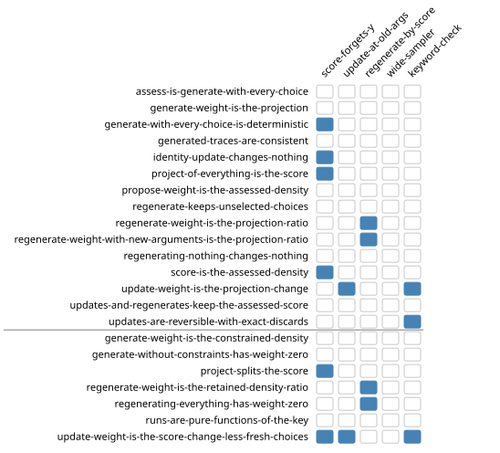
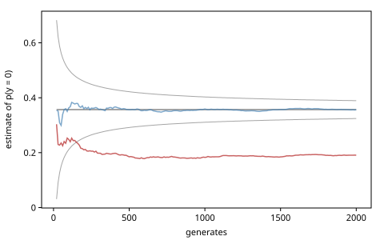

# Verification: the Laws

The chapters of Part III state what the operations of the Generative
Function Interface mean: a trace's score is the density of its choices,
`update`'s weight is a ratio of densities, `regenerate`'s weight is the
ratio Metropolis–Hastings needs. Each of these is an equation between
operations, and an equation can be tested. gen.clj states the interface's
equations as *laws*, functions that check them on any generative
function, and runs them as property tests over every kind of generative
function it has. This chapter shows the laws, runs them on a generative
function written by hand, and then tests the tests: it plants bugs and
watches which laws catch them.

The chapter ports the structure of the GenMLX book's *Verification*
chapter: the laws as runnable values, a taxonomy, and the mistakes caught
before a model runs. The laws themselves are gen.clj's, from
`ext/laws/src/gen/laws.clj`, audited against the thesis in
`docs/research/law-audit.md` and listed with their tests in
`docs/research/genjl-parity.md` §3. GenMLX keeps its laws as data records
that one function runs against a model. gen.clj's are test.check
properties, so the same machinery that draws, shrinks and reports
property tests draws their cases, shrinks a failing one and reports it.

The laws live in the namespace `gen.laws`, in a module of gen.clj outside
its core, `ext/laws`, which adds test.check to gen.clj's dependencies.
`clojure -M:laws` puts it on the classpath, and so does `-M:test`. A
project of your own takes it as a git dependency on gen.clj's repository,
with `:deps/root "ext/laws"`.

<!-- code: ns -->
```clojure
(ns book.verification
  (:refer-clojure :exclude [+ - * /])
  (:require [clojure.string :as str]
            [clojure.test.check.generators :as tcg]
            [clojure.test.check.properties :as prop]
            [gen.array :as array :refer [+ - * /]]
            [gen.book.svg :as svg]
            [gen.choicemap :as cm]
            [gen.diff :as diff]
            [gen.dist :as d]
            [gen.dist.core :as dc]
            [gen.dynamic :as dyn :refer [gen]]
            [gen.gfi :as gfi]
            [gen.inference.proposal :as proposal]
            [gen.laws :as laws]
            [gen.random :as rng]
            [gen.random-static-models :as rsm]
            [gen.selection :as sel]
            [gen.trace :as trace]))
```

## A law is a function

The running example is a measurement. A true value $x$ is drawn around a
known mean $\mu$, and a measurement $y$ is drawn around $x$:

$$
x \sim \mathcal{N}(\mu, 1), \qquad y \mid x \sim \mathcal{N}(x, 0.5).
$$

A law runs over *model entries*: vectors of a label, a generative
function, its arguments, and a vector of other argument vectors, with
which the laws also update and regenerate.

<!-- code: model -->
```clojure
(def measurement
  (gen [mu]
    (let [x (trace :x (d/normal mu 1))]
      (trace :y (d/normal x 0.5)))))

(def models
  "The measurement model as a model entry: a label, the generative
   function, its arguments, and other arguments to update and regenerate
   with."
  [[:measurement measurement [0.0] [[1.5] [-2.0]]]])
```

`laws/cases` turns model entries into a test.check generator of *cases*,
and a law is a function from cases to a test.check property. The law
`score-is-the-assessed-density` is the thesis's trace consistency (Def.
2.1.16): the score of a simulated trace is the log density `assess` gives
its choices, and the two return values agree. `laws/quick-check` runs a
property on a number of cases, as test.check's `quick-check` does, and
adds the count of *vacuous* cases, which a later section explains:

<!-- code: one-law -->
```clojure
(def score-law (laws/score-is-the-assessed-density (laws/cases models)))

(select-keys (laws/quick-check 20 score-law {:seed 1})
             [:pass? :num-tests :vacuous])
;=> {:pass? true, :num-tests 20, :vacuous 0}
```

The `:seed` is test.check's own: it fixes which cases are drawn, so this
result is the same at every run. A case is a model entry, a seed for the
keys the law's operations take, 32 booleans that say which addresses the
law constrains or selects, and whether to change the arguments:

<!-- code: a-case -->
```clojure
(let [[[label] seed picks alt?] (tcg/generate (laws/cases models) 30 7)]
  [label (int? seed) (count picks) (boolean? alt?)])
;=> [:measurement true 32 true]
```

The seeds span $2^{31}$ values (`laws/seeds`), and the booleans are
cycled over a trace's addresses in order. So a law constrains random
subsets of a trace's choices, not always the first one, and half of the
cases change the arguments. The random subsets and the changed arguments
came from the law audit, below; the wide seeds from a planted bug, in the
section on planted bugs.

## The sets of laws

The laws come in maps from a name to a law. `laws/verify` runs every law
of such a map over model entries, `laws/all` by default, and returns the
failures: a map from each law that failed to what it says, `{}` when
every law holds. Its options are the number of cases of each law and the
seed they are drawn from, a fresh one at each run unless one is given.
The chapter runs 20 cases from one seed:

<!-- code: verify -->
```clojure
(def few
  "The chapter's runs of a law: 20 cases, from one seed."
  {:num-tests 20 :seed 1})

(laws/verify models few)
;=> {}
```

`laws/general` holds fifteen laws and `laws/forward-sampling` seven more;
`laws/all`, which the measurement model passed, is both:

<!-- code: sets -->
```clojure
(mapv count [laws/general laws/forward-sampling laws/all])
;=> [15 7 22]
```

The *general* laws state the thesis's definitions, so they hold for every
generative function:

- `score-is-the-assessed-density`: a simulated trace's score is
  `assess`'s weight of its choices, and the return values agree (Def.
  2.1.16).
- `propose-weight-is-the-assessed-density`: `propose`'s weight is
  `assess`'s weight of the choices it proposed.
- `project-of-everything-is-the-score`: a trace projected on every address
  gives its score.
- `generate-with-every-choice-is-deterministic`: constrained on every
  choice of a trace, `generate` makes those choices, with the score as its
  weight.
- `generated-traces-are-consistent`: constrained on some of them,
  `generate` keeps the constraints and makes a consistent trace, and its
  weight is not NaN.
- `generate-weight-is-the-projection`: `generate`'s weight is the
  projection of its trace on the constrained addresses, for any internal
  proposal (§4.1.1).
- `assess-is-generate-with-every-choice`: `assess` and `generate` agree on
  the same choices and key.
- `identity-update-changes-nothing`: an update without constraints has
  weight 0, keeps every choice, discards nothing, and reports a sound
  change of its return value.
- `updates-are-reversible-with-exact-discards`: an update with random
  constraints, from another run on other arguments, makes a consistent
  trace, its discard is exactly Def. 2.3.1's, and updating back with the
  discard restores the trace (Prop. 2.3.1).
- `update-weight-is-the-projection-change`: `update`'s weight is the
  projection of the new trace on its choices not drawn afresh, less the
  old score (Def. 2.3.1).
- `regenerate-keeps-unselected-choices`: `regenerate` makes a consistent
  trace and keeps every unselected choice.
- `regenerating-nothing-changes-nothing`: with nothing selected, its
  weight is 0 and the choices stay.
- `regenerate-weight-is-the-projection-ratio`: its weight is the ratio of
  the new and the old trace's projections on the retained choices (Eq.
  4.1).
- `regenerate-weight-with-new-arguments-is-the-projection-ratio`: the
  same, with new arguments.
- `updates-and-regenerates-keep-the-assessed-score`: after an update and
  its reverse, and a regenerate to other arguments and back, the traces
  are still consistent.

The *forward-sampling* laws hold when the internal proposal draws every
open choice from the model, each site from its own key, as `gen` and the
combinators do:

- `generate-without-constraints-has-weight-zero`.
- `generate-weight-is-the-constrained-density`: the weight is the log
  density of the constrained choices, and the open ones are drawn as
  `simulate` draws them on the same key.
- `update-weight-is-the-score-change-less-fresh-choices`: the weight is
  the change of score less the log density of the choices drawn afresh.
- `regenerate-weight-is-the-retained-density-ratio`: the weight is the log
  density ratio of the retained choices (Alg. 18).
- `regenerating-everything-has-weight-zero`.
- `project-splits-the-score`: the projection on nothing is 0, and the
  projections on a selection and on its complement add up to the score.
  The projection on the union of two disjoint selections is the sum of
  theirs, and with the one on the intersection of their complements (De
  Morgan's law) it adds up to the score.
- `runs-are-pure-functions-of-the-key`: the same key makes the same
  choices.

One more property is gen.clj's, not the thesis's:
`identity-update-reports-no-change`, an update without constraints
reports no change of the return value, unless the value holds an array.
The thesis's Def. 2.3.2 allows an unknown change at any time, so a
correct generative function may fail it. It is the set
`laws/conventions`, which gen.clj's suites run on its own generative
functions beside `laws/all`.

A generative function whose internal proposal is something else need
satisfy only the general set. `proposal/with-internal-proposal` gives a
model another internal proposal (Alg. 16 of the thesis): here, `:x` is
proposed from $\mathcal{N}(\mu + 0.5, 1.5)$ whenever the constraints leave
it open.

<!-- code: guided -->
```clojure
(defn open?
  "Does the choice map sigma leave the address a open?"
  [sigma a]
  (not (cm/has-value? sigma a)))

(def guided
  (proposal/with-internal-proposal measurement
    (gen [sigma mu]
      (when (open? sigma :x)
        (trace :x (d/normal (+ mu 0.5) 1.5))))))

(def guided-models [[:guided guided [0.0] [[1.5] [-2.0]]]])

(laws/verify guided-models few laws/general)
;=> {}

(count (laws/verify guided-models few laws/forward-sampling))
;=> 5
```

The general laws hold, and five forward-sampling laws fail, for a correct
generative function. Without constraints, `generate` still proposes $x$
from $q$, so its weight is $\log p(x) - \log q(x)$, not 0. That is the
general law's projection, here on no address at all:

<!-- code: guided-weight -->
```clojure
(let [{t :trace w :weight} (gfi/generate guided [0.0] cm/EMPTY (rng/key 1))
      x (t :x)]
  [(array/allclose? w (- (dc/log-prob (d/normal 0 1) x)
                         (dc/log-prob (d/normal 0.5 1.5) x)))
   (array/allclose? w (gfi/project t sel/none))])
;=> [true true]
```

Four more sets cover what these two cannot. A generative function with
*encapsulated randomness* (the thesis's §4.5) draws randomness that is not
among its choices, so its score is an estimate of its density, at one
draw of that randomness. This mixture draws its component untraced:

<!-- code: mixture -->
```clojure
(def mixture
  (gen []
    (let [i (untraced (d/categorical [0.2 0.5 0.3]))]
      (trace :a (d/normal (array/take (array/array [-2.0 0.0 3.0]) i) 1)))))

(def mixture-models [[:mixture mixture [] []]])

(contains? (laws/verify mixture-models few laws/general)
           :score-is-the-assessed-density)
;=> true

(laws/verify mixture-models few laws/encapsulated)
;=> {}
```

`assess` draws its own component from its own key, so its estimate
differs from the trace's, and the general set's comparisons between
separate runs fail. `laws/encapsulated` keeps the laws that hold for one
draw of the randomness, and compares `assess` with a trace's score on the
same key. The rest hold only in expectation (the thesis's Eqs. 4.3–4.4),
which statistical tests check. An estimated density whose sampler draws
its randomness otherwise than its estimate fails that last comparison
correctly, and `laws/estimated` is the set without it (*Extending
gen.clj*).

`laws/fixed-support` holds one law: for a model whose every address has a
fixed support, constraints taken from a simulated trace are inside the
support, so `generate`'s weights are finite (Def. 4.1.1). A model whose
supports move passes every other law and fails this one, correctly, since
its precondition does not hold:

<!-- code: support -->
```clojure
(def nested
  (gen []
    (let [x (trace :x (d/uniform 0 1))]
      (trace :y (d/uniform 0 x)))))

(def nested-models [[:nested nested [] []]])

(laws/verify nested-models few)
;=> {}

(keys (laws/verify nested-models {:num-tests 200 :seed 1}
                   laws/fixed-support))
;=> (:generate-weights-are-finite-on-a-fixed-support)
```

Constrained on `:y` alone, `generate` draws a new `:x`, which falls below
`:y` a quarter of the time: $\mathbb{E}[y] = \mathbb{E}[x]/2 = 1/4$. The
weight is then $-\infty$, and rightly so. In 2000 tries the share is
within five standard errors of a quarter:

<!-- code: support-quarter -->
```clojure
(defn out-of-support?
  "Is the weight -Inf of a generate of nested constrained on the :y of a
   simulated trace, with x drawn anew? The key splits in two, for each."
  [key]
  (let [[k1 k2] (rng/split key)
        y ((gfi/simulate nested [] k1) :y)
        w (:weight (gfi/generate nested [] (cm/choicemap :y y) k2))]
    (= ##-Inf (array/item w))))

(let [n 2000
      share (/ (count (filter out-of-support? (rng/split (rng/key 2) n))) n)]
  (< (abs (- share 0.25)) (* 5 (Math/sqrt (/ (* 0.25 0.75) n)))))
;=> true
```

The last two sets are `laws/static`, which the section on the fuzzer
runs, and `laws/across`, for a trace that a generative function updates
or regenerates although another made it. Then only the trace's choices
carry over (`gfi/revise`). Its model entries add that other function: here
the same model under another parameter store, whose value shifts $x$'s
mean.

<!-- code: across -->
```clojure
(def shifted
  (gen [mu]
    (let [x (trace :x (d/normal (+ mu (param :shift)) 1))]
      (trace :y (d/normal x 0.5)))))

(laws/verify [[:stores (dyn/with-params shifted {:shift 0.0})
               [0.0] [[1.5] [-2.0]]
               (dyn/with-params shifted {:shift 1.0})]]
             few laws/across)
;=> {}
```


## A generative function by hand

`gen` and the combinators are checked by gen.clj's own test battery. The
laws matter most for a generative function of a new kind: one written
against the protocol directly, a combinator, an internal proposal. The
protocol is `gfi/IGenerativeFunction`, with one method per operation:
`-simulate`, `-generate`, `-update`, `-regenerate`, `-assess`,
`-propose` and `-project`. We write the measurement model by hand.

To plant bugs later one at a time, our record keeps its parts in a map:
the model's sampler and density, and one function per operation. A
generative function written for use would implement the methods
directly.

<!-- code: record -->
```clojure
(defrecord HandWritten [parts]
  gfi/IGenerativeFunction
  (-simulate [gf args key] ((:simulate parts) gf args key))
  (-generate [gf args constraints key]
    ((:generate parts) gf args constraints key))
  (-update [gf tr args argdiffs constraints key]
    ((:update parts) gf tr args argdiffs constraints key))
  (-regenerate [gf tr args argdiffs selection key]
    ((:regenerate parts) gf tr args argdiffs selection key))
  (-assess [gf args choices key] ((:assess parts) gf args choices key))
  (-propose [gf args key] ((:propose parts) gf args key))
  (-project [gf tr selection] ((:project parts) gf tr selection)))
```

The model's parts are a sampler and a density. The sampler keeps the
values it is given and draws the others, each from its own key, so that a
constrained run draws the open choices as an unconstrained run on the
same key does. The forward-sampling laws need that.

<!-- code: model-parts -->
```clojure
(defn draw
  "The values of the measurement model's choices on mu, as a map from
   address to value: those in given, and the others drawn, each from its
   own key split from key."
  [mu given key]
  (let [[kx ky] (rng/split key)
        x (or (:x given) (dc/sample (d/normal mu 1) kx))]
    {:x x :y (or (:y given) (dc/sample (d/normal x 0.5) ky))}))

(defn log-densities
  "The log density of each of the measurement model's choices m on mu, as
   a map from address to log density."
  [mu {:keys [x y]}]
  {:x (dc/log-prob (d/normal mu 1) x)
   :y (dc/log-prob (d/normal x 0.5) y)})
```

Three helpers read a choice map, add up log densities and make a trace.
`values-of` is loud for an address the model does not have, with the
error `gfi/unvisited` makes, the one gen.clj raises for a constraint no
run visits. `trace/make-trace` records which generative function made the
trace.

<!-- code: helpers -->
```clojure
(defn values-of
  "The values in the choice map c, as a map from address to value: loud
   for an address the measurement model does not have."
  [op c]
  (let [paths (cm/addresses c)]
    (when-let [others (seq (remove #{[:x] [:y]} paths))]
      (throw (gfi/unvisited op others)))
    (into {} (map (fn [[a]] [a (cm/get-choice c a)])) paths)))

(defn log-density
  "The sum of the log densities of the choices m on mu at addresses (all
   by default), by gf's density."
  ([gf mu m] (log-density gf mu m [:x :y]))
  ([gf mu m addresses]
   (let [{:keys [log-densities]} (:parts gf)]
     (reduce + 0.0 (vals (select-keys (log-densities mu m) addresses))))))

(defn make-trace
  "The trace of gf on args with the choices m."
  [gf [mu :as args] m]
  (trace/make-trace {:gen-fn gf :args args :choices (cm/from-map m)
                     :retval (:y m) :score (log-density gf mu m)}))
```

The operations follow the weights of *Update and Regenerate*. The
internal proposal draws the open choices from the model, so `generate`'s
weight $\log p(\tau) - \log q(\upsilon)$ is the log density of the
constrained choices. The model's structure never changes, so `update`
draws nothing afresh: its weight is the difference of scores, and its
discard holds the old values of the constrained choices. `regenerate`'s
weight is the log density ratio of the retained choices, Eq. 4.1 for a
proposal that samples forward.

<!-- code: operations -->
```clojure
(defn simulate-op
  "simulate: every choice drawn."
  [gf [mu :as args] key]
  (let [{:keys [draw]} (:parts gf)]
    (make-trace gf args (draw mu {} key))))

(defn generate-op
  "generate: the constrained choices kept, the others drawn."
  [gf [mu :as args] constraints key]
  (let [{:keys [draw]} (:parts gf)
        given (values-of :generate constraints)
        m (draw mu given key)]
    {:trace (make-trace gf args m)
     :weight (log-density gf mu m (keys given))}))

(defn update-op
  "update: the constrained choices replaced, nothing drawn."
  [gf tr args argdiffs constraints _]
  (let [given (values-of :update constraints)
        old (values-of :update (:choices tr))
        t (make-trace gf args (merge old given))]
    {:trace t
     :weight (- (:score t) (:score tr))
     :retdiff (if (and (empty? given) (every? diff/no-change? argdiffs))
                diff/no-change
                diff/unknown-change)
     :discard (cm/from-map (select-keys old (keys given)))}))

(defn regenerate-op
  "regenerate: the selected choices drawn again."
  [gf tr [mu :as args] _ selection key]
  (let [{:keys [draw]} (:parts gf)
        old (values-of :regenerate (:choices tr))
        kept (into {} (remove (fn [[a]] (sel/selected? selection a))) old)
        m (draw mu kept key)]
    {:trace (make-trace gf args m)
     :weight (- (log-density gf mu m (keys kept))
                (log-density gf (first (:args tr)) old (keys kept)))
     :retdiff diff/unknown-change}))

(defn assess-op
  "assess: the log density of every choice, each given."
  [gf [mu] choices _]
  (let [m (values-of :assess choices)]
    (doseq [a [:x :y] :when (not (contains? m a))]
      (throw (ex-info (str "assess: no value for the choice at " [a])
                      {:path [a]})))
    {:weight (log-density gf mu m) :retval (:y m)}))

(defn propose-op
  "propose: simulate's choices, with their log density."
  [gf args key]
  (let [t (simulate-op gf args key)]
    {:choices (:choices t) :weight (:score t) :retval (:retval t)}))

(defn project-op
  "project: the log density of the selected choices."
  [gf tr selection]
  (log-density gf (first (:args tr)) (values-of :project (:choices tr))
               (filter #(sel/selected? selection %) [:x :y])))
```

The generative function is the record of these parts, and `entry` makes a
model entry of it with the measurement model's arguments:

<!-- code: by-hand -->
```clojure
(def by-hand
  (->HandWritten {:draw draw :log-densities log-densities
                  :simulate simulate-op :generate generate-op
                  :update update-op :regenerate regenerate-op
                  :assess assess-op :propose propose-op :project project-op}))

(defn entry
  "A model entry of gf, on the measurement model's arguments."
  [label gf]
  [label gf [0.0] [[1.5] [-2.0]]])
```

It scores choices as the `gen` version does, and it passes every law,
the fixed-support law included:

<!-- code: by-hand-check -->
```clojure
(let [c (cm/choicemap :x 0.3 :y -0.2)]
  (array/allclose? (:weight (gfi/assess by-hand [0.5] c))
                   (:weight (gfi/assess measurement [0.5] c))))
;=> true

(laws/verify [(entry :by-hand by-hand)] few)
;=> {}

(laws/verify [(entry :by-hand by-hand)] few laws/fixed-support)
;=> {}
```

It is loud where gen.clj's own generative functions are. The laws rely on
it: an error that says a constraint was not visited marks a case the law
says nothing about, as the section on vacuity shows.

<!-- code: by-hand-loud -->
```clojure
;; error: generate: the constraint at [:z] was not visited
(gfi/generate by-hand [0.0] (cm/choicemap :z 1.0) (rng/key 2))
```

### In a test namespace

In a test namespace, `laws/deflaws` defines one test.check spec per law,
named by a prefix and the law. Each runs as a `clojure.test` test with the
given number of cases (`clojure -X:test`), from a fresh seed at each run
as test.check's specs do, or, called with a count and a seed, on those:

<!-- code: deflaws -->
```clojure
(laws/deflaws hand [(entry :by-hand by-hand)] 100)

(count (filter (comp ::laws/law meta) (vals (ns-interns 'book.verification))))
;=> 22

(select-keys (hand-update-weight-is-the-projection-change 10 :seed 1)
             [:pass? :num-tests])
;=> {:pass? true, :num-tests 10}
```

A fourth argument names another set, or an expression of sets:
`(laws/deflaws prefix models 100 (merge laws/all laws/fixed-support))`.
The book runs each law on 20 cases. gen.clj's own suites run `laws/all`
with `laws/conventions`, 100 cases per law over the dynamic models and
over the combinators,
200 over random dynamic models, and 300 for the static law over random
static models; `gen.soak` runs every property again with ten times its
cases and a fresh seed, before a milestone is signed off.

## Planted bugs: the test of a test

A law that has never failed has not been shown to test anything. gen.clj's
rule for its tests is that a new test must be able to fail: before it is
trusted, a bug is planted, a *mutation*, and the test must catch it. The
laws' docstrings record their plants. One is in `laws/seeds`: when the
seeds came from `gen/nat`, which test.check bounds by its size, a normal
sampler that returned NaN beyond 3.25 standard deviations failed 2 of 240
runs of the dynamic laws; with seeds over $2^{31}$ it failed 46.

We plant five bugs in the hand-written generative function, each by
replacing one part:

<!-- code: planted -->
```clojure
(defn planted
  "gf with its part k replaced by f: a planted bug."
  [gf k f]
  (assoc-in gf [:parts k] f))

(defn simulate-forgetting-y
  "simulate, its score without y's term."
  [gf [mu :as args] key]
  (let [t (simulate-op gf args key)
        m (values-of :simulate (:choices t))]
    (assoc t :score (log-density gf mu m [:x]))))

(defn update-at-old-arguments
  "update, its weight computed at the trace's old arguments."
  [gf tr args argdiffs constraints key]
  (let [r (update-op gf tr args argdiffs constraints key)
        m (values-of :update (:choices (:trace r)))]
    (assoc r :weight (- (log-density gf (first (:args tr)) m) (:score tr)))))

(defn regenerate-by-score
  "regenerate, its weight the score difference: the proposal forgotten."
  [gf tr args argdiffs selection key]
  (let [r (regenerate-op gf tr args argdiffs selection key)]
    (assoc r :weight (- (:score (:trace r)) (:score tr)))))

(defn draw-wide
  "draw, with x from N(mu, 2) where the density says N(mu, 1)."
  [mu given key]
  (let [[kx ky] (rng/split key)
        x (or (:x given) (dc/sample (d/normal mu 2) kx))]
    {:x x :y (or (:y given) (dc/sample (d/normal x 0.5) ky))}))

(defn update-checking-keywords
  "update, its check of the constraints written with keywords where
   cm/addresses gives paths: every constraint is unvisited."
  [gf tr args argdiffs constraints key]
  (when-let [others (seq (remove #{:x :y} (cm/addresses constraints)))]
    (throw (gfi/unvisited :update others)))
  (update-op gf tr args argdiffs constraints key))

(def plants
  "The planted bugs: a name, the part each replaces and its replacement."
  [[:score-forgets-y :simulate simulate-forgetting-y]
   [:update-at-old-args :update update-at-old-arguments]
   [:regenerate-by-score :regenerate regenerate-by-score]
   [:wide-sampler :draw draw-wide]
   [:keyword-check :update update-checking-keywords]])
```

Each is a mistake a hand-written generative function can make: a score
that forgets a term, an incremental weight that forgets the arguments
changed, a regenerate weight that forgets its proposal, a sampler that
disagrees with the density, and an address check that compares paths
with keywords. Every law runs on each:

<!-- code: caught -->
```clojure
(def caught
  "For each planted bug, the laws that fail on it."
  (into {} (for [[name k f] plants
                 :let [models [(entry name (planted by-hand k f))]]]
             [name (set (keys (laws/verify models few)))])))

(mapv (comp count caught first) plants)
;=> [6 2 4 0 3]
```

<!-- code: planted-figure -->
```clojure
;; figure: figures/035-planted.svg
(let [names (concat (sort (keys laws/general))
                    (sort (keys laws/forward-sampling)))]
  (svg/grid (map name names)
            (map (comp name first) plants)
            (for [law names]
              (for [[plant] plants] (contains? (caught plant) law)))
            {:rules [(dec (count laws/general))]}))
```



**The score that forgets a term** fails six laws. test.check shrinks a
failing case to a smallest one, which a failure shows with the model by
its label: here the seed 0 of its keys with no address picked. The
failure names the check that failed and the values it compared.
The score is higher than the density `assess` gives the same choices, by
$y$'s missing term:

<!-- code: score-failure -->
```clojure
(def forgets-y (planted by-hand :simulate simulate-forgetting-y))

(def score-failure
  (:score-is-the-assessed-density
   (laws/verify [(entry :forgets-y forgets-y)] few)))

(let [{:keys [model key-seed picks]} (:case score-failure)]
  [model key-seed (not-any? true? picks)])
;=> [:forgets-y 0 true]

(let [{:keys [check score assessed]} score-failure]
  [check (> (array/item score) (array/item assessed))])
;=> [(consistent? (gfi/simulate gf args (rng/key seed))) true]
```

**The update at the old arguments** fails only the two laws that state
update's weight, and only because the model entry has other arguments.
Without them, every law passes it:

<!-- code: old-args -->
```clojure
(= (caught :update-at-old-args)
   #{:update-weight-is-the-projection-change
     :update-weight-is-the-score-change-less-fresh-choices})
;=> true

(def at-old-args (planted by-hand :update update-at-old-arguments))

(laws/verify [[:same-args at-old-args [0.0] []]] few)
;=> {}

(keys (laws/verify [(entry :old-args at-old-args)] few laws/general))
;=> (:update-weight-is-the-projection-change)
```

In the general set one law catches it, and that law came late: the law
audit planted a weight off by one in `update`, every general law passed
it, and the law was added (2026-10-20). The random dynamic models took no
arguments until a planted update on the old arguments passed every law of
the fuzz suite; they take one now, with alternatives.

**The regenerate weight that forgets its proposal** is the mistake of
*Update and Regenerate*'s second exercise, which a chain's statistics
caught there. Here four pointwise laws catch it, all that state
regenerate's weight but `regenerating-nothing-changes-nothing`, where the
score difference is 0 as well:

<!-- code: by-score -->
```clojure
(= (caught :regenerate-by-score)
   #{:regenerate-weight-is-the-projection-ratio
     :regenerate-weight-is-the-retained-density-ratio
     :regenerate-weight-with-new-arguments-is-the-projection-ratio
     :regenerating-everything-has-weight-zero})
;=> true
```

**The wide sampler** fails no law, and **the keyword check** fails three
for a reason of its own. The next two sections take them up.

## Vacuity

A law draws its constraints from another run of the model. When the
model's structure varies, that run may have choices this one cannot
visit, and the interface rejects them loudly. The case then says nothing
about the law: it is *vacuous*. The coin model of *Update and Regenerate*
flips `:b` only when `:a` comes up true. Six of a hundred cases of the
reversibility law are vacuous:

<!-- code: coins -->
```clojure
(def coins
  (gen [prob-a]
    (let [a (trace :a (d/bernoulli prob-a))
          b (when a (trace :b (d/bernoulli 0.6)))
          val (if a b true)
          c (trace :c (d/bernoulli (if val 0.9 0.2)))]
      (and val c))))

(def coin-models [[:coins coins [0.3] [[0.6]]]])

(def reversible (laws/updates-are-reversible-with-exact-discards
                 (laws/cases coin-models)))

(select-keys (laws/quick-check 100 reversible {:seed 1}) [:pass? :vacuous])
;=> {:pass? true, :vacuous 6} ; float64
```

Such a case gives `:b` to a trace whose `:a` is false, without changing
`:a`, and the error says the constraint was not visited:

<!-- code: unvisitable -->
```clojure
;; error: update: the constraint at [:b] was not visited
(let [t (:trace (gfi/generate coins [0.3] (cm/choicemap :a false)
                              (rng/key 3)))]
  (gfi/update t (cm/choicemap :b true) (rng/key 4)))
```

The laws tell such a case by its error's message (`laws/unvisitable?`):
a constraint not visited, or a nested choice map or a single value where
the other belongs. So a generative function written by hand throws
`gfi/unvisited`'s error for a constraint it does not visit, as
`values-of` does; any other error fails the law. A law of your own wraps
such an operation in `laws/vacuous-on-unvisitable`, which gives
`laws/vacuous` in place of that error, and states its comparisons in
`laws/checks`, which counts a case all of whose checks were vacuous.

A vacuous case passes, which is right for one case and dangerous for
many: a law all of whose cases are vacuous passes without testing
anything. The keyword check is such a bug. It rejects every constraint as
unvisited, so the update laws' cases are vacuous whenever they constrain
anything. `laws/quick-check`, which runs one law's property,
`laws/verify` and every spec `deflaws` defines fail a law more than
`laws/max-vacuous` of whose cases are vacuous:

<!-- code: keyword-check -->
```clojure
(def keyword-check (planted by-hand :update update-checking-keywords))

(def keyword-law
  (laws/update-weight-is-the-projection-change
   (laws/cases [(entry :keyword-check keyword-check)])))

(:result-data (laws/quick-check 20 keyword-law {:seed 1}))
;=> {:vacuous 15, :of 20, :max-vacuous 0.6}

(:pass? (laws/quick-check 20 keyword-law {:seed 1 :max-vacuous 1.0}))
;=> true
```

Fifteen of the twenty cases were vacuous, so the law fails; allowed any
share, it passes. The threshold comes from measurement: over five runs of
every law in the battery, the largest share of vacuous cases was the
random-model fuzz's 0.32 of 200 cases, and the threshold is more than
eight standard errors above it:

<!-- code: max-vacuous -->
```clojure
laws/max-vacuous
;=> 0.6

(/ (- laws/max-vacuous 0.32) (Math/sqrt (/ (* 0.32 0.68) 200)))
;=> 8.5
```

The same plant, an update that rejects every constraint, passed the
update laws of the dynamic and combinator suites before the count
existed.

## Statistical laws

The wide sampler draws $x$ from $\mathcal{N}(\mu, 2)$, while its density
says $\mathcal{N}(\mu, 1)$. Every operation draws with the same sampler
and scores with the same density, so every pointwise law, which compares
one operation's number with another's, passes. What the bug breaks is a
statement about distributions: `generate`'s weight is an unbiased
estimate of the marginal likelihood of the constraints (the thesis's
§4.1; law 3 in the parity list's §3),

$$
\mathbb{E}_{\upsilon \sim q(\cdot;\, x, \sigma)}\bigl[e^{w}\bigr]
= p(\sigma; x).
$$

The measurement model has it in closed form: $y$'s marginal is
$\mathcal{N}(\mu, \sqrt{1 + 0.5^2})$. On $\mu = 0$ and $y = 0$:

<!-- code: evidence -->
```clojure
(defn density-at-0
  "The density at 0 of N(0, sd)."
  [sd]
  (array/item (array/exp (dc/log-prob (d/normal 0 sd) 0.0))))

(def exact-evidence
  "p(y = 0) on mu = 0: y's marginal is N(mu, sqrt(1 + 0.5^2))."
  (density-at-0 (Math/sqrt 1.25)))

exact-evidence
;=> 0.3568

(defn evidence-draws
  "exp(weight) of n generates of gf on mu = 0 with y fixed to 0, as host
   numbers: draws whose mean estimates p(y = 0)."
  [gf n key]
  (mapv (fn [k]
          (let [{w :weight} (gfi/generate gf [0.0] (cm/choicemap :y 0.0) k)]
            (array/item (array/exp w))))
        (rng/split key n)))
```

A statistical law is a band around the exact value. The mean of $n$
independent draws has a standard error of their standard deviation over
$\sqrt{n}$, and the book's rule is five of them: a correct estimate falls
outside with probability below one in a million, under the normal
approximation. The draws are host numbers, so the loop keeps no traces.

<!-- code: within -->
```clojure
(defn mean-se
  "The mean of the host numbers xs, and its standard error."
  [xs]
  (let [n (count xs)
        m (/ (reduce + xs) n)
        v (/ (reduce + (map #(* (- % m) (- % m)) xs)) (dec n))]
    [m (Math/sqrt (/ v n))]))

(defn within-5-se?
  "Is the mean of xs within five standard errors of value?"
  [xs value]
  (let [[m se] (mean-se xs)]
    (< (abs (- m value)) (* 5 se))))

(def right-draws (evidence-draws by-hand 2000 (rng/key 5)))

(def wide-draws
  (evidence-draws (planted by-hand :draw draw-wide) 2000 (rng/key 6)))

[(within-5-se? right-draws exact-evidence)
 (within-5-se? wide-draws exact-evidence)]
;=> [true false]
```

A band must also be narrow enough to catch a plausible error. With 2000
draws, five standard errors are less than a tenth of the value, so the
law would catch an estimate biased by ten percent:

<!-- code: band-width -->
```clojure
(< (* 5 (second (mean-se right-draws))) (* 0.1 exact-evidence))
;=> true
```

The wide sampler's estimate is unbiased too, for another model: the one
its sampler draws from, whose marginal is
$\mathcal{N}(\mu, \sqrt{2^2 + 0.5^2})$.

<!-- code: wide-target -->
```clojure
(within-5-se? wide-draws (density-at-0 (Math/sqrt 4.25)))
;=> true
```

The running means show both, and the band narrowing as the draws grow:

<!-- code: evidence-figure -->
```clojure
;; figure: figures/035-evidence.svg
(defn running-means
  "[n, the mean of the first n of xs] for n from 20 on, every 10th."
  [xs]
  (let [sums (vec (reductions + xs))]
    (for [n (range 20 (inc (count xs)) 10)]
      [n (/ (sums (dec n)) n)])))

(let [sd (* (second (mean-se right-draws)) (Math/sqrt (count right-draws)))
      band (fn [sign]
             (for [n (range 20 2001 10)]
               [n (+ exact-evidence (* sign 5 (/ sd (Math/sqrt n))))]))]
  (svg/paths [{:paths [(band 1) (band -1)] :color "gray" :width 1}
              {:paths [[[20 exact-evidence] [2000 exact-evidence]]]
               :color "black" :width 1}
              {:paths [(running-means right-draws)]}
              {:paths [(running-means wide-draws)] :color "firebrick"}]
             {:x-label "generates" :y-label "estimate of p(y = 0)"}))
```



Statistical laws are not in `gen.laws`, whose properties hold case by
case. They are tests in each suite, against an exact answer: a closed
form, an enumeration, or quadrature. Each uses fixed keys, so it is
deterministic, and its band is five standard errors (or five Monte Carlo
standard errors for a chain's average). Among them: importance sampling's
and the particle filter's estimates are unbiased, an MH chain leaves an
exact posterior invariant, and with encapsulated randomness the expected
estimate is the density (Eq. 4.3).

In all, the laws compare in four ways. Choices, discards and return values
compare exactly, with `=`, and a weight that must be 0 must be exactly 0.
Weights and scores compare up to rounding, with `laws/close?`: within
float64's round-off, or, on a float32 backend, a relative $10^{-4}$ and
an absolute $10^{-3}$, since a weight is a difference of scores and
carries their error. Statistical laws compare within five standard
errors. And a case may be vacuous, which counts against a law only in
numbers.

## The law audit

On 2026-10-18 an independent, read-only audit compared the laws and the
handler with the thesis (`docs/research/law-audit.md`), page by page.
Two more audits followed on 2026-10-20. They found:

- **An error in the implementation.** `update` mishandled an address that
  is a choice in the old trace and a call in the new one: the old choice
  was neither subtracted from the weight nor discarded.
- **Laws stronger than the thesis.** Several laws held only for an
  internal proposal that samples forward, so a correct generative function
  with another proposal failed them. They became the forward-sampling
  set, and the general set gained the projection laws, which hold for
  any internal proposal; `guided` above is such a function.
- **Weak laws.** Mutations of the handler passed every test: regenerate
  subtracting the densities of removed choices, and regenerate ignoring
  new arguments for retained ones. The regenerate law always selected the
  first address, and the update law always constrained one address with
  the same arguments. The laws now constrain and select random subsets,
  of another run's choices for update, and change the arguments.
- **Missing laws.** The most valuable was trace consistency after every
  operation, which now runs inside every law that makes a trace
  (`consistent?`), and catches a stale score wherever it arises.
- **Errata in the thesis.** Alg. 5 (p. 92) swaps the forward and backward
  proposal terms of custom-proposal MH; the acceptance probability 0.6 in
  the example of pp. 148–149 should be 1; and the "log w = 1" of p. 146
  should be 0. gen.clj follows the corrected forms.

`docs/research/genjl-parity.md` §3 lists twenty laws of the interface,
from the thesis and from Gen.jl, with a coverage matrix that maps each to
the tests that check it. The pointwise ones are `gen.laws`'s; gradients,
estimators, MH stationarity, trace translators and involutive MCMC are
checked by numerical and statistical tests in their own suites.

## The path-equivalence fuzzer

Some bodies have a second way to run. A static body, `gen ^:static`
(*Speeding Up*), updates by walking its graph and assesses with a score
function generated from it, without the handler. The static law,
`laws/static`, requires every operation on a static generative function to
give what the same body without `^:static` gives under the same keys: the
same choices, return values and discards, scores and weights equal up to
rounding, and a sound change of the return value.

<!-- code: static -->
```clojure
(def static-measurement
  (gen ^:static [mu]
    (let [x (trace :x (d/normal mu 1))
          y (trace :y (d/normal x 0.5))]
      y)))

(laws/verify [(entry :static static-measurement)] few laws/static)
;=> {}
```

A bug in the static path makes it compute another model than its body.
To plant one, we give the static function the graph of a body whose
measurement noise is 1, not 0.5:

<!-- code: grafted -->
```clojure
(def wider-noise
  (gen ^:static [mu]
    (let [x (trace :x (d/normal mu 1))
          y (trace :y (d/normal x 1.0))]
      y)))

(def grafted (assoc static-measurement :static (:static wider-noise)))

(keys (laws/verify [(entry :grafted grafted)] few laws/static))
;=> (:static-matches-dynamic)
```

A law over a few hand-written models tests the paths those models take.
GenMLX's path-equivalence fuzzer held its compiled paths to the handler
over random programs, and gen.clj's does the same for the static
language. `gen.random-static-models` (test code) generates a static body
as data, a spec, writes it as a `gen ^:static` form, and evaluates it.
Its model entries carry the spec and the form as their label:

<!-- code: random-model -->
```clojure
(def random-model (tcg/generate rsm/gen-model 0 1))

(= (:form (first random-model))
   '(dyn/with-params
      (gen ^:static [i0 xs1 [u2 v2]]
        (let [b0 (trace [:b0 i0] (d/laplace v2 0.7))]
          (trace :ret (d/normal b0 1.0))))
      {:w 1.5}))
;=> true

(subvec random-model 2)
;=> [[2 [0.25] [-1.0 -0.75]] [[2 [0.25] [-1.0 -0.75]] [2 [0.25] [-1.0 1.75]]]]
```

This one, from the generator's smallest size, already has a computed
address, a destructured argument and a parameter store; larger ones have
every distribution family, computations under each change-propagation
rule, Maps, Unfolds, calls of static and dynamic generative functions,
macros and rest arguments. The static law holds over twenty of them:

<!-- code: fuzz -->
```clojure
(def static-law (laws/static-matches-dynamic (laws/cases rsm/gen-model)))

(select-keys (laws/quick-check 20 static-law {:seed 1}) [:pass? :num-tests])
;=> {:pass? true, :num-tests 20}
```

A failing case shrinks to a small spec, and prints the spec and the form
it became, which reads back as code. The battery runs the static law on
300 random models, and on 1000 in its slow tier, with the general laws
over random static models; it also holds compiled HMC, MALA and NUTS
steps to plain ones along random chains. The fuzzer found two bugs, both
fixed. `gen.diff`'s rules for `+`, `-`, `inc` and `dec` gave the sum of
an integer and a float an integer change, which the float's rounding
breaks. And Map's and Unfold's scores, kept as running totals, became NaN
($-\infty + \infty$) when an update took a choice out of its support and
the next brought it back. The second led to a general law,
`updates-and-regenerates-keep-the-assessed-score`, which holds every kind
of generative function to it. Batched execution, the other path a body
can take, has its own fuzzer over random dynamic models
(`gen.fuzz-test`): every batched particle is its own scalar trace.

## Mistakes caught before they run

Some mistakes never reach a law. The thesis lists five restrictions a
body of its dynamic modeling language must satisfy (§2.2.1, p. 63): it
halts, its addresses are unique, randomness outside random choices
affects neither control flow nor supports, it mutates nothing outside
itself, and it is not passed to higher-order functions. gen.clj checks
some of these, and a few mistakes of its own, loudly.

A lazy sequence in Clojure runs only when something reads it. A `map`
whose value is discarded would never run its `trace` calls, so `gen`
refuses to compile it:

<!-- code: lazy-error -->
```clojure
;; error: Syntax error compiling
(gen [xs]
  (map (fn [x] (trace [:y x] (d/normal x 1))) xs)
  xs)
```

The REPL prints the compiler's line and then its cause, which says what
to do. `compile-error` returns the cause:

<!-- code: compile-error -->
```clojure
(defn compile-error
  "The message of the error that compiling form raises (the cause the
   compiler reports), or nil when it compiles."
  [form]
  (try (eval form)
       nil
       (catch clojure.lang.Compiler$CompilerException e
         (ex-message (ex-cause e)))))

(= (compile-error '(gen [xs]
                     (map (fn [x] (trace [:y x] (d/normal x 1))) xs)
                     xs))
   (str "In gen: map here is lazy and its value is discarded, so its trace"
        " calls would never run. Use doseq, run! or mapv."))
;=> true

(str/starts-with?
 (compile-error '(gen ^:static [xs]
                   (let [s (trace :s (d/normal 0 1))]
                     (doseq [x xs] (trace [:y x] (d/normal s 1)))
                     s)))
 "gen ^:static: the let returns one expression")
;=> true
```

The second is the static language refusing a body that is not static,
as in *Speeding Up*. At run time, an address used twice, a constraint no
site visits and a missing choice in `assess` are errors, as earlier
chapters showed, and so are mistakes that would otherwise pass silently.
A plain Clojure map as constraints would read as no constraints at all,
and a missing argdiff would read as no change:

<!-- code: plain-map -->
```clojure
;; error: generate: the constraints must be a choice map
(gfi/generate measurement [0.0] {:y 1.0} (rng/key 7))
```

<!-- code: argdiffs -->
```clojure
;; error: update: 1 arguments but 0 argdiffs
(gfi/update (gfi/simulate measurement [0.0] (rng/key 8))
            [1.0] [] cm/EMPTY (rng/key 9))
```

Randomness outside random choices is the thesis's third restriction, and
gen.clj's form of it is `untraced`, whose draws come from a key, as the
mixture's did. A call of `rand` draws from a global source instead, which
no key controls and nothing at compile time sees. The laws see it: a run
is no longer a function of its key, and `assess` cannot reproduce a
trace's score.

<!-- code: rand -->
```clojure
(def with-rand
  (gen [mu]
    (let [x (trace :x (d/normal (+ mu (rand)) 1))]
      (trace :y (d/normal x 0.5)))))

(every? (laws/verify [(entry :with-rand with-rand)] few)
        [:runs-are-pure-functions-of-the-key :score-is-the-assessed-density])
;=> true
```

## Where Part III ends

Part III defined the interface's operations (*The Generative Function
Interface*), built inference from them (*Inference as Operations on the
GFI*), extended them with trace translators (*Trace Translators and
Involutive MCMC*), and explained the design (*Design Rationale*). This
chapter made the definitions executable: the laws hold every kind of
generative function to them, a generative function written by hand passed
them, and each bug planted in it failed a law, or a statistical law where
the pointwise ones could not see it.

Part IV, *The System*, turns to the machinery under the interface.
*Arrays, Backends and Gradients* applies the same discipline one layer
down: a conformance suite holds every array backend to the JVM backend's
results.

## Workshop

Each exercise has a tested solution at the end of the chapter.

1. **Predict the failures.** Plant a `project` that forgets $y$'s term:
   it counts only `:x`'s log density, whatever the selection. Predict
   which laws fail, then run them.
2. **Write a law.** Write a law of your own, as a function from cases to
   a test.check property: updating a trace with its own choices as the
   constraints has weight 0, keeps the choices, and discards them all.
   Check that it holds for the `gen` model and the hand-written one. Which
   of the five planted bugs does it catch, and why not the others?
3. **The model you meant.** Change the measurement noise from 0.5 to 1 in
   both the sampler and the density of the hand-written function. Predict
   which laws fail. Does the statistical law against the closed form
   catch it?
4. **A statistical law without a closed form.** Compute $p(y = 0)$ from
   the generative function's own `assess`, by summing the joint density
   of $x$ and $y = 0$ over a grid of $x$. Check it against the closed
   form, and use it in place of the closed form in the statistical law.
   Which of the plants of exercise 3 and of the wide sampler does it
   catch?

## Solutions

**1.** Every law that projects on `:y` fails: the projection of
everything is no longer the score, the score no longer splits, and every
weight stated as a projection disagrees. Eight laws fail, and none of
those that compare the score with `assess`:

<!-- code: solution-1 -->
```clojure
(defn project-forgetting-y
  "project, without y's term."
  [gf tr selection]
  (log-density gf (first (:args tr)) (values-of :project (:choices tr))
               (filter #(and (= :x %) (sel/selected? selection %)) [:x :y])))

(def project-forgets-y (planted by-hand :project project-forgetting-y))

(= (set (keys (laws/verify [(entry :project-forgets-y project-forgets-y)] few)))
   #{:generate-weight-is-the-constrained-density
     :generate-weight-is-the-projection
     :project-of-everything-is-the-score
     :project-splits-the-score
     :regenerate-weight-is-the-projection-ratio
     :regenerate-weight-is-the-retained-density-ratio
     :regenerate-weight-with-new-arguments-is-the-projection-ratio
     :update-weight-is-the-projection-change})
;=> true
```

**2.** The law destructures a case as `gen.laws`'s laws do, compares
the weight up to rounding with `laws/close?`, and states its comparisons
in `laws/checks`, so that a failure names the one that failed. `holds?`
runs it alone, as a law set of one:

<!-- code: solution-2 -->
```clojure
(defn update-to-its-own-choices-changes-nothing
  "A law: updating a trace with its own choices as the constraints has
   weight 0, keeps them, and discards them all."
  [cases]
  (prop/for-all [[[_ gf args] seed] cases]
    (let [tr (gfi/simulate gf args (rng/key seed))
          {t :trace w :weight discard :discard}
          (gfi/update tr (:choices tr) (rng/key (inc seed)))]
      (laws/checks (laws/close? w 0.0)
                   (= (:choices tr) (:choices t))
                   (= (:choices tr) discard)))))

(defn holds?
  "Does the law hold on the chapter's cases of models?"
  [law models]
  (= {} (laws/verify models few {:own law})))

[(holds? update-to-its-own-choices-changes-nothing models)
 (holds? update-to-its-own-choices-changes-nothing [(entry :by-hand by-hand)])]
;=> [true true]

(mapv (fn [[name k f]]
        (holds? update-to-its-own-choices-changes-nothing
                [(entry name (planted by-hand k f))]))
      plants)
;=> [false true true true false]
```

It catches the score that forgets a term, because the update rescores
the trace in full and its weight is no longer 0. It catches the keyword
check, but not as `gen.laws` would: the update throws, and an error the
law does not expect fails it. The law never changes the arguments and
never regenerates, and an update of every choice draws nothing, so the
other three pass.

**3.** No law fails. The sampler and the density agree, so the
generative function is a correct one, of another model; the laws check
that a generative function is consistent, not that it is the model you
meant. The statistical law against the closed form of the model you
meant catches it:

<!-- code: solution-3 -->
```clojure
(defn draw-1
  "draw, with y from N(x, 1)."
  [mu given key]
  (let [[kx ky] (rng/split key)
        x (or (:x given) (dc/sample (d/normal mu 1) kx))]
    {:x x :y (or (:y given) (dc/sample (d/normal x 1) ky))}))

(defn log-densities-1
  "log-densities, with y from N(x, 1)."
  [mu {:keys [x y]}]
  {:x (dc/log-prob (d/normal mu 1) x)
   :y (dc/log-prob (d/normal x 1) y)})

(def noise-1
  (-> by-hand (planted :draw draw-1) (planted :log-densities log-densities-1)))

(laws/verify [(entry :noise-1 noise-1)] few)
;=> {}

(within-5-se? (evidence-draws noise-1 2000 (rng/key 10)) exact-evidence)
;=> false
```

**4.** The joint density is negligible beyond eight units from 0, and a
grid of step 0.01 agrees with the closed form to rounding:

<!-- code: solution-4 -->
```clojure
(defn evidence-by-quadrature
  "p(y = 0) on mu = 0 by gf's assess: the joint density of x and y = 0,
   summed over a grid of x."
  [gf]
  (let [dx 0.01
        log-joint (fn [x]
                    (:weight (gfi/assess gf [0.0] (cm/choicemap :x x :y 0.0))))]
    (* dx (reduce + (map #(array/item (array/exp (log-joint %)))
                         (range -8.0 8.0 dx))))))

(array/allclose? (evidence-by-quadrature by-hand) exact-evidence)
;=> true

[(within-5-se? right-draws (evidence-by-quadrature by-hand))
 (within-5-se? wide-draws
               (evidence-by-quadrature (planted by-hand :draw draw-wide)))]
;=> [true false]

(within-5-se? (evidence-draws noise-1 2000 (rng/key 10))
              (evidence-by-quadrature noise-1))
;=> true
```

This law needs no closed form, so it applies to any generative function
with one continuous latent choice. It catches the wide sampler, whose
draws disagree with its own density. It passes the model with noise 1,
since it compares the generative function with itself: only a check
against what you meant, a closed form or a reference implementation,
can tell you built the wrong model.
