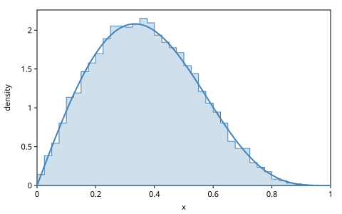
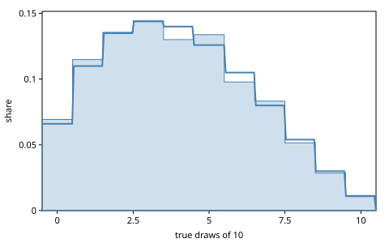
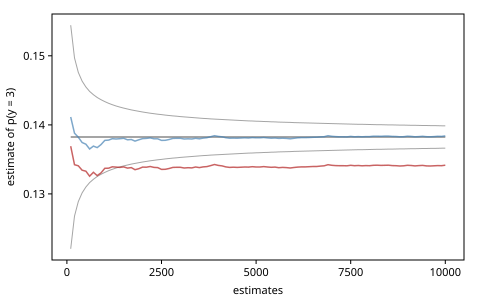

# Extending gen.clj

The chapters before this one used the distributions, generative
functions and gradients that gen.clj ships. None of them is special. A
distribution is a record whose behavior is a set of open multimethods, a
generative function is anything that implements the interface's seven
operations, and a gradient is whatever `gen.array` computes for code
written with its operators, or what you tell it. This chapter adds one of
each kind of building block from outside the library and holds each to
what it claims: a density to its closed form, a sampler to its moments,
a gradient to finite differences, a generative function to the laws, an
incremental computation to the full one, and a saved trace to the trace
that was saved.

The chapter ports the GenMLX book's *Extensions* chapter and Gen.jl's
five how-tos: *Adding New Distributions*, *Adding New Types of
Generative Functions*, *Customizing Gradients*, *Customizing Incremental
Computation* and *Extending Gen*. The extension points, and Gen.jl's
names for them:

| To add | gen.clj | Gen.jl |
|--------|---------|--------|
| a distribution | `gen.dist.core/defdist` | a `Distribution` subtype |
| a pushforward of one draw | `gen.dist.dsl/dist` | `@dist` |
| a family from a host library | `gen.dist.host/family` | GenDistributions |
| a generative function | `gen.gfi/defgf` | a `GenerativeFunction` subtype |
| a gradient | `array/custom-vjp`; `custom/deterministic`'s `:gradient` | `CustomGradientGF` |
| an estimated density | `gen.custom/estimated` | encapsulated randomness |
| an incremental computation | `:update-with-state`; `gen.diff/propagate` | `CustomUpdateGF` |
| a saved trace | `gen.serialize` | GenSerialization |

<!-- code: ns -->
```clojure
(ns book.extending
  (:refer-clojure :exclude [+ - * /])
  (:require [clojure.string :as str]
            [gen.array :as array :refer [+ - * /]]
            [gen.book.svg :as svg]
            [gen.choicemap :as cm]
            [gen.custom :as custom]
            [gen.diff :as diff]
            [gen.dist :as d]
            [gen.dist.core :as dc]
            [gen.dist.dsl :refer [dist]]
            [gen.dist.host :as host]
            [gen.dynamic :as dyn :refer [gen]]
            [gen.gfi :as gfi]
            [gen.gradients :as grad]
            [gen.inference.diagnostics :as diag]
            [gen.inference.mh :as mh]
            [gen.laws :as laws]
            [gen.learning :as learning]
            [gen.random :as rng]
            [gen.selection :as sel]
            [gen.serialize :as serialize]
            [gen.trace :as trace]))
```

## A distribution from scratch

A distribution in gen.clj is one record, `Distribution`, holding a type
keyword and a map of parameters. What it does is a set of multimethods
dispatched on the type: `-sample` and `-log-prob`, and optionally its
support, whether it is discrete, and the shape of its values. The
built-in normal is such a record with such methods, and `defdist` writes
both for a new family: a constructor that validates its parameters, and
the methods.

The *Kumaraswamy distribution* on $(0, 1)$ is not in `gen.dist`. It
looks like a beta, but its CDF has a closed form, $F(x) = 1 - (1 -
x^a)^b$, so it samples by inverting the CDF at a uniform draw:

$$
p(x; a, b) = a b\, x^{a-1} (1 - x^a)^{b-1}, \qquad
F^{-1}(u) = \bigl(1 - (1 - u)^{1/b}\bigr)^{1/a}.
$$

<!-- code: kumaraswamy -->
```clojure
(dc/defdist ^:elementwise ^:pathwise kumaraswamy
  "kumaraswamy(a, b): the Kumaraswamy distribution on (0, 1), whose
   density is a·b·x^(a-1)·(1 - x^a)^(b-1)."
  [a b]
  (validate (dc/check-positive "kumaraswamy" "a" a)
            (dc/check-positive "kumaraswamy" "b" b))
  (sample [key batch-shape]
    ;; the inverse of the CDF 1 - (1 - x^a)^b, at a uniform draw
    (let [u (rng/uniform key (dc/elementwise-shape batch-shape a b))]
      (array/pow (- 1.0 (array/pow (- 1.0 u) (/ 1.0 b))) (/ 1.0 a))))
  (log-prob [x]
    ;; outside (0, 1) the density is 0; a stand-in of 0.5 keeps the other
    ;; branch finite, so that its gradient is not NaN
    (let [inside (array/logical-and (array/> x 0.0) (array/< x 1.0))
          x (array/where inside x 0.5)
          log-1-xa (array/log1p (array/negate (array/pow x a)))]
      (array/where inside
                   (+ (array/log (* a b))
                      (* (- a 1.0) (array/log x))
                      (* (- b 1.0) log-1-xa))
                   ##-Inf))))
```

The clauses follow gen.dist's rules for its own families:

- `validate` checks the parameters when the distribution is made, on the
  host, so a bad one is an error at the site that made it, on every
  backend.
- `sample` takes a key and a *batch shape*: `[]` for one draw, `[n]` for
  $n$ of them in one call. Batched execution (*Speeding Up*) draws a
  batch of particles that way, so a sampler written with `gen.array`'s
  elementwise operators batches for free.
- `log-prob` is $-\infty$ outside the support, never NaN. The stand-in
  0.5 keeps the branch `where` discards finite, so that a gradient
  through the `where` is not NaN either.
- `^:elementwise` declares that a value has the parameters' broadcast
  shape, so a value of another shape at a site is an error rather than
  several draws scored as one. `^:pathwise` declares that a draw is a
  differentiable function of the parameters for a fixed key, which the
  pathwise gradient estimator of *Variational Inference* needs.

The type keyword is the namespace's, `:book.extending/kumaraswamy`, so
two libraries' families of the same name never collide. GenMLX also
makes a distribution from a map of functions, `map->dist`; gen.clj has
no such function, since a `defdist` is as short at the REPL, and
`host/family` (below) takes a map of host functions.

### Checking it

The log density agrees with the closed form, and it is $-\infty$ at and
beyond the ends of the support:

<!-- code: kumaraswamy-density -->
```clojure
(defn kumaraswamy-density
  "The Kumaraswamy density at x, on the host."
  [a b x]
  (* a b (Math/pow x (- a 1.0)) (Math/pow (- 1.0 (Math/pow x a)) (- b 1.0))))

(def k25 (kumaraswamy 2.0 5.0))

(every? (fn [x] (array/allclose? (dc/log-prob k25 x)
                                 (Math/log (kumaraswamy-density 2.0 5.0 x))))
        [0.05 0.3 0.5 0.9])
;=> true

(mapv #(dc/log-prob k25 %) [-0.5 0.0 1.0 1.5])
;=> [##-Inf ##-Inf ##-Inf ##-Inf]
```

A log density can be right in shape and wrong by a constant, which a
pointwise comparison with a mistaken closed form would not see. The
density integrates to 1 (the midpoint rule on $10^4$ intervals is exact
to many more digits than shown):

<!-- code: kumaraswamy-normalized -->
```clojure
(defn integral
  "The integral of the density of d over (0, 1), by the midpoint rule on m
   intervals."
  [d m]
  (let [dx (/ 1.0 m)
        density (fn [x] (array/item (array/exp (dc/log-prob d x))))]
    (* dx (reduce + (map #(density (* (+ % 0.5) dx)) (range m))))))

(integral k25 10000)
;=> 1.0
```

The validation is loud:

<!-- code: kumaraswamy-validation -->
```clojure
;; error: kumaraswamy: a must be positive, got -1
(kumaraswamy -1 5.0)
```

The density and the sampler are separate code, and nothing makes them
agree but care. *Verification* planted a sampler that disagreed with its
density, and no pointwise law caught it. A sampler is checked by its
moments: $\mathbb{E}[X^r] = b\, B(1 + r/a, b)$. Twenty thousand draws in
one batched call put the first two moments within five standard errors:

<!-- code: kumaraswamy-moments -->
```clojure
(defn mean-se
  "The mean of the host numbers xs, and its standard error."
  [xs]
  (let [n (count xs)
        m (/ (reduce + xs) n)
        v (/ (reduce + (map #(* (- % m) (- % m)) xs)) (dec n))]
    [m (Math/sqrt (/ v n))]))

(defn within-5-se?
  "Is the mean of the host numbers xs within five standard errors of
   value?"
  [xs value]
  (let [[m se] (mean-se xs)]
    (< (abs (- m value)) (* 5 se))))

(def k25-draws
  (array/->clj (dc/sample k25 (rng/key 1) [20000])))

(defn kumaraswamy-moment
  "E[X^r] of kumaraswamy(a, b): b·B(1 + r/a, b)."
  [a b r]
  (* b (array/item (array/exp (array/log-beta (+ 1.0 (/ r a)) b)))))

[(within-5-se? k25-draws (kumaraswamy-moment 2.0 5.0 1))
 (within-5-se? (map #(* % %) k25-draws) (kumaraswamy-moment 2.0 5.0 2))]
;=> [true true]

[(kumaraswamy-moment 2.0 5.0 1) (kumaraswamy-moment 2.0 5.0 2)]
;=> [0.3694 0.1667]
```

<!-- code: kumaraswamy-figure -->
```clojure
;; figure: figures/045-kumaraswamy.svg
(svg/histogram [{:values k25-draws
                 :density #(kumaraswamy-density 2.0 5.0 %)}]
               {:range [0.0 1.0] :x-label "x"})
```



### It is a generative function

`Distribution` implements the interface, so the new family needs nothing
more to be traced. In a `gen` body it is a site like any other, and
`generate`'s weight for a constrained value is its log density:

<!-- code: kumaraswamy-site -->
```clojure
(def proportion
  (gen []
    (trace :x (kumaraswamy 2.0 5.0))))

(let [{w :weight} (gfi/generate proportion [] (cm/choicemap :x 0.3)
                                (rng/key 2))]
  (array/allclose? w (dc/log-prob k25 0.3)))
;=> true
```

`^:pathwise` is a claim too. A draw is a function of $a$ for a fixed
key, so the mean of a thousand draws has a gradient in $a$, which
autodiff and a central difference agree on. The step and the tolerance
are 1%, wide enough for draws in float32, and far narrower than a
gradient that misses $a$:

<!-- code: kumaraswamy-pathwise -->
```clojure
(defn sample-mean
  "The mean of n draws from kumaraswamy(a, 5) with key."
  [a n key]
  (array/mean (dc/sample (kumaraswamy a 5.0) key [n])))

(let [key (rng/key 3)
      h 0.01
      by-autodiff ((array/grad #(sample-mean % 1000 key)) 2.0)
      by-differences (/ (- (sample-mean (+ 2.0 h) 1000 key)
                           (sample-mean (- 2.0 h) 1000 key))
                        (* 2 h))]
  [(dc/pathwise? k25)
   (array/allclose? by-autodiff by-differences {:rtol 0.01})])
;=> [true true]
```

## Pushforwards: the dist DSL

Many distributions are a deterministic function of one draw from
another: a log-normal is $e^X$ for a normal $X$, a label is a lookup by a
categorical index. Gen.jl's `@dist` defines such a *pushforward* by its
sampler alone and works out its density. gen.clj's `dist` does the same:
the body makes exactly one draw, the rest of it is `gen.array` code on
the parameters, and the density comes from the draw's. Here are the
examples of Gen.jl's how-to, in Clojure, with indices from 0:

<!-- code: pushforwards -->
```clojure
(dist labeled-uniform
  "A label drawn uniformly from labels."
  [labels]
  (nth labels (d/uniform-discrete 0 (dec (count labels)))))

(dist labeled-categorical
  "A label of labels, the i-th with probability (probs i)."
  [labels probs]
  (nth labels (d/categorical probs)))

(dist noisy-bit
  "The bit x, flipped with probability p (Gen.jl's bit_flip)."
  [x p]
  (d/bernoulli (+ (* (- 1 x) p) (* x (- 1 p)))))

(dist sym-binom
  "A binomial count of 2·scale fair trials, centered on mean."
  [mean scale]
  (+ (- (d/binom (* 2 scale) 0.5) scale) mean))

(dist shifted-geometric
  "A geometric count, shifted by shift."
  [p shift]
  (+ (d/geometric p) shift))

(dist log-normal
  "e^X for X normal(mu, sigma)."
  [mu sigma]
  (array/exp (d/normal mu sigma)))

(dist gumbel
  "The Gumbel distribution, location mu and scale beta."
  [mu beta]
  (- mu (* beta (array/log (- 0.0 (array/log (d/uniform 0 1)))))))
```

The density depends on what the draw is. A draw with an enumerable
support (a categorical, a binomial) gives each value of the body the mass
of every draw the body maps to it, summed, so labels may repeat. The
labels need not be numbers:

<!-- code: labels -->
```clojure
(def answers (labeled-categorical [:yes :no :yes] [0.2 0.3 0.5]))

[(dc/sample answers (rng/key 4)) (dc/support answers)]
;=> [:yes [:yes :no]] ; float64

(array/allclose? (dc/log-prob answers :yes) (Math/log 0.7))
;=> true

(dc/log-prob (labeled-uniform [:a :b :c :d]) :c)
;=> -1.3863
```

`noisy-bit` is Gen.jl's `bit_flip`. Its body is only a draw, a bernoulli
whose parameter is a function of the arguments:

<!-- code: noisy-bit -->
```clojure
[(dc/log-prob (noisy-bit true 0.1) true)
 (dc/log-prob (noisy-bit false 0.1) true)]
;=> [-0.1054 -2.3026]
```

A binomial has an enumerable support, so `sym-binom` sums masses as the
labels did. A geometric has none, so `shifted-geometric` inverts its body
step by step down to the draw and rounds to the draw's lattice. A value
off the lattice, or below the shift, has mass 0:

<!-- code: discrete-pushforwards -->
```clojure
(array/allclose? (dc/log-prob (sym-binom 10 3) 12) (Math/log (/ 6.0 64)))
;=> true

(array/allclose? (dc/log-prob (shifted-geometric 0.3 5) 7)
                 (Math/log (* 0.3 0.7 0.7)))
;=> true

(mapv #(dc/log-prob (shifted-geometric 0.3 5) %) [4 7.5])
;=> [##-Inf ##-Inf]
```

A continuous draw is inverted step by step, each step adding the log of
its Jacobian. `gen.dist` has a log-normal and a Gumbel of its own, which
the pushforwards match at every point, and the Gumbel's sampler has the
mean $\mu + \beta\gamma$, $\gamma$ the Euler–Mascheroni constant:

<!-- code: continuous-pushforwards -->
```clojure
(every? (fn [x] (and (array/allclose? (dc/log-prob (log-normal 0.5 0.8) x)
                                      (dc/log-prob (d/log-normal 0.5 0.8) x))
                     (array/allclose? (dc/log-prob (gumbel 1.0 2.0) x)
                                      (dc/log-prob (d/gumbel 1.0 2.0) x))))
        [0.3 1.0 2.0 7.5])
;=> true
```

<!-- code: gumbel-moments -->
```clojure
(def euler-gamma 0.5772156649015329)

(within-5-se? (array/->clj (dc/sample (gumbel 1.0 2.0) (rng/key 5) [20000]))
              (+ 1.0 (* 2.0 euler-gamma)))
;=> true
```

Gen.jl's restrictions hold here, and they are loud. A body with two
draws has no density the DSL can compute, and the macro refuses it when
it expands (`compile-error` returns the cause the compiler reports, as in
*Verification*):

<!-- code: compile-error -->
```clojure
(defn compile-error
  "The message of the error that compiling form raises (the cause the
   compiler reports), or nil when it compiles."
  [form]
  (try (eval form)
       nil
       (catch clojure.lang.Compiler$CompilerException e
         (ex-message (ex-cause e)))))

(str/starts-with? (compile-error '(dist sum-of-two [mu]
                                    (+ (d/normal mu 1) (d/normal mu 1))))
                  "dist sum-of-two: the body must make exactly one random draw")
;=> true
```

The steps a draw may pass through on its way to the value are `+`, `-`,
`*` and `/` by terms without the draw, `negate`, `exp` and `log`: those
it can invert. A square is not invertible, and the error comes when the
density is first needed, since sampling from such a body is fine:

<!-- code: not-invertible -->
```clojure
;; error: dist: (array/square (d/normal mu 1)) is not an invertible step
(dist squared-normal [mu] (array/square (d/normal mu 1)))

(dc/log-prob (squared-normal 0.0) 1.0)
```

## Families from a host library

Some families are not worth writing in `gen.array`, or exist already in
a library: GenDistributions wraps those of Distributions.jl for Gen.jl.
`gen.dist.host/family` makes a family from three host functions: `:make`
builds an object from the parameters (and validates them), `:quantile`
maps a uniform in $(0, 1)$ to a value, and `:log-density` scores a value.
A draw is the quantile of a uniform made from the key's Threefry bits, so
it is a pure function of the key, and the same on every backend.

The *beta-binomial* counts the successes in $n$ trials whose shared
success probability is drawn from a beta. `gen.dist` lacks it, and its
mass is host arithmetic: with $x^{(m)} = x(x+1)\cdots(x+m-1)$ the rising
factorial,

$$
P(K = k) = \binom{n}{k} \frac{a^{(k)}\, b^{(n-k)}}{(a+b)^{(n)}}.
$$

<!-- code: beta-binomial -->
```clojure
(defn log-rising
  "log of x(x + 1)…(x + m - 1), the rising factorial, on the host."
  [x m]
  (reduce + 0.0 (map #(Math/log (+ x %)) (range m))))

(defn beta-binomial-log-pmf
  "log P(K = k) for K beta-binomial(n, a, b), on the host:
   log C(n, k) + log B(k + a, n - k + b) - log B(a, b)."
  [n a b k]
  (+ (- (log-rising 1.0 n) (log-rising 1.0 k) (log-rising 1.0 (- n k)))
     (log-rising a k) (log-rising b (- n k)) (- (log-rising (+ a b) n))))

(def beta-binomial
  "beta-binomial(n, a, b): the number of successes in n trials whose
   success probability is drawn from beta(a, b)."
  (host/family
   {:name "beta-binomial"
    :discrete? true
    :make (fn [n a b]
            (when-not (and (integer? n) (<= 0 n))
              (throw (IllegalArgumentException. "n must be a count")))
            (when-not (and (pos? a) (pos? b))
              (throw (IllegalArgumentException. "a and b must be positive")))
            {:n n :pmf (mapv #(Math/exp (beta-binomial-log-pmf n a b %))
                             (range (inc n)))})
    ;; the least k whose cumulative probability reaches u
    :quantile (fn [{:keys [n pmf]} u]
                (loop [k 0 c (pmf 0)]
                  (if (or (<= u c) (= k n))
                    k
                    (recur (inc k) (+ c (pmf (inc k)))))))
    :log-density (fn [{:keys [n pmf]} k]
                   (if (<= 0 k n) (Math/log (pmf k)) ##-Inf))
    :support (fn [{:keys [n]}] (range (inc n)))}))
```

`:discrete?` marks an integer family, whose quantile returns integers,
and `:support` makes it enumerable, so enumeration and the dist DSL can
use it. Its masses sum to 1, a value off the support has mass 0, and its
draws need no `; float64`: every backend draws the same integers.

<!-- code: beta-binomial-check -->
```clojure
(def bb (beta-binomial 10 2.0 3.0))

[(dc/discrete? bb) (dc/support bb)]
;=> [true [0 1 2 3 4 5 6 7 8 9 10]]

(reduce + (map #(array/item (array/exp (dc/log-prob bb %))) (dc/support bb)))
;=> 1.0

[(dc/log-prob bb 4) (dc/log-prob bb 4.5) (dc/log-prob bb 11)]
;=> [-1.9671 ##-Inf ##-Inf]

(dc/sample bb (rng/key 6) [8])
;=> [4 7 1 5 5 3 1 6]
```

An exception in `:make` is reported as the family's:

<!-- code: host-validation -->
```clojure
;; error: beta-binomial: invalid parameters [10 -2.0 3.0]
(beta-binomial 10 -2.0 3.0)
```

The price of host code is that the library sees numbers, not arrays.
Parameters and values are read on the host, so a batched run falls back
to one particle at a time at such a site, and a parameter being
differentiated is an error rather than a gradient silently lost:

<!-- code: host-gradient -->
```clojure
;; error: A beta-binomial distribution is backed by a host library
((array/grad (fn [a] (dc/log-prob (beta-binomial 10 a 3.0) 4))) 2.0)
```

Apache Commons Math is such a library. `gen.dist.commons-math`, in
`ext/commons-math` and outside the core's dependencies, makes a family
of any of its distributions: `(real name make)` for a
`RealDistribution` that `make` builds from the parameters, `(integer
name make)` for an `IntegerDistribution`, enumerable when its support is
finite. It ships `hypergeometric` and `zipf`, the discrete families
`gen.dist` lacks. Its tests run with the alias, `clojure -X:test:commons-math`;
this chapter runs without it, as the book's gate does.

## A generative function by hand

Gen.jl's how-to for a new type of generative function lists what to
decide (the arguments, the addresses, the return value) and the methods
to implement. In gen.clj the methods are the protocol
`gfi/IGenerativeFunction`'s seven: `-simulate`, `-generate`, `-update`,
`-regenerate`, `-assess`, `-propose` and `-project`. A trace is
`gen.trace`'s record, so there is no trace type to define, and gradients
come from differentiating `assess`, so there is no `choice_gradients` to
write. *Verification* wrote one by hand to plant bugs in it. Here is one
with a reason to exist.

A *Pólya urn* makes $n$ draws, true or false. Draw $i$ is true with
probability $(a + k)/(a + b + i)$, where $k$ of the $i$ draws before it
were true: each true draw makes the next likelier to be true. It is the
coin of unknown bias $\theta \sim \mathrm{Beta}(a, b)$, with $\theta$
integrated out. The draws are exchangeable, and their probability
depends on them only through their count $k$:

$$
p(x_0, \dots, x_{n-1}; a, b) = \frac{B(a + k,\, b + n - k)}{B(a, b)}.
$$

A `gen` body scores sixty draws by visiting sixty sites, and an update of
one draw visits all sixty again. A generative function by hand can score
from the count, and update the count.

<!-- code: urn-math -->
```clojure
(defn predictive
  "The distribution of the urn's next draw after i draws, k of them true:
   true with probability (a + k) / (a + b + i)."
  [a b k i]
  (d/bernoulli (/ (+ a k) (+ a b i))))

(defn urn-score
  "The log probability of n draws of the urn, k of them true, the bias
   integrated out: log B(a + k, b + n - k) - log B(a, b). Loud for
   arguments outside their ranges."
  [a b n k]
  (dc/check-positive "urn" "a" a)
  (dc/check-positive "urn" "b" b)
  (dc/check-integer "urn" "n" n 0)
  (- (array/log-beta (+ a k) (+ b (- n k))) (array/log-beta a b)))

(array/allclose? (urn-score 1.0 2.0 3 2)
                 (+ (dc/log-prob (predictive 1.0 2.0 0 0) true)
                    (dc/log-prob (predictive 1.0 2.0 1 1) false)
                    (dc/log-prob (predictive 1.0 2.0 1 2) true)))
;=> true
```

The check multiplies out the chain rule for three draws, true, false,
true.

### Its choices and its internal proposal

The choices are at `[:draw 0]` to `[:draw (dec n)]`, and the return
value is the count of true draws. When a draw is not constrained, the
urn draws it from its predictive given the draws before it, each with
its own key folded from the operation's key by its index: *forward
sampling*, the internal proposal of every generative function gen.clj
ships, which the forward-sampling laws assume. `walk` does it for draws
`i0` onward, the given ones kept:

<!-- code: urn-walk -->
```clojure
(defn as-count
  "1 for a true draw, 0 for a false one."
  [x]
  (array/where x 1 0))

(defn count-true
  "The number of true values in xs."
  [xs]
  (reduce + 0 (map as-count xs)))

(defn total
  "The sum of the numbers xs, 0.0 for none."
  [xs]
  (reduce + 0.0 xs))

(defn walk
  "The urn's draws i0 … n-1 on the arguments [a b n], after k0 true
   draws: draw i is (given i), or, where that is nil, drawn from the
   predictive with its own key, (rng/fold-in key i). Returns the draws and
   their predictive log probabilities, as maps from index, and the count
   of true draws."
  [[a b n] given k0 i0 key]
  (loop [i i0, k k0, draws {}, lps {}]
    (if (>= i n)
      {:draws draws :lps lps :k k}
      (let [p (predictive a b k i)
            x (if (some? (given i))
                (given i)
                (dc/sample p (rng/fold-in key i)))]
        (recur (inc i) (+ k (as-count x)) (assoc draws i x)
               (assoc lps i (dc/log-prob p x)))))))
```

The helpers read and make choice maps. `draws-in` is loud for an address
the urn does not have, with the error `gfi/unvisited` makes, which
gen.clj raises for a constraint no run visits:

<!-- code: urn-choices -->
```clojure
(defn draw-at
  "The address of draw i."
  [i]
  [:draw i])

(defn draws-in
  "The draws in the choice map c, as a map from index to value: loud, as
   gen.clj's own generative functions are, for an address that is not
   one of n draws."
  [op c n]
  (let [paths (cm/addresses c)
        draw? (fn [[head i :as p]]
                (and (= 2 (count p)) (= :draw head) (int? i) (< -1 i n)))]
    (when-let [others (seq (remove draw? paths))]
      (throw (gfi/unvisited op others)))
    (into {} (map (fn [[_ i :as p]] [i (cm/get-choice c p)])) paths)))

(defn choices-of
  "The choice map c (empty by default) with the draws, pairs of an index
   and a value."
  ([draws] (choices-of cm/EMPTY draws))
  ([c draws] (reduce (fn [c [i x]] (cm/set-choice c (draw-at i) x)) c draws)))

(defn urn-trace
  "The trace of gf on args with the choices and their count k."
  [gf [a b n :as args] choices k]
  (trace/make-trace {:gen-fn gf :args args :choices choices :retval k
                     :score (urn-score a b n k)}))

(defn log-predictives
  "The predictive log probability of each of tr's draws, by index: a walk
   over its draws in order."
  [tr]
  (let [[_ _ n :as args] (:args tr)]
    (:lps (walk args (draws-in :project (:choices tr) n) 0 0 nil))))
```

### Update: work in the size of the change

`update` follows Def. 2.3.1 of the thesis, with the weights of *Update
and Regenerate*. The new trace keeps the old draws, replaces the
constrained ones, drops those past a smaller $n$, and draws afresh those
past a larger one. Its weight is $\log p(\tau') - \log p(\tau) - \log
q(\text{fresh})$, and its discard holds the old values of the replaced
and the dropped draws. The new count is the old one, moved by the
changed and the dropped draws, so the score needs no walk; only the
draws past the old ones are walked. The return value is the old one,
unchanged, when no draw is constrained and $n$ stays: then the retdiff
is `no-change`, which the laws hold sound.

<!-- code: urn-update -->
```clojure
(defn fresh-draws
  "The indices of the added draws that the constraints given do not fix:
   the draws an update makes afresh."
  [added given]
  (remove #(contains? given %) (keys added)))

(defn update-urn
  "The urn's update of tr to args with constraints: the old count moved
   by the draws dropped and the draws changed, then the draws past the
   old ones walked, constrained or fresh. Its work grows with the
   changes, not with the number of draws."
  [gf tr [_ _ n :as args] constraints key]
  (let [n0 (nth (:args tr) 2)
        old #(cm/get-choice (:choices tr) (draw-at %))
        given (draws-in :update constraints n)
        changed (filter #(< % n0) (keys given))
        dropped (range n n0)
        k (- (+ (:retval tr) (count-true (map given changed)))
             (count-true (map old (concat changed dropped))))
        {added :draws lps :lps k' :k} (walk args given k n0 key)
        same? (and (empty? given) (= n n0))
        choices (choices-of (reduce #(cm/remove-path %1 (draw-at %2))
                                    (:choices tr) dropped)
                            (concat (select-keys given changed) added))
        t (urn-trace gf args choices (if same? (:retval tr) k'))]
    {:trace t
     :weight (- (:score t) (:score tr)
                (total (map lps (fresh-draws added given))))
     :retdiff (if same? diff/no-change diff/unknown-change)
     :discard (choices-of (map (juxt identity old) (concat changed dropped)))}))
```

`regenerate` draws the selected draws again, which changes the
predictive of every later draw, so it walks them all. Its weight is the
ratio of the predictive probabilities of the draws it keeps, Eq. 4.1 for
forward sampling:

<!-- code: urn-regenerate -->
```clojure
(defn regenerate-urn
  "The urn's regenerate of tr to args: the selected draws drawn again, in
   order, each from the predictive given the draws before it; the weight
   is the ratio of the predictive probabilities of the draws kept."
  [gf tr [_ _ n :as args] selection key]
  (let [old (draws-in :regenerate (:choices tr) (nth (:args tr) 2))
        kept (into {} (remove (fn [[i]] (sel/selected? selection (draw-at i))))
                   old)
        {:keys [draws lps k]} (walk args kept 0 0 key)
        retained (filter #(< % n) (keys kept))
        old-lps (log-predictives tr)]
    {:trace (urn-trace gf args (choices-of draws) k)
     :weight (- (total (map lps retained)) (total (map old-lps retained)))
     :retdiff diff/unknown-change}))
```

### The record

`gfi/defgf` is `defrecord` for a generative function, with Gen.jl's
untraced call besides: `(urn a b n)` is the return value of a fresh run,
as for a `gen` function. Two details of `generate`'s weight matter. With
no constraints it is exactly 0, as `simulate`'s. With every draw given it
is exactly the score: `gen.serialize` rebuilds a saved trace with
`generate` and checks that its weight is its score, bit for bit. A
weight that summed the draws' predictive log probabilities, equal to the
score only up to rounding, made `write-trace` refuse the urn's traces.

<!-- code: urn -->
```clojure
(gfi/defgf Urn []
  gfi/IGenerativeFunction
  (-simulate [gf args key]
    (let [{:keys [draws k]} (walk args {} 0 0 key)]
      (urn-trace gf args (choices-of draws) k)))
  (-generate [gf [_ _ n :as args] constraints key]
    (let [given (draws-in :generate constraints n)
          {:keys [draws lps k]} (walk args given 0 0 key)
          t (urn-trace gf args (choices-of draws) k)]
      ;; without constraints, simulate's weight, 0; with them,
      ;; log p(draws) - log q(fresh draws), the score itself when every
      ;; draw is given
      {:trace t
       :weight (if (empty? given)
                 0.0
                 (- (:score t) (total (map lps (fresh-draws draws given)))))}))
  (-update [gf tr args _ constraints key]
    (update-urn gf tr args constraints key))
  (-regenerate [gf tr args _ selection key]
    (regenerate-urn gf tr args selection key))
  (-assess [_ [a b n] choices _]
    (let [given (draws-in :assess choices n)]
      (when-let [i (first (remove #(contains? given %) (range n)))]
        (throw (ex-info (str "assess: no value for the draw at " (draw-at i))
                        {:path (draw-at i)})))
      (let [k (count-true (vals given))]
        {:weight (urn-score a b n k) :retval k})))
  (-propose [gf args key]
    (let [t (gfi/simulate gf args key)]
      {:choices (:choices t) :weight (:score t) :retval (:retval t)}))
  (-project [_ tr selection]
    (total (keep (fn [[i lp]] (when (sel/selected? selection (draw-at i)) lp))
                 (log-predictives tr)))))

(def urn
  "The Pólya urn: on [a b n], n draws, true or false, that are exchangeable,
   with the bias beta(a, b) integrated out; the return value is the count
   of true draws."
  (->Urn))
```

### Checking it

A trace of six draws:

<!-- code: urn-run -->
```clojure
(def urn-tr (gfi/simulate urn [1.0 2.0 6] (rng/key 7)))

[(:retval urn-tr) (mapv #(urn-tr (draw-at %)) (range 6))]
;=> [1 [false false true false false false]] ; float64
```

The same urn as a `gen` body scores the same choices to rounding:

<!-- code: urn-by-gen -->
```clojure
(def urn-by-gen
  (gen [a b n]
    (loop [i 0 k 0]
      (if (= i n)
        k
        (let [x (trace (draw-at i) (predictive a b k i))]
          (recur (inc i) (+ k (as-count x))))))))

(array/allclose? (:score urn-tr)
                 (:weight (gfi/assess urn-by-gen [1.0 2.0 6] (:choices urn-tr)
                                      (rng/key 0))))
;=> true
```

The count of an urn's true draws is beta-binomial, the host family above:
$P(K = k)$ is $\binom{n}{k}$ times the probability of one sequence with
$k$ true draws, which is the urn's score.

<!-- code: urn-beta-binomial -->
```clojure
(let [k (long (array/item (:retval urn-tr)))
      log-choose (- (log-rising 1.0 6)
                    (log-rising 1.0 k) (log-rising 1.0 (- 6 k)))]
  (array/allclose? (+ log-choose (:score urn-tr))
                   (dc/log-prob (beta-binomial 6 1.0 2.0) k)))
;=> true
```

So the urn's sampler is checked against the host family's masses. Of
4000 runs of ten draws, the share with each count is within five
standard errors of its probability:

<!-- code: urn-counts -->
```clojure
(def urn-counts
  (mapv #(long (array/item (:retval (gfi/simulate urn [2.0 3.0 10] %))))
        (rng/split (rng/key 8) 4000)))

(defn frequency-within-5-se?
  "Is the share of k among counts within five standard errors of p?"
  [counts k p]
  (let [n (count counts)
        share (/ (count (filter #{k} counts)) (double n))]
    (< (abs (- share p)) (* 5 (Math/sqrt (/ (* p (- 1 p)) n))))))

(every? #(frequency-within-5-se? urn-counts %
                                 (array/item (array/exp (dc/log-prob bb %))))
        (range 11))
;=> true
```

<!-- code: urn-figure -->
```clojure
;; figure: figures/045-urn.svg
(svg/histogram [{:values urn-counts
                 ;; the probability of the count nearest x
                 :density (fn [x] (array/exp (dc/log-prob bb (Math/round x))))}]
               {:range [-0.5 10.5] :bins 11 :x-label "true draws of 10"
                :y-label "share"})
```



### The laws

The laws of *Verification* run on any generative function. The model
entry gives the urn other arguments to update and regenerate with: other
$a$ and $b$, more draws and fewer. It passes all 23 laws and the
fixed-support law:

<!-- code: urn-laws -->
```clojure
(def urn-models
  "The urn as a model entry: its arguments, and others to update and
   regenerate with: other a and b, more draws, fewer draws."
  [[:urn urn [1.0 2.0 4] [[2.0 0.5 4] [1.0 2.0 6] [1.0 2.0 2]]]])

(defn failures
  "The names of the laws of law-set (a map of name to law) that fail on n
   cases (20 by default) of models."
  ([law-set models] (failures law-set models 20))
  ([law-set models n]
   (let [cases (laws/cases models)]
     (into (sorted-set)
           (keep (fn [[name law]]
                   (when-not (:pass? (laws/check n (law cases) {:seed 1}))
                     name)))
           law-set))))

[(failures laws/all urn-models) (failures laws/fixed-support urn-models)]
;=> [#{} #{}]
```

In a test namespace `laws/deflaws` defines a spec per law, as
*Verification* showed, and gen.clj's own suites run each on 100 cases:

<!-- code: urn-deflaws -->
```clojure
(laws/deflaws urn-law urn-models 100)

(select-keys (urn-law-updates-are-reversible-with-exact-discards 100 :seed 2)
             [:pass? :num-tests :vacuous])
;=> {:pass? true, :num-tests 100, :vacuous 0}
```

The first version of this urn had a bug the laws caught at once. It
found the fresh draws with the constraints' map as the predicate,
`(remove given …)`. A map called on a key returns its value, and a draw
constrained to `false` has the value `false`, so it looked
unconstrained, and its predictive was subtracted from the weight as a
fresh draw's. Planted back, it fails six laws, all of them about the
weights of `generate` and `update`:

<!-- code: urn-bug -->
```clojure
(defn fresh-by-lookup
  "fresh-draws with the map given as the predicate: a draw constrained to
   false looks unconstrained."
  [added given]
  (remove given (keys added)))

(= (with-redefs [fresh-draws fresh-by-lookup]
     (failures laws/all urn-models))
   #{:assess-is-generate-with-every-choice
     :generate-weight-is-the-constrained-density
     :generate-weight-is-the-projection
     :generate-with-every-choice-is-deterministic
     :update-weight-is-the-projection-change
     :update-weight-is-the-score-change-less-fresh-choices})
;=> true
```

### In a model

The urn composes as any generative function does. Here a share $m$,
with a Kumaraswamy prior, sets the urn's parameters to $a = 10m$ and $b
= 10(1 - m)$, so that its draws are true a share $m$ of the time on
average. Sixty draws are observed, every fourth true:

<!-- code: urn-model -->
```clojure
(defn urn-model
  "A share m from kumaraswamy(2, 5), and n draws of an urn, by urn-gf,
   whose draws are true a share m of the time on average: the urn on
   10m and 10(1 - m)."
  [urn-gf]
  (gen [n]
    (let [m (trace :m (kumaraswamy 2.0 5.0))]
      (splice :urn urn-gf (* 10.0 m) (* 10.0 (- 1.0 m)) n)
      m)))

(def observed
  "Sixty draws, every fourth true, under :urn."
  (cm/set-submap cm/EMPTY :urn
                 (choices-of (map (fn [i] [i (zero? (mod i 4))]) (range 60)))))
```

A Metropolis–Hastings chain on $m$ proposes a beta around the current
value. Every step updates the urn to new $a$ and $b$ with no draw
constrained, which the hand-written update does without a walk, and the
`gen` version does by visiting all sixty draws. Both make the same chain
of 2000 steps:

<!-- code: urn-chain -->
```clojure
(def m-walk
  "A proposal of m near the current one, inside (0, 1): a beta of mean
   m."
  (gen [tr]
    (let [m (tr :m)]
      (trace :m (d/beta (* 20.0 m) (* 20.0 (- 1.0 m)))))))

(defn m-chain
  "The values of m, host numbers, along n MH steps with the proposal
   m-walk on (urn-model urn-gf), from a trace generated with the observed
   draws. Each trace is dropped as the chain moves on."
  [urn-gf n key]
  (let [model (urn-model urn-gf)
        [k-start k-chain] (rng/split key)
        start (:trace (gfi/generate model [60] observed k-start))]
    (second
     (reduce (fn [[tr ms] k]
               (let [tr' (:trace (mh/mh tr m-walk [] k))]
                 [tr' (conj ms (array/item (tr' :m)))]))
             [start []]
             (rng/split k-chain n)))))

(= (m-chain urn 2000 (rng/key 11)) (m-chain urn-by-gen 2000 (rng/key 11)))
;=> true ; float64
```

The proposal stays inside $(0, 1)$, since the urn checks its arguments:
an $m$ outside would make $a$ or $b$ negative, which is an error, as for
gen.clj's distributions, not a NaN weight. The posterior of $m$ is
one-dimensional, so a grid gives it exactly. The mean of a chain of
10000 steps is within five Monte Carlo standard errors of the grid's.
The band is narrow enough to tell the posterior from the prior, which
a chain that ignored the draws would sample: the prior's mean, 0.369, is
more than five standard errors away:

<!-- code: urn-posterior -->
```clojure
(def m-grid "A grid over (0, 1)." (mapv #(/ (+ % 0.5) 1000.0) (range 1000)))

(defn grid-posterior
  "The posterior mean and standard deviation of m given k true draws of
   n, on m-grid: the prior times the urn's probability of the draws."
  [n k]
  (let [log-post (mapv #(array/item
                         (+ (dc/log-prob k25 %)
                            (urn-score (* 10.0 %) (* 10.0 (- 1.0 %)) n k)))
                       m-grid)
        top (apply max log-post)
        w (mapv #(Math/exp (- % top)) log-post)
        z (reduce + w)
        mean (/ (reduce + (map * m-grid w)) z)
        sq (fn [m] (* (- m mean) (- m mean)))
        variance (/ (reduce + (map #(* (sq %1) %2) m-grid w)) z)]
    {:mean mean :sd (Math/sqrt variance)}))

(def exact-m (grid-posterior 60 15))

exact-m
;=> {:mean 0.3113 :sd 0.1123}

(def urn-chain (m-chain urn 10000 (rng/key 12)))

(def urn-summary (diag/summary [(subvec urn-chain 500)]))

(let [{:keys [mean mcse-mean]} urn-summary]
  [(< (abs (- mean (:mean exact-m))) (* 5 mcse-mean))
   (> (- (kumaraswamy-moment 2.0 5.0 1) (:mean exact-m)) (* 5 mcse-mean))])
;=> [true true]
```

## Custom gradients

gen.clj differentiates a model by running it on values that `gen.array`
tracks. Host code cannot be tracked: `Math/exp`, a loop of host
arithmetic, a Java library. The *Lambert W function*, the $w$ with $w
e^w = x$, has no closed form; Newton's method finds it on the host:

<!-- code: lambert-w-host -->
```clojure
(defn lambert-w-host
  "W(x) for x >= 0, the w with w·e^w = x: Newton's method, on the host."
  [x]
  (loop [w (Math/log1p x) i 0]
    (let [ew (Math/exp w)
          step (/ (- (* w ew) x) (* ew (+ w 1.0)))]
      (if (or (< (abs step) 1e-15) (= i 50))
        (- w step)
        (recur (- w step) (inc i))))))

(let [w (lambert-w-host 2.0)]
  (array/allclose? (* w (Math/exp w)) 2.0))
;=> true
```

To differentiate such code anyway, it must read the tracked value on the
host, which would drop the derivative of that path and leave a gradient
that is silently wrong. gen.clj makes the read a loud error, and the
message names the ways out:

<!-- code: host-read -->
```clojure
;; error: Cannot read a value being differentiated on the host
((array/grad (fn [x] (lambert-w-host (array/item x)))) 2.0)
```

This is why custom gradients exist. `array/custom-vjp` gives a function
its gradient by a rule: the rule takes the arguments, the value and the
cotangent of the value, and returns one cotangent per argument. By the
implicit function theorem, $dW/dx = 1/(e^W (1 + W))$, and a central
difference of the host function agrees:

<!-- code: lambert-w -->
```clojure
(def lambert-w
  "W(x), computed on the host, with its gradient: dW/dx = 1/(e^W (1 + W)),
   by the implicit function theorem."
  (array/custom-vjp
   (fn [x] (lambert-w-host (array/item x)))
   (fn [_args w g] [(/ g (* (array/exp w) (+ 1.0 w)))])))

(defn central-difference
  "(f(x + h) - f(x - h)) / 2h, for h = 1e-5."
  [f x]
  (let [h 1e-5]
    (/ (- (f (+ x h)) (f (- x h))) (* 2 h))))

[(lambert-w 2.0)
 (array/allclose? ((array/grad lambert-w) 2.0)
                  (central-difference lambert-w-host 2.0))]
;=> [0.8526 true]
```

*Learning* gave a deterministic generative function, Kepler's equation,
its gradient the same way through `gen.custom`. Gen.jl's how-to example
is smaller: `MyPlus`, binary addition with its gradient written by hand.
Its `has_argument_grads` becomes an entry per argument, `nil` for one
without a gradient. As a call in a model it passes its gradient to the
choices that feed it:

<!-- code: my-plus -->
```clojure
(def my-plus
  "Gen.jl's MyPlus: a + b, with its gradient written by hand."
  (custom/deterministic
   {:apply (fn [[a b]] (+ a b))
    :gradient (fn [_args _retval retgrad] [retgrad retgrad])}))

(defn summed
  "x and y, and z observed around their sum by plus."
  [plus]
  (gen []
    (let [x (trace :x (d/normal 0 1))
          y (trace :y (d/normal 0 1))]
      (trace :z (d/normal (splice :sum plus x y) 0.5)))))

(defn summed-density
  "log p(x, y, z = 1.2) of (summed my-plus)."
  [x y]
  (array/item (:weight (gfi/assess (summed my-plus) []
                                   (cm/choicemap :x x :y y :z 1.2)
                                   (rng/key 0)))))

(defn summed-gradients
  "The gradient of the log density of (summed plus) in x and y, at
   x = 0.3, y = -0.4 and z = 1.2."
  [plus]
  (let [t (:trace (gfi/generate (summed plus) []
                                (cm/choicemap :x 0.3 :y -0.4 :z 1.2)
                                (rng/key 12)))
        gs (:gradients (grad/choice-gradients t (sel/select :x :y)))]
    (mapv #(cm/get-choice gs %) [:x :y])))

(defn agrees-with-differences?
  "Do the gradients of (summed plus) agree with central differences of
   the density, in x and in y?"
  [plus]
  (let [[gx gy] (summed-gradients plus)]
    [(array/allclose? gx (central-difference #(summed-density % -0.4) 0.3))
     (array/allclose? gy (central-difference #(summed-density 0.3 %) -0.4))]))

[(summed-gradients my-plus) (agrees-with-differences? my-plus)]
;=> [[4.9 5.6] [true true]]
```

With $x = 0.3$, $y = -0.4$ and $z = 1.2$, the derivatives are $-x + (z
- x - y)/0.25 = 4.9$ and $-y + (z - x - y)/0.25 = 5.6$. gen.clj uses the
gradient it is given, right or wrong, so a custom gradient needs this
check. A gradient that doubles $y$'s share fails it:

<!-- code: wrong-gradient -->
```clojure
(def my-wrong-plus
  (custom/deterministic
   {:apply (fn [[a b]] (+ a b))
    :gradient (fn [_args _retval retgrad] [retgrad (* 2.0 retgrad)])}))

(agrees-with-differences? my-wrong-plus)
;=> [true false]
```

### Parameter updates

The second half of Gen.jl's *Customizing Gradients* adds an update rule
for trainable parameters, with `FixedStepGradientDescent` as its
example. That rule is `gen.learning/sgd`, which *Learning* used. A rule
in Gen.jl implements two functions, `init_update_state` and
`apply_update!`. gen.learning's optimizers are maps with a `:kind`, and
two multimethods dispatch on it: `-init`, the rule's initial state for a
store, and `-step`, a pure function from the state, the store and its
gradients to `[store' state']`. So a new rule is two methods, in any
namespace. `learning/update-given` walks the gradients' tree, so a step
updates nested stores, and only the parameters it is given gradients
for, as the built-in steps do. Momentum keeps a velocity of the store's
shape:

<!-- code: momentum -->
```clojure
(defmethod learning/-init ::momentum [_ store]
  (array/tree-map array/zeros-like store))

(defmethod learning/-step ::momentum [{:keys [lr beta]} velocity store grads]
  ;; v' = βv + g, then θ' = θ + lr·v'
  (let [v (learning/update-given (fn [v g] (+ (* beta v) g)) velocity grads)]
    [(learning/update-given (fn [theta _ v] (+ theta (* lr v))) store grads v)
     v]))
```

`learning/step` evaluates what `-step` returns, and `learning/train`
and the VI fits step the new rule as they step the built-in ones.
Momentum fits a mean to five numbers, whose maximum-likelihood estimate
is their average. The data is one example, all five numbers, so every
step is along the full gradient:

<!-- code: momentum-fit -->
```clojure
(def mean-model
  (gen [n]
    (let [mu (param :mu)]
      (doseq [i (range n)]
        (trace [:y i] (d/normal mu 1.0))))))

(def ys [1.2 0.4 2.1 1.7 0.9])

(def example
  "The five numbers as one example: mean-model's arguments and
   constraints."
  [[(count ys)] (apply cm/choicemap (mapcat (fn [i y] [[:y i] y]) (range) ys))])

(defn fit
  "mean-model's store after 200 steps of optimizer from mu = 0."
  [optimizer]
  (:store (learning/train mean-model {:mu 0.0} optimizer (constantly example)
                          grad/param-gradients {:batches-per-epoch 200})))

(def fitted (fit {:kind ::momentum :lr 0.05 :beta 0.5}))

(array/allclose? (:mu fitted) (/ (reduce + ys) (count ys)))
;=> true
```

gen.learning has momentum built in, and the two fits agree:

<!-- code: momentum-builtin -->
```clojure
(array/allclose? (:mu fitted)
                 (:mu (fit (learning/momentum {:lr 0.05 :momentum 0.5}))))
;=> true
```

## Estimated densities

Some generative functions cannot compute their density, only estimate
it: a likelihood that integrates over a latent variable, estimated by
importance sampling or a particle filter. The thesis (§4.5) allows that,
as long as the estimate $\xi$ is unbiased, $\mathbb{E}[\xi] = p$; MH with
such a density is *pseudo-marginal* MH, and it still targets the exact
posterior. `gen.custom/estimated` makes such a generative function from
`:estimate`, the log of an estimate of the density of all its choices
from a key, and `:simulate`, a joint sampler of the choices and the
estimate. *SMC in Depth* used a particle filter's estimate for PMMH.

Here is one with an exact answer to check against. A count $y$ is
Poisson with a rate from $\mathrm{Gamma}(2, \theta)$. The estimate
averages $y$'s Poisson probability over five rates from that prior:

<!-- code: counts -->
```clojure
(def n-rates "The estimator's number of importance samples." 5)

(defn log-estimate
  "The log of the importance estimate of p(y): the mean over the rates of
   y's Poisson probability."
  [y rates]
  (- (array/logsumexp (dc/log-prob (d/poisson rates) y)) (Math/log n-rates)))

(def counts
  "A count y, Poisson with a rate from gamma(2, theta), its density
   estimated by importance sampling over the rate from its prior."
  (custom/estimated
   {:addresses [:y]
    :estimate (fn [[theta] choices key]
                (log-estimate (cm/get-choice choices :y)
                              (dc/sample (d/gamma 2.0 theta) key [n-rates])))
    :simulate (fn [[theta] key]
                ;; y with its own rate, which joins the estimate at a
                ;; uniform position among rates from the prior
                (let [[k-rate k-y k-j k-rates] (rng/split key 4)
                      rate (dc/sample (d/gamma 2.0 theta) k-rate)
                      y (dc/sample (d/poisson rate) k-y)
                      j (rng/randint k-j 0 n-rates)
                      others (dc/sample (d/gamma 2.0 theta) k-rates [n-rates])
                      rates (array/where (array/== (array/arange n-rates) j)
                                         rate others)]
                  {:choices (cm/choicemap :y y)
                   :log-estimate (log-estimate y rates)}))}))
```

`:simulate` samples the choices and the estimator's randomness jointly
(§4.5.1): $y$ from the model, and the randomness from the estimator's
conditional given $y$, which for an importance sampler is $y$'s own rate
at a uniform position among the samples, the others from the prior.

A gamma mixture of Poissons is a negative binomial, so the density is
known: $p(y = 3; \theta = 1.5) = 0.1382$. The mean of 10000 estimates is
within five standard errors of it. The mean of their logs is not near
the log density: by Jensen's inequality $\mathbb{E}[\log \xi] < \log
\mathbb{E}[\xi]$, and it falls short by more than five standard errors.
An estimate must be unbiased on the scale of the density, not of its
log:

<!-- code: counts-exact -->
```clojure
(defn counts-log-density
  "The exact log p(y; theta): a gamma(2, theta) mixture of Poissons is
   neg-binom(2, 1/(1 + theta))."
  [theta y]
  (dc/log-prob (d/neg-binom 2 (/ 1.0 (+ 1.0 theta))) y))

(def log-estimates
  "10000 estimates of log p(y = 3; theta = 1.5), host numbers."
  (let [y3 (cm/choicemap :y 3)]
    (mapv #(array/item (:weight (gfi/generate counts [1.5] y3 %)))
          (rng/split (rng/key 14) 10000))))

(def exact-count (array/item (array/exp (counts-log-density 1.5 3))))

exact-count
;=> 0.1382

[(within-5-se? (map #(Math/exp %) log-estimates) exact-count)
 (let [[m se] (mean-se log-estimates)]
   (> (- (Math/log exact-count) m) (* 5 se)))]
;=> [true true]
```

<!-- code: estimates-figure -->
```clojure
;; figure: figures/045-estimates.svg
(defn running-means
  "[i, the mean of the first i of xs] for i from 100 on, every 100th."
  [xs]
  (let [sums (vec (reductions + xs))]
    (for [i (range 100 (inc (count xs)) 100)]
      [i (/ (sums (dec i)) i)])))

(let [xis (mapv #(Math/exp %) log-estimates)
      n (count xis)
      sd (* (second (mean-se xis)) (Math/sqrt n))
      band (fn [sign]
             (for [i (range 100 (inc n) 100)]
               [i (+ exact-count (* sign 5 (/ sd (Math/sqrt i))))]))]
  (svg/paths [{:paths [(band 1) (band -1)] :color "gray" :width 1}
              {:paths [[[100 exact-count] [n exact-count]]]
               :color "black" :width 1}
              {:paths [(running-means xis)]}
              {:paths [(map (fn [[i m]] [i (Math/exp m)])
                            (running-means log-estimates))]
               :color "firebrick"}]
             {:x-label "estimates" :y-label "estimate of p(y = 3)"}))
```



An estimated density is held to `laws/encapsulated`, the laws that hold
for one draw of the estimator's randomness. It passes them but one:

<!-- code: counts-laws -->
```clojure
(def counts-models [[:counts counts [1.5] [[0.5]]]])

(failures laws/encapsulated counts-models)
;=> #{:score-is-assessed-on-the-same-key}
```

That law requires `assess` on a trace's key to reproduce its score, as
an untraced draw does. A joint sampler draws its randomness otherwise:
`simulate`'s estimate includes $y$'s own rate, `assess` draws five rates
from the prior. gen.clj's own suite drops the law for estimated
densities with a joint sampler.

An operation that needs exact densities refuses an estimate rather than
fix one draw of it silently: a gradient, an exact enumeration, a
replayed proposal.

<!-- code: counts-model -->
```clojure
(def rate-model
  "theta from gamma(2, 1), and a count given theta by counts."
  (gen []
    (let [theta (trace :theta (d/gamma 2.0 1.0))]
      (splice :obs counts theta)
      theta)))

(def rate-trace
  (:trace (gfi/generate rate-model [] (cm/choicemap [:obs :y] 3) (rng/key 15))))
```

<!-- code: counts-gradient -->
```clojure
;; error: A gradient needs exact densities
(grad/choice-gradients rate-trace (sel/select :theta))
```

## Change hints

An update reruns what changed and keeps the rest; it knows what changed
from *change hints*. An *argdiff* is the caller's assertion of how an
argument changed, and a *retdiff* is the callee's report of how its
return value did (`gen.diff`): `no-change`, `unknown-change`, which is
always sound, and precise ones, `vector-diff` (which elements of a
vector changed), `int-diff`, `set-diff` and `dict-diff`. *Composition*
showed a Map that reruns only the elements a vector-diff names.

A deterministic generative function can use them too. Gen.jl's
*Customizing Incremental Computation* sums a vector and, given a
`VectorDiff`, moves the sum by the elements that changed. In gen.clj the
function is `custom/deterministic` with `:apply-with-state`, which
computes the value and the state an update needs, and
`:update-with-state`. To count the work, the additions go through a
counter:

<!-- code: vector-sum -->
```clojure
(def additions "The number of additions vector-sum has made." (atom 0))

(defn add
  "x + y, counted in additions."
  [x y]
  (swap! additions inc)
  (+ x y))

(defn sum-of
  "The sum of xs, by add."
  [xs]
  (reduce add 0.0 xs))

(defn moved-sum
  "The sum of xs', from state, holding xs and its sum, and d, xs''s
   vector-diff from xs: one addition for each element updated, added or
   removed."
  [{:keys [xs sum]} xs' d]
  (let [n (count xs)
        n' (count xs')]
    (as-> sum s
      (reduce (fn [s i] (add s (- (xs' i) (xs i)))) s (keys (:updated d)))
      (reduce (fn [s i] (add s (xs' i))) s (range n n'))
      (reduce (fn [s i] (add s (- (xs i)))) s (range n' n)))))

(def vector-sum
  "Gen.jl's MySum: the sum of a vector, which an update with a vector-diff
   moves by the elements that changed."
  (custom/deterministic
   {:apply-with-state (fn [[xs]] (let [s (sum-of xs)] [s {:xs xs :sum s}]))
    :update-with-state
    (fn [state [xs'] [d]]
      (let [s (if (diff/vector-diff? d) (moved-sum state xs' d) (sum-of xs'))]
        [{:xs xs' :sum s} s diff/unknown-change]))}))
```

Told that only element 3 of 1000 changed, the update makes one
addition; told nothing, all 1000. The two sums agree to rounding, not
bit for bit, since floating-point addition is not associative. Told that
the last ten were dropped, it makes ten. Gen.jl's how-to has a slip
there: for the dropped elements it subtracts `arr[i]`, the new vector's,
which ends before them, where the old vector's are meant, `(xs i)` here:

<!-- code: vector-sum-update -->
```clojure
(def xs1000 (mapv #(Math/sin %) (range 1000)))

(def xs1000' (assoc xs1000 3 10.0))

(def one-changed
  "xs1000''s change from xs1000: element 3."
  (diff/vector-diff 1000 1000 {3 diff/unknown-change}))

(defn additions-of
  "[the additions (f) makes, its value]."
  [f]
  (reset! additions 0)
  (let [v (f)]
    [@additions v]))

(def summed-trace (gfi/simulate vector-sum [xs1000] (rng/key 16)))

(let [[n-moved moved] (additions-of #(gfi/update summed-trace [xs1000']
                                                 [one-changed] cm/EMPTY
                                                 (rng/key 17)))
      [n-again again] (additions-of #(gfi/update summed-trace [xs1000']
                                                 [diff/unknown-change]
                                                 cm/EMPTY (rng/key 17)))]
  [n-moved n-again (:retval (:trace moved)) (:retval (:trace again))])
;=> [1 1000 9.845970085481296 9.845970085481321]

(let [xs990 (subvec xs1000 0 990)
      ten-dropped (diff/vector-diff 990 1000 {})
      [n-dropped dropped] (additions-of #(gfi/update summed-trace [xs990]
                                                     [ten-dropped] cm/EMPTY
                                                     (rng/key 18)))]
  [n-dropped (array/allclose? (:retval (:trace dropped)) (reduce + xs990))])
;=> [10 true]
```

The caller of `update` makes the assertion. Inside a model, the static
language (*Speeding Up*) passes a parameter's argdiff on to the call
that uses it. The dynamic language cannot know how an argument changed,
only whether it is the identical value, so it passes `unknown-change`
and the sum starts over. Both give the same weight:

<!-- code: static-hint -->
```clojure
(def static-noisy-sum
  (gen ^:static [xs]
    (let [s (splice :sum vector-sum xs)]
      (trace :y (d/normal s 1.0)))))

(def dynamic-noisy-sum
  (gen [xs]
    (let [s (splice :sum vector-sum xs)]
      (trace :y (d/normal s 1.0)))))

(defn update-additions
  "The additions an update of model's trace from xs1000 to xs1000' makes,
   with their vector-diff as the argdiff, and its weight."
  [model]
  (let [t (:trace (gfi/generate model [xs1000] (cm/choicemap :y 20.0)
                                (rng/key 18)))]
    (additions-of #(:weight (gfi/update t [xs1000'] [one-changed] cm/EMPTY
                                        (rng/key 19))))))

(let [[n-static w-static] (update-additions static-noisy-sum)
      [n-dynamic w-dynamic] (update-additions dynamic-noisy-sum)]
  [n-static n-dynamic (array/allclose? w-static w-dynamic)])
;=> [1 1000 true]
```

### A rule for your own function

In the static language a binding that calls a function gets its diff
from `gen.diff/propagate`, a multimethod on the function's var. It has
rules for `count`, `nth`, `conj`, `+` and a few more; any other function
of a changed argument is `unknown-change`. A function of our own that
scales a vector stops the hint, until we give it a rule: element $i$ of
the result changes only when element $i$ of the vector does.

<!-- code: propagate -->
```clojure
(defn scaled
  "xs times c, element by element."
  [xs c]
  (mapv #(* c %) xs))

(def scaled-noisy-sum
  (gen ^:static [xs]
    (let [ys (scaled xs 2.0)
          s (splice :sum vector-sum ys)]
      (trace :y (d/normal s 1.0)))))

(first (update-additions scaled-noisy-sum))
;=> 1000

(defmethod diff/propagate #'scaled [_ _ [d-xs d-c]]
  ;; element i of the result changes only when element i of xs does
  (if (diff/no-change? d-c) d-xs diff/unknown-change))

(first (update-additions scaled-noisy-sum))
;=> 1
```

A rule is an assertion, as an argdiff is: the static language trusts it.
`diff/consistent?` checks one against a change:

<!-- code: propagate-sound -->
```clojure
(diff/consistent? (scaled xs1000 2.0) (scaled xs1000' 2.0)
                  (diff/propagate #'scaled [xs1000' 2.0]
                                  [one-changed diff/no-change]))
;=> true
```

And the static law of *Verification* checks a rule wherever the model
uses it, since it updates a static model with precise argdiffs and holds
the result to the same body run without `^:static`. A wrong rule, which
says the doubled vector never changes, makes the static update skip the
sum, and the law fails:

<!-- code: propagate-laws -->
```clojure
(defn doubled
  "xs times 2, element by element."
  [xs]
  (mapv #(* 2.0 %) xs))

(defmethod diff/propagate #'doubled [_ _ _]
  ;; wrong: the result changes when xs does
  diff/no-change)

(def doubled-noisy-sum
  (gen ^:static [xs]
    (let [ys (doubled xs)
          s (splice :sum vector-sum ys)]
      (trace :y (d/normal s 1.0)))))

(defn entry
  "A model entry of the static model on ten numbers, with one of them
   changed as other arguments."
  [label model]
  (let [xs (mapv double (range 10))]
    [label model [xs] [[(assoc xs 3 7.5)]]]))

[(failures laws/static [(entry :scaled scaled-noisy-sum)])
 (failures laws/static [(entry :doubled doubled-noisy-sum)])]
;=> [#{} #{:static-matches-dynamic}]
```

## Saving and loading

*Choice Maps, Traces and Selections* wrote a trace as EDN text, where
GenMLX writes JSON, and read it back. As in Gen.jl's GenSerialization,
the text holds a trace's arguments and choices, never its generative
function, which is code: the reader supplies it, and the trace is
rebuilt by `generate` with every choice constrained. Nothing about that is specific to the built-in
generative functions, so a trace of the urn model, with its Kumaraswamy
share and the urn's sixty draws, goes to a file and comes back equal:

<!-- code: save-trace -->
```clojure
(def urn-model-gf (urn-model urn))

(def saved
  (:trace (gfi/generate urn-model-gf [60] observed (rng/key 20))))

(def trace-file
  (doto (java.io.File/createTempFile "urn-trace" ".edn") .deleteOnExit))

(spit trace-file (serialize/write-trace saved))

(def loaded (serialize/read-trace urn-model-gf (slurp trace-file)))

(let [parts (juxt :args :choices :retval :score)]
  (= (parts saved) (parts loaded)))
;=> true
```

The text also records the score and the numerics it was computed with,
the backend and the float dtype. `read-trace` rebuilds under those and
checks the rebuilt score against the written one, bit for bit, which is
why the urn's `generate` returns its score exactly. On another backend
the same choices load with `gfi/generate`, from `read-trace-data`'s
parts:

<!-- code: trace-data -->
```clojure
(let [{:keys [numerics args choices score]}
      (serialize/read-trace-data (slurp trace-file))]
  [(set (keys numerics)) args (count (cm/addresses choices))
   (= score (:score saved))])
;=> [#{:backend :float} [60] 61 true]
```

A trace with encapsulated randomness cannot be saved yet: its score
depends on the estimator's keys, which `generate` would draw afresh.
`write-trace` refuses it rather than write a trace that would load with
another score:

<!-- code: not-serializable -->
```clojure
;; error: write-trace: the trace keeps encapsulated randomness
(serialize/write-trace rate-trace)
```

## Where Part IV ends

Part IV opened the system under the interface: arrays and backends,
exact structure made explicit, language models as generative functions
and constrained generation. This chapter opened it from the outside. A
distribution, a pushforward, a host family, a generative function, a
gradient, an estimated density, a change hint and a saved trace were
each added without touching gen.clj, and each was held to the same
evidence as the built-in ones: closed forms, moments within five
standard errors, finite differences, the laws, counted work, and an
exact round trip.

Part V puts the system to work on whole problems, starting with
*Data-Driven Proposals*: proposals that read the data to guess where the
posterior is, for an agent whose goal we infer from its path.

## Workshop

Each exercise has a tested solution at the end of the chapter.

1. **Drop the constant.** Define the Kumaraswamy without its constant
   $\log(ab)$ in the log density. Predict which of the section's checks
   fail: the closed form, the integral, the moments. Does an MH
   acceptance ratio between two values change?
2. **A steadier gradient.** The Euclidean norm $\lVert x\rVert$ has the
   gradient $x/\lVert x\rVert$, which autodiff evaluates as $0/0$ at $x =
   0$. Give the norm a custom gradient that is 0 there, and check it
   against central differences elsewhere.
3. **The gradient you ask for.** `array/round`'s derivative is 0 almost
   everywhere. Give it the gradient of the identity, the
   *straight-through* estimator of quantized networks. What do autodiff,
   your gradient and a central difference say at 2.3, and which check is
   the right one for a gradient that is not the derivative on purpose?
4. **A faster regenerate.** An MH move that regenerates only $m$ in the
   urn model makes the urn regenerate with no draw selected, and the
   urn's regenerate walks all sixty draws anyway. Give it a path without
   the walk when it keeps every draw. Run the laws on it, then plant a
   bug in the new path (forget the change of arguments) and run them
   again. How many cases does it take to catch it, and why?
5. **Save a posterior.** Run 200 MH steps on the urn model, save every
   trace's choices in one file, and rebuild the traces from it. What did
   you have to keep apart from the file?

## Solutions

**1.** The constant is $\log 10$ for $a = 2$, $b = 5$. The density now
integrates to $1/(ab) = 0.1$, and the closed-form check fails. The
sampler is untouched, so the moments pass: a moment check cannot see a
density's constant. An MH ratio is a difference of log densities, in
which the constant cancels, so MH would run as before; an importance
weight, a `generate` weight and every estimate of a marginal likelihood
would be off by a factor of 10.

<!-- code: solution-1 -->
```clojure
(dc/defdist ^:elementwise unnormalized-kumaraswamy
  "kumaraswamy's density without its constant a·b."
  [a b]
  (sample [key batch-shape] (dc/sample (kumaraswamy a b) key batch-shape))
  (log-prob [x]
    (- (dc/log-prob (kumaraswamy a b) x) (array/log (* a b)))))

(def u25 (unnormalized-kumaraswamy 2.0 5.0))

(integral u25 10000)
;=> 0.1

(array/allclose? (- (dc/log-prob u25 0.3) (dc/log-prob u25 0.5))
                 (- (dc/log-prob k25 0.3) (dc/log-prob k25 0.5)))
;=> true

[(within-5-se? (array/->clj (dc/sample u25 (rng/key 1) [20000]))
               (kumaraswamy-moment 2.0 5.0 1))
 (every? (fn [x] (array/allclose? (dc/log-prob u25 x)
                                  (Math/log (kumaraswamy-density 2.0 5.0 x))))
         [0.05 0.3 0.5 0.9])]
;=> [true false]
```

**2.** The rule returns $g\,x/\lVert x\rVert$ where the norm is
positive, and 0 at the origin, a subgradient there. The `maximum` keeps
the discarded branch finite at 0, as the Kumaraswamy's stand-in did. The
central difference takes a step of $10^{-3}$, and the comparison a
tolerance to match, so that it holds in float32 too:

<!-- code: solution-2 -->
```clojure
(defn norm
  "The Euclidean norm of x."
  [x]
  (array/sqrt (array/sum (* x x))))

(array/->clj (array/isnan ((array/grad norm) (array/array [0.0 0.0]))))
;=> [true true]

(def safe-norm
  "The norm, with the gradient x/|x|, and 0 at x = 0."
  (array/custom-vjp
   norm
   (fn [[x] n g]
     [(array/where (array/> n 0.0) (* g (/ x (array/maximum n 1e-300))) 0.0)])))

(defn norm-difference
  "The central difference of the norm at x along axis i, with the step
   1e-3."
  [x i]
  (let [e (array/array (assoc [0.0 0.0] i 1e-3))]
    (/ (- (norm (+ x e)) (norm (- x e))) 2e-3)))

(let [x (array/array [3.0 4.0])
      differences (array/array [(norm-difference x 0) (norm-difference x 1)])]
  [((array/grad safe-norm) (array/array [0.0 0.0]))
   ((array/grad safe-norm) x)
   (array/allclose? ((array/grad safe-norm) x) differences {:rtol 1e-3})])
;=> [[0.0 0.0] [0.6 0.8] true]
```

**3.** Autodiff says 0, the custom gradient 1, and a central difference
0, since $h = 10^{-5}$ does not cross a step of the rounding. A
straight-through gradient is not the derivative, so finite differences
are the wrong check: the right one is that gen.clj uses the gradient you
gave, as the first two values show.

<!-- code: solution-3 -->
```clojure
(def straight-through-round
  "array/round, with the gradient of the identity."
  (array/custom-vjp array/round (fn [_args _out g] [g])))

[((array/grad array/round) 2.3)
 ((array/grad straight-through-round) 2.3)
 (central-difference #(array/item (array/round %)) 2.3)]
;=> [0.0 1.0 0.0]
```

**4.** When no draw is selected and $n$ stays, the weight is the ratio
of the retained predictive probabilities over all the draws, which is
the ratio of the scores: no walk is needed. The laws pass the new path.
The planted bug passes 20 cases and fails two laws in 100. The new path
runs only when no draw is picked, one case in sixteen with four draws,
and the bug shows only when the arguments change and $n$ does not, one
of the three alternatives, so one case in 48 of the law that always
changes the arguments reaches it. Twenty cases may well miss it, and
with the seed 1 they do. That is why gen.clj's suites run 100.

<!-- code: solution-4 -->
```clojure
(def walking-regenerate regenerate-urn)

(defn keeps-every-draw?
  "Does a regenerate of tr to n draws with selection keep all of its
   draws?"
  [tr n selection]
  (and (= n (nth (:args tr) 2))
       (not-any? #(sel/selected? selection (draw-at %)) (range n))))

(defn regenerate-urn-fast
  "regenerate-urn, without the walk when it keeps every draw: its weight
   is then the change of the score."
  [gf tr [_ _ n :as args] selection key]
  (if (keeps-every-draw? tr n selection)
    (let [t (urn-trace gf args (:choices tr) (:retval tr))]
      {:trace t :weight (- (:score t) (:score tr)) :retdiff diff/no-change})
    (walking-regenerate gf tr args selection key)))

(with-redefs [regenerate-urn regenerate-urn-fast]
  (failures laws/all urn-models))
;=> #{}

(defn regenerate-urn-stale
  "regenerate-urn-fast whose weight is 0 when it keeps every draw: the
   change of the arguments forgotten."
  [gf tr [_ _ n :as args] selection key]
  (cond-> (regenerate-urn-fast gf tr args selection key)
    (keeps-every-draw? tr n selection) (assoc :weight 0.0)))

(with-redefs [regenerate-urn regenerate-urn-stale]
  [(failures laws/all urn-models)
   (= (failures laws/all urn-models 100)
      #{:regenerate-weight-is-the-retained-density-ratio
        :regenerate-weight-with-new-arguments-is-the-projection-ratio})])
;=> [#{} true]
```

**5.** The choices are data and go in the file; the generative function
is code and stays out of it, so the reader supplies `urn-model-gf` and
its arguments, `[60]`. Rebuilt traces have the same
choices, and their scores agree to rounding: the chain's scores came
from updates, the rebuilt ones from `generate`.

<!-- code: solution-5 -->
```clojure
(def posterior-traces
  "200 MH steps on urn-model-gf from the saved trace, every trace kept."
  (vec (reductions (fn [tr k] (:trace (mh/mh tr m-walk [] k)))
                   saved
                   (rng/split (rng/key 21) 200))))

(def chain-file
  (doto (java.io.File/createTempFile "urn-chain" ".edn") .deleteOnExit))

(spit chain-file (serialize/write (mapv :choices posterior-traces)))

(def rebuilt
  (mapv #(:trace (gfi/generate urn-model-gf [60] % (rng/key 22)))
        (serialize/read (slurp chain-file))))

[(= (mapv :choices posterior-traces) (mapv :choices rebuilt))
 (every? true? (map #(array/allclose? (:score %1) (:score %2))
                    posterior-traces rebuilt))]
;=> [true true]
```
