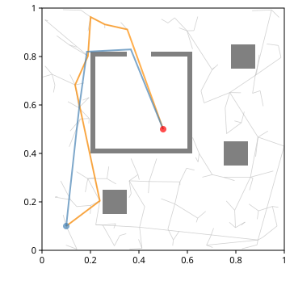
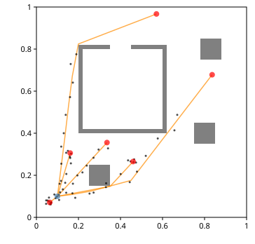
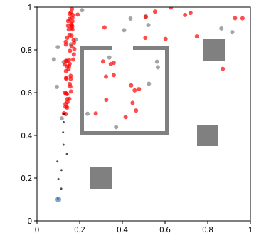
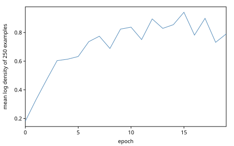
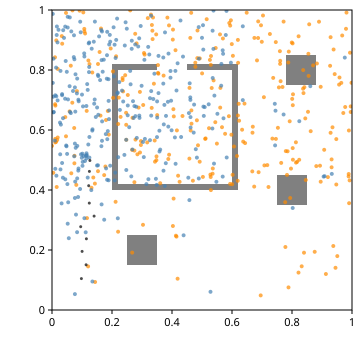

# Data-Driven Proposals: Inverse Planning

Importance sampling guesses whole explanations of the data and weighs
each by how well it explains them. It works when some guesses land near
the truth, and fails when almost none do. A *data-driven proposal* looks
at the observations before it guesses. It can be a heuristic, or a
function trained on the model's own simulations; either way, importance
sampling weighs its guesses so that the answer stays correct, and the
better the guesses, the fewer of them it takes.

This chapter ports Gen.jl's tutorial *Improving Inference using
Data-Driven Custom Proposals*, with the inverse-planning code of
gen-quickstart (a scene, its geometry and a path planner) ported to
Clojure. The model is *algorithmic*: an agent walks toward a destination
along a path from a planner, ordinary host code called inside a
generative function. From ten noisy measurements of where the agent has
been, we infer where it is going. We infer first with the prior as the
proposal, then with a heuristic, then with proposals trained by
`learn/train`: one parameter of the heuristic, then a small neural
network.

<!-- code: ns -->
```clojure
(ns book.data-driven-proposals
  (:refer-clojure :exclude [+ - * /])
  (:require [clojure.core :as c]
            [gen.array :as array :refer [+ - * /]]
            [gen.book.svg :as svg]
            [gen.choicemap :as cm]
            [gen.dist :as d]
            [gen.dist.core :as dc]
            [gen.dynamic :as dyn :refer [gen]]
            [gen.gfi :as gfi]
            [gen.gradients :as grad]
            [gen.inference.importance :as is]
            [gen.inference.weights :as w]
            [gen.learning :as learn]
            [gen.random :as rng]))
```

## A scene

A point is a vector `[x y]` of host numbers. The scene's geometry and the
planner are host code: they compute on host doubles, never on arrays, so
they use clojure.core's arithmetic, aliased `c`. gen.array's operators
would give the same results, but they dispatch on their arguments to
serve every backend's arrays, and the planner does that arithmetic
millions of times.

The planner needs one geometric test: do two segments meet? `ccw` gives
the side of a line on which a point lies, by the sign of a cross
product. Two segments miss each other exactly when one of them has both
ends of the other strictly on one side of its line:

<!-- code: geometry -->
```clojure
(defn distance
  "The distance between the points a and b, each [x y]."
  [[ax ay] [bx by]]
  (let [dx (c/- bx ax)
        dy (c/- by ay)]
    (Math/sqrt (c/+ (c/* dx dx) (c/* dy dy)))))

(defn ccw
  "Twice the signed area of the triangle a, b, c: positive when c lies to
   the left of the line from a to b, negative to its right, 0 on it."
  [[ax ay] [bx by] [cx cy]]
  (c/- (c/* (c/- bx ax) (c/- cy ay)) (c/* (c/- cx ax) (c/- by ay))))

(defn segments-meet?
  "Do the segments a1–a2 and b1–b2 meet? They do unless one of them has
   both ends of the other strictly on one side of its line."
  [a1 a2 b1 b2]
  (not (or (pos? (c/* (ccw a1 a2 b1) (ccw a1 a2 b2)))
           (pos? (c/* (ccw b1 b2 a1) (ccw b1 b2 a2))))))
```

<!-- code: geometry-checks -->
```clojure
(distance [0.0 0.0] [3.0 4.0])
;=> 5.0

[(ccw [0.0 0.0] [1.0 0.0] [0.0 1.0]) (ccw [0.0 0.0] [1.0 0.0] [0.0 -1.0])]
;=> [1.0 -1.0]

[(segments-meet? [0.0 0.0] [1.0 1.0] [0.0 1.0] [1.0 0.0])
 (segments-meet? [0.0 0.0] [1.0 0.0] [0.0 1.0] [1.0 1.0])
 (segments-meet? [0.0 0.0] [1.0 0.0] [0.5 0.0] [0.5 1.0])]
;=> [true false true]
```

The two diagonals of the unit square cross; two parallel sides do not;
and a segment that ends on another meets it. The test is conservative
in one case: segments on one line meet whenever their four ccw values
are 0, even when they are apart. For the planner that only means a path
grazing a wall's line counts as blocked.

<!-- code: collinear -->
```clojure
(segments-meet? [0.0 0.0] [1.0 0.0] [2.0 0.0] [3.0 0.0])
;=> true
```

Every obstacle of the tutorial's scene is an axis-aligned rectangle: a
square (a tree) or a wall. A rectangle is its lower-left and upper-right
corners. A segment meets one only if it reaches the rectangle's span on
both axes, a test of four comparisons that rules out most obstacles
before any edge is tested:

<!-- code: obstacles -->
```clojure
(defn rectangle
  "The obstacle [x, x + w] × [y, y + h], as its lower-left and upper-right
   corners."
  [x y w h]
  [[x y] [(c/+ x w) (c/+ y h)]])

(defn square
  "A square obstacle of side size centered at [x y]: a tree."
  [[x y] size]
  (let [half (c// size 2.0)]
    (rectangle (c/- x half) (c/- y half) size size)))

(defn wall
  "A wall of the given thickness from the corner [x y], length long to
   the right (:horizontal) or up (:vertical)."
  [direction [x y] length thickness]
  (case direction
    :horizontal (rectangle x y length thickness)
    :vertical (rectangle x y thickness length)))

(defn corners
  "The corners of a rectangle, counterclockwise from its lower left."
  [[[x0 y0] [x1 y1]]]
  [[x0 y0] [x1 y0] [x1 y1] [x0 y1]])

(defn crosses?
  "Does the segment a–b meet an edge of the rectangle r? Only if it
   reaches r's span on both axes, and then if it meets one of r's edges."
  [[[x0 y0] [x1 y1] :as r] [ax ay :as a] [bx by :as b]]
  (and (<= (min ax bx) x1) (<= x0 (max ax bx))
       (<= (min ay by) y1) (<= y0 (max ay by))
       (let [cs (corners r)]
         (boolean (some (fn [[v w]] (segments-meet? v w a b))
                        (map vector cs (conj (subvec cs 1) (cs 0))))))))

(defn obstructed?
  "Does an obstacle of scene stand in the way of the segment a–b?"
  [scene a b]
  (boolean (some #(crosses? % a b) (:obstacles scene))))
```

The scene is the unit square with three trees and a room of four walls,
with a door in the top wall between $x = 0.35$ and $x = 0.45$:

<!-- code: scene -->
```clojure
(def thickness 0.02)

(def scene
  {:xmin 0.0 :xmax 1.0 :ymin 0.0 :ymax 1.0
   :obstacles [(square [0.30 0.20] 0.1)
               (square [0.83 0.80] 0.1)
               (square [0.80 0.40] 0.1)
               (wall :horizontal [0.20 0.40] 0.40 thickness)
               (wall :vertical [0.60 0.40] 0.40 thickness)
               (wall :horizontal [0.45 0.80] (c/+ 0.15 thickness) thickness)
               (wall :horizontal [0.20 0.80] 0.15 thickness)
               (wall :vertical [0.20 0.40] 0.40 thickness)]})
```

A segment through the room's left wall is blocked, one up the corridor to
its left is clear, and so is one through the door:

<!-- code: obstructed-checks -->
```clojure
[(obstructed? scene [0.1 0.6] [0.3 0.6])
 (obstructed? scene [0.1 0.1] [0.1 0.9])
 (obstructed? scene [0.4 0.9] [0.4 0.6])]
;=> [true false false]
```

## A planner

The planner builds a *rapidly exploring random tree* (RRT; LaValle
1998) from the start. Each iteration draws a uniform point of the scene
and steps from the tree's nearest node toward it, by at most `:rrt-step`;
the step joins the tree unless an obstacle blocks it. A node records its
parent and its distance from the root along the tree, its *cost*:

<!-- code: tree -->
```clojure
(defn nearest
  "The index of the node of tree nearest the point p."
  [tree p]
  (apply min-key #(distance (:point (tree %)) p) (range (count tree))))

(defn toward
  "The point at most step from a on the segment from a to b."
  [a b step]
  (let [d (distance a b)]
    (if (<= d step)
      b
      (let [s (c// step d)]
        (mapv (fn [u v] (c/+ u (c/* s (c/- v u)))) a b)))))

(defn grow-tree
  "A rapidly exploring random tree from root in scene: :rrt-iters times, a
   uniform point of the scene, and a step of at most :rrt-step from the
   tree's nearest node toward it, kept when nothing obstructs it. A node
   is {:point :parent :cost}, cost its distance from the root along the
   tree, parent its parent's index; the root is node 0."
  [scene root {:keys [rrt-iters rrt-step]} key]
  (let [{:keys [xmin xmax ymin ymax]} scene
        targets (array/->clj
                 (rng/uniform key [rrt-iters 2]
                              {:low (array/array [xmin ymin])
                               :high (array/array [xmax ymax])}))]
    (reduce (fn [tree target]
              (let [i (nearest tree target)
                    {:keys [point cost]} (tree i)
                    new (toward point target rrt-step)]
                (if (obstructed? scene point new)
                  tree
                  (conj tree {:point new :parent i
                              :cost (c/+ cost (distance point new))}))))
            [{:point root :parent nil :cost 0.0}]
            targets)))
```

The tree does not depend on the destination. To reach one, `route` picks
the node with the least cost plus straight distance among those that see
the destination, and follows parents back to the root. Gen.jl's version
reads the scene from a global variable; here it is an argument.

<!-- code: route -->
```clojure
(defn route
  "The tree's shortest way from its root to dest, as a vector of points:
   through the node that sees dest unobstructed with the least cost plus
   distance to dest; nil when no node sees it."
  [scene tree dest]
  (let [cost (fn [{:keys [point cost]}] (c/+ cost (distance point dest)))
        sees? (fn [i] (not (obstructed? scene (:point (tree i)) dest)))]
    (when-let [best (first (filter sees? (sort-by #(cost (tree %))
                                                  (range (count tree)))))]
      (let [up (take-while some? (iterate #(:parent (tree %)) best))]
        (conj (mapv #(:point (tree %)) (reverse up)) dest)))))
```

A route along the tree zigzags. `refine` shortens it: it moves the
interior points in turn by a normal step, and keeps a move when the path
gets shorter and stays clear. The ends never move.

<!-- code: refine -->
```clojure
(defn path-length
  "The length of the path, a sequence of points."
  [path]
  (reduce c/+ 0.0 (map distance path (rest path))))

(defn refine
  "path, shortened: :refine-iters times, its interior points in turn moved
   by a normal step of :refine-sd in each coordinate, each move kept when
   it shortens the path and leaves it unobstructed. The ends stay."
  [scene path {:keys [refine-iters refine-sd]} key]
  (let [n (c/- (count path) 2)
        steps (array/->clj (rng/normal key [refine-iters 2]))]
    (if (zero? n)
      path
      (reduce (fn [path [i [ex ey]]]
                (let [j (inc (mod i n))
                      [before p after] (subvec path (dec j) (c/+ j 2))
                      q [(c/+ (p 0) (c/* refine-sd ex))
                         (c/+ (p 1) (c/* refine-sd ey))]]
                  (if (and (< (c/+ (distance before q) (distance q after))
                              (c/+ (distance before p) (distance p after)))
                           (not (obstructed? scene before q))
                           (not (obstructed? scene q after)))
                    (assoc path j q)
                    path)))
              path
              (map-indexed vector steps)))))
```

`plan-path` puts the three together. Its parameters are Gen.jl's, with
a smaller tree and fewer, finer refining steps, so that a plan costs
a fraction of the tutorial's; the workshop compares the two ways of
refining.

<!-- code: plan -->
```clojure
(def planner
  "The planner's parameters, Gen.jl's rrt_iters, rrt_dt, refine_iters and
   refine_std: a smaller tree than the tutorial's 600 iterations, and 1000
   finer refining steps for its 3500 of standard deviation 1."
  {:rrt-iters 200 :rrt-step 3.0 :refine-iters 1000 :refine-sd 0.05})

(defn plan-path
  "A path from start to dest in scene that no obstacle obstructs, by
   params (planner's keys), drawing its randomness from key: a tree grown
   from start, its route to dest, refined. nil when the tree finds no
   route."
  [scene start dest params key]
  (let [[k-tree k-refine] (rng/split key)]
    (when-let [path (route scene (grow-tree scene start params k-tree) dest)]
      (refine scene path params k-refine))))
```

A tree of 200 iterations has 153 nodes, the root and 152 steps; the
other 48 steps were blocked. Its route into the room is 1.55 long, and
refining shortens it to 1.26.

<!-- code: plan-example -->
```clojure
(def start [0.1 0.1])

(def tree (grow-tree scene start planner (rng/key 3)))

(def rough (route scene tree [0.5 0.5]))

(def example-path (refine scene rough planner (rng/key 4)))

[(count tree) (path-length rough) (path-length example-path)]
;=> [153 1.5528 1.2617] ; float64
```

These lengths are sampled values (`; float64`): on MLX the key draws
other points, and the tree grows otherwise. What holds on every backend
is checked as such. The path runs from the start to the destination, no
obstacle blocks any of its segments, before refining or after, and
refining never lengthens it:

<!-- code: plan-checks -->
```clojure
(defn clear?
  "Does no obstacle of scene obstruct a segment of path?"
  [scene path]
  (not-any? (fn [[a b]] (obstructed? scene a b)) (partition 2 1 path)))

[(first example-path) (peek example-path)
 (clear? scene rough) (clear? scene example-path)
 (<= (path-length example-path) (path-length rough))]
;=> [[0.1 0.1] [0.5 0.5] true true true]
```

<!-- code: plan-figure -->
```clojure
;; figure: figures/051-planner.svg
(svg/shapes [{:polygons (map corners (:obstacles scene))}
             {:paths (keep (fn [{:keys [point parent]}]
                             (when parent [(:point (tree parent)) point]))
                           tree)
              :color "silver" :width 0.8}
             {:paths [rough] :color "darkorange" :width 2}
             {:paths [example-path] :color "steelblue" :width 2}
             {:points [start] :r 4}
             {:points [[0.5 0.5]] :color "red" :r 4}])
```



The route enters the room through the door. It climbs the corridor left
of the room, as the shortest way does; another tree could have routed
around the right side, which refining, a local search, would shorten but
never leave.

A destination in view of the start needs no tree: the root sees it, and
no node can do better than the straight segment, which has nothing to
refine. A destination inside a tree has no route at all, and the planner
returns nil:

<!-- code: plan-cases -->
```clojure
[(plan-path scene start [0.16 0.9] planner (rng/key 3))
 (plan-path scene start [0.83 0.80] planner (rng/key 3))]
;=> [[[0.1 0.1] [0.16 0.9]] nil]
```

### Where the planner's randomness goes

Gen.jl's planner draws from Julia's global random number generator, so
each run of the model plans with fresh randomness that no trace records.
gen.clj has no hidden randomness, and there are two ways to port it.

One passes a key as an argument of the model. Every run of the model
would then plan with the same tree and the same refining steps, and
inference would condition on that one draw, as if the observer knew the
agent's random tree. The other calls `(untraced-key)` inside the model, a
key from the model's *encapsulated randomness* $\omega$, as *MCMC and
MAP* described for RANSAC's proposal. Each run draws its own tree, as
with Gen.jl's global generator.

We take the second: the tree is the agent's randomness, not the
observer's knowledge. The price is that a trace's score is the density
of its choices given $\omega$, as *The agent model* checks below. Importance
sampling stays valid: it draws $\omega$ with the other choices, from
$\omega$'s own distribution, so its estimate of the marginal likelihood
stays unbiased and its resampled traces follow the posterior with
$\omega$ integrated out (Cusumano-Towner's thesis, §4.5.2). The planner
itself takes its key as an argument, so it is a pure function, tested
with fixed keys as above.

## Walking a path

The agent walks its path at a constant speed and stays at the end once
there. `walk` gives its locations at `n-ticks` times, `dt` apart, from
time 0:

<!-- code: walk -->
```clojure
(defn point-along
  "The point at distance s along path, or its end when s is past it."
  [path s]
  (loop [[a b & more] path
         s s]
    (let [d (if b (distance a b) 0.0)]
      (cond (nil? b) a
            (<= s d) (let [f (if (pos? d) (c// s d) 0.0)]
                       (mapv (fn [u v] (c/+ u (c/* f (c/- v u)))) a b))
            :else (recur (cons b more) (c/- s d))))))

(defn walk
  "The agent's locations at n-ticks times dt apart from time 0, moving
   along path at speed and staying at its end once there."
  [path speed dt n-ticks]
  (mapv #(point-along path (c/* speed dt %)) (range n-ticks)))
```

Along an L-shaped path at speed 0.25, half a time unit apart, the agent
covers 0.125 per tick, turns the corner at tick 4, and arrives at tick 8:

<!-- code: walk-checks -->
```clojure
(def walked (walk [[0.0 0.0] [0.5 0.0] [0.5 0.5]] 0.25 0.5 10))

(subvec walked 0 2)
;=> [[0.0 0.0] [0.125 0.0]]

(subvec walked 4 6)
;=> [[0.5 0.0] [0.5 0.125]]

(subvec walked 8)
;=> [[0.5 0.5] [0.5 0.5]]
```

## The agent model

The model draws the start and the destination uniformly in the scene,
plans a path between them, draws a speed, and measures the agent's
location at each tick with noise of standard deviation 0.01. When
planning fails, the agent stays at the start.

<!-- code: model -->
```clojure
(def noise 0.01)

(def agent-model
  (gen [scene dt n-ticks params]
    (let [{:keys [xmin xmax ymin ymax]} scene
          start [(trace :start-x (d/uniform xmin xmax))
                 (trace :start-y (d/uniform ymin ymax))]
          dest [(trace :dest-x (d/uniform xmin xmax))
                (trace :dest-y (d/uniform ymin ymax))]
          path (plan-path scene (mapv array/item start) (mapv array/item dest)
                          params (untraced-key))
          speed (trace :speed (d/uniform 0.3 1.0))
          locations (if path
                      (walk path (array/item speed) dt n-ticks)
                      (repeat n-ticks start))]
      (doseq [[i [x y]] (map-indexed vector locations)]
        (trace [:meas i :x] (d/normal x noise))
        (trace [:meas i :y] (d/normal y noise)))
      path)))
```

The planner and `walk` read the start, the destination and the speed on
the host (`array/item`): on MLX that evaluates them before planning, and
a batched run (`{:batched? true}`) falls back to one sample at a time,
with the same weights, so this chapter runs one at a time. The measurement
addresses are `[:meas i :x]` and `[:meas i :y]`, with ticks counted from
0, where Gen.jl's are `:meas => (i, :x)` from 1. The tutorial measures
ten ticks 0.1 apart:

<!-- code: model-args -->
```clojure
(def dt 0.1)

(def n-ticks 10)

(def model-args [scene dt n-ticks planner])
```

<!-- code: simulate -->
```clojure
(def t1 (gfi/simulate agent-model model-args (rng/key 5)))

(mapv #(array/item (t1 %)) [:start-x :start-y :dest-x :dest-y :speed])
;=> [0.1965 0.9129 0.9828 0.8668 0.9500] ; float64

(= (:retval t1) (:retval (gfi/simulate agent-model model-args (rng/key 5))))
;=> true
```

The same key gives the same trace, and the same path: the planner's key
comes from the model's key. The score adds the log densities of the
choices, the uniforms', the speed's and the measurements' around the
path the trace returned. The planner's draws add nothing:

<!-- code: score -->
```clojure
(defn score-by-hand
  "The sum of the log densities of trace t's choices, given the path it
   returned (nil when planning failed)."
  [t]
  (let [{:keys [xmin xmax ymin ymax]} scene
        start [(t :start-x) (t :start-y)]
        locations (if-let [path (:retval t)]
                    (walk path (array/item (t :speed)) dt n-ticks)
                    (repeat n-ticks start))
        lp (fn [dist v] (array/item (dc/log-prob dist v)))]
    (reduce c/+ (lp (d/uniform 0.3 1.0) (t :speed))
            (concat
             (map (fn [a lo hi] (lp (d/uniform lo hi) (t a)))
                  [:start-x :start-y :dest-x :dest-y]
                  [xmin ymin xmin ymin] [xmax ymax xmax ymax])
             (map-indexed (fn [i [x y]]
                            (c/+ (lp (d/normal x noise) (t [:meas i :x]))
                                 (lp (d/normal y noise) (t [:meas i :y]))))
                          locations)))))

(array/allclose? (:score t1) (score-by-hand t1))
;=> true
```

Six runs from a start fixed in the lower left show what the model
believes before it sees any data. The agent walks toward its destination
at its own speed; within the ten ticks, some arrive and some do not.

<!-- code: measured -->
```clojure
(defn measured
  "The measured locations of a trace of agent-model, as host numbers."
  [t]
  (mapv (fn [i] [(array/item (t [:meas i :x])) (array/item (t [:meas i :y]))])
        (range n-ticks)))
```

<!-- code: traces-figure -->
```clojure
;; figure: figures/051-traces.svg
(let [ts (mapv #(:trace (gfi/generate agent-model model-args
                                      (cm/choicemap :start-x 0.1 :start-y 0.1)
                                      %))
               (rng/split (rng/key 6) 6))]
  (svg/shapes [{:polygons (map corners (:obstacles scene))}
               {:paths (keep :retval ts) :color "darkorange"}
               {:points (mapcat measured ts) :color "black" :r 1.5}
               {:points (mapv #(mapv array/item [(% :dest-x) (% :dest-y)]) ts)
                :color "red" :r 4}
               {:points [start] :r 4}]))
```



## Inferring the destination

These are the tutorial's measurements of an agent that started at
$(0.1, 0.1)$. It walked up the corridor left of the room:

<!-- code: data -->
```clojure
(def measurements
  [[0.0980245 0.104775] [0.113734 0.150773] [0.100412 0.195499]
   [0.114794 0.237386] [0.0957668 0.277711] [0.140181 0.31304]
   [0.124384 0.356242] [0.122272 0.414463] [0.124597 0.462056]
   [0.126227 0.498338]])

(defn observations
  "The choice map of the start and the measured locations ms."
  [start ms]
  (apply cm/choicemap :start-x (start 0) :start-y (start 1)
         (mapcat (fn [i [x y]] [[:meas i :x] x [:meas i :y] y]) (range) ms)))

(def observed (observations start measurements))
```

Each run of importance sampling below takes `n` samples from a proposal
(the prior when it is nil), and reports their effective sample size and
one destination drawn in proportion to the weights. It keeps host numbers,
not traces, as *The Inference Toolkit* advised for long loops:

<!-- code: sample-run -->
```clojure
(def proposal-args [measurements scene dt])

(defn sample-run
  "One run of importance sampling of n samples with key and the proposal q
   (the model's prior when nil): its effective sample size, and the
   destination of a sample drawn in proportion to the weights."
  [q n key]
  (let [[k-run k-draw] (rng/split key)
        opts (cond-> {:key k-run}
               q (assoc :proposal q :proposal-args proposal-args))
        {:keys [traces log-weights ess]}
        (is/importance-sampling agent-model model-args observed n opts)
        t (traces (first (w/multinomial log-weights 1 k-draw)))]
    {:ess ess :dest [(array/item (t :dest-x)) (array/item (t :dest-y))]}))

(defn mean-se
  "The mean of the numbers vs, and its standard error."
  [vs]
  (let [n (count vs)
        mean (c// (reduce c/+ vs) n)
        sq (reduce c/+ (map #(let [e (c/- % mean)] (c/* e e)) vs))]
    {:mean mean :se (Math/sqrt (c// sq (c/* n (dec n))))}))
```

Twenty runs of fifty samples from the prior:

<!-- code: prior-runs -->
```clojure
(def n-samples 50)

(def prior-runs
  (mapv #(sample-run nil n-samples %) (rng/split (rng/key 7) 20)))

(mean-se (map :ess prior-runs))
;=> {:mean 1.020 :se 0.012} ; float64
```

The effective sample size averages 1.02 out of 50. In nearly every run,
one sample carries all the weight, and the run's answer is the one guess
that happened to come closest.

### What the measurements pin down

A guess must get every latent choice right at once: the destination, and
the speed too. For a destination in view of the start, the path is the
straight segment toward it, with unit direction $u$, and at tick $i$ the
agent is at $s_0 + v\,\delta t\,i\,u$, for start $s_0$ and speed $v$
(until it arrives). The log density of the measurements $m_i$ is then
quadratic in $v$:

$$
\log p = c - \sum_i \frac{\lVert m_i - s_0 - v\,\delta t\,i\,u \rVert^2}
{2\sigma^2},
\qquad
\hat v = \frac{\sum_i i\,(m_i - s_0)\cdot u}{\delta t \sum_i i^2},
\qquad
\mathrm{sd}(v) = \frac{\sigma}{\delta t \sqrt{\sum_i i^2}}.
$$

For the destination $(0.16, 0.9)$, in view of the start:

<!-- code: speed-pinned -->
```clojure
(def in-view [0.16 0.9])

(defn log-density-at
  "The log density of the trace with the observations, the destination
   dest and the speed: generate's weight when every choice is given."
  [dest speed]
  (let [choices (cm/choicemap :dest-x (dest 0) :dest-y (dest 1) :speed speed)]
    (array/item (:weight (gfi/generate agent-model model-args
                                       (cm/merge observed choices)
                                       (rng/key 0))))))

(defn dot
  "The dot product of the vectors a and b."
  [a b]
  (reduce c/+ (map c/* a b)))

(defn straight-speed
  "The speed that best explains the measurements ms of an agent walking
   straight from start toward dest, and its standard deviation: there the
   log density is quadratic in the speed."
  [start dest ms]
  (let [u (mapv #(c// (c/- %1 %2) (distance start dest)) dest start)
        ahead (fn [m] (dot (mapv c/- m start) u))
        is (range (count ms))
        sum-i2 (dot is is)]
    {:speed (c// (dot is (map ahead ms)) (c/* dt sum-i2))
     :sd (c// noise (c/* dt (Math/sqrt sum-i2)))}))

(def pinned (straight-speed start in-view measurements))

pinned
;=> {:speed 0.4452 :sd 0.005923}
```

The model agrees: its log density peaks at that speed, and its second
difference there is $-1/\mathrm{sd}^2$ to a part in a thousand:

<!-- code: speed-pinned-check -->
```clojure
(let [{:keys [speed sd]} pinned
      h 0.02
      [below at above] (map #(log-density-at in-view %)
                            [(c/- speed h) speed (c/+ speed h)])
      curvature (c// (c/+ below (c/* -2.0 at) above) (c/* h h))]
  [(> at (max below above))
   (< (abs (c/+ 1.0 (c/* curvature sd sd))) 1e-3)])
;=> [true true]
```

The measurements pin the speed to within 0.006, and the prior spreads it
over $[0.3, 1]$. Only one draw from the prior in thirty lands within two
standard deviations of it:

<!-- code: speed-odds -->
```clojure
(c// (c/* 4.0 (:sd pinned)) 0.7)
;=> 0.0338
```

## A data-driven proposal

Looking at the measurements, a person would guess that the agent is
heading up: it would not walk away from its destination. The tutorial
turns that into a heuristic for each coordinate of the destination.
Divide the coordinate's range into five bins. If the coordinate grew
from the first measurement to the last, give the bin of the last
measurement and the bins beyond it a score `score-high`, the others 1,
and normalize; if it shrank, the same toward the other side. (Gen.jl's
code takes the bin of the last measurement as if the range started at 0;
this one subtracts the start of the range.)

<!-- code: bins -->
```clojure
(def n-bins 5)

(defn bin-probs
  "The heuristic's probabilities of n equal bins of [lo, hi], for travel
   from coordinate first to coordinate last: score-high for the bin of
   last and the bins beyond it in the direction of travel, 1 for the
   others, normalized."
  [n lo hi first last score-high]
  (let [bin (min (dec n) (long (Math/floor (c// (c/- last lo)
                                                 (c// (c/- hi lo) n)))))
        ahead? (fn [i] (if (>= last first) (>= i bin) (<= i bin)))
        scores (array/where (array/array (mapv ahead? (range n)))
                            score-high 1.0)]
    (/ scores (array/sum scores))))
```

For these measurements, $y$ grew from 0.10 to 0.50, so its three upper
bins get 5/17 each and the two lower ones 1/17. $x$ grew too, from 0.098
to 0.126, but the last measurement is in the first bin, so every bin is
"ahead" and the heuristic says nothing about $x$:

<!-- code: bins-checks -->
```clojure
(let [[x-first y-first] (first measurements)
      [x-last y-last] (peek measurements)]
  [(bin-probs n-bins 0.0 1.0 x-first x-last 5.0)
   (array/allclose? (bin-probs n-bins 0.0 1.0 y-first y-last 5.0)
                    (/ (array/array [1.0 1.0 5.0 5.0 5.0]) 17.0))])
;=> [[0.2 0.2 0.2 0.2 0.2] true]
```

The proposal is a generative function that draws `:dest-x` and `:dest-y`
from `piecewise-uniform` distributions with those probabilities, uniform
within a bin. It makes its choices at the model's addresses, and
`score-high` is an argument, here the tutorial's 5:

<!-- code: binned-dest -->
```clojure
(def binned-dest
  (gen [ms scene score-high]
    (let [{:keys [xmin xmax ymin ymax]} scene
          [x-first y-first] (first ms)
          [x-last y-last] (peek ms)]
      (trace :dest-x (d/piecewise-uniform
                      (array/linspace xmin xmax (inc n-bins))
                      (bin-probs n-bins xmin xmax x-first x-last score-high)))
      (trace :dest-y (d/piecewise-uniform
                      (array/linspace ymin ymax (inc n-bins))
                      (bin-probs n-bins ymin ymax y-first y-last
                                 score-high))))))
```

The tutorial proposes only the destination, and leaves the speed to the
prior; it asks for a proposal of the speed in an exercise. The last
section showed that the prior's speed alone wastes 29 samples in 30, so
we propose it too: from a normal around the distance between the first
and last measurements over the time between them, truncated to the
prior's range. Its standard deviation, 0.01, is the speed's own (0.006)
widened for the guess's error, which a path that bends would make larger.

<!-- code: speed-proposal -->
```clojure
(defn speed-guess
  "The agent's speed as the measurements ms suggest: the distance from the
   first to the last over the time between them."
  [ms dt]
  (c// (distance (first ms) (peek ms)) (c/* dt (dec (count ms)))))

(def speed-proposal
  (gen [ms dt]
    (trace :speed (d/truncated-normal (speed-guess ms dt) 0.01 0.3 1.0))))

(speed-guess measurements dt)
;=> 0.4384
```

`with-speed` makes a proposal of the destination into one of the
destination and the speed. `splice` without an address (Gen.jl's `{*}`)
puts the callee's choices at the caller's addresses:

<!-- code: heuristic-proposal -->
```clojure
(defn with-speed
  "A proposal of the destination by dest-q, a generative function of the
   measurements and the scene, and of the speed by speed-proposal."
  [dest-q]
  (gen [ms scene dt]
    (splice dest-q ms scene)
    (splice speed-proposal ms dt)))

(def heuristic-dest
  (gen [ms scene] (splice binned-dest ms scene 5.0)))

(def heuristic-proposal (with-speed heuristic-dest))
```

`gfi/propose` draws the proposal's choices with their log density, as
Gen.jl's `propose` does. Of 1000 draws, the share in the three upper
bins of $y$ is 15/17 within five standard errors:

<!-- code: heuristic-draws -->
```clojure
(def heuristic-draws
  (mapv #(:choices (gfi/propose heuristic-proposal proposal-args %))
        (rng/split (rng/key 8) 1000)))

(let [up (count (filter #(>= (array/item (cm/get-choice % :dest-y)) 0.4)
                        heuristic-draws))
      p (c// 15.0 17.0)
      se (Math/sqrt (c// (c/* p (c/- 1.0 p)) 1000))]
  (< (abs (c/- (c// up 1000.0) p)) (c/* 5 se)))
;=> true
```

## Importance sampling with a custom proposal

`is/importance-sampling` and `is/importance-resampling` take a proposal
and its arguments in their options, `{:proposal q :proposal-args args}`.
Each sample draws the proposal's choices, generates the model with them
and the observations, and is weighed by the model's density over the
proposal's, $\log p(t) - \log q(\text{dest}, \text{speed})$. Here every
choice of the model is either observed or proposed, so the weight is the
trace's score less the proposal's log density:

<!-- code: weight-by-hand -->
```clojure
(let [{t :trace weight :weight}
      (is/weighted-sample agent-model model-args observed
                          {:proposal heuristic-proposal
                           :proposal-args proposal-args}
                          (rng/key 9))
      proposed (cm/choicemap :dest-x (t :dest-x) :dest-y (t :dest-y)
                             :speed (t :speed))
      q (:weight (gfi/assess heuristic-proposal proposal-args proposed
                             (rng/key 0)))]
  (array/allclose? weight (- (:score t) q)))
;=> true
```

Eighty runs of fifty samples, now from the data-driven proposal:

<!-- code: heuristic-runs -->
```clojure
(def heuristic-runs
  (mapv #(sample-run heuristic-proposal n-samples %)
        (rng/split (rng/key 10) 80)))

(mean-se (map :ess heuristic-runs))
;=> {:mean 1.96 :se 0.091} ; float64
```

The runs are worth 1.96 samples on average, against the prior's 1.02:
still few, but the data-driven proposal beats the prior by more than five
standard errors of the difference. The prior's runs are few because
their effective sample sizes hardly vary; the proposal's vary more, and
it takes eighty runs to measure them that well.

<!-- code: beats -->
```clojure
(defn gap-in-se
  "How many standard errors of their difference the mean of the numbers as
   lies above the mean of the numbers bs."
  [as bs]
  (let [{ma :mean sa :se} (mean-se as)
        {mb :mean sb :se} (mean-se bs)]
    (c// (c/- ma mb) (Math/sqrt (c/+ (c/* sa sa) (c/* sb sb))))))

(> (gap-in-se (map :ess heuristic-runs) (map :ess prior-runs)) 5)
;=> true
```

The destinations the runs draw show the difference. The prior's are
spread over the top half of the scene and the room. The data-driven
proposal's gather straight ahead of the agent, up the corridor to the
top of the scene, with some in the room and along the top:

<!-- code: posterior-figure -->
```clojure
;; figure: figures/051-posterior.svg
(svg/shapes [{:polygons (map corners (:obstacles scene))}
             {:points (map :dest prior-runs) :color "gray" :r 3}
             {:points (map :dest heuristic-runs) :color "red" :r 3}
             {:points measurements :color "black" :r 1.5}
             {:points [start] :r 4}])
```



The proposal changes how fast the answer comes, not what it is: as the
number of samples grows, both converge to the same posterior. A proposal
that favors a region gives its samples there smaller weights, by the
same factor.

## Training the heuristic

The tutorial's 5 was a guess. Gen.jl makes it a trainable parameter, on
the log scale so that it stays positive, and trains it to maximize the
proposal's expected log density of the destination given the
measurements, over the model's own runs: the destinations that agents
the model simulates were really heading to.

The training data are runs of the model whose planning succeeded, each
the proposal's arguments and the destination as constraints. Gen.jl's
`train!` takes a data generator; `learn/train` takes a function of a key
that returns one example. Both call it for each epoch's examples.
Simulating the model plans a path each time, so we simulate 500 examples
once, and `picker` draws from them, where the tutorial simulates fresh
ones every epoch. Two hundred more are held
out to judge the proposals:

<!-- code: examples -->
```clojure
(defn example
  "A training example from a run of the model with key whose planning
   succeeded: the proposal's arguments (the measurements and the scene)
   and the destination, as constraints. nil when planning failed."
  [key]
  (let [t (gfi/simulate agent-model model-args key)]
    (when (:retval t)
      [[(measured t) scene]
       (cm/choicemap :dest-x (t :dest-x) :dest-y (t :dest-y))])))

(defn examples
  "n training examples, from runs of the model whose planning succeeded."
  [n key]
  (vec (take n (keep example (rng/split key (* 2 n))))))

(defn picker
  "A function of a key that picks one of the examples uniformly: the
   data of gen.learning/train."
  [examples]
  (fn [key] (examples (array/item (rng/randint key 0 (count examples))))))

(def training (examples 500 (rng/key 11)))

(def held-out (examples 200 (rng/key 12)))
```

The trainable proposal reads its parameter with `(param
:log-score-high)`, from the store that `dyn/with-params` gives it, and
`mean-log-density` is the objective, which `gfi/assess` computes for each
example:

<!-- code: score-high -->
```clojure
(def trainable-dest
  (gen [ms scene]
    (splice binned-dest ms scene (array/exp (param :log-score-high)))))

(defn mean-log-density
  "The mean log density of the destinations of the examples under the
   proposal q: the objective of gen.learning/train."
  [q examples]
  (c// (reduce c/+ (map (fn [[args constraints]]
                          (array/item (:weight (gfi/assess q args constraints
                                                           (rng/key 0)))))
                        examples))
       (count examples)))
```

One hundred steps of Adam, each on 50 examples: twenty epochs, each
drawing 250 examples from the training set and taking five minibatches
of 50 from them:

<!-- code: train-score-high -->
```clojure
(def score-high-fit
  (learn/train trainable-dest {:log-score-high 0.0} (learn/adam {:lr 0.05})
               (picker training) grad/param-gradients
               {:epochs 20 :epoch-size 250 :batches-per-epoch 5 :batch-size 50
                :key (rng/key 13)}))

(def learned-score-high
  (Math/exp (array/item (:log-score-high (:store score-high-fit)))))

learned-score-high
;=> 11.0 ; float64
```

`learn/train`'s history is Gen.jl's: after each epoch, the mean log
density of fresh draws of the data function, here 250 of them. They are
draws of the training examples, so the history tracks the training
objective; the 200 held-out examples judge the proposals below. It
climbs from 0.18 after the first epoch's five steps (the uniform
proposal, where the score starts at $e^0 = 1$, has 0) and levels off
after about ten epochs, fifty steps, as noisy as 250 examples make it:

<!-- code: training-figure -->
```clojure
;; figure: figures/051-training.svg
(svg/series (:history score-high-fit)
            {:x-label "epoch" :y-label "mean log density of 250 examples"})
```



The learned score is 11.0, larger than the tutorial's 5. On the
held-out examples, the uniform proposal (score 1) has mean log density
0, since its density is 1 throughout the scene; the guess of 5 has
0.80, and the trained score 0.89. A trained value depends on its data
and its steps, so its checks take their bands from training it again:
ten times, each with its own examples and steps, the spreads measured
once and written beside the checks. The learned score is above 1, so
the heuristic helps, and the trained proposal beats the guess on the
held-out examples, each by more than five spreads:

<!-- code: score-high-checks -->
```clojure
(def trained-dest (dyn/with-params trainable-dest (:store score-high-fit)))

(def uniform-dest
  (gen [ms scene] (splice binned-dest ms scene 1.0)))

(mapv #(mean-log-density % held-out)
      [uniform-dest heuristic-dest trained-dest])
;=> [0.0 0.8015 0.889] ; float64

;; spreads over ten trainings, each with its own 500 examples (keys 201
;; to 210) and steps (keys 301 to 310): 1.03 of the learned score-high,
;; 0.00075 of the trained proposal's held-out density
(let [guess (mean-log-density heuristic-dest held-out)
      trained (mean-log-density trained-dest held-out)]
  [(> (c/- learned-score-high 1.0) (c/* 5 1.03))
   (> (c/- trained guess) (c/* 5 0.00075))])
;=> [true true]
```

## A neural proposal

A heuristic needs someone who knows what to look for. A network can
learn a proposal from the model's runs alone. gen.clj has no library of
layers yet, so the network is gen.array arithmetic, as in *Learning*.
Like the tutorial's, it reads the first and last measurements, scaled to
$[-0.5, 0.5]$, and gives a probability to each bin of each coordinate.
The tutorial uses two networks of two hidden layers of 50 units each; to
train in seconds, this one has one hidden layer of 16 tanh units, shared
by an output for the $x$ bins and one for the $y$ bins. Its weights are
the proposal's parameters:

<!-- code: network -->
```clojure
(defn features
  "The network's inputs: the first and last measurements of ms, scaled to
   [-0.5, 0.5] across scene."
  [ms scene]
  (let [{:keys [xmin xmax ymin ymax]} scene
        scale (fn [[x y]] [(c/- (c// (c/- x xmin) (c/- xmax xmin)) 0.5)
                           (c/- (c// (c/- y ymin) (c/- ymax ymin)) 0.5)])]
    (array/array (into (scale (first ms)) (scale (peek ms))))))

(defn bin-logits
  "The network: a hidden layer of tanh units over the inputs, then the
   logits of the destination's x bins and of its y bins."
  [{:keys [w1 b1 wx bx wy by]} inputs]
  (let [hidden (array/tanh (+ (array/matmul w1 inputs) b1))]
    [(+ (array/matmul hidden wx) bx) (+ (array/matmul hidden wy) by)]))

(def neural-dest
  (gen [ms scene]
    (let [{:keys [xmin xmax ymin ymax]} scene
          weights {:w1 (param :w1) :b1 (param :b1)
                   :wx (param :wx) :bx (param :bx)
                   :wy (param :wy) :by (param :by)}
          [x-logits y-logits] (bin-logits weights (features ms scene))]
      (trace :dest-x (d/piecewise-uniform
                      (array/linspace xmin xmax (inc n-bins))
                      (array/softmax x-logits)))
      (trace :dest-y (d/piecewise-uniform
                      (array/linspace ymin ymax (inc n-bins))
                      (array/softmax y-logits))))))

(defn initial-weights
  "Random weights for h hidden units, each layer's scaled by one over the
   root of its number of inputs, and zero biases."
  [h key]
  (let [[k1 kx ky] (rng/split key 3)]
    {:w1 (/ (rng/normal k1 [h 4]) 2.0)
     :b1 (array/zeros [h])
     :wx (/ (rng/normal kx [h n-bins]) (Math/sqrt h))
     :bx (array/zeros [n-bins])
     :wy (/ (rng/normal ky [h n-bins]) (Math/sqrt h))
     :by (array/zeros [n-bins])}))
```

The tutorial trains for about ten minutes, on 5000 examples. This
network takes a thousand steps of Adam, each on 20 examples: forty
epochs, each drawing 500 of the training examples, with repeats, and
taking 25 minibatches of 20 from them:

<!-- code: train-network -->
```clojure
(def network-fit
  (learn/train neural-dest (initial-weights 16 (rng/key 14))
               (learn/adam {:lr 0.03}) (picker training) grad/param-gradients
               {:epochs 40 :epoch-size 500 :batches-per-epoch 25 :batch-size 20
                :key (rng/key 15)}))

(def network-proposal (dyn/with-params neural-dest (:store network-fit)))

(mean-log-density network-proposal held-out)
;=> 0.810 ; float64
```

For the tutorial's measurements, the network gives the leftmost bin of
$x$ a probability of 0.56, where the heuristic gave every bin 0.2, and
the fourth bin of $y$ 0.35, beside 0.31 and 0.29 in the third and the
fifth:

<!-- code: network-probs -->
```clojure
(mapv array/softmax (bin-logits (:store network-fit)
                                (features measurements scene)))
;=> [[0.560 0.269 0.139 0.016 0.017] [0.004 0.041 0.314 0.353 0.288]] ; float64
```

<!-- code: proposals-figure -->
```clojure
;; figure: figures/051-proposals.svg
(let [draws (fn [q key]
              (mapv #(let [cs (:choices (gfi/propose q [measurements scene] %))]
                       [(cm/get-choice cs :dest-x) (cm/get-choice cs :dest-y)])
                    (rng/split key 300)))]
  (svg/shapes [{:polygons (map corners (:obstacles scene))}
               {:points (draws heuristic-dest (rng/key 16))
                :color "darkorange" :r 2}
               {:points (draws network-proposal (rng/key 17)) :r 2}
               {:points measurements :color "black" :r 1.5}]))
```



The heuristic spreads its proposals over the upper bins, left to right;
the network's gather on the left, around the corridor the agent walked
up and into the left of the room. On the held-out examples as a whole,
the network does about as well as the hand-made heuristic: 0.81, against
0.80 for the guess and 0.89 for the trained score.

<!-- code: held-out -->
```clojure
(mapv #(mean-log-density % held-out)
      [heuristic-dest trained-dest network-proposal])
;=> [0.8015 0.889 0.8098] ; float64
```

Its spread over ten trainings is large, 0.078, since each training draws
its own examples and initial weights. The network is far better than the
uniform proposal, and within five spreads of the trained heuristic: from
simulations alone, it learned about as much as the heuristic was written
to know.

<!-- code: network-checks -->
```clojure
;; spreads over ten trainings, each with its own 500 examples (keys 201
;; to 210), initial weights (keys 401 to 410) and steps (keys 501 to
;; 510): 0.078 of the network's held-out density, 0.078 of its gap to
;; the trained heuristic's
(let [trained (mean-log-density trained-dest held-out)
      network (mean-log-density network-proposal held-out)]
  [(> network (c/* 5 0.078))
   (< (abs (c/- network trained)) (c/* 5 0.078))])
;=> [true true]
```

A trained network is a proposal like any other. Forty runs with it,
with the speed proposed as before:

<!-- code: network-runs -->
```clojure
(def network-runs
  (mapv #(sample-run (with-speed network-proposal) n-samples %)
        (rng/split (rng/key 18) 40)))

(mean-se (map :ess network-runs))
;=> {:mean 3.15 :se 0.19} ; float64

[(> (gap-in-se (map :ess network-runs) (map :ess prior-runs)) 5)
 (gap-in-se (map :ess network-runs) (map :ess heuristic-runs))]
;=> [true 5.75] ; float64
```

Its runs are worth 3.15 samples, against the prior's 1.02. They are
worth more than the heuristic's too, by 5.7 standard errors of the
difference. That is this network's result: a network's held-out density
spreads by 0.078 over trainings, so another training might not do as
well.

Gen.jl's tutorial closes on what the weights do with a proposal's bias.
A proposal that strongly prefers one region proposes most of its samples
there, and importance sampling weighs each of them down by the same
preference, so with enough samples the answer does not depend on the
proposal at all. A good proposal only gets there with fewer samples.
Data-driven proposals serve MCMC as well, as RANSAC's did in *MCMC and
MAP*. The next chapter's proposals go further: they change the structure
of the model's trace, and reversible-jump MCMC accepts or rejects them.

## Workshop

Each exercise has a tested solution at the end of the chapter.

1. **The speed from the prior.** Propose the destination by the
   heuristic, as the tutorial does, and leave the speed to the prior.
   Predict the effective sample size of twenty runs of fifty samples,
   then run them.
2. **Two doors.** Open a second door in the room's bottom wall, as the
   tutorial's exercise does, between $x = 0.35$ and $x = 0.45$. For a
   destination inside the room, $(0.4, 0.6)$, and the pinned speed,
   compare the log density of the observations in the two scenes over 40
   planner draws. Why would a person, and the model, now find the room a
   less likely destination?
3. **Refining as the tutorial does.** On the same trees (the same keys),
   refine with the tutorial's 3500 steps of standard deviation 1 instead
   of 1000 steps of 0.05. Which paths into the room are shorter, and by
   how much?
4. **Constraints.** Constrain the start to $(0.9, 0.1)$, the destination
   to $(0.9, 0.8)$ and the speed to 0.5. What path does the agent take,
   and where is it at the last tick?

## Solutions

**1.** The speed's prior wastes 29 samples in 30, so the destination's
proposal hardly matters. The runs are worth about one sample, as the
prior's are, and the data-driven proposal beats them by more than five
standard errors:

<!-- code: solution-1 -->
```clojure
(def dest-only
  (gen [ms scene dt] (splice heuristic-dest ms scene)))

(def dest-only-runs
  (mapv #(sample-run dest-only n-samples %) (rng/split (rng/key 20) 20)))

(mean-se (map :ess dest-only-runs))
;=> {:mean 1.067 :se 0.043} ; float64

(> (gap-in-se (map :ess heuristic-runs) (map :ess dest-only-runs)) 5)
;=> true
```

**2.** The bottom wall becomes two walls with a gap. A person who wanted
to enter the room from the lower left would take the bottom door, not
the corridor; so would the planner. In the one-door scene, most planner
draws route up the corridor to the top door and explain the
measurements (log density above 0); in the two-door scene almost none
do, since the shortest way enters from below:

<!-- code: solution-2 -->
```clojure
(def two-doors
  (update scene :obstacles
          #(-> %
               (assoc 3 (wall :horizontal [0.20 0.40] 0.15 thickness))
               (conj (wall :horizontal [0.45 0.40] (c/+ 0.15 thickness)
                           thickness)))))

(defn in-room
  "The log densities of the observations with the destination [0.4 0.6]
   in the room and the pinned speed, in scene, for 40 planner draws."
  [scene key]
  (let [choices (cm/merge observed (cm/choicemap :dest-x 0.4 :dest-y 0.6
                                                 :speed (:speed pinned)))]
    (mapv #(array/item (:weight (gfi/generate agent-model
                                              [scene dt n-ticks planner]
                                              choices %)))
          (rng/split key 40))))

(def one-door-densities (in-room scene (rng/key 21)))

(def two-door-densities (in-room two-doors (rng/key 21)))
```

<!-- code: solution-2-check -->
```clojure
(defn fraction-se
  "The fraction of the booleans bs that are true, and its standard error."
  [bs]
  (let [n (count bs)
        p (c// (double (count (filter true? bs))) n)]
    {:mean p :se (Math/sqrt (c// (c/* p (c/- 1.0 p)) n))}))

(let [{p1 :mean s1 :se} (fraction-se (map #(> % 0.0) one-door-densities))
      {p2 :mean s2 :se} (fraction-se (map #(> % 0.0) two-door-densities))]
  [p1 p2 (> (c/- p1 p2) (c/* 5 (Math/sqrt (c/+ (c/* s1 s1) (c/* s2 s2)))))])
;=> [0.675 0.025 true] ; float64
```

The share of planner draws that explain the measurements falls from
0.675 to 0.025, a gap of more than five standard errors. Importance
sampling rejects destinations in the room accordingly.

**3.** A step of standard deviation 1 in a unit scene mostly lands far
from the path, where it cannot shorten it, so most of the tutorial's 3500
steps are wasted. On the same trees its paths stay longer, by 0.135 on
average, more than five standard errors of the paired differences:

<!-- code: solution-3 -->
```clojure
(def tutorial-refining (assoc planner :refine-iters 3500 :refine-sd 1.0))

(def length-pairs
  (mapv (fn [key]
          (mapv #(path-length (plan-path scene start [0.5 0.5] % key))
                [tutorial-refining planner]))
        (rng/split (rng/key 22) 40)))

(let [{:keys [mean se]} (mean-se (map (fn [[a b]] (c/- a b)) length-pairs))]
  [mean (> mean (c/* 5 se))])
;=> [0.135 true] ; float64
```

**4.** The destination is in view of the start, so the path is the
straight segment. At speed 0.5 the agent covers 0.05 per tick, and at
the last tick, tick 9, it is at $(0.9, 0.55)$, still on its way:

<!-- code: solution-4 -->
```clojure
(let [choices (cm/choicemap :start-x 0.9 :start-y 0.1 :dest-x 0.9 :dest-y 0.8
                            :speed 0.5)
      t (:trace (gfi/generate agent-model model-args choices (rng/key 24)))]
  [(:retval t) (point-along (:retval t) (c/* 0.5 dt 9))])
;=> [[[0.9 0.1] [0.9 0.8]] [0.9 0.55]]
```
