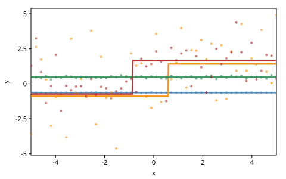
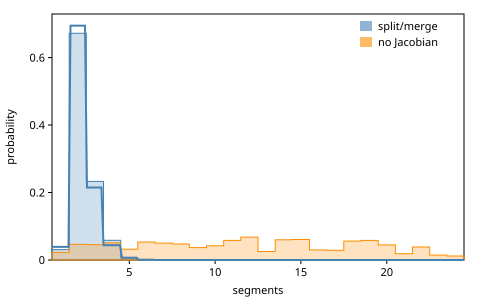
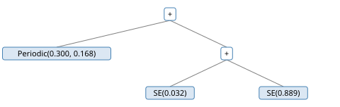
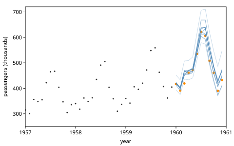

# Reversible-Jump MCMC and Structure Learning

Some models are unsure of their own shape. A regression may not know how
many pieces its function has, and a model of a time series may not know
which program computes its covariance. In both, discrete choices decide
which continuous choices exist, and an MCMC kernel that changes the
discrete choices must create or delete continuous ones. *Trace Translators
and Involutive MCMC* built the construct for such moves, the involution,
and ran one split/merge move between one mean and two. This chapter puts
it to work on two models of real size. A piecewise-constant regression
splits and merges segments, and a grammar of Gaussian-process kernels is
searched by regenerating subtrees of a program.

The chapter ports Gen.jl's *Reversible-Jump MCMC* notebook
(gen-quickstart), whose second half follows Saad et al.'s *Bayesian
Synthesis of Probabilistic Programs for Automatic Data Modeling* (POPL
2019). Two details of the notebook do not survive the port. Its split
leaves a Jacobian out of the acceptance ratio, so its chain does not
sample the posterior. And its involution is not one: applied twice, it
exchanges two values. gen.clj catches both, the first because a
transform's Jacobian comes from automatic differentiation, the second
because `:check? true` applies the move twice. An exact posterior shows
what the missing Jacobian costs.

The code:

<!-- code: ns -->
```clojure
(ns book.reversible-jump
  (:refer-clojure :exclude [+ - * /])
  (:require [clojure.edn :as edn]
            [clojure.java.io :as io]
            [gen.array :as array :refer [+ - * /]]
            [gen.array.linalg :as linalg]
            [gen.book :as book]
            [gen.book.svg :as svg]
            [gen.choicemap :as cm]
            [gen.dist :as d]
            [gen.dist.core :as dc]
            [gen.dist.dsl :refer [dist]]
            [gen.dynamic :refer [gen]]
            [gen.gfi :as gfi]
            [gen.inference.diagnostics :as diag]
            [gen.inference.mh :as mh]
            [gen.inference.transform :as tf]
            [gen.random :as rng]
            [gen.selection :as sel]))
```

## Piecewise-constant functions

The model divides the range of the inputs $x$ into $k$ segments, gives
each segment a value, and observes each $y_i$ near the value of the
segment that holds $x_i$:

$$
k - 1 \sim \mathrm{Poisson}(1), \quad f \sim \mathrm{Dirichlet}(1, \dots,
1), \quad v_j \sim \mathcal{N}(0, 1), \quad \sigma \sim \mathrm{Gamma}(1,
1), \quad y_i \sim \mathcal{N}(v_{s(x_i)}, \sigma).
$$

The *fractions* $f$ are the segments' shares of the range, a point of the
simplex. The count needs a distribution on $1, 2, \dots$, which the
notebook makes with `@dist`, a Poisson count plus one. gen.clj's `dist`
is the same construct, and the density of 3 is the Poisson density of 2:

<!-- code: poisson-plus-one -->
```clojure
(dist poisson-plus-one
  "A count of at least 1: a Poisson count plus one."
  [rate]
  (+ (d/poisson rate) 1))

[(dc/log-prob (poisson-plus-one 1) 3) (dc/log-prob (d/poisson 1) 2)]
;=> [-1.6931 -1.6931]
```

The segment that holds $x$ is the number of segment ends to its left. The
last end is the range's own, so it is not counted; that also spares the
notebook's fix for cumulative fractions that sum to 0.999999. Fractions
$(0.3, 0.5, 0.2)$ over eight points put three in the first segment, three
in the second and two in the third:

<!-- code: segment-index -->
```clojure
(defn segment-index
  "The segment that holds each of xs, when segments of the given fractions
   divide the range of xs: the number of segment ends left of x, not
   counting the last end, which is the range's."
  [xs fractions]
  (let [xs (array/array xs)
        lo (array/min xs)
        u (/ (- xs lo) (- (array/max xs) lo))
        k (first (array/shape fractions))
        ends (array/slice (array/cumsum fractions) 0 0 (dec k))]
    (array/sum (array/< (array/expand-dims ends 0) (array/expand-dims u 1))
               {:axis 1})))

(segment-index (vec (range 8)) (array/array [0.3 0.5 0.2]))
;=> [0 0 0 1 1 1 2 2]
```

The model draws the count, the fractions, a value per segment and the
noise, then the observations. gen.clj makes the observations one vector
choice at `:ys`, since `normal` broadcasts (Gen.jl's
`broadcasted_normal`); the notebook makes one choice per point. The count
passes through `host-count` because `range` and array shapes need a host
integer, and on MLX a draw is a 0-d array.

<!-- code: model -->
```clojure
(defn host-count
  "A count drawn in a body, as the host integer that range and array shapes
   need: on MLX a draw is a 0-d array."
  [k]
  (long (array/item k)))

(def piecewise-constant
  (gen [xs]
    (let [k (host-count (trace :segment-count (poisson-plus-one 1)))
          fractions (trace :fractions (d/dirichlet (array/ones [k])))
          values (mapv #(trace [:segments %] (d/normal 0 1)) (range k))
          noise (trace :noise (d/gamma 1 1))
          means (array/take (array/stack values) (segment-index xs fractions))]
      (trace :ys (d/normal means noise))
      values)))
```

Four traces from the prior, on the notebook's fifty points from $-5$ to
5, show the range of the model's beliefs: one segment or several, and
noise from slight to large.

<!-- code: prior-traces -->
```clojure
(def xs-dense (mapv #(+ -5.0 (* 10.0 (/ % 49.0))) (range 50)))

(def prior-traces
  (mapv #(gfi/simulate piecewise-constant [xs-dense] %)
        (rng/split (rng/key 1) 4)))

(mapv #(% :segment-count) prior-traces)
;=> [1 2 1 2] ; float64
```

<!-- code: prior-figure -->
```clojure
;; figure: figures/052-prior.svg
(svg/plot (segment-layers prior-traces) {:x-range [-5 5]})
```



## Split and merge

A proposal from the prior guesses a new count, new fractions and new
values blindly. The notebook's better move refines what the trace
has. A *split* cuts one segment in two at a random share of its
length and gives the two pieces values near the old one. A *merge* joins
two neighbors into one segment with a value near their mean. Neither is a
valid kernel alone, since each moves the count only one way; together, a
split undone by a merge and a merge undone by a split, they are an
involution.

The proposal draws the move's auxiliary choices: split or merge (a split
always when there is one segment, else with probability 0.3), the index,
and for a split its share (the notebook's split percentage) and the two
new values. The share's distribution is an argument, uniform in the
notebook, for the workshop:

<!-- code: split-merge-proposal -->
```clojure
(defn segment-values
  "The values of trace tr's segments, in order."
  [tr]
  (mapv #(tr [:segments %]) (range (first (array/shape (tr :fractions))))))

(def split-merge-proposal
  (gen [tr share]
    (let [values (segment-values tr)
          k (count values)]
      (if (trace :split? (d/bernoulli (if (= k 1) 1.0 0.3)))
        (let [v (nth values (trace :index (d/uniform-discrete 0 (dec k))))]
          (trace :split-percentage share)
          (trace :new-value-1 (d/normal v 0.1))
          (trace :new-value-2 (d/normal v 0.1)))
        (let [i (trace :index (d/uniform-discrete 0 (- k 2)))
              mean (/ (+ (nth values i) (nth values (inc i))) 2)]
          (trace :new-value (d/normal mean 0.1)))))))
```

A split inserts two fractions where there was one, and a merge removes
one:

<!-- code: fractions -->
```clojure
(defn split-fractions
  "fractions with the i-th split in two, its share s and the rest."
  [fractions i s]
  (let [f (array/take fractions i)]
    (array/concatenate [(array/slice fractions 0 0 i)
                        (array/stack [(* f s) (* f (- 1 s))])
                        (array/slice fractions 0 (inc i) nil)])))

(defn merge-fractions
  "[fractions' share]: fractions with the i-th and the next merged, and the
   i-th's share of the two."
  [fractions i]
  (let [a (array/take fractions i)
        b (array/take fractions (inc i))]
    [(array/concatenate [(array/slice fractions 0 0 i)
                         (array/stack [(+ a b)])
                         (array/slice fractions 0 (+ i 2) nil)])
     (/ a (+ a b))]))

(split-fractions (array/array [0.3 0.5 0.2]) 1 0.4)
;=> [0.3 0.2 0.3 0.2]

(merge-fractions (array/array [0.3 0.2 0.3 0.2]) 1)
;=> [[0.3 0.5 0.2] 0.4]
```

The transform reads the trace and the auxiliary choices and writes the
new trace's choices and the auxiliary choices of the move back. A split
of segment $i$ writes the merge of $i$ and $i + 1$ to the auxiliary
output, with the old value as the merged one; a merge writes the split
that restores both values and the share. The segments past the move
shift by one index, which `tf/copy` says without reading them:

<!-- code: split-merge -->
```clojure
(tf/deftransform split-merge
  "Segment i split in two, or segments i and i + 1 merged into one: the
   segments after them move up or down an index."
  [model-in aux-in model-out aux-out]
  (let [k (tf/read model-in :segment-count :discrete)
        split? (tf/read aux-in :split? :discrete)
        i (tf/read aux-in :index :discrete)
        fractions (tf/read model-in :fractions :continuous)
        value (fn [j] (tf/read model-in [:segments j] :continuous))]
    (tf/write aux-out :split? (not split?) :discrete)
    (tf/write aux-out :index i :discrete)
    (if split?
      (let [s (tf/read aux-in :split-percentage :continuous)]
        (tf/write model-out :segment-count (inc k) :discrete)
        (tf/write model-out :fractions (split-fractions fractions i s)
                  :continuous)
        (tf/write aux-out :new-value (value i) :continuous)
        (tf/write model-out [:segments i]
                  (tf/read aux-in :new-value-1 :continuous) :continuous)
        (tf/write model-out [:segments (inc i)]
                  (tf/read aux-in :new-value-2 :continuous) :continuous)
        (doseq [j (range (inc i) k)]
          (tf/copy model-in [:segments j] model-out [:segments (inc j)])))
      (let [[merged share] (merge-fractions fractions i)]
        (tf/write model-out :segment-count (dec k) :discrete)
        (tf/write model-out :fractions merged :continuous)
        (tf/write aux-out :split-percentage share :continuous)
        (tf/write aux-out :new-value-1 (value i) :continuous)
        (tf/write aux-out :new-value-2 (value (inc i)) :continuous)
        (tf/write model-out [:segments i]
                  (tf/read aux-in :new-value :continuous) :continuous)
        (doseq [j (range (+ i 2) k)]
          (tf/copy model-in [:segments j] model-out [:segments (dec j)]))))))
```

A trace with three segments, split at its middle segment with share 0.4,
becomes four. The auxiliary output names the merge that undoes the
split:

<!-- code: three-segments -->
```clojure
(def xs-small [0.0 1.0 2.0 3.0 4.0 5.0 6.0 7.0])

(def ys-small [0.0 0.3 -0.2 1.1 0.9 1.2 0.8 1.0])

(defn observations
  "The choice map fixing the observations to ys."
  [ys]
  (cm/choicemap :ys (array/array ys)))

(defn segments-trace
  "The trace of piecewise-constant given ys-small with these latent
   choices, address and value in turn."
  [& choices]
  (:trace (gfi/generate piecewise-constant [xs-small]
                        (cm/merge (observations ys-small)
                                  (apply cm/choicemap choices))
                        (rng/key 0))))

(def three
  (segments-trace :segment-count 3 :fractions (array/array [0.3 0.5 0.2])
                  [:segments 0] 0.0 [:segments 1] 1.0 [:segments 2] 0.9
                  :noise 0.2))

(def split-choices
  (cm/choicemap :split? true :index 1 :split-percentage 0.4
                :new-value-1 0.95 :new-value-2 1.05))

(def split (tf/run split-merge three split-choices))

(def split-model (cm/to-map (:model split)))

[(:segment-count split-model) (:fractions split-model)]
;=> [4 [0.3 0.2 0.3 0.2]]

(:segments split-model)
;=> {1 0.95 2 1.05 3 0.9}

(cm/to-map (:aux split))
;=> {:split? false :index 1 :new-value 1.0}
```

The split's continuous part maps $(f_i, s, v_i, a, b)$, the fraction, the
share, the old value and the two new values, to $(f_i s, f_i (1 - s), a,
b, v_i)$. The values only change places, so they contribute a
determinant of $\pm 1$, but the fractions do not:
$(f, s) \mapsto (fs, f(1 - s))$ has the Jacobian $\begin{pmatrix} s & f
\\ 1 - s & -f \end{pmatrix}$, whose determinant is $-f$. So $\log \lvert
\det J \rvert = \log f_i$, here $\log 0.5$, which is what automatic
differentiation gives:

<!-- code: split-jacobian -->
```clojure
[(:log-abs-det split) (Math/log 0.5)]
;=> [-0.6931 -0.6931]
```

The split stretches the space by the fraction it divides, and a merge
shrinks it by the sum it joins. Applied to the split trace, the merge
gives back the split's auxiliary choices, and the two logs of
determinants cancel:

<!-- code: split-twice -->
```clojure
(def split-merge-move (tf/involution split-merge {:check? true}))

(def four (:trace (split-merge-move three split-choices nil [] (rng/key 0))))

(let [merged (tf/run split-merge four (:aux split))]
  [(tf/same-choices? (:aux merged) split-choices)
   (array/allclose? (+ (:log-abs-det split) (:log-abs-det merged)) 0.0)])
;=> [true true]
```

The notebook's involution is a Julia function that updates the trace
and, as the notebook says it always will, returns the new trace's score
less the old one's as the weight. That leaves out $\log f_i$. It also orders the values
differently. Its split sets the old index to the first new value and
then inserts the second before it, so the second comes first; its merge
returns the left value as the first. A merge followed by a split then
exchanges two segments' values. Written as a transform:

<!-- code: notebook-split-merge -->
```clojure
(tf/deftransform notebook-split-merge
  "split-merge as the notebook writes it: a split puts the second new value
   first."
  [model-in aux-in model-out aux-out]
  (let [k (tf/read model-in :segment-count :discrete)
        split? (tf/read aux-in :split? :discrete)
        i (tf/read aux-in :index :discrete)
        fractions (tf/read model-in :fractions :continuous)
        value (fn [j] (tf/read model-in [:segments j] :continuous))]
    (tf/write aux-out :split? (not split?) :discrete)
    (tf/write aux-out :index i :discrete)
    (if split?
      (let [s (tf/read aux-in :split-percentage :continuous)]
        (tf/write model-out :segment-count (inc k) :discrete)
        (tf/write model-out :fractions (split-fractions fractions i s)
                  :continuous)
        (tf/write aux-out :new-value (value i) :continuous)
        (tf/write model-out [:segments i]
                  (tf/read aux-in :new-value-2 :continuous) :continuous)
        (tf/write model-out [:segments (inc i)]
                  (tf/read aux-in :new-value-1 :continuous) :continuous)
        (doseq [j (range (inc i) k)]
          (tf/copy model-in [:segments j] model-out [:segments (inc j)])))
      (let [[merged share] (merge-fractions fractions i)]
        (tf/write model-out :segment-count (dec k) :discrete)
        (tf/write model-out :fractions merged :continuous)
        (tf/write aux-out :split-percentage share :continuous)
        (tf/write aux-out :new-value-1 (value i) :continuous)
        (tf/write aux-out :new-value-2 (value (inc i)) :continuous)
        (tf/write model-out [:segments i]
                  (tf/read aux-in :new-value :continuous) :continuous)
        (doseq [j (range (+ i 2) k)]
          (tf/copy model-in [:segments j] model-out [:segments (dec j)]))))))
```

`:check? true` applies the transform to its own result and finds that the
auxiliary choices do not come back:

<!-- code: notebook-check -->
```clojure
;; error: The inverse transform does not give back the forward choices
(def notebook-move (tf/involution notebook-split-merge {:check? true}))

(notebook-move three split-choices nil [] (rng/key 0))
```

The exchange happens not to change the acceptance ratio, since the split
draws its two values from the same distribution. The missing Jacobian
does change it, and the next two sections measure by how much.

## An exact posterior

For a small data set, the posterior of the number of segments can be
computed exactly. The data are the eight points above, evenly spaced,
which rise by about 1 halfway. Three facts make the computation finite.

First, the Dirichlet(1, …, 1) fractions are the spacings of $k - 1$
points drawn uniformly on $[0, 1]$ and sorted: the segment ends. Which
data share a segment depends only on which gaps between consecutive data
points hold at least one end. For a set $S$ of gaps, the probability that
the ends fall in exactly those gaps is, by inclusion and exclusion,

$$
P(S \mid k) = \sum_{T \subseteq S} (-1)^{|S| - |T|} \Bigl(\sum_{g \in T}
\ell_g\Bigr)^{k - 1},
$$

with $\ell_g$ the gap lengths. Over every $S$, these probabilities sum to
1:

<!-- code: subsets -->
```clojure
(defn subsets
  "Every subset of xs, each a vector."
  [xs]
  (reduce (fn [acc x] (into acc (map #(conj % x) acc))) [[]] xs))

(defn occupied-probability
  "The probability that m points, each uniform on [0, 1], fall in exactly
   the gaps S (at least one in each) of gaps of the given lengths: by
   inclusion and exclusion over the subsets T of S, each holding all m
   points with probability (Σ_T lengths)^m."
  [lengths S m]
  (reduce + (for [T (subsets S)]
              (* (if (even? (- (count S) (count T))) 1.0 -1.0)
                 (Math/pow (reduce + 0.0 (map lengths T)) m)))))

(def gap-lengths
  "The lengths of the gaps between consecutive xs-small, on [0, 1]."
  (vec (repeat 7 (/ 1.0 7))))

(map (fn [m] (reduce + (map #(occupied-probability gap-lengths % m)
                            (subsets (range 7)))))
     [0 1 2 5])
;=> [1.0 1.0 1.0 1.0]
```

Second, the data in one run of points between occupied gaps share a
segment, and that segment's value integrates out: its $m$ observations
are normal with covariance $\sigma^2 I + \mathbf{1}\mathbf{1}^\top$. A
segment with no data contributes nothing.

<!-- code: blocks -->
```clojure
(defn blocks
  "The indices 0 … n-1 of the data in runs that the occupied gaps S (gap j
   lies between points j and j + 1) separate: the data of each segment."
  [n S]
  (let [cut? (set S)]
    (reduce (fn [runs j]
              (if (cut? (dec j))
                (conj runs [j])
                (update runs (dec (count runs)) conj j)))
            [[0]] (range 1 n))))

(blocks 8 [2 5])
;=> [[0 1 2] [3 4 5] [6 7]]
```

<!-- code: log-block -->
```clojure
(defn log-block
  "The log marginal density of the ys of a block, one segment's data: its
   value v ~ N(0, 1) integrated out of Π_i N(y_i; v, sigma). Their
   covariance σ²I + 11ᵀ has determinant σ^2(m-1) (σ² + m)."
  [ys block sigma]
  (let [m (count block)
        vs (map ys block)
        mean (/ (reduce + vs) m)
        ss (reduce + (map #(* (- % mean) (- % mean)) vs))
        s2 (* sigma sigma)]
    (- (* -0.5 m (Math/log (* 2 Math/PI)))
       (* (dec m) (Math/log sigma))
       (* 0.5 (Math/log (+ s2 m)))
       (/ ss (* 2 s2))
       (/ (* m mean mean) (* 2 (+ s2 m))))))

(let [block [3 4 5 6 7]
      sigma 0.3
      cov (+ (* sigma sigma (array/eye 5)) (array/ones [5 5]))]
  (array/allclose? (log-block ys-small block sigma)
                   (dc/log-prob (d/mvnormal (array/zeros [5]) cov)
                                (array/array (mapv ys-small block)))))
;=> true
```

Third, the noise is one number, integrated against its prior by the
midpoint rule. Then

$$
P(k \mid y) \propto p(k) \sum_S P(S \mid k) \int_0^\infty e^{-\sigma}
\prod_{B} p(y_B \mid \sigma) \, d\sigma,
$$

the product over the runs $B$ that $S$ makes:

<!-- code: exact-posterior -->
```clojure
(defn log-sum-exp
  "log Σ exp(xs), stable."
  [xs]
  (let [top (apply max xs)]
    (+ top (Math/log (reduce + (map #(Math/exp (- % top)) xs))))))

(defn log-evidence
  "log p(ys | the segments' data are the blocks bs): each block's marginal
   density, the noise integrated out against its Gamma(1, 1) prior, whose
   density is exp(-σ), by the midpoint rule with n intervals on (0, 4]."
  [ys bs n]
  (let [h (/ 4.0 n)]
    (+ (Math/log h)
       (log-sum-exp (for [i (range n)
                          :let [sigma (* h (+ i 0.5))]]
                      (- (reduce + (map #(log-block ys % sigma) bs))
                         sigma))))))

(defn segment-count-evidence
  "log p(ys | k) for k = 1 … k-max: Σ_S P(S | k) p(ys | S) over the sets
   S of gaps that hold the k - 1 segment ends."
  [xs ys k-max]
  (let [n (count xs)
        span (- (apply max xs) (apply min xs))
        lengths (mapv #(/ (- %2 %1) span) xs (rest xs))
        gap-sets (subsets (range (dec n)))
        evidence (mapv #(log-evidence ys (blocks n %) 2000) gap-sets)]
    (vec (for [k (range 1 (inc k-max))]
           (log-sum-exp
            (for [[S e] (map vector gap-sets evidence)
                  :let [p (occupied-probability lengths S (dec k))]
                  :when (pos? p)]
              (+ (Math/log p) e)))))))

(def evidence (segment-count-evidence xs-small ys-small 12))

(def exact
  "P(k | ys) for k = 1 … 12: the evidence times k's prior, Poisson(1) at
   k - 1, normalized."
  (let [log-prior (fn [k] (- -1.0 (reduce + 0.0 (map #(Math/log %)
                                                     (range 1 k)))))
        joint (map-indexed #(+ (log-prior (inc %1)) %2) evidence)
        total (log-sum-exp joint)]
    (mapv #(Math/exp (- % total)) joint)))

(subvec exact 0 5)
;=> [0.0387 0.6944 0.2148 0.0440 0.0070]
```

The data favor two segments, then three. A Monte Carlo estimate checks
the enumeration of gaps: it draws fractions and noise from their priors,
finds the segments from the model's own `segment-index`, and integrates
the values out. Its estimate of $p(y \mid k = 3)$ agrees with the exact
one within five standard errors:

<!-- code: monte-carlo -->
```clojure
(defn mean-se
  "The mean of numbers xs and its standard error."
  [xs]
  (let [n (count xs)
        mean (/ (reduce + xs) n)
        variance (/ (reduce + (map #(* (- % mean) (- % mean)) xs)) (dec n))]
    {:mean mean :se (Math/sqrt (/ variance n))}))

(defn evidence-estimate
  "A Monte Carlo estimate of p(ys | k) and its standard error, from n
   draws of the fractions and the noise from their priors, the segments'
   values integrated out."
  [k n key]
  (let [[k1 k2] (rng/split key)
        fractions (dc/sample (d/dirichlet (array/ones [k])) k1 [n])
        sigmas (array/->clj (dc/sample (d/gamma 1 1) k2 [n]))
        likelihood
        (fn [i sigma]
          (let [segment (array/->clj (segment-index
                                      xs-small (array/take fractions i)))
                runs (vals (group-by segment (range (count xs-small))))]
            (Math/exp (reduce + (map #(log-block ys-small (vec %) sigma)
                                     runs)))))]
    (mean-se (mapv likelihood (range n) sigmas))))

(let [{:keys [mean se]} (evidence-estimate 3 20000 (rng/key 12))]
  (< (abs (- mean (Math/exp (evidence 2)))) (* 5 se)))
;=> true
```

## The chain

The sweep is the notebook's: the split/merge move, then a data-driven
move for each segment's value, a normal around the mean of the data the
segment holds (the prior's, where it holds none; the notebook's would
divide by zero), then the noise from its prior. We add a move of the
fractions from their prior, as the notebook's simpler sweep has, so that
segment ends can move without a split or a merge.

<!-- code: segment-proposal -->
```clojure
(def segment-proposal
  (gen [tr xs ys i]
    (let [in? (array/== (segment-index xs (tr :fractions)) i)
          n (array/sum in?)
          mean (/ (array/sum (array/where in? ys 0.0)) (array/maximum n 1))]
      (if (array/> n 0)
        (trace [:segments i] (d/normal mean 0.3))
        (trace [:segments i] (d/normal 0 1))))))
```

<!-- code: sweep -->
```clojure
(defn rj-sweep
  "A sweep: the split/merge move (the involution move, splits drawing their
   share from share), a data-driven move of each segment's value, and moves
   of the fractions and the noise from their priors."
  [move share xs ys]
  (let [ys (array/array ys)]
    (fn [tr key]
      (let [[k1 k2 k3 k4] (rng/split key 4)
            tr (:trace (mh/involutive-mh tr split-merge-proposal [share] move
                                         k1))
            k (first (array/shape (tr :fractions)))
            tr (reduce (fn [tr [i k]]
                         (:trace (mh/mh tr segment-proposal [xs ys i] k)))
                       tr (map vector (range k) (rng/split k2 k)))
            tr (:trace (mh/mh tr (sel/select :fractions) k3))]
        (:trace (mh/mh tr (sel/select :noise) k4))))))

(defn segment-counts
  "The number of segments after each of n sweeps from one segment."
  [sweep n key]
  (let [[k-start k-chain] (rng/split key)
        start (:trace (gfi/generate piecewise-constant [xs-small]
                                    (cm/merge (observations ys-small)
                                              (cm/choicemap :segment-count 1))
                                    k-start))]
    (mapv #(first (array/shape (% :fractions)))
          (rest (reductions sweep start (rng/split k-chain n))))))

(def uniform-share "The notebook's share of a split." (d/uniform 0 1))

(def counts
  (segment-counts (rj-sweep (tf/involution split-merge) uniform-share
                            xs-small ys-small)
                  4000 (rng/key 2)))
```

Over 4000 sweeps from one segment, the fraction of sweeps with $k$
segments agrees with the exact $P(k \mid y)$ within five Monte Carlo
standard errors, for $k$ from 1 to 4:

<!-- code: chain-check -->
```clojure
(defn indicator-summary
  "The summary of the indicator of k segments along a run of counts."
  [counts k]
  (diag/summary (mapv #(if (= % k) 1.0 0.0) counts)))

(defn agrees?
  "Does each P(k | ys), k = 1 … 4, estimated from counts, agree with the
   exact one within five Monte Carlo standard errors?"
  [counts]
  (every? (fn [k]
            (let [{:keys [mean mcse-mean]} (indicator-summary counts k)]
              (< (abs (- mean (exact (dec k)))) (* 5 mcse-mean))))
          [1 2 3 4]))

(agrees? counts)
;=> true
```

With the notebook's weight, the chain is wrong. A split of fraction $f_i$
is accepted $1/f_i$ times too often and a merge too rarely, and the
segments multiply: after 1500 sweeps, the fraction with two segments is
far below the exact 0.6944:

<!-- code: without-jacobian -->
```clojure
(defn without-jacobian
  "The involution of transform t with log |det J| taken out of its weight:
   the notebook's weight, the update's alone."
  [t]
  (let [move (tf/involution t)]
    (fn [tr u retval args key]
      (update (move tr u retval args key) :weight -
              (:log-abs-det (tf/run t tr u))))))

(def notebook-counts
  (segment-counts (rj-sweep (without-jacobian split-merge) uniform-share
                            xs-small ys-small)
                  1500 (rng/key 2)))

(let [{:keys [mean mcse-mean]} (indicator-summary notebook-counts 2)]
  [(agrees? notebook-counts)
   (> (- (exact 1) mean) (* 5 mcse-mean))])
;=> [false true]
```

The chain with the Jacobian (blue) matches the exact posterior (the
curve); the chain without it (orange) spreads over up to two dozen
segments:

<!-- code: counts-figure -->
```clojure
;; figure: figures/052-segment-counts.svg
(svg/histogram [{:values counts :label "split/merge"
                 :density #(get exact (dec (Math/round (double %))) 0.0)}
                {:values notebook-counts :label "no Jacobian"}]
               {:range [0.5 24.5] :bins 24 :x-label "segments"
                :y-label "probability"})
```



## Kernel programs

The notebook's second model explains a time series as a Gaussian process
and searches for its covariance function. A *kernel* $k(x_1, x_2)$ gives
the covariance of the series at two times. Four primitive kernels, each
with parameters in $(0, 1)$, encode four patterns: a constant, a linear
trend through $c$, a squared exponential (smoothness) and a periodic
pattern. Sums and products of kernels are kernels, so a kernel is a
program in a small language, and a syntax tree:

$$
\begin{aligned}
\mathrm{Constant}(c) &: c, &
\mathrm{Linear}(c) &: (x_1 - c)(x_2 - c), \\
\mathrm{SE}(\ell) &: e^{-(x_1 - x_2)^2 / 2\ell}, &
\mathrm{Periodic}(s, p) &: e^{-\sin^2(2\pi \lvert x_1 - x_2 \rvert / p)
/ s}.
\end{aligned}
$$

A kernel program here is a vector: `[:periodic 0.5 0.4]`, `[:plus k1
k2]`. One function computes it, on host numbers and on arrays: given a
column and a row of points, gen.array's broadcasting makes the whole
covariance matrix from the same code.

<!-- code: covariance -->
```clojure
(defn primitive?
  "Is kernel a primitive, not a :plus or a :times of two kernels?"
  [kernel]
  (not (#{:plus :times} (first kernel))))

(defn covariance
  "k(x1, x2) of a kernel program: its value at host numbers, and, by
   broadcasting, the covariance matrix at a column and a row of points."
  [[kind a b] x1 x2]
  (case kind
    :constant (array/full-like (- x1 x2) a)
    :linear (* (- x1 a) (- x2 a))
    :squared-exponential (array/exp (/ (* -0.5 (array/square (- x1 x2))) a))
    :periodic (array/exp (/ (- (array/square
                                (array/sin (* (/ (* 2 Math/PI) b)
                                              (array/abs (- x1 x2))))))
                            a))
    :plus (+ (covariance a x1 x2) (covariance b x1 x2))
    :times (* (covariance a x1 x2) (covariance b x1 x2))))

(defn covariance-matrix
  "The covariance matrix of kernel at xs: covariance at a column and a row."
  [kernel xs]
  (let [x (array/array xs)]
    (covariance kernel (array/expand-dims x 1) (array/expand-dims x 0))))
```

At $x_1 = 0.1$ and $x_2 = 0.6$, by hand: the constant is 0.3; the linear
kernel through 0.2 is $(-0.1)(0.4) = -0.04$; the squared exponential is
$e^{-0.25} = 0.7788$; the periodic one is $e^{-\sin^2(\pi/2)/0.5} =
e^{-2}$. A product of sums follows:

<!-- code: hand-values -->
```clojure
(mapv #(covariance % 0.1 0.6)
      [[:constant 0.3] [:linear 0.2] [:squared-exponential 0.5]
       [:periodic 0.5 0.4]])
;=> [0.3 -0.04 0.7788 0.1353]

(let [k [:times [:linear 0.2] [:plus [:constant 0.3] [:periodic 0.5 0.4]]]]
  (array/allclose? (covariance k 0.1 0.6) (* -0.04 (+ 0.3 0.1353353))))
;=> true
```

One property of the notebook's periodic kernel is easy to miss. $\sin^2$
repeats at half the period of $\sin$, so $\mathrm{Periodic}(s, p)$
repeats every $p/2$, not every $p$:

<!-- code: half-period -->
```clojure
(mapv #(covariance [:periodic 0.5 0.4] 0.0 %) [0.1 0.2 0.4])
;=> [0.1353 1.0 1.0]
```

The matrix holds the kernel at every pair of points:

<!-- code: matrix -->
```clojure
(let [xs [0.0 0.25 0.5 0.75]
      k [:plus [:linear 0.2] [:periodic 0.5 0.4]]
      m (covariance-matrix k xs)]
  [(array/shape m)
   (array/allclose? (array/take (array/take m 1) 3)
                    (covariance k 0.25 0.75))])
;=> [[4 4] true]
```

## A grammar of kernels

The prior over programs is a grammar: a node is a primitive with
probability 0.8 (0.2 each) and a sum or a product with 0.2, and a
composite's children are kernels drawn the same way. The notebook draws
the kind with a `@dist` over its kernel types, and so does gen.clj, with
keywords as the labels. The grammar is a recursive `gen` that splices
itself at `:left` and `:right`, as *Composition* did with trees; the
period's distribution is an argument, for a proposal below.

<!-- code: grammar -->
```clojure
(def kernel-kinds
  [:constant :linear :squared-exponential :periodic :plus :times])

(dist kernel-kind
  "A kernel node's kind: each primitive with probability 0.2, :plus and
   :times with 0.1."
  []
  (nth kernel-kinds (d/categorical [0.2 0.2 0.2 0.2 0.1 0.1])))

(def kernel-grammar
  (gen [period]
    (let [kind (trace :kernel-type (kernel-kind))]
      (case kind
        (:plus :times) [kind (splice :left kernel-grammar period)
                        (splice :right kernel-grammar period)]
        :periodic [kind (trace :scale (d/uniform 0 1)) (trace :period period)]
        [kind (trace :param (d/uniform 0 1))]))))

(def uniform-period "The prior of a period." (d/uniform 0 1))
```

`comb/recurse`, Gen.jl's Recurse, would number the nodes flatly, `[i
:production …]`, so one subtree's choices would be spread over many node
numbers. The recursive `gen` keeps a subtree's choices under one address,
`[:left :right …]`, which is what regenerating a subtree needs.

Draws from the grammar are mostly short:

<!-- code: prior-programs -->
```clojure
(def prior-programs
  (mapv #(:retval (gfi/simulate kernel-grammar [uniform-period] %))
        (rng/split (rng/key 3) 4000)))

(mapv first (take 5 prior-programs))
;=> [:periodic :plus :plus :squared-exponential :constant] ; float64
```

Each node is a composite with probability 0.2 and then has two children,
so the expected size $N$ satisfies $N = 1 + 0.2 \cdot 2N$, and $N = 5/3$.
Over 4000 programs, the fraction of composite roots and the mean size
agree with 0.2 and 5/3 within five standard errors:

<!-- code: prior-sizes -->
```clojure
(defn size
  "The number of nodes of a kernel program."
  [kernel]
  (if (primitive? kernel)
    1
    (+ 1 (size (second kernel)) (size (nth kernel 2)))))

(defn within-5-se?
  "Is the mean of xs within five standard errors of expected?"
  [xs expected]
  (let [{:keys [mean se]} (mean-se xs)]
    (< (abs (- mean expected)) (* 5 se))))

[(within-5-se? (mapv #(if (primitive? %) 0.0 1.0) prior-programs) 0.2)
 (within-5-se? (mapv size prior-programs) (/ 5.0 3))]
;=> [true true]
```

## The model and its jitter

The model draws a kernel, a noise variance, and the observations from a
multivariate normal whose covariance is the kernel's matrix plus the
noise on the diagonal. The noise is a Gamma draw plus 0.01:

<!-- code: gp-model -->
```clojure
(dist gamma-bounded-below
  "A Gamma(shape, scale) draw plus bound."
  [shape scale bound]
  (+ (d/gamma shape scale) bound))

(def gp-model
  (gen [xs]
    (let [kernel (splice :tree kernel-grammar uniform-period)
          noise (trace :noise (gamma-bounded-below 1 1 0.01))
          n (count xs)
          cov (+ (covariance-matrix kernel xs) (* noise (array/eye n)))]
      (trace :ys (d/mvnormal (array/zeros [n]) cov))
      kernel)))
```

The floor of 0.01 matters more than it looks. Many kernels' matrices are
singular or nearly so. `mvnormal` checks its covariance at the precision
it factors it in and refuses one it cannot factor, loudly. A squared
exponential at 72 close points is singular to the backend's precision:

<!-- code: float32 -->
```clojure
(def unit-xs (mapv #(/ % 71.0) (range 72)))

(defn float32-mvnormal
  "mvnormal with mean 0 and covariance cov, factored in float32."
  [cov]
  (d/mvnormal (array/zeros [(first (array/shape cov))])
              (array/astype cov :float32)))

(def rank-one (covariance-matrix [:linear 0.5] unit-xs))
```

<!-- code: smooth-error -->
```clojure
;; error: mvnormal: cov must be positive definite
(d/mvnormal (array/zeros [72])
            (covariance-matrix [:squared-exponential 0.5] unit-xs))
```

On MLX the precision is float32, where a small jitter is lost to
rounding. A linear kernel has rank one; with $10^{-8}$ on its diagonal,
float32 still cannot factor it:

<!-- code: float32-error -->
```clojure
;; error: mvnormal: cov must be positive definite, and not singular at float32
(float32-mvnormal (+ rank-one (* 1e-8 (array/eye 72))))
```

With $10^{-7}$, the error suggests the smallest jitter that passes. The
floor is far above it, and holds:

<!-- code: float32-jitter -->
```clojure
(def suggested
  (try (float32-mvnormal (+ rank-one (* 1e-7 (array/eye 72))))
       (catch clojure.lang.ExceptionInfo e (:suggested-jitter (ex-data e)))))

suggested
;=> 1.0E-6 ; float64

(some? (float32-mvnormal (+ rank-one (* 0.01 (array/eye 72)))))
;=> true
```

The floor keeps the smallest eigenvalue of the correlation matrix above
$0.01 / (\max_i K_{ii} + 0.01)$, and the grammar's kernels have small
diagonals. Five hundred programs from the prior, each with the floor, all
pass at float32:

<!-- code: float32-prior -->
```clojure
(every? #(some? (float32-mvnormal (+ (covariance-matrix % unit-xs)
                                     (* 0.01 (array/eye 72)))))
        (take 500 prior-programs))
;=> true
```

The notebook's predictions add $10^{-6}$ to the diagonal, the smallest
jitter the error above suggests, at the edge of what float32 resolves.
Ours predict observations, noise and all, so the floor protects them
too.

## Subtree regeneration

The notebook's move picks a node of the program and replaces the subtree
there with a fresh one from the grammar. To pick a node, it walks down
from the root, stopping at each composite with probability $\frac12$
(always at a primitive) and going left or right with probability
$\frac12$. The walk returns the path it took:

<!-- code: random-node-path -->
```clojure
(def random-node-path
  (gen [kernel]
    (if (trace :stop (d/bernoulli (if (primitive? kernel) 1.0 0.5)))
      []
      (let [left? (trace :left (d/bernoulli 0.5))
            [_ l r] kernel]
        (into [(if left? :left :right)]
              (splice :rest-of-path random-node-path (if left? l r)))))))

(def example-kernel
  [:plus [:linear 0.72] [:times [:constant 0.3] [:periodic 0.5 0.4]]])

(mapv #(:retval (gfi/simulate random-node-path [example-kernel] %))
      (rng/split (rng/key 8) 6))
;=> [[] [:right :left] [:right] [:left] [:right :left] [:right]] ; float64
```

The proposal draws a path and a new subtree:

<!-- code: regenerate-subtree -->
```clojure
(def regenerate-subtree
  (gen [tr period]
    (let [path (splice :path random-node-path (:retval tr))]
      (splice :new-subtree kernel-grammar period)
      path)))
```

The transform exchanges the subtree at the path with the new one. It
does not see the proposal's return value, so it reads the path back from
the choices that made it. It keeps the path, so that the move back picks
the same node, and returns the old subtree as the move back's new one.
Every write is a copy, so the move has no continuous part and its
Jacobian is 1:

<!-- code: subtree-swap -->
```clojure
(defn node-path
  "The model address of the node that the auxiliary choices at :path pick,
   read in a transform's body: :tree, then :left or :right at each step."
  [aux-in]
  (loop [at [:path] path [:tree]]
    (if (tf/read aux-in (conj at :stop) :discrete)
      path
      (recur (conj at :rest-of-path)
             (conj path (if (tf/read aux-in (conj at :left) :discrete)
                          :left
                          :right))))))

(tf/deftransform subtree-swap
  "The subtree at the picked node exchanged with the new subtree. The path
   is kept, so that the move back picks the same node."
  [model-in aux-in model-out aux-out]
  (let [path (node-path aux-in)]
    (tf/copy aux-in :path aux-out :path)
    (tf/copy aux-in :new-subtree model-out path)
    (tf/copy model-in path aux-out :new-subtree)))
```

On a sum of a linear and a constant kernel, regenerating the right
subtree as a periodic kernel gives the new program, and the old constant
comes back as the move back's new subtree:

<!-- code: subtree-example -->
```clojure
(def kernel-only (gen [] (splice :tree kernel-grammar uniform-period)))

(def example-trace
  (:trace (gfi/generate kernel-only []
                        (cm/choicemap [:tree :kernel-type] :plus
                                      [:tree :left :kernel-type] :linear
                                      [:tree :left :param] 0.72
                                      [:tree :right :kernel-type] :constant
                                      [:tree :right :param] 0.3)
                        (rng/key 0))))

(def regrow
  (cm/choicemap [:path :stop] false [:path :left] false
                [:path :rest-of-path :stop] true
                [:new-subtree :kernel-type] :periodic
                [:new-subtree :scale] 0.5 [:new-subtree :period] 0.4))

(def swapped ((tf/involution subtree-swap {:check? true})
              example-trace regrow nil [] (rng/key 0)))

(:retval (:trace swapped))
;=> [:plus [:linear 0.72] [:periodic 0.5 0.4]]

(cm/to-map (cm/get-submap (:bwd-choices swapped) :new-subtree))
;=> {:kernel-type :constant :param 0.3}
```

The acceptance ratio holds the model's densities and the proposal's in
both directions, including the walk's stops: a walk that stops at a
primitive does so with probability 1, at a composite with
$\frac12$. With no data, the target is the prior itself, and the move must
leave it stationary. A chain of 4000 moves on traces of the grammar alone
agrees with the prior's 0.2 and 5/3 within five Monte Carlo standard
errors:

<!-- code: prior-invariance -->
```clojure
(def subtree-move (tf/involution subtree-swap))

(defn subtree-chain
  "The kernel programs along n subtree-regeneration moves on traces of
   kernel-only, new periods drawn from period."
  [period n key]
  (let [[k-start k-chain] (rng/split key)]
    (mapv :retval
          (reductions (fn [tr k]
                        (:trace (mh/involutive-mh tr regenerate-subtree
                                                  [period] subtree-move k)))
                      (gfi/simulate kernel-only [] k-start)
                      (rng/split k-chain n)))))

(defn within-5-mcse?
  "Is a chain's average of the numbers xs within five Monte Carlo standard
   errors of expected?"
  [xs expected]
  (let [{:keys [mean mcse-mean]} (diag/summary (mapv double xs))]
    (< (abs (- mean expected)) (* 5 mcse-mean))))

(def prior-chain (subtree-chain uniform-period 4000 (rng/key 5)))

[(within-5-mcse? (mapv #(if (primitive? %) 0 1) prior-chain) 0.2)
 (within-5-mcse? (mapv size prior-chain) (/ 5.0 3))]
;=> [true true]
```

## The airline data

The data are the monthly counts of international airline passengers from
1949 to 1960, in thousands: Box and Jenkins' AirPassengers series. The
notebook ships them as `airline.csv`, less their mean; the book keeps the
counts themselves, which adding the mean back recovers exactly, at
`book/data/airpassengers.edn`:

<!-- code: airline -->
```clojure
(def airline
  "The AirPassengers series: international airline passengers each month,
   in thousands, January 1949 to December 1960."
  (edn/read-string (slurp (io/file book/dir "data" "airpassengers.edn"))))

(def passengers (:passengers airline))

[(:start airline) (count passengers) (first passengers) (apply max passengers)]
;=> ["1949-01" 144 112 622]

(/ (reduce + passengers) (count passengers))
;=> 280.2986
```

We depart from the notebook in three ways. The series' seasonal swing
grows with its level, so a sum of kernels describes its logarithm, not
the counts. We hold out 1960 and fit the six years before it, 72 months:
each move costs a Cholesky factor of the data's covariance, and six
years keep the chains short. And we center and stretch the logarithms by
the training months alone, so that the held-out months inform nothing.
Time is scaled as the notebook scales it, from 0 to 1 across the twelve
years:

<!-- code: windows -->
```clojure
(def train-months "1954 to 1959, the months the model sees." (range 60 132))

(def test-months "1960, held out." (range 132 144))

(defn month-x
  "Month m (0 is January 1949) as the notebook scales time: 0 to 1."
  [m]
  (/ m 143.0))

(def log-train (mapv #(Math/log (passengers %)) train-months))

(def center (/ (reduce + log-train) (count log-train)))

(def stretch (/ 4.0 (- (apply max log-train) (apply min log-train))))

(defn month-y
  "The log count of month m, centered and stretched as the training months
   need to span 4."
  [m]
  (* stretch (- (Math/log (passengers m)) center)))

(defn y-passengers
  "The count, in thousands, that y stands for."
  [y]
  (Math/exp (+ center (/ y stretch))))

(def train-xs (mapv month-x train-months))
(def train-ys (mapv month-y train-months))
(def test-xs (mapv month-x test-months))
(def test-ys (mapv month-y test-months))

[(- (apply max train-ys) (apply min train-ys)) (y-passengers (first test-ys))]
;=> [4.0 417.0]
```

## Synthesis

A kernel that repeats every 12 months has $p$ = 0.1678, by the half
period above. The data pin $p$ down to about a percent (every chain
below lands within 1%), and the prior gives that window a probability of
0.0034. A program from the grammar has a third of a periodic leaf on
average (4/3 leaves, a quarter of them periodic), so a subtree drawn from
the prior puts a period in the window about once in 900 moves:

<!-- code: year-period -->
```clojure
(def year-period
  "The period of a kernel that repeats every 12 months: sin² repeats at
   half the period."
  (/ (* 2 12) 143.0))

[year-period (covariance [:periodic 0.5 year-period] (month-x 0) (month-x 12))]
;=> [0.1678 1.0]

(* 0.02 year-period)
;=> 0.0034

(defn periodic-leaves
  "The number of kernel's periodic leaves."
  [kernel]
  (count (filter #(= :periodic (first %))
                 (tree-seq (complement primitive?) rest kernel))))

[(within-5-se? (mapv periodic-leaves prior-programs) (/ 1.0 3))
 (* (/ 1.0 3) 0.02 year-period)]
;=> [true 0.0011]
```

The notebook's own chain did not get that far. Its loop `for iter in
iters_per_frame` iterates over one integer, once, so its 100 frames made
100 moves, and its run ended at `SquaredExponential(0.337)`.

The proposal need not be the prior. Involutive MCMC weighs the proposal's
density in both directions, so any proposal gives an exact chain, and a
proposal may look at the data. The month-to-month changes of the
training data correlate most with themselves at a lag of 12 months:

<!-- code: autocorrelation -->
```clojure
(defn autocorrelation-peak
  "The lag, from 2 to 30 months, at which the month-to-month changes of ys
   correlate most with themselves."
  [ys]
  (let [changes (mapv - (rest ys) ys)
        m (/ (reduce + changes) (count changes))
        at-lag (fn [lag] (reduce + (map #(* (- %1 m) (- %2 m))
                                        changes (drop lag changes))))]
    (apply max-key at-lag (range 2 31))))

(autocorrelation-peak train-ys)
;=> 12
```

New periodic nodes then draw their period half the time from the prior
and half the time within 1% of the period of that lag:

<!-- code: period-proposal -->
```clojure
(defn period-proposal
  "The period of new periodic nodes: half the time uniform on (0, 1), as the
   prior, and half the time within 1% of the period that repeats every lag
   months."
  [lag]
  (let [p (/ (* 2 lag) 143.0)
        a (* 0.99 p)
        b (* 1.01 p)]
    (d/piecewise-uniform (array/array [0.0 a b 1.0])
                         (array/array [(* 0.5 a) (+ 0.5 (* 0.5 (- b a)))
                                       (* 0.5 (- 1 b))]))))

(def data-period (period-proposal (autocorrelation-peak train-ys)))
```

Two more moves tune what the subtree move finds. The notebook proposes
the noise from its prior, which rarely comes near the posterior's noise,
a little above the floor; a random walk scaled to the current noise does.
And a random walk adjusts the parameters of one leaf, picked uniformly.
The pick's probability, one over the number of leaves, depends on the
trace, but the walk keeps the tree, so the probability is the same both
ways and cancels. Both walks are truncated normals that stay in the
parameters' support: a parameter outside it would give an indefinite
covariance, and `mvnormal` would throw rather than score the trace
$-\infty$.

<!-- code: walks -->
```clojure
(def noise-walk
  (gen [tr]
    (trace :noise (d/truncated-normal (tr :noise) (* 0.2 (tr :noise))
                                      0.01 ##Inf))))

(defn leaf-paths
  "The model addresses of kernel's leaves, the kernel at address path."
  [kernel path]
  (if (primitive? kernel)
    [path]
    (into (leaf-paths (second kernel) (conj path :left))
          (leaf-paths (nth kernel 2) (conj path :right)))))

(def leaf-walk
  (gen [tr path]
    (let [at #(conj path %)
          walk (fn [a step] (trace (at a) (d/truncated-normal (tr (at a))
                                                              step 0 1)))]
      (if (= :periodic (cm/get-choice (:choices tr) (at :kernel-type)))
        (do (walk :scale 0.05) (walk :period 0.002))
        (walk :param 0.05)))))
```

<!-- code: synthesis-sweep -->
```clojure
(defn synthesis-sweep
  "A sweep: subtree regeneration, its new periods from period; a random walk
   on the noise; and one on the parameters of a leaf picked uniformly."
  [period]
  (fn [tr key]
    (let [[k1 k2 k3 k4] (rng/split key 4)
          tr (:trace (mh/involutive-mh tr regenerate-subtree [period]
                                       subtree-move k1))
          tr (:trace (mh/mh tr noise-walk [] k2))
          leaves (leaf-paths (:retval tr) [:tree])
          leaf (nth leaves (array/item (rng/randint k3 0 (count leaves))))]
      (:trace (mh/mh tr leaf-walk [leaf] k4)))))
```

Eight chains, each from its own key, run 500 sweeps:

<!-- code: synthesize -->
```clojure
(defn synthesize
  "The last trace of n sweeps from a trace of gp-model given the training
   months."
  [sweep n key]
  (let [[k-start k-chain] (rng/split key)
        start (:trace (gfi/generate gp-model [train-xs]
                                    (cm/choicemap :ys (array/array train-ys))
                                    k-start))]
    (reduce sweep start (rng/split k-chain n))))

(def synthesized
  (mapv #(synthesize (synthesis-sweep data-period) 500 %)
        (rng/split (rng/key 6) 8)))
```

Every chain finds a periodic kernel with a period within 1% of a year's,
and a squared exponential beside it:

<!-- code: structure -->
```clojure
(defn kinds
  "The kinds of kernel's leaves."
  [kernel]
  (set (map first (filter primitive? (tree-seq (complement primitive?) rest
                                               kernel)))))

(defn periods
  "The periods of kernel's periodic leaves, as host numbers."
  [kernel]
  (for [leaf (tree-seq (complement primitive?) rest kernel)
        :when (= :periodic (first leaf))]
    (array/item (nth leaf 2))))

(defn yearly?
  "Has kernel a periodic leaf whose period is within 1% of a year's?"
  [kernel]
  (boolean (some #(< (abs (- (/ % year-period) 1)) 0.01) (periods kernel))))

(every? #(and (yearly? (:retval %))
              (contains? (kinds (:retval %)) :squared-exponential))
        synthesized)
;=> true
```

The chain with the highest score found a yearly periodic kernel plus
two squared exponentials, a short one and a long one:

<!-- code: best -->
```clojure
(def best (apply max-key #(array/item (:score %)) synthesized))
```

<!-- code: kernel-figure -->
```clojure
;; figure: figures/052-kernel.svg
(defn kernel-label
  "A node's label: a composite's operator, or a primitive's kind and its
   parameters to three digits."
  [[kind a b]]
  (let [digits #(format "%.3f" (array/item %))]
    (case kind
      :plus "+"
      :times "*"
      :constant (str "Constant(" (digits a) ")")
      :linear (str "Linear(" (digits a) ")")
      :squared-exponential (str "SE(" (digits a) ")")
      :periodic (str "Periodic(" (digits a) ", " (digits b) ")"))))

(defn kernel-paths
  "The paths from kernel's root to each of its leaves, each node a symbol
   of its label."
  [kernel]
  (let [node (symbol (kernel-label kernel))]
    (if (primitive? kernel)
      [[node]]
      (mapv #(into [node] %) (concat (kernel-paths (second kernel))
                                     (kernel-paths (nth kernel 2)))))))

(svg/tree (map rest (kernel-paths (:retval best)))
          {:root (kernel-label (:retval best))})
```



The others vary around this core, with a constant or a product here
and there, and two of the eight also have a linear leaf. None is
"periodic plus linear". A linear kernel through $c$ is the covariance of
$w(x - c)$ with $w \sim \mathcal{N}(0, 1)$, so it believes in slopes near
1, and the training data's slope is nearly five times that:

<!-- code: slope -->
```clojure
(count (filter #(contains? (kinds (:retval %)) :linear) synthesized))
;=> 2 ; float64

(defn least-squares-slope
  "The slope of the least-squares line through (xs, ys)."
  [xs ys]
  (let [mx (/ (reduce + xs) (count xs))
        my (/ (reduce + ys) (count ys))]
    (/ (reduce + (map #(* (- %1 mx) (- %2 my)) xs ys))
       (reduce + (map #(* (- % mx) (- % mx)) xs)))))

(least-squares-slope train-xs train-ys)
;=> 4.87
```

A squared exponential carries the trend at no such cost, and the
posterior prefers it.

## Forecasting the held-out year

A Gaussian process conditioned on data predicts new points in closed
form: the mean $K_{*}^\top (K + \sigma^2 I)^{-1} y$ and the variance
$k(x_*, x_*) + \sigma^2 - K_*^\top (K + \sigma^2 I)^{-1} K_*$, both from
the Cholesky factor of $K + \sigma^2 I$. These are predictions of
observations, so the noise and its floor are in them.

<!-- code: predict -->
```clojure
(defn predict
  "The predictive means and standard deviations of y at new-xs, given ys at
   xs, under kernel and noise: the Gaussian process conditioned on the
   data, through the Cholesky factor of their covariance."
  [kernel noise xs ys new-xs]
  (let [column #(array/expand-dims (array/array %) 1)
        row #(array/expand-dims (array/array %) 0)
        l (linalg/cholesky (+ (covariance kernel (column xs) (row xs))
                              (* noise (array/eye (count xs)))))
        a (linalg/solve-triangular l (column ys))
        v (linalg/solve-triangular l (covariance kernel (column xs)
                                                 (row new-xs)))
        x* (array/array new-xs)]
    {:mean (array/->clj (array/squeeze (array/matmul (array/transpose v) a)
                                       1))
     :sd (mapv #(Math/sqrt %)
               (array/->clj (- (+ (covariance kernel x* x*) noise)
                               (array/sum (* v v) {:axis 0}))))}))

(defn forecast
  "The predictive means and standard deviations of trace tr's kernel and
   noise at the held-out months."
  [tr]
  (predict (:retval tr) (tr :noise) train-xs train-ys test-xs))
```

Each chain's kernel forecasts the twelve months of 1960. Repeating 1959
errs by 50.7 thousand passengers a month, root mean square. The kernels'
forecasts err by 24.5 on average over the eight chains, less by more
than five standard errors of that average:

<!-- code: errors -->
```clojure
(def held-out (mapv passengers test-months))

(defn rmse
  "The root mean square error of counts against the held-out months'."
  [counts]
  (Math/sqrt (/ (reduce + (map #(* (- %1 %2) (- %1 %2)) counts held-out))
                (count held-out))))

(def errors (mapv #(rmse (map y-passengers (:mean (forecast %)))) synthesized))

(def last-year (rmse (map passengers (range 120 132))))

last-year
;=> 50.7

(mean-se errors)
;=> {:mean 24.5 :se 2.6} ; float64

(let [{:keys [mean se]} (mean-se errors)]
  (> (- last-year mean) (* 5 se)))
;=> true
```

A forecast that also knows the growth rate, 1959 scaled by its growth
over 1958, errs by 16.8:

<!-- code: growth -->
```clojure
(def growth
  "1959's passengers over 1958's."
  (/ (reduce + (map passengers (range 120 132)))
     (reduce + (map passengers (range 108 120)))))

(rmse (map #(* growth (passengers %)) (range 120 132)))
;=> 16.8
```

The kernels' trend is a squared exponential, which decays toward the
mean as it leaves the data instead of carrying the growth on. Their
uncertainty is honest: in every chain, eleven or twelve of the twelve
months lie within two predictive standard deviations.

<!-- code: coverage -->
```clojure
(defn coverage
  "The fraction of the held-out months within two predictive standard
   deviations of trace tr's forecast."
  [tr]
  (let [{:keys [mean sd]} (forecast tr)]
    (/ (count (filter true? (map #(< (abs (- %1 %3)) (* 2 %2))
                                 mean sd test-ys)))
       (double (count test-ys)))))

(mapv coverage synthesized)
;=> [0.9167 1.0 0.9167 1.0 0.9167 1.0 0.9167 0.9167] ; float64
```

<!-- code: forecast-figure -->
```clojure
;; figure: figures/052-forecast.svg
(defn year-of
  "Month m as a year: 1949 + m/12."
  [m]
  (+ 1949 (/ m 12.0)))

(defn forecast-layers
  "Figure layers: the training months (black) and the held-out ones
   (orange) as dots, each trace's forecast as a line, and the best trace's
   two-standard-deviation band."
  [traces best]
  (let [months-at (fn [ms ys] (map #(vector (year-of %1) %2) ms ys))
        {:keys [mean sd]} (forecast best)
        band (fn [sign] (months-at test-months
                                   (map #(y-passengers (+ %1 (* sign 2 %2)))
                                        mean sd)))]
    (concat
     [{:paths [(months-at train-months (map passengers train-months))]
       :color "black" :width 0 :r 1.5 :opacity 0.8}
      {:paths [(months-at test-months held-out)]
       :color "darkorange" :width 0 :r 2.5 :opacity 1}]
     (for [tr traces]
       {:paths [(months-at test-months (map y-passengers
                                            (:mean (forecast tr))))]
        :color "steelblue" :width 1 :opacity 0.6})
     [{:paths [(band 1) (band -1)] :color "steelblue" :width 1
       :opacity 0.3}])))

(svg/paths (forecast-layers synthesized best)
           {:x-range [1957 1961] :y-range [250 720] :x-label "year"
            :y-label "passengers (thousands)"})
```



## Summary

| The notebook | gen.clj |
|--------------|---------|
| `@dist poisson_plus_one`, `choose_kernel_type` | `dist` (`gen.dist.dsl`) |
| `(:y, i)` for each point | one vector choice `:ys` |
| `split_merge_proposal_randomness` | `split-merge-proposal`, its share an argument |
| `involution`, a Julia function with weight `get_score(t') - get_score(t)` | `tf/deftransform split-merge`, its Jacobian $f_i$ by automatic differentiation; `tf/involution` |
| `mh(tr, randomness, (), involution)` | `mh/involutive-mh` |
| `covariance_prior`, recursive | `kernel-grammar`, a recursive `gen` with `splice` |
| `random_node_path`, `subtree_involution` | `random-node-path`, `tf/deftransform subtree-swap` (copies only) |
| `predict_ys` with a jitter of $10^{-6}$ | `predict`, the noise floor of 0.01 as its jitter |

The split/merge chain matched an exact posterior, and the notebook's
weight did not. Every subtree-regeneration chain found the airline data's
yearly cycle, with a proposal that looked at the data and a chain that
stayed exact. *SMC Recipes*, next, moves particles where these chapters
moved one trace.

## Workshop

Each exercise has a tested solution at the end of the chapter.

1. **Another share.** Draw a split's share from $\mathrm{Beta}(2, 2)$ in
   place of the uniform. Predict whether the chain still matches the
   exact posterior.
2. **A smarter split.** The notebook asks why splits restricted to
   promising places are invalid. Restrict the share to the middle half,
   $\mathcal{U}(0.25, 0.75)$. What is $\log q$ of the move back from a
   merge of fractions $(0.1, 0.9)$? Is the chain still correct?
3. **A wrong period.** Write the periodic kernel with $\pi$ in place of
   $2\pi$. Which of the chapter's hand values change, and what period
   would a yearly kernel need?
4. **A bushier grammar.** Give each primitive probability 0.15 and each
   composite 0.2. Predict the mean size of a program, then simulate.
5. **Does the proposal bias the chain?** The data-driven period proposal
   prefers periods near a year's. Run it on the grammar alone, with no
   data, and check whether the chain still samples the prior.

## Solutions

**1.** Any share distribution with full support gives an exact chain,
since the proposal's density enters the ratio both ways. The chain still
matches:

<!-- code: solution-1 -->
```clojure
(def beta-counts
  (segment-counts (rj-sweep (tf/involution split-merge) (d/beta 2 2)
                            xs-small ys-small)
                  3000 (rng/key 7)))

(agrees? beta-counts)
;=> true
```

**2.** Merging two segments whose left one holds a share of 0.1 can
only be undone by a split with share 0.1, which the restricted proposal
never makes. The move back has density 0, so the merge's ratio is 0 and
it is rejected:

<!-- code: solution-2 -->
```clojure
(def middle-share "Splits in the middle half of a segment only."
  (d/uniform 0.25 0.75))

(def lopsided
  (segments-trace :segment-count 2 :fractions (array/array [0.1 0.9])
                  [:segments 0] 0.0 [:segments 1] 0.9 :noise 0.2))

(let [{merged :trace back :bwd-choices}
      (split-merge-move lopsided
                        (cm/choicemap :split? false :index 0 :new-value 0.5)
                        nil [] (rng/key 0))]
  [(cm/get-choice back :split-percentage)
   (:weight (gfi/assess split-merge-proposal [merged middle-share] back
                        (rng/key 0)))])
;=> [0.1 ##-Inf]
```

Rejecting it is what the ratio says, not a fault: involutive MCMC accepts
with the ratio of both directions' densities, and where one is 0 the
kernel still leaves the posterior stationary. The notebook calls the
restriction invalid because a hand-written ratio would not see the 0.
The chain here still matches, through the fractions' own move, which
reaches the shares splits cannot make:

<!-- code: solution-2-chain -->
```clojure
(agrees? (segment-counts (rj-sweep (tf/involution split-merge) middle-share
                                   xs-small ys-small)
                         3000 (rng/key 8)))
;=> true
```

**3.** With $\pi$, $\sin^2(\pi d / p)$ repeats every $p$, so the
parameter is the period itself. At $d = 0.1$ and $p = 0.4$ the value is
$e^{-\sin^2(\pi/4)/0.5} = e^{-1}$, not $e^{-2}$, and the kernel no longer
repeats at 0.2. A yearly kernel would need $p = 12/143$, half of
`year-period`, and with it the kernel repeats every 12 months:

<!-- code: solution-3 -->
```clojure
(defn periodic-with-pi
  "The periodic kernel's value with π in place of 2π."
  [scale period x1 x2]
  (array/exp (/ (- (array/square (array/sin (* (/ Math/PI period)
                                               (array/abs (- x1 x2))))))
                scale)))

(mapv #(periodic-with-pi 0.5 0.4 0.0 %) [0.1 0.2 0.4])
;=> [0.3679 0.1353 1.0]

(periodic-with-pi 0.5 (/ 12 143.0) (month-x 0) (month-x 12))
;=> 1.0
```

**4.** A composite now has probability 0.4, so $N = 1 + 0.4 \cdot 2N$,
and $N = 5$. The sizes vary far more (the mean offspring, 0.8, is close
to 1), but their variance is finite, and 4000 programs agree within five
standard errors:

<!-- code: solution-4 -->
```clojure
(dist bushy-kind
  "A kernel node's kind: each primitive with probability 0.15, :plus and
   :times with 0.2."
  []
  (nth kernel-kinds (d/categorical [0.15 0.15 0.15 0.15 0.2 0.2])))

(def bushy-grammar
  (gen []
    (let [kind (trace :kernel-type (bushy-kind))]
      (case kind
        (:plus :times) [kind (splice :left bushy-grammar)
                        (splice :right bushy-grammar)]
        :periodic [kind (trace :scale (d/uniform 0 1))
                   (trace :period (d/uniform 0 1))]
        [kind (trace :param (d/uniform 0 1))]))))

(def bushy-sizes
  (mapv #(size (:retval (gfi/simulate bushy-grammar [] %)))
        (rng/split (rng/key 9) 4000)))

(within-5-se? bushy-sizes 5.0)
;=> true
```

**5.** It does not. With no data, the target is the prior, and the
chain samples it: the mean size is 5/3, and a root is a periodic kernel
with a period below 0.5 with probability $0.2 \cdot 0.5 = 0.1$, within
five Monte Carlo standard errors:

<!-- code: solution-5 -->
```clojure
(def data-driven-chain (subtree-chain data-period 4000 (rng/key 10)))

(defn short-periodic?
  "Is kernel a periodic leaf with a period below 0.5?"
  [kernel]
  (and (= :periodic (first kernel)) (< (array/item (nth kernel 2)) 0.5)))

[(within-5-mcse? (mapv size data-driven-chain) (/ 5.0 3))
 (within-5-mcse? (mapv #(if (short-periodic? %) 1 0) data-driven-chain) 0.1)]
;=> [true true]
```
